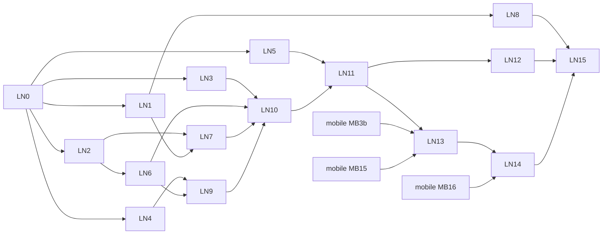

# LAN nodes: native apps exchange their audio on the local network

Reference notes for agents working on the LAN exchange between the native apps (`desktop/` and
`mobile/`) and on its server side. Read [CLAUDE.md](../../CLAUDE.md) first: its process and seven
rules apply here. Other areas: [docs/agents/](./). The apps that become nodes are
[desktop.md](desktop.md) and [mobile.md](mobile.md); the downloads worker is `nz-offline` (desktop
*D13*, mobile *SC4*); the server's priorities and capabilities are [server.md](server.md); accounts,
groups and access are [providers.md](providers.md); the existing pairing-by-link (remote control,
party, public playlist) is [party-remote.md](party-remote.md).

**Status (2026-11-18): LN0 delivered, the rest planned.** LN0 landed every contract and every stub
(`nz-lan`, `Feature::Lan`, `Api::gates()`, the `nz-model` payloads, the Android module and routes) with
no behaviour; nothing else of this exists in code yet. This note is the plan the coding lots follow, in
order (*The lots*). Each lot, when it lands, replaces its plan paragraph by what was learned (rule, why,
number) — a delivered lot is not a changelog.

## The need

The person goes on a trip. Their PC has a lot of disk and has downloaded a great many tracks; their
phone has little room. On the same LAN (home Wi-Fi before leaving, a holiday flat, the phone's own
hotspot with the laptop on it), the two apps must **find each other securely** and **exchange
files**, with no server involved day to day:

- when a track is loaded (to play it or to download it), the app first asks the devices on the LAN
  whether they have the file; if one does, that peer serves it (faster than the server, and it works
  when the server is out of reach);
- downloading one or several **playlists** looks on the LAN first; a peer that has the playlist
  **complete** locally serves the whole of it;
- a setting **« Qualités tolérées »**: the qualities accepted from a peer **while the server is
  reachable**. For each track played or downloaded: if the peer only has a quality outside the
  tolerated list, the server is used when reachable; otherwise the peer's quality is taken;
- the cover art and the metadata come along, so the playlist looks the same offline;
- trusted devices only: **the same account's devices, and the devices of people added as trusted
  friends** (a friend sees only what they were allowed);
- secure, and **transparent day to day**: the one thing that may need the server is fetching, once
  and then silently from time to time, the key that lets the device authenticate on the LAN.

Who, where, which network: a phone on a flaky link is the default case (CLAUDE.md step 1). Here the
LAN is often **better** than the WAN (Wi-Fi at 20–80 MB/s against a 1–5 MB/s mobile link), or the
only network that works at all (a trip without data). The LAN path must therefore never make a tap
slower when it fails: it answers from memory, fails fast, and falls back to the server (rule 3).

## Research (sources) and what it decided

| Topic | Sources | Decision |
|---|---|---|
| Discovery protocol | [RFC 6762 mDNS](https://www.rfc-editor.org/rfc/rfc6762), [RFC 6763 DNS-SD](https://www.rfc-editor.org/rfc/rfc6763), [Spotify Connect ZeroConf API](https://developer.spotify.com/documentation/commercial-hardware/implementation/guides/zeroconf) (`_spotify-connect._tcp`, SRV + TXT `CPath`), [LocalSend protocol](https://github.com/localsend/protocol) (UDP multicast 224.0.0.167:53317, "some Android devices reject other groups"), [KDE Connect](https://userbase.kde.org/KDEConnect) (UDP broadcast 1716 + mDNS `_kdeconnect._udp`), [Syncthing local discovery](https://docs.syncthing.net/dev/device-ids.html) (broadcast, unauthenticated) | **DNS-SD over mDNS**, service type `_neezer-lan._udp.local.`. It is what Android (NSD), iOS (Bonjour, no special entitlement) and Linux (`mdns-sd`, Avahi-compatible) all speak natively; a home-made multicast group (LocalSend) needs the iOS multicast entitlement and is filtered by some Android builds. Discovery is **only a hint**: an announcement proves nothing (Syncthing's own security note), authentication happens on the connection. |
| Discovery privacy | [draft-ietf-dnssd-prireq](https://datatracker.ietf.org/doc/html/draft-ietf-dnssd-prireq-03) (instance name, host name and TXT leak identity), [draft-ietf-dnssd-privacy](https://datatracker.ietf.org/doc/draft-ietf-dnssd-privacy/01/), [AirDrop leak, USENIX Security 2021 (PrivateDrop)](https://tuprints.ulb.tu-darmstadt.de/20599/1/sec21-heinrich.pdf), [Matthew Green, AirDrop tracing (2024)](https://blog.cryptographyengineering.com/2024/01/11/attack-of-the-week-airdrop-tracing/) | The announcement carries **nothing identifying**: a random instance name and host name re-drawn at every network change, TXT `v=1` only — no user, no device name, no hash of an identifier (AirDrop's truncated hashes were reversed by dictionary). A stranger learns "a Neezer node is at this address", and nothing else. |
| Android discovery | [NsdManager](https://developer.android.com/reference/android/net/nsd/NsdManager), [WifiManager.MulticastLock](https://developer.android.com/reference/android/net/wifi/WifiManager.MulticastLock), [AOSP "Take the multicast lock on mDNS usage"](https://gerrit.omnirom.org/plugins/gitiles/android_packages_modules_Connectivity/+/a8efbe0e3237d0bbae738fb0ce55530977267759%5E%21) (the system takes it itself only for importance ≥ FOREGROUND_SERVICE, from T extensions 7), [chainfire on Android multicast](https://chainfire.eu/articles/742/_dev_Android_Datagrams_UDP_Broadcast_and_Multicast_.) | On Android the **platform's NSD daemon** browses and registers (Kotlin, `NsdManager`), and feeds the Rust core (`Discovery::External`). The app holds a `MulticastLock` (permission `CHANGE_WIFI_MULTICAST_STATE`) **only while browsing**, because API 26–32 and un-updated API 33 need it and the system only takes it for a foreground service. |
| iOS later | [WWDC20 "Support local network privacy"](https://developer.apple.com/videos/play/wwdc2020/10110/), [Apple: multicast networking](https://developer.apple.com/news/?id=0oi77447), [Google Cast iOS permission notes](https://developers.google.com/cast/docs/ios_sender/ios_permissions_changes) | Bonjour (`NWBrowser`) with `NSBonjourServices = [_neezer-lan._udp]` and `NSLocalNetworkUsageDescription`; **no** `com.apple.developer.networking.multicast` entitlement needed because we never send raw multicast. Same `Discovery::External` seam as Android. |
| Transport | [RFC 9000 QUIC](https://www.rfc-editor.org/rfc/rfc9000), [RFC 9001 QUIC-TLS §9.2 0-RTT replay](https://www.rfc-editor.org/rfc/rfc9001), [quinn](https://github.com/quinn-rs/quinn), [iroh TLS verifier](https://docs.rs/crate/iroh/1.0.0/source/src/tls/verifier.rs) (raw keys, TLS 1.3 only), [rustls `ClientCertVerifier`](https://docs.rs/crate/rustls/latest/source/src/verify.rs), [libp2p Noise spec](https://github.com/libp2p/specs/blob/master/noise/README.md), [Noise framework intro (Duo)](https://duo.com/labs/tech-notes/noise-protocol-framework-intro), [snow](https://docs.rs/snow) (unaudited, says so) | **QUIC (quinn 0.11.12) with TLS 1.3, 0-RTT disabled.** Multiplexed streams (a control request never waits behind a 30 MB file), per-stream flow control, loss recovery on a lossy Wi-Fi, encryption — all from one audited stack already in both `Cargo.lock`s (rustls 0.23.46 + aws-lc-rs, the provider `nz-api` already uses). Noise (snow) would need our own framing, flow control and a crate that is not audited. iroh/libp2p bring relays, hole punching and DHTs a LAN does not need (no NAT between two devices on one subnet) and a second dependency tree of several hundred crates. |
| Authentication | [Syncthing device IDs and security](https://docs.syncthing.net/dev/device-ids.html) (identity = key, mutual TLS, discovery not trusted), [KDE Connect pairing](https://userbase.kde.org/KDEConnect) (TOFU on certificate fingerprints), [LocalSend fingerprints](https://github.com/localsend/protocol) (identifier only, not authentication), [RFC 5705 / RFC 8446 §7.5 exporters](https://www.rfc-editor.org/rfc/rfc8446#section-7.5), [RFC 9266 tls-exporter channel binding](https://www.rfc-editor.org/rfc/rfc9266) | No TOFU and no pairing ceremony (the person asked for transparency, and TOFU on a hotel Wi-Fi is exactly where a MITM sits). Instead **the server is the authority**: each device holds an Ed25519 **device key** and a short **credential** signed by the server's LAN key (*Trust chain*). On the QUIC connection each side proves its device key by **signing the TLS exporter of THIS connection** — a MITM terminates two TLS sessions with two different exporters, so the signature it relays fails; a recorded proof is useless on any other connection (no replay). |
| Lifetime and revocation | [RFC 9608 noRevAvail](https://www.rfc-editor.org/rfc/rfc9608.html) (short-lived certificates make revocation unnecessary), [Syncthing security](https://manpages.ubuntu.com/manpages/noble/man7/syncthing-security.7.html) | Credentials live **30 days** (admin setting, 7–90), renewed silently every day the server is reachable. Revocation is a **signed revocation list** (serial number, monotonic) fetched with the roster and **gossiped between peers**, so a revoked device is refused by every peer that met any device which saw the server after the revocation. The residual window (a peer that met nobody since) is bounded by the credential's expiry. |
| Integrity, resume | [BLAKE3/bao verified streaming](https://docs.rs/crate/bao-tree/latest) (Merkle outboards), [tvix verified streaming note](https://git.dgnum.eu/mdebray/tvl-depot/raw/commit/06db871bd75a714a61434dd4b13bc87e1319ba92/tvix/castore/docs/verified-streaming.md), RFC 9000 (AEAD per packet) | QUIC already authenticates every byte in transit. What is left is **a peer's own file being wrong** (truncated, rewritten between a fetch and its resume): each indexed file has a **SHA-256** (aws-lc-rs, hardware-accelerated, no new crate) computed in the background; a fetch announces `(len, sha256)` and a resume carries them back, so a resume onto a different file is refused. The received file is then **probed by the decoder** (codec and duration) before it is published. A Merkle tree (bao) only pays when an untrusted *third* party relays the bytes — not our case: the peer is authenticated, and the server's on-demand Opus transcodes are not byte-reproducible, so no server-side hash could certify them anyway. |
| Reference apps | [Syncthing](https://docs.syncthing.net/dev/device-ids.html), [LocalSend](https://github.com/localsend/protocol), [KDE Connect](https://userbase.kde.org/KDEConnect), [Spotify Connect](https://developer.spotify.com/documentation/commercial-hardware/implementation/guides/zeroconf), [AirDrop research](https://tuprints.ulb.tu-darmstadt.de/20599/1/sec21-heinrich.pdf) | Taken: DNS-SD (Spotify Connect, KDE Connect), mutual authentication by key on the connection (Syncthing), "discovery is not trust" (Syncthing), either side may connect (KDE Connect). Avoided: unauthenticated HTTP fallback (LocalSend), identity hashes in announcements (AirDrop), TOFU pairing (KDE Connect, LocalGo). |
| Hotel / public Wi-Fi | [Meraki wireless client isolation](https://documentation.meraki.com/MR/Design_and_Configure/Firewall_and_Traffic_Shaping/Wireless_Client_Isolation), [Ruckus client isolation](https://support.ruckuswireless.com/articles/000014743), [Juniper Mist isolation](https://www.mist.com/documentation/isolation/), AirSnitch (breaking isolation, 2025) | Guest networks usually **isolate clients**: no unicast and no multicast between two guests. Nothing can fix that from an app; the app says it (« Aucun appareil trouvé : sur un Wi-Fi d'hôtel les appareils sont souvent isolés — partagez la connexion du téléphone ») and the phone's hotspot is the documented way. Isolation is also NOT a security boundary we rely on: the protocol is safe on a hostile open Wi-Fi. |
| Mobile constraints | [Doze and App Standby](https://developer.android.com/training/monitoring-device-state/doze-standby), MulticastLock docs (locks cost battery; released at process death) | Browse and announce **only while the app is in the foreground, or playing, or the downloads worker runs**; idle QUIC connections close after 60 s in the background; no keep-alive with the screen off; nothing schedules a wake-up for the LAN. |

**Measured on a throwaway prototype** (2026-11-18, this machine, debug build, never committed, under
`~/.cache`): `quinn =0.11.12` + `rustls 0.23.46` (TLS 1.3 only, `max_early_data_size = 0`, ALPN
`neezer-lan/1`), an ephemeral self-signed Ed25519 certificate per endpoint (`rcgen 0.14.10`),
`mdns-sd 0.17.2`, and the exporter-bound Ed25519 proof of *Transport and authentication*. Two
processes inside a **user network namespace** (`unshare -rn`, `lo` up with multicast, a route for
224.0.0.0/4 — no sudo), 5 runs:

- mDNS browse → resolved: **480–650 ms**; QUIC handshake: **2.8–4.2 ms**; handshake + both proofs
  exchanged and verified: **19–22 ms** (debug).
- A proof with one flipped bit: refused by the responder, **0 bytes** of answer.
- The credential, revocation-list and proof formats of *Trust chain* produce **byte-identical
  signatures** from Python `pycryptodome 4.4` (already a server dependency: `eddsa.new(key,
  'rfc8032')`) and from Rust (Ed25519 RFC 8032 is deterministic) — the test vectors below.

**Pitfalls found by building, not by reading:**

- `aws-lc-rs` is the rustls provider ALREADY compiled in both apps (`nz-api` depends on it; `ring` is in
  the locks but not built). Enabling rustls's `ring` feature as well makes the process-default
  provider ambiguous and `ClientConfig::builder()` panics. **nz-lan always uses
  `builder_with_provider(Arc::new(rustls::crypto::aws_lc_rs::default_provider()))`, quinn's
  `rustls-aws-lc-rs` feature, rcgen's `aws_lc_rs` feature, and never calls `install_default`.**
- `quinn` is in both `Cargo.lock`s but not compiled today (an optional dependency): asking for
  `=0.11.12` adds no package to either lock, only compile time.
- `mdns-sd` 0.17 hands addresses back as `ScopedIp` (not `Copy`; an IPv6 link-local address carries
  its interface scope, which a `SocketAddr` without it cannot reach).
- `RecvStream::read_exact` is async in quinn 0.11 (a 0.10 example does not compile).
- Omarchy ships **ufw with `DEFAULT_INPUT_POLICY="DROP"`** (this machine: only LocalSend's 53317
  and a few local services are open). mDNS multicast to 224.0.0.251:5353 is accepted by ufw's
  `before.rules`, so discovery works, but **an inbound QUIC connection to the desktop is dropped**.
  Hence: either side may initiate and one connection serves both directions; a fixed default port
  (`45910/udp`) the person can open with one command, which Réglages shows.

## Threat model

**Assets**: the audio files and their metadata and covers; the *list* of what a person has
(library, playlists, listening taste); the identity of the person and of their devices; the
device's key and credential; the person's bandwidth, battery and CPU (rule 1).

**Trusted**: the Neezer server the account belongs to (it is already trusted with everything); the
person's own devices while their credentials are valid and not revoked; a trusted friend, **only**
for what the person shared with them.

**Adversaries and what each must NOT achieve** (each line is a test in lot LN15):

| # | Adversary | Must not | How it is stopped |
|---|---|---|---|
| T1 | A stranger on the same Wi-Fi (passive) | learn who is there, what they have, what they play | mDNS carries a random name and `v=1` only; everything after discovery is TLS 1.3 (certificates encrypted too); the file requests are inside it. Residual: the stranger sees that a Neezer node exists, and traffic volumes. |
| T2 | A stranger who connects to a node | obtain any file, list, title, name or identifier of the node | The **initiator authenticates first**; the responder answers nothing — not even its own credential — until the initiator's proof and credential verify and the subject is authorised. Before that: one stream, ≤ 2 KiB read, 2 s deadline, then close with the same code whatever failed. |
| T3 | A stranger who answers as a node (spoofed mDNS, rogue AP) | obtain anything from the initiator; make the app play its audio | The initiator verifies the responder's proof and credential before sending any request; a responder that is not of the same account or a friend who shares with us is dropped. Residual: a rogue responder receives the initiator's credential (opaque subject id, device key, dates — no name, no content); credentials and device keys rotate at every renewal (≤ 30 days), which bounds tracking. |
| T4 | A MITM between two of my devices | read or alter the exchange, or relay a proof | Proofs sign the TLS exporter of the connection they travel on: a relayed proof does not verify on the other leg. |
| T5 | Replay of a recorded handshake or request | be accepted | Exporter-bound proofs; QUIC 0-RTT disabled (RFC 9001 §9.2); requests only exist inside an authenticated connection. |
| T6 | A stolen or lost device, revoked on the server | keep fetching from my other devices | Revocation list, signed, monotonic serial, gossiped peer to peer; credentials expire (default 30 days). Residual window documented and configurable. |
| T7 | A trusted friend's device | see or fetch anything outside what I shared with them; learn whether I have a track I did not share | Scope is enforced by the responder from the **server-signed roster**; an out-of-scope request is answered **exactly like an absent file** (same frame, same code path, from the same in-memory index). Inventory and sets sent to a friend are filtered the same way. |
| T8 | A device of another account on the same server, not a friend | anything | Its subject is neither mine nor in my roster: refused at T2's step. |
| T9 | A hostile authorised peer (bug or compromise) | crash or exhaust the node; fill the disk; make a bad file permanent | Frame size caps, stream and rate caps, timeouts, `len` checked against the free disk before writing, SHA-256 checked at the end and on resume, decoder probe before publication, the peer is marked bad for the session after one bad file. |
| T10 | A forged credential (wrong key, other server, expired, tampered) | be accepted | Ed25519 signature by a known LAN key id; validity window with ±10 min skew; magic/version/length exact. |
| T11 | Someone who copies the device's data directory | impersonate the device forever | Key file `0600` in app-private storage, excluded from Android backup; revocation from Réglages on any other device or the web UI; expiry. |

**Out of scope, stated**: a malicious server (it already holds everything); a compromised OS on the
person's own device; traffic analysis of volumes and timing on the LAN; client isolation on guest
Wi-Fi (an availability problem, not a confidentiality one).

## Architecture

```
            server (once, then from time to time; never needed to exchange)
            ├─ LAN key (Ed25519, kid)  ── signs ──►  credential(device) · roster(user) · revocations
            └─ routes /api/lan/*  (enroll, roster, devices, friends, settings)
                       ▲ nz-api (Lane::Bulk)
   ┌───────────────────┴───────────────────┐         ┌──────────────────────────────┐
   │ app (desktop GPUI  /  mobile nz-core)  │         │ another node                 │
   │  nz-player · nz-audio  ◄─ PeerFirstOpener ──┐   │                              │
   │  nz-offline           ◄─ PeerFirstDownloader│   │                              │
   │                         nz-lan ─────────────┴── QUIC/TLS1.3 + exporter proofs ─┤
   │  discovery: mdns-sd (desktop) | NSD→External (Android) | last-known addresses   │
   └────────────────────────────────────────┘         └──────────────────────────────┘
```

### One shared crate: `desktop/crates/nz-lan`

Everything that is not UI lives in **`desktop/crates/nz-lan`**, a member of the desktop workspace
(the `crates/*` glob picks it up without touching `desktop/Cargo.toml`'s member list) and a path
dependency of `mobile/rust` (`nz-lan = { path = "../../desktop/crates/nz-lan",
default-features = false }`). It compiles for Android: no GPUI, no cpal (it asks `nz-audio` with
`default-features = false`), and `mdns-sd` sits behind the default feature `mdns` that the mobile
build does not enable.

```
desktop/crates/nz-lan/
  Cargo.toml          # features: default = ["mdns"]; mdns = ["dep:mdns-sd"]
  src/
    lib.rs            # module list + re-exports (LN0)
    types.rs          # shared types: DeviceKeyPub, Subject, Kid, Urgency, Tolerance, LanError (LN0)
    proto.rs          # every wire frame, serde (LN0, final)
    cred.rs           # credential / revocation list / roster: encode, decode, verify (LN2)
    keys.rs           # the device key file: create, load, rotate, wipe (LN2)
    codec.rs          # length-prefixed frames on a QUIC stream, caps (LN6)
    transport.rs      # quinn endpoint, TLS configs, connect/accept, connection table (LN6)
    auth.rs           # the exporter-bound proof exchange, authorisation decision (LN6)
    discovery.rs      # Discovery trait, External feed, last-known addresses (LN3)
    discovery_mdns.rs # mdns-sd browse + register, behind feature "mdns" (LN3)
    store.rs          # lan.sqlite: own-file hashes, peers' last addresses, trust blobs (LN4)
    index.rs          # local inventory from nz-cache (downloads + play cache), versions (LN4)
    hashing.rs        # background SHA-256 of local files, niced, yields (LN4)
    scope.rs          # what a subject may see: own / friend scope / nothing (LN4)
    serve.rs          # responder: Inventory, Sets, Meta, Cover, Fetch; serve limits (LN4)
    peers.rs          # connected peers, replicated inventories (counted bytes) (LN9)
    decide.rs         # source decision: local / peer / server, with the tolerance (LN9)
    fetch.rs          # requester: fetch into a file, resume, hash, probe (LN9)
    enroll.rs         # enrolment, renewal, roster + revocation sync with the server (LN7)
    gossip.rs         # revocation list + own roster exchanged between peers (LN7)
    settings.rs       # kv keys and defaults (LN7)
    service.rs        # `Lan`: lifecycle, runtime, snapshot, events, shutdown joins (LN10)
    opener.rs         # PeerFirstOpener: nz_audio::StreamOpener (LN11)
    downloader.rs     # PeerFirstDownloader: nz_offline::Downloader (LN11)
    sets.rs           # playlists from a peer: list, choose, completeness (LN11)
    import.rs         # covers and metadata copied from a peer (LN11)
  tests/              # one file per lot (named in each lot)
  examples/lan_node.rs  # headless node for the two-node harness (LN15)
  tools/netns.sh        # user-namespace LAN for tests, no sudo (LN3)
```

### Trust chain

**The server's LAN key.** One Ed25519 key per server, created on first use, its 32-byte seed stored
in `Meta` under `lan_ca_seed`, encrypted with AES-GCM under `sha256(get_secret_key("lan_ca_secret"))`
(the `encrypt_password` pattern of `neezer/managers/user.py`, its own derived key). Its **key id**
`kid = SHA-256(public key)[0..8]`. A rotation (admin action, or a lost secret) creates a new key:
`GET /api/lan/status` lists the current key and the previous one for 90 days, so credentials signed
by the old key stay valid until they expire. If the server secret changes and the seed cannot be
decrypted, a new key is created and every device re-enrols silently at its next contact.

**The subject.** A person is named on the LAN by an opaque 16-byte **subject**:
`HMAC-SHA256(get_secret_key("lan_subject"), "neezer-lan/1 subject" || user_id)[0..16]` — stable,
unguessable, no column, never the name. Device names and friends' names travel only inside an
authenticated connection or from the server.

**The credential** — 154 bytes, fixed layout, big-endian, signed over a domain-separated message:

| Offset | Size | Field |
|---|---|---|
| 0 | 4 | magic `NZLC` |
| 4 | 1 | version `1` |
| 5 | 8 | `kid` |
| 13 | 16 | `subject` |
| 29 | 12 | `device_id` (the server's row id, random) |
| 41 | 32 | `device_pub` (Ed25519) |
| 73 | 8 | `not_before` (i64 unix seconds) |
| 81 | 8 | `not_after` (i64) |
| 89 | 1 | `flags` (bit 0 may serve, bit 1 may fetch; other bits 0) |
| 90 | 64 | `sig = Ed25519(LAN key, b"neezer-lan/1 credential\x00" ‖ bytes[0..90])` |

Verification (`cred::Credential::verify`): exact length 154, magic, version 1, flags' reserved bits
0, `kid` among the known keys, signature, `not_before − 600 ≤ now ≤ not_after + 600`, `device_pub`
not in the revocation list. Every failure is ONE error variant for the peer (`Refused`), and a
precise cause for the local log and the tests.

**The revocation list** — `NZLR`, version 1, `kid`(8), `serial`(u64), `issued`(i64), `count`(u32),
then `count × 32` bytes of revoked device keys **sorted ascending, unique**, then
`sig = Ed25519(LAN key, b"neezer-lan/1 revocations\x00" ‖ body)`. Only keys whose credential has not
expired yet are listed (the list stays small: bounded by devices revoked in the last lifetime). Max
4 096 entries. A device keeps the highest serial it has seen per `kid`, from the server or from any
authenticated peer (*gossip*).

**The roster** — the per-person view the server signs, fetched by each of the person's devices:

```json
{"body": "<base64 of the canonical JSON below>", "sig": "<base64 Ed25519 over b\"neezer-lan/1 roster\\x00\" ‖ body>"}
body = {"v":1,"kid":"<hex8>","subject":"<hex16>","serial":42,"issued":1798761600,"expires":1801353600,
        "shares_to":[{"subject":"<hex16>","all":false,
                      "playlists":[{"id":"<playlist id>","title":"Route","tracks":["<track id>", …]}]}],
        "trusted_by":[{"subject":"<hex16>","name":"Alice"}]}
```

`shares_to`: the people I share with and exactly what (`all`: everything I have locally; otherwise
the union of the listed playlists' tracks, the server's snapshot at `issued`). `trusted_by`: the
people who share with me (whom my devices may ask, and their display name). The device verifies the
signature over the exact bytes received, then parses; `serial` only grows; a roster is gossiped
**only between devices of the same subject**. Caps: 64 friends, 20 000 track ids in total.

**Test vectors** (computed with both pycryptodome and ed25519-dalek, identical; LN1 and LN2 assert
them, which is what makes the Python and Rust lots compatible without waiting for each other):

```
LAN key seed   = 000102…1f (bytes 0..31)      -> pub 03a107bff3ce10be1d70dd18e74bc09967e4d6309ba50d5f1ddc8664125531b8
device seed    = 202122…3f (bytes 32..63)     -> pub 29acbae141bccaf0b22e1a94d34d0bc7361e526d0bfe12c89794bc9322966dd7
kid            = 56475aa75463474c
subject        = 00112233445566778899aabbccddeeff ; device_id = 01×12 ; not_before = 1798761600 ;
not_after      = 1801353600 ; flags = 3
credential     = 4e5a4c430156475aa75463474c00112233445566778899aabbccddeeff010101010101010101010101
                 29acbae141bccaf0b22e1a94d34d0bc7361e526d0bfe12c89794bc9322966dd7000000006b36ec80
                 000000006b5e798003a839e52b155515b9f88b70ab9844585cb0ed07a9a685618cce2243fedfce50
                 968c222fb9c69068b1ded70f7eff5f1d66acc9419e4f4b524add9fa8bf7efcde09
revocations    = (serial 7, issued 1798761600, one entry = the device pub above)
                 4e5a4c520156475aa75463474c0000000000000007000000006b36ec800000000129acbae141bccaf0
                 b22e1a94d34d0bc7361e526d0bfe12c89794bc9322966dd705c36844f72116363d35c16696464d37f6
                 88ada1a8c22f6a2f40c6a7c718da4def658ef1e6d64f8bbc5308c208fd72f661f7060efdb9dcd17a87
                 1035e0ebd005
auth proof     = Ed25519(device, b"neezer-lan/1 auth\x00" ‖ b"initiator" ‖ AA×32)
               = 8cac16e29f13ab9811527b65c630d17c0774e759eff96a937ca365f050f91b6306424a132990da39
                 4b6082123d0c7825db8adb538ee1b31242a2e036aa78b709
```

**Enrolment** (transparent): at login, and every 24 h while the server is reachable, the device
(`enroll.rs`, `Lane::Bulk`) creates its key if absent, then `POST /api/lan/enroll` with a
possession proof; the server answers the credential, the roster and the revocation list. A device
whose credential has fewer than 23 of its 30 days left renews; a renewal **rotates the device key**
(new key, new credential; the old key is listed as revoked only if the person revokes the device,
otherwise it simply expires). Logout wipes the key, the credential and the roster, and calls
`DELETE /api/lan/devices/self` when reachable.

### Discovery

- Service `_neezer-lan._udp.local.`, port = the node's QUIC port, instance name and host name
  `nz-<10 random hex>` re-drawn at every network change, TXT exactly `v=1`. Never the machine's host
  name, never a user or device name.
- **Desktop**: `mdns-sd` (feature `mdns`) browses and registers on every up, non-loopback interface.
  `MdnsDiscovery::new(true)` is **loopback only** (the tests' mode: a test must never multicast on the
  machine's own network), `new(false)` is the app's policy (LN3).
- **Android**: Kotlin `NsdManager.registerService` + `discoverServices`/`resolveService`
  (API ≥ 34: `registerServiceInfoCallback`), holding a `MulticastLock` only while browsing; each
  resolved `(host, port)` goes to `LanApi::found(host, port)`, each loss to `LanApi::lost(...)`.
- **Last-known addresses**: every authenticated peer's last `(ip, port)` is saved (`store.rs`); on a
  network change (desktop: interface list changes; Android: `ConnectivityManager` callback, already
  fed to `NzCore::set_network`) the node tries those addresses directly, once, before any mDNS
  answer — the reconnect path when multicast is filtered but unicast passes.
- **When** (battery, rule 1): discovery and announcement run while the app is in the foreground,
  while it plays, or while the downloads worker has work; they stop 60 s after the last of those.
  The desktop runs them whenever the app is open (mains-powered, cheap).
- A discovered node is dialled at once (one handshake, ~20 ms) to learn whether it is ours; a node
  that refuses us, or that we refuse, is not dialled again for 10 min (per announcement instance).
- LAN only on Wi-Fi/Ethernet/hotspot interfaces; never over the cellular interface.

### Transport and authentication

- **QUIC** (quinn 0.11.12) on UDP, dual-stack, default port **45910** (Réglages → Appareils à
  proximité → avancé, `0` = any; when 45910 is taken the node falls back to an ephemeral port and
  says so). ALPN `neezer-lan/1`. TLS 1.3 only, `max_early_data_size = 0`, `enable_early_data =
  false`. Each node creates an **ephemeral** self-signed Ed25519 certificate at start (rcgen); the
  certificate verifiers accept any certificate but still verify the TLS 1.3 handshake signature with
  it (`rustls::crypto::verify_tls13_signature`). The certificate is NOT the identity — the
  exporter-bound proof is.
- Idle timeout 30 s; keep-alive 10 s only while foreground or transferring; at most 16 connections;
  **one connection per peer pair** — when two exist (both dialled), the one dialled by the lower
  `device_pub` survives.
- **The proof exchange** (first bidirectional stream, opened by the initiator):

```
exporter_r = TLS exporter(label "EXPORTER-neezer-lan/1", context = role, 32 bytes), role ∈ {"initiator","responder"}
proof_r    = Ed25519(device key, b"neezer-lan/1 auth\x00" ‖ role ‖ exporter_r)

I → R  Auth   { cred: 154 B, proof: proof_initiator, revocation_serial: u64, proto: 1 }
R      verify cred (vs R's known kids + revocations), proof over R's own exporter("initiator"),
       authorise subject: == R's subject → Own ; in R's roster.shares_to → Friend(scope) ; else close
R → I  AuthOk { cred, proof: proof_responder, revocation_serial, proto: 1 }
I      verify the same; authorise: == I's subject → Own ; in I's roster.trusted_by → Friend ; else close
both   Hello  { name, platform, app_version, inventory_version, sets_version }   (names only now)
       then: the side with the higher revocation serial for a shared kid sends Revocations{blob};
       same subject: the side with the higher roster serial sends Roster{blob}
```

- Before `AuthOk` the responder reads at most one stream and 2 KiB, for at most 2 s; any failure
  closes the connection with application code `0x10` and an empty reason — the same for every cause.
- A friend's connection is **one-directional in content**: the responder serves only if the
  initiator's subject is in ITS `shares_to`. Two friends who share with each other each authorise
  the other on their own side.

### Protocol messages (`proto.rs`, final in LN0)

Every request opens a new bidirectional stream: one request frame, one response frame, and for
`Fetch` the raw bytes after it until FIN. A frame is `u32` big-endian length + UTF-8 JSON
(`serde_json`, `#[serde(tag = "t")]`), **≤ 1 MiB** (`Inventory`/`Sets` paginate). Unknown fields are
ignored; an unknown `t` answers `Error{code:"unknown"}` (rule 7: a newer peer talking to an older
one).

```rust
#[derive(Serialize, Deserialize)] #[serde(tag = "t")]
pub enum Request {
    Inventory { since: Option<u64>, page: u32 },          // page size 4 000 items
    Sets { page: u32 },                                    // 64 sets per page
    Meta { tracks: Vec<String> },                          // ≤ 200 ids
    Cover { url: String },                                 // ≤ 2 MiB answer
    Fetch { track: String, quality: WireQuality, from: u64, expect: Option<FileTag>, urgency: Urgency },
    Ping,
}
#[derive(Serialize, Deserialize)] #[serde(tag = "t")]
pub enum Response {
    InventoryFull { version: u64, page: u32, last: bool, items: Vec<Item> },
    InventoryDelta { from: u64, to: u64, added: Vec<Item>, removed: Vec<ItemKey> },
    Sets { version: u64, page: u32, last: bool, sets: Vec<SetInfo> },
    Meta { rows: Vec<TrackMeta> },
    Cover { mime: String, len: u32 },                      // then `len` raw bytes
    FetchOk { len: u64, tag: Option<FileTag>, quality: WireQuality }, // then raw bytes from `from`
    NotFound,                                              // absent OR out of scope: identical
    Busy { retry_in_ms: u32 },                             // serve limits (rule 1 on the responder)
    Pong,
    Error { code: String },
}
pub struct Item { pub track: String, pub copies: Vec<Copy> }
pub struct Copy { pub quality: WireQuality, pub len: u64 }
pub struct ItemKey { pub track: String, pub quality: WireQuality }
pub struct FileTag { pub len: u64, pub sha256: String }          // hex
pub struct SetInfo { pub kind: String, pub ident: String, pub title: String, pub cover: Option<String>,
                     pub tracks: Vec<String>, pub local: u32, pub complete: bool }
pub struct TrackMeta { pub id: String, pub title: String, pub artists: String, pub album: String,
                       pub album_id: Option<String>, pub duration_s: u32, pub cover: Option<String>,
                       pub explicit: bool }
#[derive(Clone, Copy)] pub enum WireQuality { Flac, Opus320, Opus128, Opus64 } // "FLAC","OPUS_320",…
#[derive(Clone, Copy)] pub enum Urgency { Play, Prefetch, Bulk }
```

- `Inventory`: everything the responder has **complete** on disk (downloads + complete play-cache
  files), per quality, filtered by the requester's scope. `since` = the requester's last version:
  a delta when the responder still has it (it keeps the last 64 changes), else a full answer.
  8 000 tracks ≈ 320 KB of JSON, sent once per peer and version.
- `Sets`: the responder's download sets (playlists, albums, shows) **whose members are in scope**,
  with their track ids and `complete` (every member has a complete local file). A friend sees only
  shared playlists (or all sets when `all`).
- `Meta` and `Cover`: only for tracks/covers in scope; `TrackMeta` is screen-shaped and sanitised
  (no likes, no play counts, no user ids).
- `Fetch`: `from` > 0 resumes; `expect` carries the `FileTag` the requester already holds — a
  different file answers `NotFound` and the requester restarts at 0 from another source.

### Authorisation and scope (`scope.rs`, the security core of the responder)

`Scope::Own` — everything. `Scope::Friend { all, tracks: HashSet<String> }` — from MY roster's
`shares_to` entry for that subject. `Scope::None` — never constructed for a live connection (the
connection was closed at authentication). Every handler takes the scope and filters; there is no
handler without it (compile-time: handlers' signature requires `&Scope`). Out of scope = `NotFound`,
built by the same function that answers an absent file.

### Choosing the source (`decide.rs`)

The decision is **local and instant**: it reads the replicated inventories already in memory, never
waits for the network to decide.

```text
input: track, wanted quality W, tolerated set T (Réglages), server_reachable (nz-api `is_online()`),
       urgency, local copies (nz-cache), peers' inventories
1. A complete local file (download, then play cache)           -> Local       (unchanged paths)
2. Candidates = peers having the track, each with its qualities
3. If a candidate has W, or a quality in T                     -> Peer(best)  best = W if present,
                                                                  else the highest quality in T;
                                                                  ties: own device before friend,
                                                                  then a peer "complete" for the
                                                                  set being downloaded, then lowest RTT
4. Else if server_reachable                                    -> Server(W)
5. Else if any candidate                                       -> Peer(highest quality it has)
6. Else                                                        -> Server(W)   (fails fast offline: rule 3)
```

`T` default: **{FLAC, Opus 320, Opus 128}** (Opus 64 is what the Auto ladder picks on a bad link;
taking it from a peer while the server could send better would be a regression). A peer that answers
`NotFound`/`Busy`/fails mid-way is skipped for this track and the decision is re-run with the rest
(one retry per peer; then the server). The opener reports which source served each track
(`LanEvent::Served`), so the UI and the tests can see it.

### Playback: peer first (`opener.rs`)

`PeerFirstOpener<O: StreamOpener>` wraps each app's opener (desktop `NetOpener`, mobile
`ServerOpener`) and implements `nz_audio::StreamOpener`:

- `local()` delegates (local files stay first).
- `open(id, quality, start, from_byte, lane)`: runs `decide`; for `Peer`, opens a `Fetch` with
  `urgency` from the lane (`User→Play`, `Prefetch→Prefetch`, `Bulk→Bulk`) and returns a
  `ByteStream` whose `len_hint()` is the file's length (a peer file is always complete, so seeks are
  byte ranges) and whose **`quality()`** (added by LN5) is the quality actually served, so the engine
  publishes the spool into the play cache under the right key. `start` (a `?start=` slice) never goes
  to a peer: a peer stream is seekable by bytes. The choice is **sticky per (track, voice)**: a seek
  re-opens from the same peer with `from_byte`.
- `ready()`: for a track the decision sends to a peer, answers `ready = true, bytes = len` from the
  inventory, without a request.
- Fails fast: no connected peer has it → straight to the inner opener, 0 ms added. A peer that
  stalls 1.5 s without a byte while the engine waits on `User` → the opener abandons it and opens
  the server (if reachable) from the byte already received, or from 0 at the peer's quality if not.

### Downloads and playlists (`downloader.rs`, `sets.rs`, `import.rs`)

- `PeerFirstDownloader` wraps `ApiDownloader` and implements `nz_offline::Downloader`; `fetch` runs
  `decide` with `urgency = Bulk`, writes the `.part` the store reserved, verifies length + SHA-256,
  probes the file, and returns `Fetched { bytes, quality }` (LN5's trait change) so the store records
  the quality actually received.
- **A playlist download** (`sets.rs`): when the person downloads a playlist, the track list comes
  from the server when reachable (today's path), otherwise from a peer's `Sets`. `Lan::best_peer_for
  (&[track])` returns the peer that has all of them (complete) — the downloader then prefers it for
  every track of that set, which is "download the playlist from the peer that has it complete".
- **« Sur vos appareils »**: a new view lists the sets the connected peers expose (own devices: all
  their download sets; friends: what they shared), each with its track count, size and « complet »;
  multi-select → « Télécharger » adds them to `nz-offline` like any download.
- **Covers and metadata** (`import.rs`): for every set taken from a peer, missing `TrackMeta` and
  covers are fetched on `Bulk` (`Meta`, `Cover`), covers stored PINNED (`Covers::put_pinned`, so the
  LRU never evicts a download's art) and titles/artists given to `nz-offline` as its `Choice` labels,
  so the downloads screen and the playlist page look the same offline.

### Rule 1 on the LAN

- **Requester**: `Urgency::Play` (the tapped track) never waits; `Prefetch` waits like the
  `Prefetch` lane; `Bulk` takes `nz-api`'s **same `Gates`** (`Api::gates()`, added by LN0): one Bulk
  transfer at a time across server AND LAN, 1 s of quiet after a `User` request, and the token bucket
  at 25 % of the playing stream's throughput while the current track still streams from the network
  (`gates.throttle(bytes)` per chunk). One mechanism, not a second throttle.
- **Responder**: serving a peer is background work for the responder. At most 2 `Play`, 1
  `Prefetch` and 1 `Bulk` transfers served at once across all peers (beyond: `Busy{retry_in_ms}`);
  `Bulk` serving waits on the responder's own `Gates` (it never slows the responder's own playback);
  reads in 64 KiB chunks on the `nz-lan` runtime thread, reniced +5 (desktop `nice`, Android
  `setpriority`), the hashing worker +10.
- The `nz-lan` runtime is its own tokio runtime (1 worker, thread `nz-lan`), owned by `Lan` and
  JOINED at shutdown; engine threads that `block_on` it are joined first (the app's shutdown order:
  engine, then offline worker, then `Lan`, then `nz-net`).

### Rules 2 and 3

- A playlist taken from a peer is an ordinary `nz-offline` job: it shows its progress, and each
  failure has its cause in French (« l'appareil "PC" ne répond plus », « fichier différent de celui
  annoncé », « qualité non tolérée et serveur injoignable » never happens — that case takes the peer).
- Enrolment, roster sync and hashing are background, silent when they succeed, and visible in
  Réglages when they fail (« Impossible de renouveler la clé LAN : serveur injoignable depuis
  3 jours »).
- Nothing on the LAN retries in a storm: a refused node waits 10 min, a failed peer is skipped for
  the track, `Busy` waits exactly `retry_in_ms`.

### Device storage (rule 7 on the device)

`$data/neezer/lan/` (desktop `$XDG_DATA_HOME`, Android `filesDir`): `device.key` (32-byte seed, mode
0600), `lan.sqlite` (WAL, `PRAGMA user_version`, idempotent migrations at start):

```sql
-- v1
CREATE TABLE IF NOT EXISTS file_tag(path TEXT PRIMARY KEY, len INTEGER NOT NULL, mtime INTEGER NOT NULL,
  sha256 TEXT NOT NULL);
CREATE TABLE IF NOT EXISTS peer_addr(device_pub TEXT PRIMARY KEY, subject TEXT NOT NULL, name TEXT,
  ip TEXT NOT NULL, port INTEGER NOT NULL, seen_at INTEGER NOT NULL);
CREATE TABLE IF NOT EXISTS trust(key TEXT PRIMARY KEY, blob BLOB NOT NULL, updated_at INTEGER NOT NULL);
  -- keys: 'credential', 'roster', 'revocations:<kid>', 'ca:<kid>'
```

Settings in `nz-cache`'s `kv` (synced nowhere; per device): `lan.enabled` (default `true`),
`lan.serve` (default `true`: « Partager mes sons avec mes appareils »), `lan.tolerated` (default
`["FLAC","OPUS_320","OPUS_128"]`), `lan.port` (default `45910`). Replicated inventories live in
memory only (counted: ≤ 64 B per item).

### Server

**Schema** (one migration, SQLite + PostgreSQL + MySQL, idempotent, `SCHEMA_VERSION` = the next
date after master's at merge time — re-date on rebase if master moved):

```sql
CREATE TABLE IF NOT EXISTS lan_device (
  id CHAR(24) PRIMARY KEY,                 -- random, also the credential's device_id (12 bytes hex)
  user_id INTEGER NOT NULL REFERENCES user(id) ON DELETE CASCADE,
  pubkey CHAR(64) NOT NULL UNIQUE,         -- hex Ed25519, current key (rotates on renewal)
  name VARCHAR(64) NOT NULL, platform VARCHAR(16) NOT NULL,   -- "desktop" | "android" | "ios"
  created DATETIME NOT NULL, last_seen DATETIME NOT NULL, not_after DATETIME NOT NULL,
  revoked DATETIME NULL);
CREATE INDEX IF NOT EXISTS lan_device_user ON lan_device(user_id);
CREATE TABLE IF NOT EXISTS lan_friend (
  owner_id INTEGER NOT NULL REFERENCES user(id) ON DELETE CASCADE,
  friend_id INTEGER NOT NULL REFERENCES user(id) ON DELETE CASCADE,
  share_all BOOLEAN NOT NULL DEFAULT FALSE, created DATETIME NOT NULL,
  PRIMARY KEY (owner_id, friend_id));
CREATE TABLE IF NOT EXISTS lan_friend_playlist (
  owner_id INTEGER NOT NULL, friend_id INTEGER NOT NULL,
  playlist_id <Playlist's id type> NOT NULL REFERENCES playlist(id) ON DELETE CASCADE,
  PRIMARY KEY (owner_id, friend_id, playlist_id));
```

(The exact column types follow `neezer/db.py`'s conventions per engine — `user` is quoted on
PostgreSQL, `DATETIME` is `TIMESTAMP` there; copy the style of the latest migration.) A revoked
device's old public keys are kept in `lan_device_key(pubkey PK, device_id FK CASCADE, not_after)`
until they expire, so the revocation list can name every key of a device whose credential may still
be valid. Meta keys: `lan_ca_seed` (encrypted), `lan_ca_prev` (previous key, encrypted, with its
end date), `lan_revocation_serial`, `lan_enabled` (default `1`), `lan_credential_days` (default 30,
7–90). The roster serial is a **column**, `user.lan_serial` (default `0`): `Meta.key` is 32
characters and `lan_roster_serial:<uuid>` is 54, which is the choice this plan left to LN1.

**Routes** (`neezer/webui/lan.py`, its own blueprint under `/api`, every route `@login_required`,
`LAN_POLICY` merged into `remote.POLICY` with every route `NEVER` — a remote-control session never
enrols, revokes or befriends; rate limits per user):

| Route | Body → answer | Rules |
|---|---|---|
| `GET /api/lan/status` | → `{enabled, subject, keys:[{kid, pub, until?}], credential_days, revocation_serial}` (`subject`: the caller's, hex) | the feature probe (`OPTIONS`); `enabled=false` hides the feature in every client |
| `POST /api/lan/enroll` | `{pubkey, name, platform, at, proof}` → `{device_id, credential, roster, revocations}` (base64) | `proof = Ed25519(device, "neezer-lan/1 enroll\x00" ‖ subject_hex ‖ pubkey_hex ‖ at)`, `|now − at| ≤ 300 s`; same device (cookie-bound `device_id` in body optional) → rotate key; ≤ 20 live devices per user (`409` + cause); 30/h per user |
| `GET /api/lan/roster` | → `{roster, revocations}` | `ETag` = `"<roster serial>-<revocation serial>"`, `304` when unchanged |
| `GET /api/lan/devices` | → `[{id, name, platform, created, last_seen, revoked, current}]` | own devices only |
| `DELETE /api/lan/devices/<id>` (`self` allowed) | → `204` | own device only (else `404`); bumps the revocation serial; audit log |
| `PATCH /api/lan/devices/<id>` | `{name}` → device | 1–64 chars |
| `GET /api/lan/friends` | → `{shares_to:[{user_id, subject, name, all, playlists:[{id,title}]}], trusted_by:[{user_id, subject, name}]}` | `user_id` is the ACCOUNT's **UUID** (String), never a number: every account id the API sends is a UUID; `subject` is the LAN's own opaque name and is a SEPARATE field |
| `POST /api/lan/friends` | `{name}` → friend | exact account name (folded); unknown or self → `404` « aucun compte de ce nom » (same answer for a disabled account); 30/h |
| `PATCH /api/lan/friends/<user_id>` | `{all?, playlists?:[id]}` → friend | `<user_id>` is the account UUID; only playlists the OWNER may read (`playlist_access`); 20 000 shared titles at most; bumps both rosters' serials |
| `DELETE /api/lan/friends/<user_id>` | → `204` | `<user_id>` is the account UUID; bumps both rosters |
| `GET/PUT /api/lan/settings` (admin) | `{enabled, credential_days}` | Meta; rule 6 |
| `POST /api/lan/rotate` (admin) | → `{kid}` | new LAN key, previous kept 90 days |

The roster serial is a per-user counter (Meta `lan_roster_serial:<user_id>`, or a column if the
lot prefers — the lot records which), bumped on any friend or scope change touching that user. A
disabled account: every device revoked (serial bump), enrol refused.

**Older servers and older apps (rule 7)**: `nz-api`'s `Feature::Lan` probes `OPTIONS
/api/lan/status`; absent (`404`) or `enabled=false` → `Lan` never starts, no screen or setting about
it is shown, and nothing else changes. An app already enrolled keeps exchanging with its peers on
the LAN with its current credential when the server is unreachable (that is the point), but stops
renewing — and stops at expiry — if the server answers `404`/`enabled=false`. Older apps (no
`nz-lan`) are unaffected: the new routes are additive, nothing existing changes shape. The protocol
carries `proto: 1`; a node refuses a different major with `0x11` and the UI says « mettez à jour
l'app sur <appareil> ».

### Screens and Réglages

French copy, glyphs through each app's icon set, no emoji, the design tokens of each app.

- **Réglages → « Appareils à proximité »** (desktop section, mobile screen): switch « Échanger avec
  mes appareils à proximité » (`lan.enabled`); switch « Partager mes sons » (`lan.serve`);
  « Qualités tolérées » (four checkboxes, at least one; explanation: « Utilisées quand un appareil
  proche a le titre et que le serveur est joignable. Sans serveur, la qualité de l'appareil est
  toujours acceptée. »); the list of devices seen now (name, own/friend, signal: « connecté »,
  latency, what is being exchanged) and of my enrolled devices (rename, « Révoquer »); « Amis de
  confiance » (add by account name, per friend: « Tout partager » or a playlist picker, remove);
  advanced: UDP port, on the desktop the firewall line (`sudo ufw allow 45910/udp`) with a copy
  button; the key's state (« Clé valable jusqu'au 18 décembre »; renewal failures with their cause).
- **« Sur vos appareils »** (desktop: a section of the downloads screen; mobile: a tab of the
  offline screen): peers' sets, multi-select, « Télécharger » (rule 2: progress in the downloads
  screen like any job).
- **Playlist page**: « Disponible complète sur PC » in the header when a peer has all of it (one
  `best_peer_for` call, in memory). No per-row badge: the shared track list stays untouched
  (rule 4's windowed lists, measured elsewhere).
- **Now playing**: the source line says « Lu depuis PC (FLAC) » when a peer serves the track.
- **The web UI (SPA)**: Réglages → « Appareils et amis »: my enrolled devices (rename, revoke), my
  trusted friends and their scope, and for admins the two server settings (rule 6). The SPA is not a
  node (a browser can neither browse mDNS nor speak raw QUIC).
- **Feedback when nothing is found** (rule 3): 10 s with no peer while I have another enrolled
  device: « Aucun appareil trouvé. Sur un Wi-Fi d'hôtel, les appareils sont souvent isolés :
  partagez la connexion du téléphone. »

## Contracts (Rust API, LN0 writes them final)

```rust
// nz-lan/src/types.rs
pub type DevicePub = [u8; 32];
#[derive(Clone, Copy, PartialEq, Eq, Hash, Debug)] pub struct Subject(pub [u8; 16]);
#[derive(Clone, Copy, PartialEq, Eq, Hash, Debug)] pub struct Kid(pub [u8; 8]);
pub use crate::proto::{Urgency, WireQuality};
#[derive(Clone, Debug, PartialEq, Eq)] pub struct Tolerance(pub BTreeSet<nz_api::Quality>);
impl Tolerance { pub fn default_set() -> Self; pub fn contains(&self, q: nz_api::Quality) -> bool; }
#[derive(Clone, Debug, PartialEq, Eq)] pub enum Relation { Own, Friend { name: String } }
#[derive(Clone, Debug, PartialEq, Eq)] pub enum Source { Local(PathBuf), Peer { peer: DevicePub, quality: nz_api::Quality }, Server(nz_api::Quality) }
#[derive(thiserror::Error, Debug, Clone, PartialEq, Eq)]
pub enum LanError {
    Disabled, Unsupported, NotEnrolled, Expired, Refused, PeerGone, NotFound, Busy { retry_in_ms: u32 },
    Mismatch, BadFile(String), Disk(String), Proto(String), Server(String), Internal(String),
}
impl LanError { pub fn cause_fr(&self) -> String; }      // every variant, a French sentence

// nz-lan/src/cred.rs
pub struct Credential { pub kid: Kid, pub subject: Subject, pub device_id: [u8; 12], pub device_pub: DevicePub,
                        pub not_before: i64, pub not_after: i64, pub flags: u8, raw: [u8; 154] }
impl Credential {
    pub fn decode(bytes: &[u8]) -> Result<Credential, CredError>;
    pub fn verify(&self, keys: &TrustKeys, revoked: &Revocations, now: i64) -> Result<(), CredError>;
    pub fn raw(&self) -> &[u8; 154];
}
pub struct TrustKeys { /* kid -> Ed25519 public key */ }
impl TrustKeys { pub fn from_status(keys: &[(Kid, [u8; 32])]) -> Self; pub fn get(&self, kid: &Kid) -> Option<&[u8; 32]>; }
pub struct Revocations { pub kid: Kid, pub serial: u64, pub issued: i64, keys: Vec<DevicePub>, raw: Vec<u8> }
impl Revocations { pub fn decode_verify(bytes: &[u8], keys: &TrustKeys) -> Result<Self, CredError>;
                   pub fn contains(&self, k: &DevicePub) -> bool; pub fn empty(kid: Kid) -> Self; }
pub struct Roster { pub kid: Kid, pub subject: Subject, pub serial: u64, pub issued: i64, pub expires: i64,
                    pub shares_to: Vec<Share>, pub trusted_by: Vec<Truster>, raw: Vec<u8> }
pub struct Share { pub subject: Subject, pub all: bool, pub playlists: Vec<SharedPlaylist> }
pub struct SharedPlaylist { pub id: String, pub title: String, pub tracks: Vec<String> }
pub struct Truster { pub subject: Subject, pub name: String }
impl Roster { pub fn decode_verify(json: &[u8], keys: &TrustKeys) -> Result<Self, CredError>;
              pub fn raw_signed(&self) -> Vec<u8>; }   // raw() = the signed body; raw_signed() = the {"body","sig"} envelope to gossip
pub fn auth_message(role: Role, exporter: &[u8; 32]) -> Vec<u8>;   // b"neezer-lan/1 auth\0" ‖ role ‖ exporter
pub enum Role { Initiator, Responder }
#[derive(thiserror::Error, Debug, PartialEq, Eq)]
pub enum CredError { Length, Magic, Version, Flags, UnknownKid, Signature, NotYetValid, Expired, Revoked, Json(String), Caps }

// nz-lan/src/keys.rs
pub struct DeviceKey { /* aws_lc_rs Ed25519KeyPair from a 32-byte seed */ }
impl DeviceKey {
    pub fn load_or_create(dir: &Path) -> std::io::Result<DeviceKey>;   // device.key, 0600, atomic write
    pub fn rotate(dir: &Path) -> std::io::Result<DeviceKey>;
    pub fn wipe(dir: &Path) -> std::io::Result<()>;
    pub fn public(&self) -> DevicePub;
    pub fn sign(&self, msg: &[u8]) -> [u8; 64];
    // `at` is its DECIMAL TEXT, not an i64: the two neighbours in
    // `b"neezer-lan/1 enroll\0" ‖ subject_hex ‖ pubkey_hex ‖ at` are strings, and
    // every binary field of this plan is spelled `i64`. LN1 and LN2 each assert
    // the same proof bytes (`tests/test_lan_crypto.py`,
    // `nz-lan/tests/cred.rs`).
    pub fn enroll_proof(&self, subject_hex: &str, at: i64) -> [u8; 64];
        // b"neezer-lan/1 enroll\0" ‖ subject_hex ‖ pubkey_hex (lowercase) ‖ str(at) — `at` is DECIMAL:
        // the two neighbours are strings, and this note writes `i64` where it means the binary encoding
}

// nz-lan/src/service.rs — the one handle the apps hold
pub struct LanConfig { pub data_dir: PathBuf, pub device_name: String, pub platform: &'static str,
                       pub app_version: String, pub discovery: DiscoveryKind, pub port: u16 }
pub enum DiscoveryKind { Mdns, External }                 // External: the platform feeds found/lost
#[derive(Clone)] pub struct Lan { /* Arc<Inner> */ }
impl Lan {
    pub fn start(cfg: LanConfig, api: Arc<nz_api::Api>, cache: nz_cache::Cache) -> Result<Lan, LanError>;
    pub fn set_active(&self, why: Activity, on: bool);    // Foreground | Playing | Downloading
    pub fn found(&self, host: IpAddr, port: u16);         // External discovery feed
    pub fn lost(&self, host: IpAddr, port: u16);
    pub fn network_changed(&self);
    pub fn snapshot(&self) -> LanSnapshot;                // cloned, never reads SQLite on the UI thread
    pub fn events(&self) -> tokio::sync::watch::Receiver<u64>;
    pub fn decide(&self, track: &str, wanted: nz_api::Quality, urgency: Urgency) -> Source;
    pub fn sets(&self) -> Vec<PeerSet>;                   // « Sur vos appareils »
    pub fn best_peer_for(&self, tracks: &[String]) -> Option<DevicePub>;
    pub fn settings(&self) -> LanSettings; pub fn set_settings(&self, s: LanSettings);
    pub fn enroll_now(&self);                             // after login; also runs daily by itself
    pub fn forget(&self);                                 // logout: wipe key, credential, roster
    pub fn memory(&self) -> usize;                        // counted bytes (rule: never RSS)
    pub fn shutdown(&self);                               // joins the nz-lan runtime and its threads
}
pub struct LanSnapshot { pub state: LanState, pub key_until: Option<i64>, pub key_error: Option<String>,
                         pub peers: Vec<PeerView>, pub transfers: Vec<TransferView>, pub failures: Vec<(String, String)>,
                         pub port: u16, pub port_fallback: bool }
pub enum LanState { Off, Unsupported, NotEnrolled, Searching, Connected(u32) }
pub struct PeerView { pub device_pub: DevicePub, pub name: String, pub relation: Relation, pub platform: String,
                      pub rtt_ms: u32, pub tracks: u32, pub sets: u32 }
pub struct TransferView { pub track: String, pub title: String, pub peer: String, pub direction: Direction,
                          pub bytes: u64, pub total: u64, pub urgency: Urgency }
pub struct PeerSet { pub peer: DevicePub, pub peer_name: String, pub relation: Relation, pub set: proto::SetInfo, pub bytes: u64 }
pub struct LanSettings { pub enabled: bool, pub serve: bool, pub tolerated: Tolerance, pub port: u16 }

// nz-lan/src/opener.rs, downloader.rs
pub struct PeerFirstOpener<O: nz_audio::StreamOpener> { /* inner: O, lan: Lan */ }
impl<O: nz_audio::StreamOpener> PeerFirstOpener<O> { pub fn new(inner: O, lan: Lan) -> Self; }
impl<O: nz_audio::StreamOpener> nz_audio::StreamOpener for PeerFirstOpener<O> { /* see Playback */ }
pub struct PeerFirstDownloader { /* inner: Arc<dyn Downloader>, lan: Lan */ }
impl PeerFirstDownloader { pub fn new(inner: Arc<dyn nz_offline::Downloader>, lan: Lan) -> Self; }
impl nz_offline::Downloader for PeerFirstDownloader { /* see Downloads */ }
```

**Shared-crate changes (LN0 additive, LN5 behavioural)** — both `Cargo.lock`s and both CIs:

```rust
// nz-api (LN0): Feature::Lan (probe "/lan/status", absent_fr "L'échange entre appareils proches");
//               pub fn gates(&self) -> Arc<lanes::Gates>;   endpoints/lan.rs (stubs, LN7 fills)
// nz-model (LN0): src/lan.rs — LanStatus, LanEnrollRequest/Answer, LanDevice, LanFriends, LanSettings (serde, tolerant)
// nz-audio (LN5): trait ByteStream { fn quality(&self) -> Option<Quality> { None } }
//                 the engine's StreamComplete carries `stream.quality().unwrap_or(requested)`
// nz-offline (LN5): pub struct Fetched { pub bytes: u64, pub quality: nz_api::Quality }
//                   Downloader::fetch(...) -> Result<Fetched, Outcome>   (ApiDownloader returns the asked quality)
// nz-cache (LN5): Downloads::complete_as(owner, track, bytes, quality) -> Result<PathBuf>
//                 (renames the .part to the file named for the RECEIVED quality and updates the row;
//                  `complete` keeps its signature and calls it with the reserved quality)
```

**Mobile FFI (LN13)** — `nz-ffi/src/lan.rs`, one object, one listener:

```rust
#[derive(uniffi::Object)] pub struct LanApi { /* nz_core::lan::LanCore */ }
#[uniffi::export(async_runtime = "tokio")]
impl LanApi {
    pub fn snapshot(&self) -> LanSnapshotFfi;
    pub fn subscribe(&self, l: Box<dyn LanListener>);          // pushes on change only
    pub fn found(&self, host: String, port: u16);               // NsdManager resolved
    pub fn lost(&self, host: String, port: u16);
    pub fn set_active(&self, foreground: bool, playing: bool, downloading: bool);
    pub fn settings(&self) -> LanSettingsFfi; pub fn set_settings(&self, s: LanSettingsFfi);
    pub fn peer_sets(&self) -> Vec<PeerSetFfi>;
    pub fn download_sets(&self, keys: Vec<String>) -> Result<(), NzError>;   // "<peer>:<kind>:<ident>"
    pub async fn devices(&self) -> Result<Vec<LanDeviceFfi>, NzError>;     // server, User lane
    pub async fn revoke(&self, id: String) -> Result<(), NzError>;
    pub async fn rename(&self, id: String, name: String) -> Result<(), NzError>;
    pub async fn friends(&self) -> Result<LanFriendsFfi, NzError>;
    pub async fn add_friend(&self, name: String) -> Result<(), NzError>;
    pub async fn set_friend_scope(&self, user_id: u32, all: bool, playlists: Vec<String>) -> Result<(), NzError>;
    pub async fn remove_friend(&self, user_id: u32) -> Result<(), NzError>;
    pub fn advertised_port(&self) -> u16;                       // what Kotlin registers with NSD
}
#[uniffi::export(with_foreign)] pub trait LanListener: Send + Sync { fn changed(&self, version: u64); }
// NzCore gains `pub fn lan(&self) -> Arc<LanApi>` in nz-ffi/src/lan.rs's own impl block (LN0 stub).
```

## Two nodes on one machine: the test harness

Every lot from LN6 on proves its behaviour with **two real nodes**, never with one process talking to
a mock of itself. Three rungs, cheapest first:

1. **In-process, loopback, static discovery** (`cargo test`): two `Endpoint`s (or two `Lan`s) in one
   test, each with its own temp data dir under the crate's `target/` (never `/tmp`), bound to
   `127.0.0.1:0`, told about each other with `found(127.0.0.1, port)`. This is what CI runs on every
   push; it covers authentication, scope, fetch, resume, priorities and the adapters.
2. **Two processes in a user network namespace, real mDNS** (`desktop/crates/nz-lan/tools/netns.sh`,
   LN3, delivered): no sudo — `unshare -rn` gives a network namespace with `lo` (the two processes'
   control sockets) and **one `dummy` interface** for the LAN, which is what the app announces on:

   ```sh
   unshare -rn sh -c '
     ip link set lo up
     ip link add nz0 type dummy && ip link set nz0 up
     ip addr add 10.42.0.1/24 dev nz0 && ip -6 addr add fe80::1/64 dev nz0
     ip route add 224.0.0.0/4 dev nz0 && ip -6 route add ff00::/8 dev nz0
     …'
   ```

   A **dummy interface and not `lo`**: Linux delivers an IPv4 multicast packet to a socket joined on
   `lo` but *drops the IPv6 one* (measured: `Ip6OutMcastPkts 3`, `Ip6InMcastPkts 0` for the same
   round trip that works over IPv4), so a `lo`-based harness cannot test the IPv6 link-local scope at
   all, and the app never announces on loopback anyway. The script runs the crate's own test binary
   twice (`--exact netns_announcer` / `--exact netns_browser`, role in `NZ_LAN_NETNS_ROLE`) until
   LN15's `examples/lan_node` exists: announce → a second daemon of the same process resolves it
   (`READY` is an event, never a sleep) → browse and measure → re-draw the names → goodbye.
   `--runs N` (20 by default) and `--binary PATH` (what `cargo test` hands its own test) are the whole
   interface; the logs and the FIFO live under `target/netns-ln3/`, never `/tmp`.

   Measured on this machine, 20 runs, debug build: `browse start → Found` **p50 0 ms, p95 0 ms**;
   `start → resolvable by another daemon` **p50 856 ms, max 1 024 ms** (RFC 6762 §8.1 probing: three
   queries 250 ms apart); `stop() → the peer's Lost` **p50 1 000 ms, max 1 001 ms**. Arch allows
   unprivileged user namespaces; **GitHub's Ubuntu 24.04 runners restrict them through AppArmor**:
   the CI step first runs `sudo sysctl -w kernel.apparmor_restrict_unprivileged_userns=0` (the runner
   has sudo; a developer machine never needs it). The harness **skips with a printed reason** when
   `unshare -rn true` fails locally, and **fails** in CI (`NZ_LAN_REQUIRE_NETNS=1`).
3. **Desktop ↔ Android emulator** (LN15): the emulator sits behind its own NAT (`10.0.2.x`), no
   multicast crosses it. `mobile/tools/emu.sh start --port <p>` (headless, `-no-window -no-audio`),
   then the emulator console `redir add udp:<hostport>:45910` maps a host UDP port to the guest; the
   desktop node is given `found(127.0.0.1, hostport)` (the last-known-address path), and the phone
   reaches the host at `10.0.2.2`. NSD itself is exercised on the emulator by the app and a second
   node pushed into the same emulator (`cargo ndk` build of `examples/lan_node`, `adb -s
   emulator-<p> push … /data/local/tmp/`); if the emulator's loopback does not carry multicast
   (to be measured by LN14), the NSD check runs on a real phone over `adb` and the PR says so.

Never on the user's display or network: the netns has no route out, the emulator is headless, the
ports are chosen per lot (`45910 + 10 × lot number`), and only the lot's own PIDs are killed.

## Measures (each lot that touches what they measure writes them in its PR and next to the assertions)

| Measure | How | Target |
|---|---|---|
| Discovery latency | netns harness, 20 runs, browse start → `PeerView` connected | p50 ≤ 1.0 s, p95 ≤ 2.0 s (desktop↔desktop); last-known address after a network change ≤ 300 ms |
| Handshake + proofs | `Endpoint::connect` → authenticated, loopback, release, 100 runs | p95 ≤ 15 ms loopback; ≤ 150 ms on real Wi-Fi (reported) |
| Tap → sound from a peer | `output_stats` `tap_ns` → `first_audible_ns` (mobile), engine events (desktop) | ≤ 300 ms on loopback; the decision itself adds **0 requests** and ≤ 1 ms (in-memory) |
| No peer has it | same, with peers connected but no copy | **+0 ms** against the server-only path (no LAN request is made) |
| LAN throughput | 200 MB file, release, loopback; real Wi-Fi reported | ≥ 300 MB/s loopback; ≥ 70 % of `iperf3 -u` on the same Wi-Fi |
| Control bytes | counted per action | a tap: 0 control bytes (inventory already replicated); first contact with an 8 000-track peer ≤ 400 KB once; a delta ≤ 2 KB |
| Memory | `Lan::memory()` counted bytes | ≤ 64 B per replicated item; 4 peers × 8 000 tracks ≤ 2.5 MB; flat (≤ 1 % growth) over 1 h of exchange |
| Rule 1 | play a network track while a peer pulls a 2 GB playlist from this node, and while this node pulls one | **0 underruns**, 0 rebuffers; the tapped track's first byte delay unchanged (± 10 %) vs no transfer |
| Battery (Android) | `/proc/<pid>/stat` utime+stime, 30 min, screen on idle with LAN on vs off; 30 min screen off not playing | ≤ +5 % CPU time on; screen off not playing: **0** LAN packets (connections closed, NSD stopped — `tcpdump` not needed: `Lan::snapshot` counters) |
| Security | LN15's mutant list | every mutant refused, **0 bytes** of content or identity leaked to the refused party |

## Worker rules (mandatory in every lot; each prompt repeats them in French)

1. **Git, non-interactive only**: `export GIT_EDITOR=true GIT_SEQUENCE_EDITOR=true EDITOR=true
   VISUAL=true`; `git commit -m`, `git merge --no-edit`, never `rebase -i`. **Never `git stash`**
   (the stack is shared by every worktree): set work aside with a WIP commit.
2. **Before merging**: `git fetch origin && git rebase origin/master`, then `git diff --stat
   origin/master...HEAD` must list ONLY the lot's exclusive files (plus its own section of this
   note). Anything else means a stale base or a stray edit: fix it before merging.
3. **One writer per file.** A lot writes only its exclusive files. A lot that needs another file
   changed stops and asks (`ao report --needs-input`), it does not edit it.
4. **A change to a shared type or to a shared crate's manifest** (`desktop/crates/*`) updates BOTH
   `desktop/Cargo.lock` and `mobile/rust/Cargo.lock` (`cargo update -p <crate> --offline` or a
   `cargo check --locked` that fails tells you which), and is merged only with BOTH the `desktop`
   and the `mobile` workflows green.
5. **Memory is measured in counted bytes** (`Lan::memory()`), never by the RSS of a shared process.
6. **A thread that borrows a tokio runtime is joined before that runtime stops** (the engine's and
   the offline worker's threads before `Lan`'s runtime, `Lan`'s before `nz-net`).
7. **Tests wait on events, never on the clock**: a channel, a `watch`, a state change; tokio's paused
   clock (`start_paused`) for timeouts. No `sleep` to "let it settle".
8. **Nothing on the user's display, speakers or network**: Xvfb for any desktop window, the emulator
   through `mobile/tools/emu.sh` (`-no-window -no-audio`), `adb -s emulator-<port>` always, the LAN
   tests on loopback or in `unshare -rn`, ports reserved per worker, kill only your own PIDs.
9. **Nothing big in `/tmp`** (tmpfs = RAM): builds, data dirs, captures and logs under the
   worktree's `target/`, `~/.cache` or `~/.local/share`. `CARGO_BUILD_JOBS=4`, one cargo at a time.
10. **Security first**: a refusal reveals nothing (same code, same timing class), every size and
    count from the wire is capped before allocation, nothing from the wire becomes a path, no key,
    credential, roster or cookie is ever logged.
11. **French UI copy, no emoji, the design tokens, rule 1 for every byte** (lanes / urgencies), and
    the numbers written in the PR and next to the assertions.
12. **Done means**: acceptance met and measured, CI fully green (every job of every workflow that
    ran, the `security.yaml` logs read and every new finding fixed), this note's lot section replaced
    by what was learned, PR merged **without waiting**; then `ao report --done`.

## The lots

### Order, waves and the graph

A **wave** is a set of lots whose exclusive files are disjoint and whose dependencies are merged:
they run in parallel. This machine holds **at most four Rust-building lots at once** and two
emulators. **Effort**: `max` for cryptography, authentication, authorisation and transport; `high`
otherwise (the worker model's variants: `deepseek-v4.1-flash` = high, `deepseek-v4.1-flash-max`).

| Wave | Lots (parallel) | Waits for |
|---|---|---|
| 0 | **LN0** contracts and stubs (high) | — |
| 1 | **LN1** server: schema, LAN key, routes (max) · **LN2** trust codec + device key (max) · LN3 discovery + netns harness (high) · **LN4** index, hashing, scope, serve (max) · LN5 shared-crate adaptations (high) | LN0 |
| 2 | **LN6** transport + authentication (max) · LN7 enrolment + trust sync (max) · LN8 web UI « Appareils et amis » (high) | LN2 (LN6, LN7), LN1 (LN7, LN8) |
| 3 | **LN9** requester core: peers, decision, fetch (high) | LN4, LN6 |
| 4 | **LN10** the `Lan` service (max) | LN3, LN6, LN7, LN9 |
| 5 | **LN11** adapters: opener, downloader, sets, covers/metadata (high) | LN5, LN10 |
| 6 | **LN12** desktop wiring + screens (high) · LN13 mobile core + FFI (high) | LN11 (+ mobile MB3b, MB15 for LN13) |
| 7 | LN14 Android: NSD + screens (high) | LN13, mobile MB16 |
| 8 | **LN15** security audit, mutants, the two-node journey measured (max) | every LN lot |



Critical path: LN0 → LN2 → LN6 → LN9 → LN10 → LN11 → LN12/LN13 → LN14 → LN15. LN1, LN3, LN4,
LN5, LN7 and LN8 must be merged before the wave that waits for them, so start them at once in
their wave.

### File ownership

| Lot | Exclusive files |
|---|---|
| LN0 | `desktop/crates/nz-lan/**` (all stubs: `Cargo.toml`, `src/*.rs`), `desktop/Cargo.toml` (`[workspace.dependencies]` pins only), `desktop/Cargo.lock`, `desktop/crates/nz-api/src/{features.rs,client.rs (only `gates()`)}`, `desktop/crates/nz-api/src/endpoints/{mod.rs (one line),lan.rs}`, `desktop/crates/nz-model/src/{lib.rs (one line),lan.rs}`, `mobile/rust/Cargo.toml`, `mobile/rust/Cargo.lock`, `mobile/rust/crates/{nz-core,nz-ffi}/Cargo.toml`, `mobile/rust/crates/nz-core/src/{lib.rs (one line),lan/mod.rs}`, `mobile/rust/crates/nz-ffi/src/{lib.rs (one line),lan.rs}`, `mobile/android/settings.gradle.kts` (one include), `mobile/android/app/build.gradle.kts` (one dependency), `mobile/android/app/src/main/AndroidManifest.xml` (one permission), `mobile/android/app/src/main/java/fr/neezer/mobile/app/NavGraph.kt` (two routes), `mobile/android/feature/lan/**` (stub module), `CLAUDE.md` + `AGENTS.md` (only if a count changes) |
| LN1 | `desktop/crates/nz-api/tests/bench.rs` (delete `PENDING_SERVER_ROUTES`' `Feature::Lan`, see *Acceptance*), `neezer/lan.py` (new: LAN key, subject, credential/roster/revocation encoding), `neezer/webui/lan.py` (new: routes, `LAN_POLICY`), `neezer/db.py` (models + `SCHEMA_VERSION`), `neezer/schema/{sqlite,postgres,mysql}.sql`, `neezer/schema/migration/{sqlite,postgres,mysql}/<date>.sql`, `neezer/web.py` (one registration), `tests/test_lan_*.py`, `docs/api` entry if the routes are listed there |
| LN2 | `desktop/crates/nz-lan/src/{cred.rs,keys.rs}`, `desktop/crates/nz-lan/tests/cred.rs` |
| LN3 | `desktop/crates/nz-lan/src/{discovery.rs,discovery_mdns.rs}`, `desktop/crates/nz-lan/tools/netns.sh`, `desktop/crates/nz-lan/tests/discovery.rs`, `.github/workflows/desktop.yaml` (one step: the AppArmor sysctl + the netns test) |
| LN4 | `desktop/crates/nz-lan/src/{store.rs,index.rs,hashing.rs,scope.rs,serve.rs}`, `desktop/crates/nz-lan/tests/serve.rs` |
| LN5 | `desktop/crates/nz-audio/src/{source.rs,engine.rs,events.rs}` (the `quality()` hook only), `desktop/crates/nz-offline/src/{download.rs,service.rs,testing.rs,lib.rs}`, `desktop/crates/nz-offline/tests/resume.rs`, `desktop/crates/nz-cache/src/downloads.rs`, the call sites that match on `StreamComplete` or call `Downloader::fetch` (`desktop/app/src/state.rs`, `desktop/app/src/wiring/{engine,offline}.rs`, `mobile/rust/crates/nz-core/src/player/mod.rs`, `mobile/rust/crates/nz-core/src/offline/**`) — signature adaptation only, no behaviour |
| LN6 | `desktop/crates/nz-lan/src/{codec.rs,transport.rs,auth.rs}`, `desktop/crates/nz-lan/tests/transport.rs` |
| LN7 | `desktop/crates/nz-lan/src/{enroll.rs,gossip.rs,settings.rs}`, `desktop/crates/nz-api/src/endpoints/lan.rs` (bodies), `desktop/crates/nz-lan/tests/enroll.rs` |
| LN8 | `webapp/src/components/LanSettings.svelte` (new), `webapp/src/lib/lan.js` (new), `webapp/src/routes/Settings.svelte` (one section include + its nav entry), `webapp/test/lan.test.js` (new), screenshots under `docs/agents/screenshots/lan/LN8/` |
| LN9 | `desktop/crates/nz-lan/src/{peers.rs,decide.rs,fetch.rs}`, `desktop/crates/nz-lan/tests/fetch.rs` |
| LN10 | `desktop/crates/nz-lan/src/service.rs`, `desktop/crates/nz-lan/tests/service.rs` |
| LN11 | `desktop/crates/nz-lan/src/{opener.rs,downloader.rs,sets.rs,import.rs}`, `desktop/crates/nz-lan/tests/integration.rs` |
| LN12 | `desktop/app/src/wiring/lan.rs` (new), `desktop/app/src/wiring/{mod.rs (one line),engine.rs (wrap the opener),offline.rs (wrap the downloader)}`, `desktop/app/src/screens/settings/lan.rs` (new), `desktop/app/src/screens/settings/mod.rs` (the section), `desktop/app/src/screens/peer_sets.rs` (new), `desktop/app/src/screens/mod.rs` (one line), the downloads screen's entry point to « Sur vos appareils » and the now-playing source line (one call each, in the files that own them), `docs/agents/screenshots/lan/LN12/` |
| LN13 | `mobile/rust/crates/nz-core/src/lan/**`, `mobile/rust/crates/nz-ffi/src/lan.rs`, the opener construction in `mobile/rust/crates/nz-core/src/player/mod.rs` and the downloader construction in `mobile/rust/crates/nz-core/src/offline/**` (≤ 20 lines each) |
| LN14 | `mobile/android/feature/lan/**`, one row in `mobile/android/feature/settings/**` (the entry), one tab entry in `mobile/android/feature/offline/**` (« Sur vos appareils »), `docs/agents/screenshots/lan/LN14/` |
| LN15 | `desktop/crates/nz-lan/examples/lan_node.rs`, `desktop/crates/nz-lan/tools/two_nodes.sh`, `desktop/crates/nz-lan/tests/{security.rs,journey.rs}`, this note (the measured numbers, the final threat-model table) |

Every lot also rewrites ITS OWN section below (and only that section) when it lands.

### The prompts

Each lot ends with a complete prompt for its worker. Copy a prompt whole, never trimmed: it carries
the rules block.

### LN0 — Contracts and stubs (delivered 2026-11-18)

**What landed.** Every declaration a later lot compiles against, in its FINAL shape, with no
behaviour: a body answers `Err(LanError::Unsupported)`, an empty collection or `None`, and nothing in
either app calls the crate yet (the desktop opens the same screens, the phone the same tabs).

- `desktop/crates/nz-lan`: the crate, its manifest, and one module per line of *Architecture* — 26
  Rust files (`lib.rs` + 25 modules), `proto.rs` complete (the six `Request`s, the ten `Response`s,
  the `Item`/`Copy`/`ItemKey`/
  `FileTag`/`SetInfo`/`TrackMeta`/`Hello` records, `Control`, `WireQuality`, `Urgency`), the
  transport surface LN6 fills (`Identity`, `TrustState`, `Endpoint`, `PeerConn`, `Reply`, `Body`,
  `Incoming`), and the signatures of `cred`, `keys`, `store`, `index`, `hashing`, `scope`, `serve`,
  `peers`, `decide`, `fetch`, `enroll`, `gossip`, `settings`, `service`, `opener`, `downloader`,
  `sets`, `import` exactly as their lots name them.
- `nz-api`: `Feature::Lan` (probe `/lan/status`, absent « L'échange entre appareils proches »),
  `Api::gates()` (the ONE throttle the LAN shares with the server), and `endpoints/lan.rs`'s twelve
  methods answering the `404` an absent route answers — the very failure `has_route` reads as "no
  such feature".
- `nz-model`: `src/lan.rs`, the eleven payloads of LN1's routes, every field `serde(default)`, and
  `Quality`'s `Ord` (see the first correction below).
- Mobile: `nz-lan` as a path dependency with `default-features = false` (workspace + `nz-core` +
  `nz-ffi`), the empty `nz-core::lan`, `LanApi`/`LanListener`/the quota of screen-shaped records and
  `NzCore::lan()` in `nz-ffi/src/lan.rs`, the empty `:feature:lan` Gradle module with its two entry
  composables, the two routes (`Routes.Lan`, `Routes.PeerSets`), and
  `CHANGE_WIFI_MULTICAST_STATE`.

**What a later lot can rely on.** It fills BODIES in its own files. It never edits a `Cargo.toml`, a
`lib.rs`, `proto.rs`, `types.rs`, the manifest, `NavGraph.kt` or a Gradle file; if a contract turns out
wrong, it stops and asks instead of forking a parallel type. `mdns` is the crate's only feature and
gates `mdns-sd` alone, so `--no-default-features` is what the phone builds.

**Where the contract lives now.** In the code, and the code is what a later lot reads after this
note: `nz-lan/src/proto.rs` (every frame), `types.rs` (identity, tolerance, source, error),
`cred.rs`/`keys.rs` (the trust chain), `transport.rs` (the surface LN6 fills),
`service.rs` (`Lan`, its snapshot and its settings), `nz-api/src/endpoints/lan.rs` (the twelve methods
and the lane of each), `nz-model/src/lan.rs` (the payloads) and `nz-ffi/src/lan.rs` (the FFI). The
signatures below this note's *Contracts* section are therefore a map, not a second copy: a divergence
would be the bug.

**The numbers, each with its command** (`desktop/`, `CARGO_BUILD_JOBS=4`, 2026-11-18):

| Measure | Value | Command |
|---|---|---|
| crates added to the desktop lock | **19 entries** = `nz-lan` + `rcgen` + `mdns-sd` and their dependencies; `quinn`/`quinn-proto`/`quinn-udp` appear **0** times as additions | `git diff desktop/Cargo.lock \| grep -cE '^\+name = '` |
| crates added to the mobile lock | **15 entries** = `nz-lan` + `rcgen` and its dependencies; **no** `mdns-sd`, `flume`, `if-addrs`, `socket-pktinfo` | same, on `mobile/rust/Cargo.lock` |
| distinct rustls versions | **1** (`0.23.46`, on 8 tree lines) | `cargo tree -p nz-lan -e normal --prefix none \| awk '$1=="rustls"{print $2}' \| sort -u` |
| TLS providers | **1** (`aws-lc-rs 1.19.0`); `ring` is in the lock, never in the graph | `cargo tree -p nz-lan -e normal \| grep -oE '(ring\|aws-lc-rs) v[0-9.]+' \| sort -u` |
| forbidden crates in the Android shape | **0 lines** (`gpui`, `cpal`, `zbus`, `whisper`, `mdns`) | `cargo tree -p nz-lan --no-default-features -e normal \| grep -cE 'gpui\|cpal\|zbus\|whisper\|mdns'` |
| the crate's own tests | **41 passed** | `cargo test -p nz-lan` |
| `nz-model`'s tests | **37 passed** (33 unit + 4 fixtures) | `cargo test -p nz-model` |
| `nz-api`'s bench | **6 passed**, and its log shows `OPTIONS /api/lan/status → 404`, `/api/genre/status → 200`, unknown route `→ 404` | `cargo test -p nz-api --test bench` |
| a feature probe's cost | **1 request**, **0-byte body** for a registered route (~700 B of headers), **207 bytes** of JSON for the 404 | `curl -s -o /dev/null -w '%{size_download}' -X OPTIONS http://127.0.0.1:<port>/api/lan/status` on `tools/perf_api.py --serve` |
| clippy | green, `-D warnings`, on `nz-lan` (desktop) and `--workspace --all-targets --locked` on `mobile/rust` | the CI command of each workflow |

The `cargo ndk -t arm64-v8a -P 26 check -p nz-lan --no-default-features` step of the plan was NOT run
on the author's machine (no Android SDK/NDK, no Gradle): the Android compile of `nz-lan` is proven by
`mobile.yaml`'s APK job instead, which builds `nz-ffi` → `nz-core` → `nz-lan` for **three** ABIs
(`mobile/rust/build-android.sh`).

**Rules a measurement taught.**

- **The plan's rustls check counted lines, not versions.** `grep -c 'rustls v'` on `cargo tree`'s
  output answers **11**, because `cargo tree` repeats a shared dependency once per path AND because
  `hyper-rustls`/`tokio-rustls` match the same pattern. The fact the note is really after is "one
  rustls VERSION", and it needs `--prefix none` + an exact `$1 == "rustls"` (1 line: `0.23.46`).
  A count of matching lines is not a count of versions.
- **`nz-audio` has its OWN `Quality` and `Lane`**, not `nz_api`'s. `StreamOpener`'s methods take
  `nz_audio::Quality` (four rungs) and `nz_audio::Lane`, while `nz_api::Quality` is the server's six.
  `PeerFirstOpener` therefore converts at its boundary and never swaps one enum for the other; that
  conversion is LN11's, and LN5's `ByteStream::quality()` is where it surfaces.
- **A listener is `#[uniffi::export(callback_interface)]`**, not `export(with_foreign)`: on uniffi
  0.32.2 the latter gives `Box<dyn LanListener>` no `TypeId` (**2 × E0277**), and the crate's three
  other listeners are declared the first way. One spelling for one pattern.
- **A stub must be unconstructible-or-honest.** `Lan::start` answers `Unsupported`, so no `Lan` exists
  before LN10 and `PeerFirstOpener`/`PeerFirstDownloader` cannot be built: their tests prove the SHAPE
  (`one StreamOpener`/`Downloader`, `Send + Sync`) and say so, rather than inventing a fake node.
  Likewise `Store::open` and `DeviceKey::load_or_create` refuse and write **nothing** (asserted: the
  temp directory stays empty), so a lot that forgot to fill one cannot leave a half-made database or an
  all-zero key on somebody's phone.
- **`serde(default)` is on every field of a wire frame and of a payload**, so a newer peer and a newer
  server each parse on the other side (rule 7); `proto::Urgency` travels lowercase, `WireQuality` with
  the server's own `FLAC`/`OPUS_320` spelling.

**Two corrections to this plan, accepted before the lot merged** (the note is the contract, so it is
corrected here with the number that proved it):

1. **`Tolerance(pub BTreeSet<nz_api::Quality>)` did not compile**: `nz_model::Quality` had no `Ord`
   (its derive was `Debug, Clone, Copy, Default, PartialEq, Eq, Hash`). `PartialOrd, Ord` were added
   **and the declaration order was made the quality order** (`Opus64 < Opus128 < Opus192 < Opus256 <
   Opus320 < Flac`), so `Tolerance::best_of` — "the best tolerated copy a peer has" — is
   `Quality`'s own `max()` and not a second ranking table that could disagree with it.
   `nz-model`'s test `the_declaration_order_is_the_quality_order` holds the two together, and
   `Tolerance::best_of` is the method `decide.rs` ranks candidates with.
2. **`Feature::Lan` would have turned the desktop CI red until LN1**: `nz-api`'s bench requires
   `Some(true)` for every `Feature::ALL` against the real server, and `/lan/status` does not exist
   before LN1. The bench now names the one exemption in `PENDING_SERVER_ROUTES = &[Feature::Lan]`
   (asserting a definite `Some(false)` for it, not a weaker "any answer"), keeps the explicit pair
   `/genre/status` = `Some(true)` / an unknown route = `Some(false)`, and **LN1 removes `Lan` from
   that list** — see LN1's acceptance, which carries the step.

### LN1 — Server: schema, LAN key, routes (delivered 2026-11-18)

**What landed.** The server is the LAN's authority, and it holds the only signing key.

- **`neezer/lan.py`** — the whole trust chain, with no Flask in it: the LAN key (Ed25519,
  created on first use, its 32-byte seed **sealed** in `Meta lan_ca_seed` under
  `sha256(get_secret_key("lan_ca_secret"))`, a rotation keeping the previous key 90 days in
  `lan_ca_prev`), the **subject**, `encode_credential` / `encode_revocations` / `encode_roster`,
  the enrolment proof, the device and friendship operations. `Refused` carries the French cause
  and the machine code a route answers; a caller that is refused learns nothing else. The 20 000
  track ids are capped **in total** at write time (`_shared_track_total`, one statement counted per
  friend-playlist pair), not per friend: 64 friends each sharing 4 000 titles would otherwise make
  every device launch read a quarter of a million rows.
- **`neezer/webui/lan.py`** — the twelve routes of the *Server* table, `LAN_POLICY` (every route
  `NEVER`) merged into `remote.POLICY` from the blueprint's `register`, the two budgets (30
  enrolments and 30 befriending attempts per account per hour), an 8 KiB body cap and one JSON
  error handler. `neezer/web.py` gains one registration.
- **Schema `20261124`** — `lan_device`, `lan_device_key`, `lan_friend`, `lan_friend_playlist`, and
  `user.lan_serial`. The roster counter is a **column**, not `Meta lan_roster_serial:<user_id>`:
  `Meta.key` is 32 characters and that key is 54 — the plan left the choice to this lot. The
  migration is a `.py` on all three engines (a guarded `ALTER` plus `CREATE TABLE IF NOT EXISTS`),
  so it is idempotent and the boot repair can replay it.
- **One contract correction, accepted before merge**: `nz-model`'s `LanFriend.user_id` (and the
  `nz-api`/`nz-ffi` friend calls) were `u32`, but every account id this API sends is a UUID
  (`AdminUser.id`, `ids::UserId`). They are `UserId`/`String` now, and the LAN's opaque `subject`
  travels as its own field — the trust chain never names an account by its id. `nz-api`'s bench
  also deleted its `PENDING_SERVER_ROUTES` exemption, so `Feature::ALL` is required again.

**What a later lot can rely on.** These are the parts LN7/LN8/LN13 consume: `GET /api/lan/status`
answers `{enabled, subject, keys:[{kid, pub, until?}], credential_days, revocation_serial}` and
`OPTIONS` on it is a 200, so the feature probe works before a login; `POST /api/lan/enroll` takes
`{pubkey, name, platform, at, proof, device_id?}` and answers `{device_id, credential, roster,
revocations}`, with `roster` as `{body, sig}` and the two blobs base64; `GET /api/lan/roster`
answers the same pair plus `etag` and sets the note's `"<roster>-<revocation>"` ETag (`304`, 0 body
bytes, on a match); `GET /api/lan/devices` is a bare array and `PATCH` a bare object; the friends
routes answer `{shares_to, trusted_by}` and one friend object, with `user_id` the account's UUID and
`subject` the hex; `GET|PUT /api/lan/settings` is admin-only; `POST /api/lan/rotate` answers
`{kid}`. The enrol proof signs `b"neezer-lan/1 enroll\0" ‖ subject_hex ‖ pubkey_hex ‖ at` with `at`
in **decimal text** — the same message LN2 pins, and the vector below is asserted on both sides.
A refusal is always `{"error": <French>, "code": <machine>}`, and the same body for every cause of
one kind (an unknown account, yourself and a disabled account are one 404).

**The numbers, each with its command** (SQLite, this machine, 2026-11-18; `~/.cache/neezer-ln1/venv`).

| Measure | Value | Command |
|---|---|---|
| The note's three vectors | **3 / 3 byte-identical** (credential 154 B, revocations 129 B, auth proof 64 B) | `python -m unittest tests.test_lan_crypto.VectorTestCase` |
| The enrolment vector LN2 pins | **byte-identical** (`a5f56aec…cb08`); `at` as 8-byte big-endian gives a DIFFERENT proof and is refused by the test | same file, `test_the_enrollment_proof_is_the_message_ln2_pins` |
| LAN tests | **53 passed** (20 crypto + 29 routes + 4 upgrade) | `python -m unittest tests.test_lan_crypto tests.test_lan_routes tests.test_lan_upgrade` |
| Whole Python suite | **2 548 passed, 39 skipped, 0 failed** (16 workers, 23.2 s) | `python tools/partest.py` |
| A share of ONE 4 000-title playlist | body **156 305 B** (the note's 200 KB), base64 envelope **208 408 B**, HTTP payload **208 701 B**, gzip **104 698 B** | `tests/test_lan_crypto.RosterTestCase.test_a_four_thousand_track_share_stays_under_200_kb_and_two_statements` |
| The same roster's cost | **5 SELECT**, of which **2** are the share (playlists + tracks); a 40-title share costs the **same 5** — no statement per title | same test (`count_statements`) |
| Roster build | **14.4 ms** for the 4 000-title share, signature included | `~/.cache/neezer-ln1/measure.py` |
| One enrolment | **18 statements** (14 SELECT, 2 INSERT, 1 SAVEPOINT + 1 RELEASE), credential 208 base64 chars | `~/.cache/neezer-ln1/measure2.py` |
| Migration, 1 000 existing accounts | **86.2 ms** for the boot that upgrades (schema check included); the migration alone replays in **0.46–0.75 ms** | `~/.cache/neezer-ln1/measure3.py`, 5 runs |
| `nz-model` | **37 passed** (33 unit + 4 fixtures) | `cargo test -p nz-model --locked` |
| `nz-api` + `nz-model` lints | **0 warning**, all targets | `cargo clippy -p nz-model -p nz-api --all-targets --locked -- -D warnings` |
| Formatting | clean | `cargo fmt --check` |

**Rules a measurement taught.**

- **pycryptodome's `eddsa.sign(SHA512.new(msg))` is Ed25519ph, not Ed25519.** The hash-object form
  prepends `dom2(1, "")` (RFC 8032 §5.1.7) and produces a signature no `ed25519-dalek` or
  `aws-lc-rs` verifier accepts. Passing the message as **`bytes`** is the pure form. The first
  vector did not reproduce until this was found — a mismatch that looked like a wrong note vector
  and was a wrong API call.
- **`Meta.key` is 32 characters**, so a per-account key (`lan_roster_serial:<uuid>`, 54) does not
  fit; `user.lan_serial` is the column, and `_repair_skipped_migrations` sees it like any other.
- **PostgreSQL has no `REPLACE` and quotes `"user"`.** `_meta_set` updates and falls back to an
  INSERT inside its own SAVEPOINT (an IntegrityError in the outer transaction poisons it on
  PostgreSQL), and every statement that names the table is written `"user"` on that engine.
- **A JSON body's playlist id is a string; `Playlist.id` is a UUID.** Comparing them directly
  matched nothing and answered "liste introuvable" for the caller's own playlist — the ids are
  parsed (`uuid.UUID`) before the query, in the same place the regex validates the spelling.
- **A share must not carry another person's private upload.** The test's administrator can see every
  row, so `Track.visible_clause` would have let a friend receive the id of somebody else's file:
  the roster filter is the stricter `owner IS NULL OR owner = <sharer>`, deliberately.
- **The revocation serial moves by itself.** There is no hook in the account manager (a file this
  lot does not own) for "this account was disabled": a digest of the list is stored in `Meta`, and
  the next sync that changes it bumps the serial. A `DELETE` bumps it explicitly.
- **Adding a table that names a user moves the admin deletion budget, but never per row.** Peewee's
  recursive delete emits one DELETE per reverse relation, so the four LAN tables took that test's
  pinned `58 → 65` statements (+7); measured, deleting an account costs **60 statements with 20
  enrolled devices and 60 with none** — the engine's CASCADE removes the rows. The pinned number is
  updated with its reason, never widened.

### LN2 — Trust codec and device key (delivered 2026-11-18)

**What landed.** `cred.rs` and `keys.rs` filled, and `tests/cred.rs` (19 tests) written from the
note's tables rather than from the decoder: the three test vectors are copied into the test with their
layouts and domain strings written out again, so a drift on either side (the Python encoder, this
decoder) breaks it. `Credential::decode/verify`, `Revocations::decode_verify`, `Roster::decode_verify`
and `auth_message` verify over the **exact bytes received**; `DeviceKey::load_or_create/rotate/wipe`
persist a 32-byte seed in `device.key` at `0600` through temp file + `fsync` + rename. Ed25519 and
SHA-256 through `aws-lc-rs` only, **no dependency added** (base64 and hex are decoded in `cred.rs`: the
strictness needed — one spelling of one body — was not something a crate should own), zero `unsafe` in
both files (asserted by a test that reads the sources).

**What a later lot can rely on.**

- `Credential::decode` answers length → magic → version → reserved flags, in that order, before any
  signature work; `verify(keys, revoked, now)` then checks `kid` known → signature → window
  (`not_before − 600 ≤ now ≤ not_after + 600`, saturating arithmetic) → not revoked.
- `Revocations::decode_verify` checks the entry cap **before** computing the length that follows from
  it (a `count` of `0xFFFFFFFF` would otherwise overflow), then the exact length, then the signature,
  then canonical order: the keys must be **strictly ascending**.
- `Roster::raw()` is the signed **body**; `Roster::raw_signed()` is the `{"body","sig"}` envelope, and
  that is what `Control::Roster` carries, base64-encoded. (LN0's comment on `raw()` said "ready to
  gossip"; the body alone is not.)
- `DeviceKey` is the only door to a key, `KEY_FILE` names the file, and `enroll_proof(subject_hex, at)`
  signs `at` as **decimal text** (below).
- Every cause stays local: `CredError` is for the log and the tests, `LanError::Refused` for the wire.

**The numbers, each with its command** (`desktop/`, `CARGO_BUILD_JOBS=4`, debug, 2026-11-18):

| Measure | Value | Command / test |
|---|---|---|
| the package's tests | **63 passed** (44 unit + 19 integration) | `cargo test -p nz-lan --locked` |
| the integration suite | **1.09 s**, including 100 key rotations with `fsync` | `cargo test -p nz-lan --test cred` |
| one-byte mutants of the credential | **154 mutants, 154 refused, 0 accepted** (the intact vector is accepted first, as the control) | `every_single_byte_flip_of_the_vector_is_refused` |
| `CredError` variants | **11 variants, 11 inputs that trigger them** | `every_refusal_variant_has_an_input_that_triggers_it` |
| allocations for 1 MiB refused | **0 bytes** from `decode` and `decode_verify`; the control (a copy of the same buffer) counts **1 048 576** | `decode_allocates_nothing_for_a_bad_length` |
| a decoded credential | **240 bytes** on the stack, **0 bytes** of heap | `a_decoded_credential_is_a_fixed_size_and_allocates_nothing` |
| a revocation list at its cap | **131 169** signed bytes (33 + 32 × 4 096 + 64) + **131 072** for the key array = **262 241 counted bytes** | `an_unsorted_or_duplicated_revocation_list_is_refused` |
| rosters at their caps | **8 083 B** for 64 friends, **180 334 B** for 20 000 track ids, both accepted; 65 friends / 20 001 ids / > 4 MiB → `Caps` | `a_roster_at_its_caps_is_accepted_and_one_over_is_refused` |
| the key file | 32 bytes, `0600`, directory `0700`, one file after 100 rotations, **0 partial reads** | `the_key_file_is_a_0600_seed_created_atomically_rotated_and_wiped`, `a_reader_never_sees_half_a_key_while_it_rotates` |
| lints and format | clippy **0 warning**, rustfmt **0 diff** | `cargo clippy -p nz-lan --all-targets --locked`, `cargo fmt --check` |

Twelve deliberate mutants of the implementation were run once each, and each turned the test that
owns the property red before the file was restored byte for byte: the signature check, the reserved
flags, the revocation lookup, the skew constant (`600` → `599`), the ascending order, the friends'
cap, the roster's "exact bytes" (verifying the base64 instead of the body), the `0600` mode, the
atomic write (delete then recreate), the damaged-key refusal, the revocation cap (`4 096` → `4 097`)
and the role in `auth_message`.

**Rules a measurement taught.**

- **"Verify, then parse" is not implementable for a roster.** The `kid` that names the verifying key
  lives *inside* the body being verified, so the order is: minimal parse of `kid` → verify the exact
  bytes → parse the whole body → caps. What the rule is really after (never build a model from
  unauthenticated bytes) is kept; the literal wording is not, and this section is the correction.
- **A non-canonical revocation list is refused as `CredError::Signature`.** The enum is in this note's
  *Contracts* block, which only the lot that owns the contract may edit, and the semantics fit: a blob
  whose keys are not strictly ascending cannot be the one the Python encoder emitted, so no verifier may
  normalise it into acceptance. `Signature`'s doc says so.
- **`at` in the enrol proof is `str(at)`, decimal.** The formula writes its two neighbours as hex
  strings and writes `i64` wherever it means the binary encoding (`not_before`, `not_after`);
  `the_enroll_proof_signs_the_note_message` verifies the proof over this message **and** asserts that
  the same proof does *not* verify over an 8-byte big-endian `at`, so LN1 and LN7 cannot silently pick
  the other reading. On LN1's request the line is also spelled in *Contracts* (under `keys.rs`), so
  LN7 finds it where it reads the surface.
- **A counting `GlobalAlloc` is the only way to measure "allocates nothing"**, and it costs one
  `unsafe impl` — in the test file. Keeping it there is what lets `cred.rs`/`keys.rs` stay at zero
  `unsafe` and still answer the acceptance with a number instead of an opinion.
- **A restored file keeps its old mtime, and cargo then skips the rebuild.** `cp -p`/`copy2` put the
  backup's timestamp back, so a mutant campaign sees the *mutant's* verdict on a "restored" tree: the
  caps mutant looked green after its revert until every restore was followed by `touch` (measured: the
  restored tree failed `the_caps_are_the_note_numbers` with `4097`). Any mutant script must restore
  **and** touch.
- **The envelope is parsed before the body, so its `sig` length is checked first**: a garbage body with
  a 3-byte signature answers `Length`, not `Json`. The test states that order, because a reviewer will
  otherwise read it as the wrong error.

The note's top *Status* line still says "LN0 delivered, the rest planned"; it belongs to whoever owns
this file's header, not to this lot.


### LN3 — Discovery and the netns harness (delivered 2026-11-18)

**What landed.** `discovery.rs` (the seam, the platform feed, the random names), `discovery_mdns.rs`
(`mdns-sd` browse + register behind the default feature), `tools/netns.sh` and `tests/discovery.rs`.
Nothing is wired into an app yet: `Lan::start` is still LN10's, so a machine with the crate compiled
behaves exactly as before (no thread, no socket — `MdnsDiscovery::new` starts nothing).

- **`Discovery` / `DiscoveryEvent`**: LN0's shape, unchanged. `Found` is ONE address (the shape the
  transport dials); `Lost` names the instance, because that is what a goodbye says.
  `DiscoveryEvent::instance()` is the de-duplication key.
- **`ExternalDiscovery`**: `found`/`lost` become the two events. The platform's FFI carries only
  `(host, port)`, so the instance handle is derived from the address (FNV-1a, 10 hex): the same peer
  keeps the same handle across a re-resolution, a moved peer is a new one, and `lost` names exactly
  what `found` named. `stop()` freezes the feed (a late `NsdManager` callback must not resurrect a
  peer the battery rules stopped looking for) and `start()` unfreezes it. No queue grows without a
  bound: the channel holds 64 events and a flood costs a dropped hint, never a stall.
- **`MdnsDiscovery`**: one daemon, one browse, one register, plus a **plain thread** (`nz-lan-mdns`)
  translating `mdns-sd`'s events — a thread and not a task, so it borrows no runtime and cannot
  outlive one. `stop()` says goodbye, stops the browse, shuts the daemon down and joins both threads;
  `Drop` calls `stop()`; `events()` is taken once and survives a `stop`/`start` cycle (the battery
  rules stop and restart discovery all day, and the consumer must not be left holding a dead channel).
- **The interface policy is two modes, not three.** `new(false)` (the app): every up, non-loopback
  interface. `new(true)` (tests): **loopback only** — not "loopback as well", because a test that
  added loopback would otherwise multicast on the machine's real network (worker rule 8). The harness
  proves the negative half of that every run: the loopback-only discovery it runs alongside never
  sees the announcement made on the dummy interface.
- **Caps, before anything is allocated** (worker rule 10): 8 addresses per resolution (a hostile
  announcement costs at most 8 dials), a 63-byte instance label (a DNS label), a 64-event queue.
  Anything else on the wire is skipped, not parsed further.

**Contracts as they now stand** (LN0's, plus what LN3 added — an addition, never a fork):

```rust
pub const SERVICE_TYPE: &str = "_neezer-lan._udp.local.";
pub const TXT_VERSION_KEY: &str = "v";  pub const TXT_VERSION_VALUE: &str = "1";
pub const INSTANCE_PREFIX: &str = "nz-";
pub fn instance_name() -> String;                                  // "nz-" + 10 hex, OS CSPRNG
impl DiscoveryEvent { pub fn instance(&self) -> &str; }
impl ExternalDiscovery { pub fn is_running(&self) -> bool; }
#[cfg(feature = "mdns")] pub const MDNS_DAEMON_THREAD: &str = "mDNS_daemon";
#[cfg(feature = "mdns")] impl MdnsDiscovery {
    pub fn new(include_loopback: bool) -> Result<Self, LanError>;   // starts nothing; `start` can fail
    pub fn includes_loopback(&self) -> bool;
    pub fn is_running(&self) -> bool;
    pub fn announced_port(&self) -> Option<u16>;
}
```

**The numbers, each with its command** (`desktop/`, `CARGO_BUILD_JOBS=4`, 2026-11-18, debug build):

| Measure | Value | Command |
|---|---|---|
| the crate's unit tests | **52 passed** | `cargo test -p nz-lan --locked --lib` |
| discovery's tests (lib + integration) | **52 + 5 passed** (5 = 4 pure + the harness) | `cargo test -p nz-lan --locked` |
| `browse start → Found` (the acceptance) | **p50 0 ms, p95 0 ms**, 20 runs | `cargo test -p nz-lan --test discovery the_netns_harness_finds_the_other_process -- --exact --nocapture` |
| `start → resolvable by another daemon` | **p50 856 ms, max 1 024 ms** (probing) | same |
| `stop() → the peer's Lost` | **p50 1 000 ms, max 1 001 ms** | same |
| announcement on the wire | instance and host `^nz-[0-9a-f]{10}$`, TXT exactly `v=1`, **20/20 runs** | same (the browser reads the raw record) |
| names re-drawn by `network_changed()` | instance **and** host changed, 20/20 runs | same |
| IPv6 link-local scope kept | `[fe80::1%2]:45940`, scope **2** (the dummy's index), 20/20 runs | same |
| threads after `stop()` and after `Drop` | **0** named `mDNS_daemon`, **0** named `nz-lan-mdns`, 20/20 runs | same |
| a machine without user namespaces | printed `NZLAN HARNESS SKIP …`, exit 0; `NZ_LAN_REQUIRE_NETNS=1` → exit 1 | `PATH=<a fake `unshare`>:$PATH tools/netns.sh --runs 2` |
| the Android shape | **0 warnings** with `--no-default-features`; the roles compile out | `cargo test -p nz-lan --no-default-features --no-run --locked` |
| clippy | green, `-D warnings`, both feature sets | `cargo clippy -p nz-lan --all-targets --locked -- -D warnings` |

**Rules a measurement taught.**

- **An IPv6 multicast packet does not loop on `lo`.** The prototype's recipe (`lo` up + a route for
  224.0.0.0/4) is enough for IPv4 and *silently* useless for IPv6: the same round trip counts
  `Ip6OutMcastPkts 3`, `Ip6InMcastPkts 0` in `/proc/net/snmp6`, so the AAAA records never reach the
  peer and "IPv6 link-local keeps its scope" cannot be measured at all. A **dummy** interface loops
  both families. The harness therefore announces on one dummy interface, which is also the app's real
  policy (`new(false)`) on a machine with one network. *(This is why `tools/netns.sh` no longer
  matches the `lo` sketch this note used to carry.)*
- **A node is not discoverable for ~750 ms after it starts announcing.** `readiness` is not "it
  registered" but "another daemon resolved it": measured p50 856 ms / max 1 024 ms, the three probes
  250 ms apart of RFC 6762 §8.1 plus one resolve. The announcer's `READY` is that event, so the
  latency the harness measures is the *browser's* (0 ms on one interface of one host), not the
  announcer's warm-up.
- **The re-drawn announcement overtakes the goodbye.** After `network_changed()`, a peer receives the
  `Found` of the new name ~300 ms *before* the `Lost` of the old one (mdns-sd emits the removal on its
  next expiry pass). Anything that consumes discovery — this lot's tests, and LN10's connection table
  — must accept the two in either order; waiting for the goodbye first loses the new peer.
- **The goodbye is immediate, the `Lost` is not.** `unregister` broadcasts the TTL-0 records before it
  answers `OK` (and resends once at +120 ms), but the peer emits `Lost` when it next *processes a
  packet*, i.e. at its browse retransmission: measured 1 000–1 001 ms for all 20 runs, against the
  4 500 s PTR TTL a peer would otherwise wait out. The assertion is therefore on the distribution
  (p95 ≤ 1 500 ms), not on a per-run second that the library, not the crate, decides.
- **One resolution is not one event.** `mdns-sd` resolves an instance as soon as its A record is
  known and *again* when the AAAA records arrive, so a peer yields several `Found` for one instance
  (one per address, several times over). Consumers key on `instance()`; a test that assumes a single
  `Found` per peer drops the IPv6 one and "proves" the wrong thing. This was the bug that cost LN3
  the most time.
- **A scope id belongs to a link-local or multicast IPv6 address only** (RFC 4007). `mdns-sd` hands
  the address back with the interface it was *seen* on (`ScopedIp`), and `SocketAddrV6` carries it;
  dropping it produces `fe80::1:45910`, an address that reaches nothing — keeping it on a global
  address is noise and can fail a connect. Measured end to end: `[fe80::1%2]:45940`.
- **AppArmor is the CI's problem, not the developer's.** `unshare -rn true` fails on Ubuntu 24.04
  until `kernel.apparmor_restrict_unprivileged_userns=0`; the workflow step lifts it with one sysctl
  and sets `NZ_LAN_REQUIRE_NETNS=1`, so a runner that loses the ability again turns the job RED
  instead of quietly skipping discovery for months.


### LN4 — Index, hashing, scope, serve (wave 1, effort max)

- **Objective**: a node knows what it has (downloads + complete play-cache files, per quality, with
  a SHA-256), answers peers' requests within their scope and its own serve limits, and never lets
  serving slow its own playback.
- **Files**: LN4 row. **Contracts**:

  ```rust
  pub struct Store;  impl Store { pub fn open(dir: &Path) -> Result<Store, LanError>; /* file_tag, peer_addr, trust */ }
  pub struct LocalFile { pub path: PathBuf, pub quality: nz_api::Quality, pub len: u64, pub tag: Option<proto::FileTag> }
  #[derive(Clone)] pub struct Index;
  impl Index {
      pub fn new(cache: nz_cache::Cache, owner: String, store: Store) -> Index;
      pub fn refresh(&self);                                   // re-read nz-cache, bump version on change
      pub fn version(&self) -> u64;  pub fn sets_version(&self) -> u64;
      pub fn events(&self) -> tokio::sync::watch::Receiver<u64>;
      pub fn inventory(&self, scope: &Scope, since: Option<u64>, page: u32) -> proto::Response;
      pub fn sets(&self, scope: &Scope, page: u32) -> proto::Response;
      pub fn meta(&self, scope: &Scope, tracks: &[String]) -> proto::Response;
      pub fn local(&self, track: &str, quality: nz_api::Quality) -> Option<LocalFile>;
      pub fn cover(&self, scope: &Scope, url: &str) -> Option<PathBuf>;
      pub fn memory(&self) -> usize;
  }
  pub struct Hashing;  impl Hashing { pub fn start(index: Index, store: Store) -> Hashing; pub fn stop(self); } // thread "nz-lan-hash", nice +10, joined
  #[derive(Clone)] pub enum Scope { Own, Friend { all: bool, tracks: Arc<HashSet<String>> } }
  impl Scope { pub fn for_peer(peer: &Subject, mine: &Subject, roster: Option<&Roster>) -> Option<Scope>;
               pub fn allows(&self, track: &str) -> bool; }
  pub struct ServeLimits { pub play: usize, pub prefetch: usize, pub bulk: usize }   // 2, 1, 1
  #[derive(Clone)] pub struct Server;
  impl Server { pub fn new(index: Index, gates: Arc<nz_api::lanes::Gates>, limits: ServeLimits) -> Server;
                pub async fn handle(&self, scope: &Scope, incoming: Incoming) -> Result<u64, LanError>;
                pub fn counts(&self) -> (usize, usize, usize); }
  ```
- **Depends on**: LN0 (tests use `Incoming` fakes built in the test file, not the transport).
- **Acceptance**: an 8 000-track cache indexed in ≤ 200 ms (counted SQL statements ≤ 5),
  `Index::memory()` ≤ 64 B per item; an inventory page for `Scope::Own` lists every complete file
  and nothing `.part`; for `Scope::Friend` only allowed tracks — **mutant**: remove the scope filter
  → the friend test fails; an out-of-scope `Fetch`/`Meta`/`Cover` returns the byte-identical
  `NotFound` frame of an absent track (compared bytes); `Fetch` serves from `from`, refuses `from >
  len`, answers `NotFound` when `expect` differs; limits: the 3rd concurrent `Play` → `Busy`; a `Bulk`
  serve waits while the node's own `Gates` show a `User` request in flight (event-driven test with
  the paused clock); the hashing thread is niced (+10, read back from `/proc/self/task/*/stat`),
  hashes ≥ 500 MB/s (release, reported) and pauses while a `User` request is in flight; rehash only
  when `(len, mtime)` change; `delta` since a version ≤ 64 changes old, `full` otherwise.
- **Pitfalls**: never return a path from the wire; the play cache can evict a file between the
  inventory and the fetch — `NotFound`, not an error; `Meta` sources: `nz-offline`'s labels
  (`LABELS_KEY`) and the API cache bodies the set pages left (read `nz-cache/src/api_cache.rs`;
  document which fields come from where); covers only for URLs referenced by an allowed track.
- **Prompt**:

  > Tu implémentes le lot **LN4 — Index, hashing, scope, serve** du plan « nœuds LAN » (effort max :
  > autorisation). But : le nœud sait ce qu'il a (téléchargements + fichiers complets du cache de
  > lecture, par qualité, avec SHA-256 calculé en fond, thread renicé +10), répond aux requêtes des
  > pairs DANS LEUR PORTÉE (un ami ne voit que ce qu'on lui partage ; hors portée = la même réponse
  > octet pour octet qu'un titre absent) et dans ses limites de service, sans jamais ralentir sa
  > propre lecture (les `Gates` de `nz-api`). Lis *Authorisation and scope*, *Protocol messages*,
  > *Rule 1 on the LAN*, *Device storage*, *Threat model* et la section LN4 de
  > `docs/agents/lan-nodes.md`, puis `desktop/crates/nz-cache/src/{downloads,play_cache,covers,api_cache,kv}.rs`
  > et `desktop/crates/nz-offline/src/settings.rs` (les libellés). Fichiers exclusifs : la ligne LN4.
  > Critères : la liste *Acceptance* de LN4.
  >
  > **Règles (obligatoires, tirées des lots précédents) :**
  > - Lis d'abord `CLAUDE.md`, puis `docs/agents/lan-nodes.md` EN ENTIER, puis les notes que cite ton lot.
  > - Git non interactif : `export GIT_EDITOR=true GIT_SEQUENCE_EDITOR=true EDITOR=true VISUAL=true` ; `git commit -m`, `git merge --no-edit`, jamais `rebase -i`. **Jamais `git stash`** (pile partagée entre worktrees) : une commit WIP à la place.
  > - **Un seul écrivain par fichier** : ne touche QUE les fichiers exclusifs de ton lot (*File ownership*). Besoin d'un autre fichier, ou contrat faux face au code : arrête-toi, `ao report --needs-input`, n'édite pas. Respecte les contrats de la note à la lettre ; si l'un est corrigé après accord, corrige la note dans la même PR.
  > - Type partagé ou manifeste d'une crate partagée (`desktop/crates/*`) modifié : mets à jour **les deux** `Cargo.lock` (`desktop/` et `mobile/rust/`) et attends **les deux** CI vertes (`desktop` et `mobile`).
  > - Mémoire mesurée en **octets comptés** (`Lan::memory()` ou l'équivalent du lot), jamais par la RSS d'un processus partagé.
  > - Un thread qui emprunte un runtime tokio est **joint avant l'arrêt** de ce runtime.
  > - Tests sur des **événements** (canal, `watch`, changement d'état, horloge tokio en pause), jamais sur l'horloge murale ni un `sleep`.
  > - **Jamais l'affichage, le son ni le réseau de l'utilisateur** : Xvfb pour une fenêtre, `mobile/tools/emu.sh` (sans fenêtre ni son) pour l'émulateur, `adb -s emulator-<port>` toujours, tests LAN sur loopback ou dans `unshare -rn`, ports réservés à ton lot (45910 + 10 × ton numéro de lot), tue seulement tes propres PID.
  > - **Rien de gros dans `/tmp`** (tmpfs = RAM) : builds, données de test et journaux sous `target/` du worktree, `~/.cache` ou `~/.local/share`. `CARGO_BUILD_JOBS=4`, un seul cargo à la fois.
  > - Sécurité : un refus ne révèle rien (même code, même chemin), toute taille ou tout compte venu du réseau est plafonné avant allocation, rien du réseau ne devient un chemin, aucune clé, attestation, roster ni cookie dans les journaux. Chaque test de sécurité est lancé une fois contre un mutant (code cassé exprès) et doit alors échouer.
  > - Règle 1 : chaque octet a sa priorité (`Lane` / `Urgency`), le travail de fond cède à la lecture. Copie française, pas d'emoji, jetons du design system.
  > - Mesure chaque critère d'acceptation ; écris les nombres (avec la commande) dans la PR et à côté des assertions.
  > - Avant de fusionner : `git fetch origin && git rebase origin/master`, puis `git diff --stat origin/master...HEAD` ne doit lister QUE les fichiers de ton lot (et sa section de la note) ; sinon base périmée ou édition parasite : corrige avant.
  > - Branche dans l'espace de branches de ta session Orchestrator. PR : résumé, sources, mesures, risques. CI **entièrement** verte (chaque job de chaque workflow, journaux de `security.yaml` lus, chaque nouvelle alerte corrigée). **Une PR verte se fusionne sans attendre ni demander.**
  > - Fin : remplace la section de ton lot dans `docs/agents/lan-nodes.md` par ce que tu as appris (règle, pourquoi, nombre mesuré), fusionne, puis `ao report --done`.

### LN5 — Shared-crate adaptations (delivered 2026-11-18)

**What landed.** A source now says which quality it REALLY serves, and both consumers of bytes
record that instead of the rung they asked for: `nz_audio::ByteStream::quality() -> Option<Quality>`
(default `None`), `EngineEvent::StreamComplete` carrying `stream.quality().unwrap_or(requested)`,
`nz_offline::Fetched { bytes, quality }` with `Downloader::fetch -> Result<Fetched, Outcome>`, and
`nz_cache::Downloads::complete_as(owner, track, bytes, quality)`; `complete` keeps its signature and
calls it with the reserved quality. No `Cargo.toml` and **no `Cargo.lock`** line moved in either
workspace, and neither app needed a behaviour edit: `StreamComplete`'s `quality` is still
`nz_audio::Quality`, so the desktop's `state.rs`/`publish_spool` and the phone's `nz-core::player`
destructure it unchanged, and every other `ByteStream` (`ApiByteStream`, `MeasuredStream`,
`HttpBody`, `FileSource`) keeps the default `None` — which IS the server's behaviour.

- **The rule, a file's quality is the quality it IS.** The name, the row and the label a screen
  prints are the digest and the word of `(track, quality really received)`, never of the request. A
  peer that holds only the FLAC answers an Opus 320 download in FLAC; publishing it as
  `{digest}.OPUS_320` would make the store, the engine's `local()` seam and LN4's LAN index claim a
  transcode that never existed, and a later `local()` would answer for a rung whose file is not on
  disk. Measured: reserved at `OPUS_320`, delivered `FLAC` → **1** file `<digest(FLAC)>.FLAC`,
  **0** `.part`, `Downloads::local` = `(that file, Flac)`, `quality_label` = « FLAC »
  (`cargo test -p nz-cache --lib a_download_delivered_in_flac`,
  `cargo test -p nz-offline --lib a_download_delivered_in_flac`).
- **The rule, `complete` is `complete_as` at the reserved quality.** One implementation
  (`Downloads::publish`) plus a rename, so the server's path cannot drift from a peer's: the
  reserved `.part` is renamed, never trusted before, and the length is read back from the published
  file. One read + one `UPDATE`, as before.
- **The rule, the engine's spool keeps the REQUESTED name while the event tells the truth.** The
  spool is private scratch keyed by `(track, requested quality)`; naming it by the delivered quality
  would collide with a concurrent voice spooling the same track at that quality, and only the cache
  row matters. So `HttpSource` names the spool exactly as before and carries
  `delivered = body.quality().unwrap_or(requested)` into `StreamComplete`; the app's `publish_spool`
  (unchanged) reserves the play cache at THAT quality, which is what makes the entry
  `(track, FLAC)`. Measured: a 4 096-byte body reporting FLAC for an `OPUS_320` request → the event
  says `Flac` (`cargo test -p nz-audio --lib
  the_completion_event_carries_the_quality_the_body_really_served`) and the play cache holds
  `(track, FLAC)` and **nothing** under `OPUS_320` (`cargo test -p neezer-desktop --bins
  wiring::engine::tests::a_spool_announced_as_flac`).
- **The rule, the phone needed zero lines.** `StreamComplete.quality` stays `nz_audio::Quality`, and
  `nz-core`'s `MeasuredStream` is a LEAF body (it owns the server's response), not a wrapper — so
  the default `None` is right for it, and LN13's `PeerFirstOpener` will report a peer's quality from
  `nz-lan`'s own `ByteStream` instead. `mobile/rust`'s whole suite stayed green with no edit.
- **The rule, each new assertion was first run against a broken build.** Three deliberate mutants,
  each one refused by the test that names it: `delivered = quality` in `HttpSource::new` (the
  engine's test fails), `Downloads::complete_as` forwarding the RESERVED quality (the store's test
  fails), and the worker calling `complete` instead of `complete_as` (the worker's test fails).
- **Stated for LN11/LN12, not solved here:** a play cached under FLAC is not found by a later
  `OPUS_320` request — `opener.local(id, Opus320)` only asks that rung — so the opener decides again
  and may re-fetch from the peer. Nothing lies on disk; a later lot can cheapen that second play by
  asking `local()` at the tolerated qualities `decide` already ranks.

### LN6 — Transport and authentication (wave 2, effort max)

- **Objective**: two nodes open one QUIC connection, prove their device keys bound to that very
  connection, authorise each other (own / friend / refuse) and then carry requests, bodies and
  control messages — and a stranger learns nothing.
- **Files**: LN6 row. **Contracts**: `transport.rs` (LN0), *Transport and authentication*,
  `Control`/`Request`/`Response` framing (`codec.rs`: `u32` BE length, ≤ 1 MiB, JSON).
- **Depends on**: LN2.
- **Acceptance** (in-process, loopback; mutants run once each against deliberately broken code):
  own↔own authenticates and exchanges `Hello`; friend↔owner only when the owner's roster shares to
  the friend; **refused without a byte of identity**: a stranger initiator (count the bytes the
  responder writes on the control stream: 0 before close), unknown `kid`, expired, revoked, a proof
  signed over another connection's exporter (replay), a responder proof replayed as initiator
  (reflection), a different `proto` major (`0x11`); the responder closes after 2 s or 2 KiB without a
  valid `Auth` (paused clock); 0-RTT disabled (a client offering early data gets none accepted:
  assert quinn's `accepted_0rtt()` false); TLS 1.2 refused; duplicate connections collapse to one
  (lower `device_pub` wins); a 1 MiB + 1 frame closes the connection and allocates ≤ 1 MiB; handshake
  + proofs p95 ≤ 15 ms (release, 100 runs, printed); `Endpoint::close` and drop join every task (no
  task outlives the runtime: a test drops the runtime after `close` and sees no panic); port 45910
  busy → ephemeral port and `port_fallback() == true`.
- **Pitfalls**: use `builder_with_provider(aws_lc_rs)` everywhere; keep the handshake signature
  check in the "accept any certificate" verifiers (`verify_tls13_signature`); the exporter label and
  context exactly as written (both sides compute their own); `quinn` `RecvStream::read_exact` is
  async; never log a proof or a credential.
- **Prompt**:

  > Tu implémentes le lot **LN6 — Transport and authentication** du plan « nœuds LAN » (effort max :
  > transport et authentification). But : QUIC (quinn 0.11.12, TLS 1.3 seul, 0-RTT désactivé,
  > certificat éphémère) entre deux nœuds, preuve de la clé d'appareil SIGNÉE SUR L'EXPORTEUR TLS DE
  > CETTE CONNEXION (anti-rejeu, anti-MITM), autorisation propre / ami / refus — l'initiateur se
  > prouve d'abord et un inconnu ne reçoit aucun octet d'identité —, puis requêtes, corps et messages
  > de contrôle. Le prototype de la note (mesures, pièges) est ton point de départ. Lis *Transport and
  > authentication*, *Protocol messages*, *Threat model*, *Pitfalls found by building* et la section
  > LN6 de `docs/agents/lan-nodes.md`. Fichiers exclusifs : la ligne LN6. Critères : la liste
  > *Acceptance* de LN6, chaque mutant lancé une fois contre le code cassé exprès.
  >
  > **Règles (obligatoires, tirées des lots précédents) :**
  > - Lis d'abord `CLAUDE.md`, puis `docs/agents/lan-nodes.md` EN ENTIER, puis les notes que cite ton lot.
  > - Git non interactif : `export GIT_EDITOR=true GIT_SEQUENCE_EDITOR=true EDITOR=true VISUAL=true` ; `git commit -m`, `git merge --no-edit`, jamais `rebase -i`. **Jamais `git stash`** (pile partagée entre worktrees) : une commit WIP à la place.
  > - **Un seul écrivain par fichier** : ne touche QUE les fichiers exclusifs de ton lot (*File ownership*). Besoin d'un autre fichier, ou contrat faux face au code : arrête-toi, `ao report --needs-input`, n'édite pas. Respecte les contrats de la note à la lettre ; si l'un est corrigé après accord, corrige la note dans la même PR.
  > - Type partagé ou manifeste d'une crate partagée (`desktop/crates/*`) modifié : mets à jour **les deux** `Cargo.lock` (`desktop/` et `mobile/rust/`) et attends **les deux** CI vertes (`desktop` et `mobile`).
  > - Mémoire mesurée en **octets comptés** (`Lan::memory()` ou l'équivalent du lot), jamais par la RSS d'un processus partagé.
  > - Un thread qui emprunte un runtime tokio est **joint avant l'arrêt** de ce runtime.
  > - Tests sur des **événements** (canal, `watch`, changement d'état, horloge tokio en pause), jamais sur l'horloge murale ni un `sleep`.
  > - **Jamais l'affichage, le son ni le réseau de l'utilisateur** : Xvfb pour une fenêtre, `mobile/tools/emu.sh` (sans fenêtre ni son) pour l'émulateur, `adb -s emulator-<port>` toujours, tests LAN sur loopback ou dans `unshare -rn`, ports réservés à ton lot (45910 + 10 × ton numéro de lot), tue seulement tes propres PID.
  > - **Rien de gros dans `/tmp`** (tmpfs = RAM) : builds, données de test et journaux sous `target/` du worktree, `~/.cache` ou `~/.local/share`. `CARGO_BUILD_JOBS=4`, un seul cargo à la fois.
  > - Sécurité : un refus ne révèle rien (même code, même chemin), toute taille ou tout compte venu du réseau est plafonné avant allocation, rien du réseau ne devient un chemin, aucune clé, attestation, roster ni cookie dans les journaux. Chaque test de sécurité est lancé une fois contre un mutant (code cassé exprès) et doit alors échouer.
  > - Règle 1 : chaque octet a sa priorité (`Lane` / `Urgency`), le travail de fond cède à la lecture. Copie française, pas d'emoji, jetons du design system.
  > - Mesure chaque critère d'acceptation ; écris les nombres (avec la commande) dans la PR et à côté des assertions.
  > - Avant de fusionner : `git fetch origin && git rebase origin/master`, puis `git diff --stat origin/master...HEAD` ne doit lister QUE les fichiers de ton lot (et sa section de la note) ; sinon base périmée ou édition parasite : corrige avant.
  > - Branche dans l'espace de branches de ta session Orchestrator. PR : résumé, sources, mesures, risques. CI **entièrement** verte (chaque job de chaque workflow, journaux de `security.yaml` lus, chaque nouvelle alerte corrigée). **Une PR verte se fusionne sans attendre ni demander.**
  > - Fin : remplace la section de ton lot dans `docs/agents/lan-nodes.md` par ce que tu as appris (règle, pourquoi, nombre mesuré), fusionne, puis `ao report --done`.

### LN7 — Enrolment and trust sync (wave 2, effort max)

- **Objective**: a device gets its credential silently after login, renews it daily (rotating its
  key), keeps its roster and revocation lists current from the server and from peers, and forgets
  everything at logout.
- **Files**: LN7 row. **Contracts**:

  ```rust
  pub struct Enrolled { pub identity: Arc<Identity>, pub trust: TrustState, pub until: i64 }
  pub async fn ensure_enrolled(api: &nz_api::Api, dir: &Path, name: &str, platform: &str, now: i64)
      -> Result<Enrolled, LanError>;            // status -> key -> enrol if absent or < 23 days left
  pub async fn sync_trust(api: &nz_api::Api, store: &Store, trust: &SharedTrust) -> Result<bool, LanError>; // ETag, 304
  pub async fn forget(api: Option<&nz_api::Api>, dir: &Path, store: &Store);
  pub fn load_cached(dir: &Path, store: &Store, now: i64) -> Option<Enrolled>; // offline start
  // gossip.rs
  pub fn offers(trust: &TrustState, peer_revocation_serial: u64, same_subject: bool, peer_roster_serial: Option<u64>) -> Vec<proto::Control>;
  pub fn accept(trust: &SharedTrust, store: &Store, c: &proto::Control, same_subject: bool) -> Result<bool, CredError>;
  // settings.rs
  pub const ENABLED: &str = "lan.enabled"; pub const SERVE: &str = "lan.serve";
  pub const TOLERATED: &str = "lan.tolerated"; pub const PORT: &str = "lan.port";
  pub fn load(cache: &nz_cache::Cache) -> LanSettings;  pub fn save(cache: &nz_cache::Cache, s: &LanSettings);
  ```
- **Depends on**: LN2; LN1 merged (its routes are the contract the endpoint bodies speak).
- **Acceptance**: against a mock HTTP server in the test file that serves the LN1 contract with the
  test vectors: first login enrols in **3 requests** (status, enroll; roster comes with enroll),
  ≤ 6 KB; a second start within 24 h makes **0 requests** (cached credential), after 24 h one
  conditional roster request answered `304`; < 23 days left → renewal with a NEW key; server `404` on
  status → `LanError::Unsupported`, nothing written; offline start loads the cached credential and
  trust; gossip: a higher-serial revocation list from a peer is verified, stored and used; a forged,
  lower-serial or other-kid list is ignored; a roster is accepted only from the same subject and with
  a higher serial; `forget` wipes `device.key`, the trust rows and calls `DELETE …/self` when online;
  every request on the lane named in LN0's block (`Bulk` for enrol/roster: asserted through the
  `X-NS-Background` header the mock records).
- **Pitfalls**: the enrol proof uses the subject from `GET /api/lan/status`; clocks differ — the
  proof's `at` is the device's clock and the server allows ±300 s, so a refused-for-skew answer must
  say « l'heure de l'appareil est décalée »; never block a screen on enrolment.
- **Prompt**:

  > Tu implémentes le lot **LN7 — Enrolment and trust sync** du plan « nœuds LAN » (effort max :
  > authentification). But : l'appareil obtient son attestation en silence après la connexion, la
  > renouvelle chaque jour (nouvelle clé), garde roster et listes de révocation à jour depuis le
  > serveur (ETag, 304) ET depuis les pairs (bavardage signé, numéro de série croissant), et oublie
  > tout à la déconnexion ; plus les corps de `nz-api/src/endpoints/lan.rs` et les clés de réglages.
  > Lis *Trust chain*, *Server* (routes), *Threat model* et la section LN7 de
  > `docs/agents/lan-nodes.md`, puis `desktop/crates/nz-api/src/{client,lanes,error}.rs`. Teste contre
  > un faux serveur HTTP dans ton fichier de test qui parle le contrat de LN1 avec les vecteurs de la
  > note. Fichiers exclusifs : la ligne LN7. Critères : la liste *Acceptance* de LN7.
  >
  > **Règles (obligatoires, tirées des lots précédents) :**
  > - Lis d'abord `CLAUDE.md`, puis `docs/agents/lan-nodes.md` EN ENTIER, puis les notes que cite ton lot.
  > - Git non interactif : `export GIT_EDITOR=true GIT_SEQUENCE_EDITOR=true EDITOR=true VISUAL=true` ; `git commit -m`, `git merge --no-edit`, jamais `rebase -i`. **Jamais `git stash`** (pile partagée entre worktrees) : une commit WIP à la place.
  > - **Un seul écrivain par fichier** : ne touche QUE les fichiers exclusifs de ton lot (*File ownership*). Besoin d'un autre fichier, ou contrat faux face au code : arrête-toi, `ao report --needs-input`, n'édite pas. Respecte les contrats de la note à la lettre ; si l'un est corrigé après accord, corrige la note dans la même PR.
  > - Type partagé ou manifeste d'une crate partagée (`desktop/crates/*`) modifié : mets à jour **les deux** `Cargo.lock` (`desktop/` et `mobile/rust/`) et attends **les deux** CI vertes (`desktop` et `mobile`).
  > - Mémoire mesurée en **octets comptés** (`Lan::memory()` ou l'équivalent du lot), jamais par la RSS d'un processus partagé.
  > - Un thread qui emprunte un runtime tokio est **joint avant l'arrêt** de ce runtime.
  > - Tests sur des **événements** (canal, `watch`, changement d'état, horloge tokio en pause), jamais sur l'horloge murale ni un `sleep`.
  > - **Jamais l'affichage, le son ni le réseau de l'utilisateur** : Xvfb pour une fenêtre, `mobile/tools/emu.sh` (sans fenêtre ni son) pour l'émulateur, `adb -s emulator-<port>` toujours, tests LAN sur loopback ou dans `unshare -rn`, ports réservés à ton lot (45910 + 10 × ton numéro de lot), tue seulement tes propres PID.
  > - **Rien de gros dans `/tmp`** (tmpfs = RAM) : builds, données de test et journaux sous `target/` du worktree, `~/.cache` ou `~/.local/share`. `CARGO_BUILD_JOBS=4`, un seul cargo à la fois.
  > - Sécurité : un refus ne révèle rien (même code, même chemin), toute taille ou tout compte venu du réseau est plafonné avant allocation, rien du réseau ne devient un chemin, aucune clé, attestation, roster ni cookie dans les journaux. Chaque test de sécurité est lancé une fois contre un mutant (code cassé exprès) et doit alors échouer.
  > - Règle 1 : chaque octet a sa priorité (`Lane` / `Urgency`), le travail de fond cède à la lecture. Copie française, pas d'emoji, jetons du design system.
  > - Mesure chaque critère d'acceptation ; écris les nombres (avec la commande) dans la PR et à côté des assertions.
  > - Avant de fusionner : `git fetch origin && git rebase origin/master`, puis `git diff --stat origin/master...HEAD` ne doit lister QUE les fichiers de ton lot (et sa section de la note) ; sinon base périmée ou édition parasite : corrige avant.
  > - Branche dans l'espace de branches de ta session Orchestrator. PR : résumé, sources, mesures, risques. CI **entièrement** verte (chaque job de chaque workflow, journaux de `security.yaml` lus, chaque nouvelle alerte corrigée). **Une PR verte se fusionne sans attendre ni demander.**
  > - Fin : remplace la section de ton lot dans `docs/agents/lan-nodes.md` par ce que tu as appris (règle, pourquoi, nombre mesuré), fusionne, puis `ao report --done`.

### LN8 — Web UI « Appareils et amis » (wave 2, effort high)

- **Objective**: rule 6 — everything configurable about the LAN exchange that lives on the server is
  configurable from the SPA: my devices (rename, revoke), my trusted friends and what each sees, and
  for admins the feature switch and the credential lifetime.
- **Files**: LN8 row. **Contracts**: the *Server* routes. French copy, `Icon.svelte`, the SPA's
  tokens, `LoadFailed.svelte` on failure, optimistic UI with rollback and « Réessayer ».
- **Depends on**: LN1.
- **Acceptance**: opening the section costs **2 requests** (`/api/lan/devices`, `/api/lan/friends`;
  +1 `/api/lan/settings` for an admin), measured with `webapp/test/requests/run.mjs`; revoke and
  rename answer in the same frame (optimistic) and roll back on failure; the friend picker lists the
  person's playlists from the already-cached library (0 extra request when cached); a server without
  the feature (`/api/lan/status` 404) hides the section entirely; `npm test` and `npm run build`
  green; looked at in a desktop window, on a phone width and in the full-screen player's narrow side
  panel (screenshots in `docs/agents/screenshots/lan/LN8/`), no default-looking widget.
- **Prompt**:

  > Tu implémentes le lot **LN8 — Web UI « Appareils et amis »** du plan « nœuds LAN » (effort
  > high). But (règle 6) : dans Réglages de la SPA, une section « Appareils et amis » — mes appareils
  > inscrits (renommer, révoquer), mes amis de confiance et ce que chacun voit (« Tout partager » ou
  > un choix de playlists), et pour un admin l'activation et la durée de validité des clés —,
  > optimiste, avec la cause et « Réessayer » en cas d'échec, masquée sur un serveur sans la fonction.
  > Lis *Server*, *Screens and Réglages* et la section LN8 de `docs/agents/lan-nodes.md`, puis
  > `docs/agents/webapp.md` et `webapp/src/routes/Settings.svelte`. Fichiers exclusifs : la ligne LN8.
  > Critères : la liste *Acceptance* de LN8 ; ouvre l'écran dans Chromium sans tête (bureau,
  > téléphone, panneau étroit) et joins les captures.
  >
  > **Règles (obligatoires, tirées des lots précédents) :**
  > - Lis d'abord `CLAUDE.md`, puis `docs/agents/lan-nodes.md` EN ENTIER, puis les notes que cite ton lot.
  > - Git non interactif : `export GIT_EDITOR=true GIT_SEQUENCE_EDITOR=true EDITOR=true VISUAL=true` ; `git commit -m`, `git merge --no-edit`, jamais `rebase -i`. **Jamais `git stash`** (pile partagée entre worktrees) : une commit WIP à la place.
  > - **Un seul écrivain par fichier** : ne touche QUE les fichiers exclusifs de ton lot (*File ownership*). Besoin d'un autre fichier, ou contrat faux face au code : arrête-toi, `ao report --needs-input`, n'édite pas. Respecte les contrats de la note à la lettre ; si l'un est corrigé après accord, corrige la note dans la même PR.
  > - Type partagé ou manifeste d'une crate partagée (`desktop/crates/*`) modifié : mets à jour **les deux** `Cargo.lock` (`desktop/` et `mobile/rust/`) et attends **les deux** CI vertes (`desktop` et `mobile`).
  > - Mémoire mesurée en **octets comptés** (`Lan::memory()` ou l'équivalent du lot), jamais par la RSS d'un processus partagé.
  > - Un thread qui emprunte un runtime tokio est **joint avant l'arrêt** de ce runtime.
  > - Tests sur des **événements** (canal, `watch`, changement d'état, horloge tokio en pause), jamais sur l'horloge murale ni un `sleep`.
  > - **Jamais l'affichage, le son ni le réseau de l'utilisateur** : Xvfb pour une fenêtre, `mobile/tools/emu.sh` (sans fenêtre ni son) pour l'émulateur, `adb -s emulator-<port>` toujours, tests LAN sur loopback ou dans `unshare -rn`, ports réservés à ton lot (45910 + 10 × ton numéro de lot), tue seulement tes propres PID.
  > - **Rien de gros dans `/tmp`** (tmpfs = RAM) : builds, données de test et journaux sous `target/` du worktree, `~/.cache` ou `~/.local/share`. `CARGO_BUILD_JOBS=4`, un seul cargo à la fois.
  > - Sécurité : un refus ne révèle rien (même code, même chemin), toute taille ou tout compte venu du réseau est plafonné avant allocation, rien du réseau ne devient un chemin, aucune clé, attestation, roster ni cookie dans les journaux. Chaque test de sécurité est lancé une fois contre un mutant (code cassé exprès) et doit alors échouer.
  > - Règle 1 : chaque octet a sa priorité (`Lane` / `Urgency`), le travail de fond cède à la lecture. Copie française, pas d'emoji, jetons du design system.
  > - Mesure chaque critère d'acceptation ; écris les nombres (avec la commande) dans la PR et à côté des assertions.
  > - Avant de fusionner : `git fetch origin && git rebase origin/master`, puis `git diff --stat origin/master...HEAD` ne doit lister QUE les fichiers de ton lot (et sa section de la note) ; sinon base périmée ou édition parasite : corrige avant.
  > - Branche dans l'espace de branches de ta session Orchestrator. PR : résumé, sources, mesures, risques. CI **entièrement** verte (chaque job de chaque workflow, journaux de `security.yaml` lus, chaque nouvelle alerte corrigée). **Une PR verte se fusionne sans attendre ni demander.**
  > - Fin : remplace la section de ton lot dans `docs/agents/lan-nodes.md` par ce que tu as appris (règle, pourquoi, nombre mesuré), fusionne, puis `ao report --done`.

### LN9 — Requester core: peers, decision, fetch (wave 3, effort high)

- **Objective**: a node keeps an in-memory replica of each connected peer's inventory, decides the
  source of any track in ≤ 1 ms without the network (tolerance included), and fetches a file or a
  stream from a peer with resume, length and hash checks and a decoder probe.
- **Files**: LN9 row. **Contracts**:

  ```rust
  pub struct Candidate { pub peer: DevicePub, pub relation: Relation, pub copies: Vec<(nz_api::Quality, u64)>, pub rtt_ms: u32 }
  #[derive(Clone)] pub struct Peers;
  impl Peers {
      pub fn new() -> Peers;
      pub fn insert(&self, conn: PeerConn);  pub fn remove(&self, peer: &DevicePub);
      pub fn get(&self, peer: &DevicePub) -> Option<PeerConn>;
      pub async fn sync_inventory(&self, peer: &DevicePub) -> Result<(), LanError>;  // full or delta, paginated
      pub fn candidates(&self, track: &str) -> Vec<Candidate>;
      pub fn complete_for(&self, tracks: &[String]) -> Option<DevicePub>;
      pub fn mark_bad(&self, peer: &DevicePub, track: &str);
      pub fn views(&self) -> Vec<PeerView>;  pub fn memory(&self) -> usize;
  }
  pub fn decide(local: Option<PathBuf>, candidates: &[Candidate], wanted: nz_api::Quality, tolerated: &Tolerance,
                server_reachable: bool, prefer: Option<DevicePub>) -> Source;          // pure, the table of *Choosing the source*
  pub struct FetchPlan { pub peer: PeerConn, pub track: String, pub quality: nz_api::Quality, pub urgency: Urgency,
                         pub from: u64, pub expect: Option<proto::FileTag> }
  pub struct Fetched { pub len: u64, pub sha256: String, pub quality: nz_api::Quality }
  pub async fn fetch_to_file(plan: FetchPlan, part: &Path, gates: &nz_api::lanes::Gates,
                             stop: tokio::sync::watch::Receiver<bool>, progress: &mut (dyn FnMut(u64, u64) + Send))
      -> Result<Fetched, LanError>;
  pub struct PeerStream;  impl PeerStream { pub async fn open(plan: FetchPlan, gates: Arc<nz_api::lanes::Gates>) -> Result<PeerStream, LanError>;
      pub fn len(&self) -> u64; pub fn quality(&self) -> nz_api::Quality; pub async fn chunk(&mut self) -> Result<Option<Vec<u8>>, LanError>; }
  pub fn probe(path: &Path, quality: nz_api::Quality, duration_s: Option<u32>) -> Result<(), LanError>; // symphonia: codec + duration ±2 s
  ```
- **Depends on**: LN4, LN6.
- **Acceptance**: `decide` is exhaustively tested against the six-row table (every combination of
  local / W present / in T / out of T / server reachable or not / no candidate: 48 cases, each
  asserted) — **mutant**: swap rows 4 and 5 → tests fail; two real nodes (LN6 transport + LN4
  serve, loopback): an 8 000-item inventory replicates in ≤ 400 KB, a change arrives as a delta
  ≤ 2 KB; `Peers::memory()` ≤ 64 B/item; a 200 MB fetch ≥ 300 MB/s (release, printed); kill the
  responder at 50 % → resume from the received offset with `expect`, final SHA-256 correct; the
  responder's file replaced between the two → `NotFound` on resume → restart at 0 elsewhere; a peer
  sending more than `len`, a wrong SHA-256, or a file whose probe fails → `BadFile`, nothing
  published, `mark_bad`; a `Bulk` fetch takes the `Gates` (one Bulk transfer across server and LAN,
  asserted with a concurrent `nz-api` Bulk request) and is throttled by `gates.throttle`; `Play`
  never waits on them.
- **Pitfalls**: a peer's inventory can be stale — the fetch answer is the truth; `len` checked
  against the free space of the target's filesystem before writing (`libc::statvfs`; `libc` is in
  both locks and LN0 lists it in nz-lan's manifest), refused with « espace disque insuffisant »;
  count the bytes received, never trust `len` alone.
- **Prompt**:

  > Tu implémentes le lot **LN9 — Requester core: peers, decision, fetch** du plan « nœuds LAN »
  > (effort high). But : réplique en mémoire de l'inventaire de chaque pair connecté (octets comptés),
  > décision de la source d'un titre en ≤ 1 ms SANS réseau selon le tableau de *Choosing the source*
  > (qualités tolérées, serveur joignable ou non), récupération d'un fichier ou d'un flux depuis un
  > pair avec reprise, contrôle de longueur et de SHA-256 et sonde du décodeur ; le transfert de fond
  > passe par les MÊMES `Gates` que `nz-api` (règle 1). Lis *Choosing the source*, *Protocol
  > messages*, *Rule 1 on the LAN*, *Measures* et la section LN9 de `docs/agents/lan-nodes.md`, puis
  > `desktop/crates/nz-api/src/lanes.rs`. Fichiers exclusifs : la ligne LN9. Critères : la liste
  > *Acceptance* de LN9.
  >
  > **Règles (obligatoires, tirées des lots précédents) :**
  > - Lis d'abord `CLAUDE.md`, puis `docs/agents/lan-nodes.md` EN ENTIER, puis les notes que cite ton lot.
  > - Git non interactif : `export GIT_EDITOR=true GIT_SEQUENCE_EDITOR=true EDITOR=true VISUAL=true` ; `git commit -m`, `git merge --no-edit`, jamais `rebase -i`. **Jamais `git stash`** (pile partagée entre worktrees) : une commit WIP à la place.
  > - **Un seul écrivain par fichier** : ne touche QUE les fichiers exclusifs de ton lot (*File ownership*). Besoin d'un autre fichier, ou contrat faux face au code : arrête-toi, `ao report --needs-input`, n'édite pas. Respecte les contrats de la note à la lettre ; si l'un est corrigé après accord, corrige la note dans la même PR.
  > - Type partagé ou manifeste d'une crate partagée (`desktop/crates/*`) modifié : mets à jour **les deux** `Cargo.lock` (`desktop/` et `mobile/rust/`) et attends **les deux** CI vertes (`desktop` et `mobile`).
  > - Mémoire mesurée en **octets comptés** (`Lan::memory()` ou l'équivalent du lot), jamais par la RSS d'un processus partagé.
  > - Un thread qui emprunte un runtime tokio est **joint avant l'arrêt** de ce runtime.
  > - Tests sur des **événements** (canal, `watch`, changement d'état, horloge tokio en pause), jamais sur l'horloge murale ni un `sleep`.
  > - **Jamais l'affichage, le son ni le réseau de l'utilisateur** : Xvfb pour une fenêtre, `mobile/tools/emu.sh` (sans fenêtre ni son) pour l'émulateur, `adb -s emulator-<port>` toujours, tests LAN sur loopback ou dans `unshare -rn`, ports réservés à ton lot (45910 + 10 × ton numéro de lot), tue seulement tes propres PID.
  > - **Rien de gros dans `/tmp`** (tmpfs = RAM) : builds, données de test et journaux sous `target/` du worktree, `~/.cache` ou `~/.local/share`. `CARGO_BUILD_JOBS=4`, un seul cargo à la fois.
  > - Sécurité : un refus ne révèle rien (même code, même chemin), toute taille ou tout compte venu du réseau est plafonné avant allocation, rien du réseau ne devient un chemin, aucune clé, attestation, roster ni cookie dans les journaux. Chaque test de sécurité est lancé une fois contre un mutant (code cassé exprès) et doit alors échouer.
  > - Règle 1 : chaque octet a sa priorité (`Lane` / `Urgency`), le travail de fond cède à la lecture. Copie française, pas d'emoji, jetons du design system.
  > - Mesure chaque critère d'acceptation ; écris les nombres (avec la commande) dans la PR et à côté des assertions.
  > - Avant de fusionner : `git fetch origin && git rebase origin/master`, puis `git diff --stat origin/master...HEAD` ne doit lister QUE les fichiers de ton lot (et sa section de la note) ; sinon base périmée ou édition parasite : corrige avant.
  > - Branche dans l'espace de branches de ta session Orchestrator. PR : résumé, sources, mesures, risques. CI **entièrement** verte (chaque job de chaque workflow, journaux de `security.yaml` lus, chaque nouvelle alerte corrigée). **Une PR verte se fusionne sans attendre ni demander.**
  > - Fin : remplace la section de ton lot dans `docs/agents/lan-nodes.md` par ce que tu as appris (règle, pourquoi, nombre mesuré), fusionne, puis `ao report --done`.

### LN10 — The `Lan` service (wave 4, effort max)

- **Objective**: one handle, `Lan`, runs everything: its own runtime, enrolment and renewal,
  discovery, dialling and accepting, authentication, gossip on connect, inventory sync, serving,
  activity gating (battery), the snapshot and events the screens read, counted memory, and a
  shutdown that joins every thread.
- **Files**: LN10 row. **Contracts**: `service.rs` in *Contracts*.
- **Depends on**: LN3, LN6, LN7, LN9.
- **Acceptance**: two `Lan`s in one test (loopback, `ExternalDiscovery`) with a mock server for
  enrolment: both enrol, find each other on `found`, connect once, exchange `Hello`, gossip a newer
  revocation list (the revoked third device is then refused by BOTH), replicate inventories, and the
  snapshot shows the peer with name, relation and RTT; `set_active(all false)` closes connections and
  stops discovery within 60 s of paused clock and **0 packets** are sent afterwards (counter);
  `enabled = false` stops everything; `Feature::Lan` absent → `LanState::Unsupported`, nothing
  started; a credential renewal swaps the identity without dropping live transfers;
  `Lan::shutdown()` joins the `nz-lan` runtime, the hashing thread and the discovery daemon (asserted
  by thread names), and a runtime that borrows nothing else panics nowhere; `memory()` = index +
  peers + buffers, flat (≤ 1 %) over 10 000 simulated inventory deltas; the snapshot is a clone, read
  without touching SQLite.
- **Pitfalls**: the order at shutdown (engine → offline → `Lan` → `nz-net`) is the APP's job — the
  service must make it possible (a `shutdown` that does not wait on anything the engine holds);
  refused nodes back off 10 min per instance; reconnect last-known addresses on `network_changed`.
- **Prompt**:

  > Tu implémentes le lot **LN10 — The `Lan` service** du plan « nœuds LAN » (effort max : cycle de
  > vie, authentification et bavardage). But : un seul objet `Lan` qui fait tout tourner — son propre
  > runtime (`nz-lan`, joint à l'arrêt), inscription et renouvellement, découverte, connexions,
  > authentification, bavardage à la connexion, synchronisation des inventaires, service des
  > requêtes, mise en sommeil selon l'activité (batterie : rien ne part écran éteint sans lecture ni
  > téléchargement), l'instantané et les événements que lisent les écrans, la mémoire comptée. Lis
  > *Architecture* en entier, *Contracts*, *Rule 1 on the LAN*, *Rules 2 and 3* et la section LN10 de
  > `docs/agents/lan-nodes.md`. Fichiers exclusifs : la ligne LN10. Critères : la liste *Acceptance*
  > de LN10.
  >
  > **Règles (obligatoires, tirées des lots précédents) :**
  > - Lis d'abord `CLAUDE.md`, puis `docs/agents/lan-nodes.md` EN ENTIER, puis les notes que cite ton lot.
  > - Git non interactif : `export GIT_EDITOR=true GIT_SEQUENCE_EDITOR=true EDITOR=true VISUAL=true` ; `git commit -m`, `git merge --no-edit`, jamais `rebase -i`. **Jamais `git stash`** (pile partagée entre worktrees) : une commit WIP à la place.
  > - **Un seul écrivain par fichier** : ne touche QUE les fichiers exclusifs de ton lot (*File ownership*). Besoin d'un autre fichier, ou contrat faux face au code : arrête-toi, `ao report --needs-input`, n'édite pas. Respecte les contrats de la note à la lettre ; si l'un est corrigé après accord, corrige la note dans la même PR.
  > - Type partagé ou manifeste d'une crate partagée (`desktop/crates/*`) modifié : mets à jour **les deux** `Cargo.lock` (`desktop/` et `mobile/rust/`) et attends **les deux** CI vertes (`desktop` et `mobile`).
  > - Mémoire mesurée en **octets comptés** (`Lan::memory()` ou l'équivalent du lot), jamais par la RSS d'un processus partagé.
  > - Un thread qui emprunte un runtime tokio est **joint avant l'arrêt** de ce runtime.
  > - Tests sur des **événements** (canal, `watch`, changement d'état, horloge tokio en pause), jamais sur l'horloge murale ni un `sleep`.
  > - **Jamais l'affichage, le son ni le réseau de l'utilisateur** : Xvfb pour une fenêtre, `mobile/tools/emu.sh` (sans fenêtre ni son) pour l'émulateur, `adb -s emulator-<port>` toujours, tests LAN sur loopback ou dans `unshare -rn`, ports réservés à ton lot (45910 + 10 × ton numéro de lot), tue seulement tes propres PID.
  > - **Rien de gros dans `/tmp`** (tmpfs = RAM) : builds, données de test et journaux sous `target/` du worktree, `~/.cache` ou `~/.local/share`. `CARGO_BUILD_JOBS=4`, un seul cargo à la fois.
  > - Sécurité : un refus ne révèle rien (même code, même chemin), toute taille ou tout compte venu du réseau est plafonné avant allocation, rien du réseau ne devient un chemin, aucune clé, attestation, roster ni cookie dans les journaux. Chaque test de sécurité est lancé une fois contre un mutant (code cassé exprès) et doit alors échouer.
  > - Règle 1 : chaque octet a sa priorité (`Lane` / `Urgency`), le travail de fond cède à la lecture. Copie française, pas d'emoji, jetons du design system.
  > - Mesure chaque critère d'acceptation ; écris les nombres (avec la commande) dans la PR et à côté des assertions.
  > - Avant de fusionner : `git fetch origin && git rebase origin/master`, puis `git diff --stat origin/master...HEAD` ne doit lister QUE les fichiers de ton lot (et sa section de la note) ; sinon base périmée ou édition parasite : corrige avant.
  > - Branche dans l'espace de branches de ta session Orchestrator. PR : résumé, sources, mesures, risques. CI **entièrement** verte (chaque job de chaque workflow, journaux de `security.yaml` lus, chaque nouvelle alerte corrigée). **Une PR verte se fusionne sans attendre ni demander.**
  > - Fin : remplace la section de ton lot dans `docs/agents/lan-nodes.md` par ce que tu as appris (règle, pourquoi, nombre mesuré), fusionne, puis `ao report --done`.

### LN11 — Adapters: opener, downloader, sets, covers and metadata (wave 5, effort high)

- **Objective**: playing and downloading go to a peer first through the apps' existing seams
  (`StreamOpener`, `Downloader`), playlists can be taken from a peer (complete first), and covers and
  metadata follow.
- **Files**: LN11 row. **Contracts**: `PeerFirstOpener`, `PeerFirstDownloader` (*Contracts*), and:

  ```rust
  // sets.rs
  pub struct PeerSetKey { pub peer: DevicePub, pub kind: String, pub ident: String }
  pub fn download_peer_sets(lan: &Lan, offline: &nz_offline::Offline, keys: &[PeerSetKey]) -> Result<usize, LanError>;
  // import.rs
  pub async fn import_for_set(lan: &Lan, cache: &nz_cache::Cache, peer: &DevicePub, tracks: &[String]) -> Result<ImportReport, LanError>;
  pub struct ImportReport { pub meta: usize, pub covers: usize, pub bytes: u64 }
  ```
- **Depends on**: LN5, LN10.
- **Acceptance** (two `Lan`s + a real `nz-audio` `Engine::new_offline` + a real `nz-offline` worker,
  loopback, real FLAC and Opus fixtures through ffmpeg):
  - play a track only the peer has → served by the peer (`LanEvent::Served`), the play cache then
    holds it under the peer's quality; tap → first audible frame ≤ 300 ms;
  - peer has Opus 64 only, T = default, server reachable (mock stream) → the server serves; server
    unreachable → the peer's Opus 64 plays;
  - no peer has it → **0 LAN requests** and the inner opener is called at once;
  - a peer stalls mid-track on `User` → the server takes over within 1.5 s, no audible gap beyond the
    engine's own rebuffer rule;
  - seek in a peer stream → a byte range from the same peer;
  - download a 50-track playlist one peer has complete → all 50 from that peer, labels and pinned
    covers present, the downloads screen state identical to a server download; the same with the
    server unreachable (track list from the peer's `Sets`);
  - rule 1: playing a network track while this node downloads from a peer and serves another →
    **0 underruns** (`OfflineSink` render loop counts), first byte of the tapped track unchanged ±10 %.
- **Pitfalls**: `ready()` must not make a request for a peer track; the opener's choice is sticky per
  voice; `PeerFirstDownloader` reports progress through the existing `Progress` trait; covers pinned,
  never through the LRU.
- **Prompt**:

  > Tu implémentes le lot **LN11 — Adapters** du plan « nœuds LAN » (effort high). But : lecture et
  > téléchargement vont d'abord à un pair par les coutures existantes des apps (`PeerFirstOpener`
  > autour d'un `nz_audio::StreamOpener`, `PeerFirstDownloader` autour d'un `nz_offline::Downloader`),
  > les playlists se prennent chez un pair (celui qui l'a complète d'abord, liste des titres depuis
  > le pair si le serveur est injoignable), pochettes (épinglées) et métadonnées suivent. Lis
  > *Playback: peer first*, *Downloads and playlists*, *Choosing the source*, *Rule 1 on the LAN* et
  > la section LN11 de `docs/agents/lan-nodes.md`, puis `desktop/crates/nz-audio/src/source.rs`,
  > `desktop/crates/nz-offline/src/{download,service}.rs`, `desktop/app/src/wiring/engine.rs`
  > (`NetOpener`). Fichiers exclusifs : la ligne LN11. Critères : la liste *Acceptance* de LN11
  > (vrais fichiers audio, vrai moteur, 0 sous-alimentation).
  >
  > **Règles (obligatoires, tirées des lots précédents) :**
  > - Lis d'abord `CLAUDE.md`, puis `docs/agents/lan-nodes.md` EN ENTIER, puis les notes que cite ton lot.
  > - Git non interactif : `export GIT_EDITOR=true GIT_SEQUENCE_EDITOR=true EDITOR=true VISUAL=true` ; `git commit -m`, `git merge --no-edit`, jamais `rebase -i`. **Jamais `git stash`** (pile partagée entre worktrees) : une commit WIP à la place.
  > - **Un seul écrivain par fichier** : ne touche QUE les fichiers exclusifs de ton lot (*File ownership*). Besoin d'un autre fichier, ou contrat faux face au code : arrête-toi, `ao report --needs-input`, n'édite pas. Respecte les contrats de la note à la lettre ; si l'un est corrigé après accord, corrige la note dans la même PR.
  > - Type partagé ou manifeste d'une crate partagée (`desktop/crates/*`) modifié : mets à jour **les deux** `Cargo.lock` (`desktop/` et `mobile/rust/`) et attends **les deux** CI vertes (`desktop` et `mobile`).
  > - Mémoire mesurée en **octets comptés** (`Lan::memory()` ou l'équivalent du lot), jamais par la RSS d'un processus partagé.
  > - Un thread qui emprunte un runtime tokio est **joint avant l'arrêt** de ce runtime.
  > - Tests sur des **événements** (canal, `watch`, changement d'état, horloge tokio en pause), jamais sur l'horloge murale ni un `sleep`.
  > - **Jamais l'affichage, le son ni le réseau de l'utilisateur** : Xvfb pour une fenêtre, `mobile/tools/emu.sh` (sans fenêtre ni son) pour l'émulateur, `adb -s emulator-<port>` toujours, tests LAN sur loopback ou dans `unshare -rn`, ports réservés à ton lot (45910 + 10 × ton numéro de lot), tue seulement tes propres PID.
  > - **Rien de gros dans `/tmp`** (tmpfs = RAM) : builds, données de test et journaux sous `target/` du worktree, `~/.cache` ou `~/.local/share`. `CARGO_BUILD_JOBS=4`, un seul cargo à la fois.
  > - Sécurité : un refus ne révèle rien (même code, même chemin), toute taille ou tout compte venu du réseau est plafonné avant allocation, rien du réseau ne devient un chemin, aucune clé, attestation, roster ni cookie dans les journaux. Chaque test de sécurité est lancé une fois contre un mutant (code cassé exprès) et doit alors échouer.
  > - Règle 1 : chaque octet a sa priorité (`Lane` / `Urgency`), le travail de fond cède à la lecture. Copie française, pas d'emoji, jetons du design system.
  > - Mesure chaque critère d'acceptation ; écris les nombres (avec la commande) dans la PR et à côté des assertions.
  > - Avant de fusionner : `git fetch origin && git rebase origin/master`, puis `git diff --stat origin/master...HEAD` ne doit lister QUE les fichiers de ton lot (et sa section de la note) ; sinon base périmée ou édition parasite : corrige avant.
  > - Branche dans l'espace de branches de ta session Orchestrator. PR : résumé, sources, mesures, risques. CI **entièrement** verte (chaque job de chaque workflow, journaux de `security.yaml` lus, chaque nouvelle alerte corrigée). **Une PR verte se fusionne sans attendre ni demander.**
  > - Fin : remplace la section de ton lot dans `docs/agents/lan-nodes.md` par ce que tu as appris (règle, pourquoi, nombre mesuré), fusionne, puis `ao report --done`.

### LN12 — Desktop wiring and screens (wave 6, effort high)

- **Objective**: the desktop app is a node: `Lan` starts after login on a server that has the
  feature, the opener and the downloader are wrapped, Réglages → « Appareils à proximité » and « Sur
  vos appareils » exist, the playlist page and the now-playing view say where a track comes from.
- **Files**: LN12 row. **Contracts**: *Screens and Réglages*; the desktop's keyboard rule (every
  action has a key, listed in the `?` overlay); D17's « an older server hides the feature ».
- **Depends on**: LN11.
- **Acceptance**: an older server (no `/api/lan/status`) → no section, no badge, no thread named
  `nz-lan` (asserted); login on a LAN-enabled server → enrolled in the background, the section shows
  the key's validity; two desktop processes in the netns (Xvfb, never the user's display) find each
  other and the second plays a track only the first has (`Lu depuis <nom> (FLAC)`); « Sur vos
  appareils » lists the other's sets and « Télécharger » on two of them fills the downloads screen;
  every click answers in the same frame (optimistic), the firewall line copies the exact
  `sudo ufw allow 45910/udp`; the app's quit joins `Lan` after the engine and the offline worker
  (D13's shutdown test extended); screenshots at 2560×1600, 1280×800 and the 420 px side panel in
  `docs/agents/screenshots/lan/LN12/`.
- **Prompt**:

  > Tu implémentes le lot **LN12 — Desktop wiring and screens** du plan « nœuds LAN » (effort high).
  > But : l'app desktop devient un nœud — `Lan` démarre après la connexion sur un serveur qui a la
  > fonction (sinon rien ne s'affiche ni ne tourne), l'opener et le downloader sont enveloppés,
  > Réglages → « Appareils à proximité » (interrupteurs, qualités tolérées, appareils vus et inscrits,
  > amis de confiance et leur portée, port et ligne `ufw`, état de la clé) et « Sur vos appareils »
  > existent, la page de playlist et le lecteur disent d'où vient le son ; l'arrêt joint `Lan` après le
  > moteur et le travailleur hors ligne. Lis *Screens and Réglages*, *Rule 1 on the LAN*, la section
  > LN12 de `docs/agents/lan-nodes.md`, puis `docs/agents/desktop.md` (*Architecture*, *D13*, *D14a*,
  > *D17*, *D18*) et les fichiers qu'elle nomme. Fichiers exclusifs : la ligne LN12. Critères : la
  > liste *Acceptance* de LN12 ; regarde l'app sous Xvfb aux trois tailles et joins les captures.
  >
  > **Règles (obligatoires, tirées des lots précédents) :**
  > - Lis d'abord `CLAUDE.md`, puis `docs/agents/lan-nodes.md` EN ENTIER, puis les notes que cite ton lot.
  > - Git non interactif : `export GIT_EDITOR=true GIT_SEQUENCE_EDITOR=true EDITOR=true VISUAL=true` ; `git commit -m`, `git merge --no-edit`, jamais `rebase -i`. **Jamais `git stash`** (pile partagée entre worktrees) : une commit WIP à la place.
  > - **Un seul écrivain par fichier** : ne touche QUE les fichiers exclusifs de ton lot (*File ownership*). Besoin d'un autre fichier, ou contrat faux face au code : arrête-toi, `ao report --needs-input`, n'édite pas. Respecte les contrats de la note à la lettre ; si l'un est corrigé après accord, corrige la note dans la même PR.
  > - Type partagé ou manifeste d'une crate partagée (`desktop/crates/*`) modifié : mets à jour **les deux** `Cargo.lock` (`desktop/` et `mobile/rust/`) et attends **les deux** CI vertes (`desktop` et `mobile`).
  > - Mémoire mesurée en **octets comptés** (`Lan::memory()` ou l'équivalent du lot), jamais par la RSS d'un processus partagé.
  > - Un thread qui emprunte un runtime tokio est **joint avant l'arrêt** de ce runtime.
  > - Tests sur des **événements** (canal, `watch`, changement d'état, horloge tokio en pause), jamais sur l'horloge murale ni un `sleep`.
  > - **Jamais l'affichage, le son ni le réseau de l'utilisateur** : Xvfb pour une fenêtre, `mobile/tools/emu.sh` (sans fenêtre ni son) pour l'émulateur, `adb -s emulator-<port>` toujours, tests LAN sur loopback ou dans `unshare -rn`, ports réservés à ton lot (45910 + 10 × ton numéro de lot), tue seulement tes propres PID.
  > - **Rien de gros dans `/tmp`** (tmpfs = RAM) : builds, données de test et journaux sous `target/` du worktree, `~/.cache` ou `~/.local/share`. `CARGO_BUILD_JOBS=4`, un seul cargo à la fois.
  > - Sécurité : un refus ne révèle rien (même code, même chemin), toute taille ou tout compte venu du réseau est plafonné avant allocation, rien du réseau ne devient un chemin, aucune clé, attestation, roster ni cookie dans les journaux. Chaque test de sécurité est lancé une fois contre un mutant (code cassé exprès) et doit alors échouer.
  > - Règle 1 : chaque octet a sa priorité (`Lane` / `Urgency`), le travail de fond cède à la lecture. Copie française, pas d'emoji, jetons du design system.
  > - Mesure chaque critère d'acceptation ; écris les nombres (avec la commande) dans la PR et à côté des assertions.
  > - Avant de fusionner : `git fetch origin && git rebase origin/master`, puis `git diff --stat origin/master...HEAD` ne doit lister QUE les fichiers de ton lot (et sa section de la note) ; sinon base périmée ou édition parasite : corrige avant.
  > - Branche dans l'espace de branches de ta session Orchestrator. PR : résumé, sources, mesures, risques. CI **entièrement** verte (chaque job de chaque workflow, journaux de `security.yaml` lus, chaque nouvelle alerte corrigée). **Une PR verte se fusionne sans attendre ni demander.**
  > - Fin : remplace la section de ton lot dans `docs/agents/lan-nodes.md` par ce que tu as appris (règle, pourquoi, nombre mesuré), fusionne, puis `ao report --done`.

### LN13 — Mobile core and FFI (wave 6, effort high)

- **Objective**: the phone's Rust core is a node: `nz-core::lan` owns `Lan` (`DiscoveryKind::
  External`), wraps the player's opener and the offline downloader, and `nz-ffi::LanApi` exposes it
  to Kotlin with a change-only listener.
- **Files**: LN13 row. **Contracts**: *Mobile FFI* in *Contracts*; mobile.md's FFI rules (one impl
  block per file, screen-shaped records, events on change only, `NzError` with a French sentence).
- **Depends on**: LN11; mobile MB3b and MB15 merged (the opener and the downloader it wraps).
- **Acceptance**: host `cargo test --workspace --locked` in `mobile/rust`: two cores (temp dirs under
  `target/`) find each other through `found`, the second plays a track only the first has; `LanApi`
  methods return within one frame for the snapshot (atomic/clone read), events fire on change only
  (a 10 min idle test with the paused clock: 0 events); `set_active(false, false, false)` → no
  packet; `shutdown` joins `Lan`; `cargo ndk -t arm64-v8a -P 26 build -p nz-ffi` green and
  `libnz_ffi.so` grows by ≤ 1.5 MB (arm64, release — report the number).
- **Prompt**:

  > Tu implémentes le lot **LN13 — Mobile core and FFI** du plan « nœuds LAN » (effort high). But :
  > le noyau Rust du téléphone devient un nœud — `nz-core/src/lan/` possède `Lan` (découverte
  > externe, alimentée par Kotlin), enveloppe l'opener du lecteur et le downloader hors ligne, et
  > `nz-ffi/src/lan.rs` expose `LanApi` (instantané en lecture immédiate, écouteur qui ne pousse que
  > sur changement). Lis *Contracts* (*Mobile FFI*), *Discovery*, *Rule 1 on the LAN* et la section
  > LN13 de `docs/agents/lan-nodes.md`, puis `docs/agents/mobile.md` (*The FFI boundary*, *Threads*,
  > *Rule 1 on the phone*, *MB3b*, *MB15*). Fichiers exclusifs : la ligne LN13. Critères : la liste
  > *Acceptance* de LN13.
  >
  > **Règles (obligatoires, tirées des lots précédents) :**
  > - Lis d'abord `CLAUDE.md`, puis `docs/agents/lan-nodes.md` EN ENTIER, puis les notes que cite ton lot.
  > - Git non interactif : `export GIT_EDITOR=true GIT_SEQUENCE_EDITOR=true EDITOR=true VISUAL=true` ; `git commit -m`, `git merge --no-edit`, jamais `rebase -i`. **Jamais `git stash`** (pile partagée entre worktrees) : une commit WIP à la place.
  > - **Un seul écrivain par fichier** : ne touche QUE les fichiers exclusifs de ton lot (*File ownership*). Besoin d'un autre fichier, ou contrat faux face au code : arrête-toi, `ao report --needs-input`, n'édite pas. Respecte les contrats de la note à la lettre ; si l'un est corrigé après accord, corrige la note dans la même PR.
  > - Type partagé ou manifeste d'une crate partagée (`desktop/crates/*`) modifié : mets à jour **les deux** `Cargo.lock` (`desktop/` et `mobile/rust/`) et attends **les deux** CI vertes (`desktop` et `mobile`).
  > - Mémoire mesurée en **octets comptés** (`Lan::memory()` ou l'équivalent du lot), jamais par la RSS d'un processus partagé.
  > - Un thread qui emprunte un runtime tokio est **joint avant l'arrêt** de ce runtime.
  > - Tests sur des **événements** (canal, `watch`, changement d'état, horloge tokio en pause), jamais sur l'horloge murale ni un `sleep`.
  > - **Jamais l'affichage, le son ni le réseau de l'utilisateur** : Xvfb pour une fenêtre, `mobile/tools/emu.sh` (sans fenêtre ni son) pour l'émulateur, `adb -s emulator-<port>` toujours, tests LAN sur loopback ou dans `unshare -rn`, ports réservés à ton lot (45910 + 10 × ton numéro de lot), tue seulement tes propres PID.
  > - **Rien de gros dans `/tmp`** (tmpfs = RAM) : builds, données de test et journaux sous `target/` du worktree, `~/.cache` ou `~/.local/share`. `CARGO_BUILD_JOBS=4`, un seul cargo à la fois.
  > - Sécurité : un refus ne révèle rien (même code, même chemin), toute taille ou tout compte venu du réseau est plafonné avant allocation, rien du réseau ne devient un chemin, aucune clé, attestation, roster ni cookie dans les journaux. Chaque test de sécurité est lancé une fois contre un mutant (code cassé exprès) et doit alors échouer.
  > - Règle 1 : chaque octet a sa priorité (`Lane` / `Urgency`), le travail de fond cède à la lecture. Copie française, pas d'emoji, jetons du design system.
  > - Mesure chaque critère d'acceptation ; écris les nombres (avec la commande) dans la PR et à côté des assertions.
  > - Avant de fusionner : `git fetch origin && git rebase origin/master`, puis `git diff --stat origin/master...HEAD` ne doit lister QUE les fichiers de ton lot (et sa section de la note) ; sinon base périmée ou édition parasite : corrige avant.
  > - Branche dans l'espace de branches de ta session Orchestrator. PR : résumé, sources, mesures, risques. CI **entièrement** verte (chaque job de chaque workflow, journaux de `security.yaml` lus, chaque nouvelle alerte corrigée). **Une PR verte se fusionne sans attendre ni demander.**
  > - Fin : remplace la section de ton lot dans `docs/agents/lan-nodes.md` par ce que tu as appris (règle, pourquoi, nombre mesuré), fusionne, puis `ao report --done`.

### LN14 — Android: NSD and screens (wave 7, effort high)

- **Objective**: the Android app discovers and announces through `NsdManager`, holds the multicast
  lock only while browsing, follows the app's activity (foreground / playing / downloading) for the
  battery, and has the « Appareils à proximité » screen and the « Sur vos appareils » tab.
- **Files**: LN14 row. **Contracts**: *Discovery* (Android), *Screens and Réglages*, mobile.md's
  standard for every screen (Sillon tokens, `LoadFailed`, French copy, `LazyColumn` over handles).
- **Depends on**: LN13; mobile MB16 merged (the Réglages entry it adds a row to).
- **Acceptance**: on the emulator (`mobile/tools/emu.sh`, headless): the app registers
  `_neezer-lan._udp` with the port `LanApi::advertised_port()` returns and a random name; a node
  pushed into the same emulator is found and resolved (or, if the emulator's loopback carries no
  multicast — measure it — on a real phone over `adb`, said in the PR); desktop ↔ emulator through
  `redir` + last-known address plays a track from the desktop on the phone; the multicast lock is
  held only while browsing (`dumpsys wifi | grep -i multicast` before/after); screen off and not
  playing → NSD stopped and connections closed within 60 s (`dumpsys` + `LanApi.snapshot()`), CPU
  time over 30 min idle with LAN on ≤ +5 % vs off; Compose UI tests by semantics for both screens;
  screenshots (phone, tablet) in `docs/agents/screenshots/lan/LN14/`.
- **Pitfalls**: `NsdManager` callbacks arrive on a binder thread — hop to the core through the FFI,
  never block; `resolveService` allows one resolve at a time before API 34 (queue them); release the
  lock in every path (`try/finally`); never run `adb` without `-s emulator-<port>`.
- **Prompt**:

  > Tu implémentes le lot **LN14 — Android: NSD and screens** du plan « nœuds LAN » (effort high).
  > But : l'app Android découvre et s'annonce par `NsdManager` (`_neezer-lan._udp`, nom aléatoire,
  > port donné par `LanApi`), ne tient le verrou multicast que pendant la recherche, suit l'activité
  > de l'app (premier plan, lecture, téléchargements) pour la batterie, et offre l'écran « Appareils à
  > proximité » et l'onglet « Sur vos appareils ». Lis *Discovery*, *Screens and Réglages*, *Two
  > nodes on one machine* (émulateur) et la section LN14 de `docs/agents/lan-nodes.md`, puis
  > `docs/agents/mobile.md` (*Tests and emulation*, *The standard every screen lot meets*, *MB16*).
  > Fichiers exclusifs : la ligne LN14. Critères : la liste *Acceptance* de LN14, mesurés sur
  > l'émulateur sans fenêtre ni son.
  >
  > **Règles (obligatoires, tirées des lots précédents) :**
  > - Lis d'abord `CLAUDE.md`, puis `docs/agents/lan-nodes.md` EN ENTIER, puis les notes que cite ton lot.
  > - Git non interactif : `export GIT_EDITOR=true GIT_SEQUENCE_EDITOR=true EDITOR=true VISUAL=true` ; `git commit -m`, `git merge --no-edit`, jamais `rebase -i`. **Jamais `git stash`** (pile partagée entre worktrees) : une commit WIP à la place.
  > - **Un seul écrivain par fichier** : ne touche QUE les fichiers exclusifs de ton lot (*File ownership*). Besoin d'un autre fichier, ou contrat faux face au code : arrête-toi, `ao report --needs-input`, n'édite pas. Respecte les contrats de la note à la lettre ; si l'un est corrigé après accord, corrige la note dans la même PR.
  > - Type partagé ou manifeste d'une crate partagée (`desktop/crates/*`) modifié : mets à jour **les deux** `Cargo.lock` (`desktop/` et `mobile/rust/`) et attends **les deux** CI vertes (`desktop` et `mobile`).
  > - Mémoire mesurée en **octets comptés** (`Lan::memory()` ou l'équivalent du lot), jamais par la RSS d'un processus partagé.
  > - Un thread qui emprunte un runtime tokio est **joint avant l'arrêt** de ce runtime.
  > - Tests sur des **événements** (canal, `watch`, changement d'état, horloge tokio en pause), jamais sur l'horloge murale ni un `sleep`.
  > - **Jamais l'affichage, le son ni le réseau de l'utilisateur** : Xvfb pour une fenêtre, `mobile/tools/emu.sh` (sans fenêtre ni son) pour l'émulateur, `adb -s emulator-<port>` toujours, tests LAN sur loopback ou dans `unshare -rn`, ports réservés à ton lot (45910 + 10 × ton numéro de lot), tue seulement tes propres PID.
  > - **Rien de gros dans `/tmp`** (tmpfs = RAM) : builds, données de test et journaux sous `target/` du worktree, `~/.cache` ou `~/.local/share`. `CARGO_BUILD_JOBS=4`, un seul cargo à la fois.
  > - Sécurité : un refus ne révèle rien (même code, même chemin), toute taille ou tout compte venu du réseau est plafonné avant allocation, rien du réseau ne devient un chemin, aucune clé, attestation, roster ni cookie dans les journaux. Chaque test de sécurité est lancé une fois contre un mutant (code cassé exprès) et doit alors échouer.
  > - Règle 1 : chaque octet a sa priorité (`Lane` / `Urgency`), le travail de fond cède à la lecture. Copie française, pas d'emoji, jetons du design system.
  > - Mesure chaque critère d'acceptation ; écris les nombres (avec la commande) dans la PR et à côté des assertions.
  > - Avant de fusionner : `git fetch origin && git rebase origin/master`, puis `git diff --stat origin/master...HEAD` ne doit lister QUE les fichiers de ton lot (et sa section de la note) ; sinon base périmée ou édition parasite : corrige avant.
  > - Branche dans l'espace de branches de ta session Orchestrator. PR : résumé, sources, mesures, risques. CI **entièrement** verte (chaque job de chaque workflow, journaux de `security.yaml` lus, chaque nouvelle alerte corrigée). **Une PR verte se fusionne sans attendre ni demander.**
  > - Fin : remplace la section de ton lot dans `docs/agents/lan-nodes.md` par ce que tu as appris (règle, pourquoi, nombre mesuré), fusionne, puis `ao report --done`.

### LN15 — Security audit, mutants, the two-node journey measured (wave 8, effort max)

- **Objective**: prove the threat model on the real code with two real nodes, measure the whole
  journey against *Measures*, and leave the harness in the repository.
- **Files**: LN15 row.
- **Mutants** (each a test that passes on the real code and FAILS on a deliberately broken copy,
  run once each and listed in the PR): M1 unknown `kid`; M2 expired by 601 s; M3 not yet valid; M4
  one flipped byte in the credential; M5 revoked key; M6 proof over another connection's exporter
  (replay); M7 responder proof replayed as initiator (reflection); M8 another account's device, not a
  friend → refused, **0 bytes** of identity written; M9 a friend's out-of-scope `Fetch`/`Meta`/
  `Cover`/`Sets` → byte-identical to absent; M10 a friend's inventory contains only shared tracks;
  M11 a 1 MiB + 1 frame; M12 `from > len`; M13 resume with another `FileTag`; M14 more bytes than
  `len`; M15 wrong SHA-256 → not published, peer marked bad; M16 forged roster gossiped → ignored;
  M17 lower-serial revocation list → ignored; M18 0-RTT offered → none accepted; M19 a responder that
  never sends `AuthOk` → the initiator gives up at 2 s having sent no request; M20 a stranger
  initiator → the responder writes 0 application bytes; M21 a remote-control session calling every
  `/api/lan/*` route → refused; M22 a friend removed on the server → refused by the owner's devices
  after their next roster sync, and by a device that only met another of the owner's devices
  (roster gossip).
- **Journey** (desktop↔desktop in the netns with `examples/lan_node`; desktop↔emulator): every row of
  *Measures* measured and written into this note and the PR; the travel scenario end to end: PC with
  2 000 downloaded tracks, phone empty, same LAN, server unreachable (the netns has no route to it):
  the phone downloads three playlists from the PC with covers and metadata, plays them with the PC
  gone, and back online with Opus 64-only copies in T it changes nothing (decided per track, as
  specified).
- **Depends on**: every LN lot.
- **Prompt**:

  > Tu implémentes le lot **LN15 — Security audit, mutants, the two-node journey measured** du plan
  > « nœuds LAN » (effort max : sécurité). But : prouver le modèle de menace sur le vrai code avec deux
  > vrais nœuds (les mutants M1 à M22 de la note, chacun lancé une fois contre une copie cassée
  > exprès), mesurer tout le parcours selon *Measures* (bureau↔bureau dans `unshare -rn`, bureau↔
  > émulateur sans fenêtre) dont le scénario du voyage serveur injoignable, laisser le harnais
  > (`examples/lan_node.rs`, `tools/two_nodes.sh`) dans le dépôt, et écrire les nombres mesurés et le
  > tableau final du modèle de menace dans `docs/agents/lan-nodes.md`. Lis toute la note, puis
  > `docs/agents/testing.md` et `docs/agents/commands.md`. Fichiers exclusifs : la ligne LN15.
  >
  > **Règles (obligatoires, tirées des lots précédents) :**
  > - Lis d'abord `CLAUDE.md`, puis `docs/agents/lan-nodes.md` EN ENTIER, puis les notes que cite ton lot.
  > - Git non interactif : `export GIT_EDITOR=true GIT_SEQUENCE_EDITOR=true EDITOR=true VISUAL=true` ; `git commit -m`, `git merge --no-edit`, jamais `rebase -i`. **Jamais `git stash`** (pile partagée entre worktrees) : une commit WIP à la place.
  > - **Un seul écrivain par fichier** : ne touche QUE les fichiers exclusifs de ton lot (*File ownership*). Besoin d'un autre fichier, ou contrat faux face au code : arrête-toi, `ao report --needs-input`, n'édite pas. Respecte les contrats de la note à la lettre ; si l'un est corrigé après accord, corrige la note dans la même PR.
  > - Type partagé ou manifeste d'une crate partagée (`desktop/crates/*`) modifié : mets à jour **les deux** `Cargo.lock` (`desktop/` et `mobile/rust/`) et attends **les deux** CI vertes (`desktop` et `mobile`).
  > - Mémoire mesurée en **octets comptés** (`Lan::memory()` ou l'équivalent du lot), jamais par la RSS d'un processus partagé.
  > - Un thread qui emprunte un runtime tokio est **joint avant l'arrêt** de ce runtime.
  > - Tests sur des **événements** (canal, `watch`, changement d'état, horloge tokio en pause), jamais sur l'horloge murale ni un `sleep`.
  > - **Jamais l'affichage, le son ni le réseau de l'utilisateur** : Xvfb pour une fenêtre, `mobile/tools/emu.sh` (sans fenêtre ni son) pour l'émulateur, `adb -s emulator-<port>` toujours, tests LAN sur loopback ou dans `unshare -rn`, ports réservés à ton lot (45910 + 10 × ton numéro de lot), tue seulement tes propres PID.
  > - **Rien de gros dans `/tmp`** (tmpfs = RAM) : builds, données de test et journaux sous `target/` du worktree, `~/.cache` ou `~/.local/share`. `CARGO_BUILD_JOBS=4`, un seul cargo à la fois.
  > - Sécurité : un refus ne révèle rien (même code, même chemin), toute taille ou tout compte venu du réseau est plafonné avant allocation, rien du réseau ne devient un chemin, aucune clé, attestation, roster ni cookie dans les journaux. Chaque test de sécurité est lancé une fois contre un mutant (code cassé exprès) et doit alors échouer.
  > - Règle 1 : chaque octet a sa priorité (`Lane` / `Urgency`), le travail de fond cède à la lecture. Copie française, pas d'emoji, jetons du design system.
  > - Mesure chaque critère d'acceptation ; écris les nombres (avec la commande) dans la PR et à côté des assertions.
  > - Avant de fusionner : `git fetch origin && git rebase origin/master`, puis `git diff --stat origin/master...HEAD` ne doit lister QUE les fichiers de ton lot (et sa section de la note) ; sinon base périmée ou édition parasite : corrige avant.
  > - Branche dans l'espace de branches de ta session Orchestrator. PR : résumé, sources, mesures, risques. CI **entièrement** verte (chaque job de chaque workflow, journaux de `security.yaml` lus, chaque nouvelle alerte corrigée). **Une PR verte se fusionne sans attendre ni demander.**
  > - Fin : remplace la section de ton lot dans `docs/agents/lan-nodes.md` par ce que tu as appris (règle, pourquoi, nombre mesuré), fusionne, puis `ao report --done`.

## Not in this plan (said, so nobody adds it by accident)

- Exchange between devices of DIFFERENT servers (the trust anchor is one server's LAN key).
- Relays, hole punching, Internet-wide peer-to-peer: a LAN has no NAT between its nodes.
- Upgrading, once the server is back, a download taken from a peer at a quality outside the tolerated
  list (the rule as specified accepts the peer's copy; a later "upgrade" job is a separate decision).
- The web player as a node (no mDNS, no raw QUIC in a browser).
- iOS (the `External` discovery seam and Bonjour notes above are what it will need).
