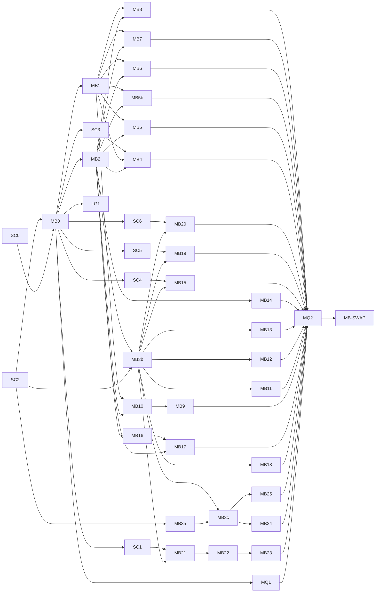

# Mobile app (native Android, Rust core; iOS later)

Reference notes for agents working on `mobile/`. Read [CLAUDE.md](../../CLAUDE.md) first: its
process and seven rules apply here. Other areas: [docs/agents/](./). The server contract is the web
app's ([webapp.md](webapp.md), [server.md](server.md)); the audio rules are the player's
([playback.md](playback.md)); remote control and the listen party are [party-remote.md](party-remote.md);
the app it REPLACES is [android.md](android.md) (read it: every hard-won rule there either survives
here or is made unnecessary, and this note says which); the Rust crates it shares come from the
desktop app ([desktop.md](desktop.md)).

**Status (2026-11-18): MB0 (the skeleton), MB1 (Sillon in Compose), MB2 (the core runtime,
session, lists, covers, links and `:bridge`), MB4 (setup, the migration from the old app, the
updater, the Deezer login), MB11 (now playing: the player, the queue, the words, the lyric card), MB15 (offline) and MB21 (the
visualiser: bars and oscilloscope) are delivered; the lots below are planned and follow this note in order.** Each lot,
when it lands, replaces its plan paragraph by what was learned (rule, why, number) — a delivered lot
is not a changelog. The old `android/` app keeps building and shipping
until lot MB-SWAP.

## The need

A person on an Android phone, on a bad mobile link by default, wants Neezer as a real app: it opens
at once on the last screen, every tap answers in the same frame, the tapped track plays now and the
next one is already there, it keeps playing behind a locked screen for hours with no gap and no
silence, the media notification, the lock screen, a headset, the car's Bluetooth and the car overlay
drive it, downloads keep going in the background without ever slowing the music, and it costs little
battery, RAM and data. It has **the same features as today's app** — the SPA (`webapp/`) as the
WebView shows it, plus everything the native side of `android/` adds (player behind a locked screen,
downloads in the app's storage, car mode, updater, Deezer login, certificate pinning) — **1:1, not a
subset**, a **new logo**, and as much code as possible in **Rust**, shared with the desktop app and
reusable for an iOS app later.

What the WebView app could not fix, and why native is the cause and not a taste: the queue, the
audio decisions and the UI lived in a renderer Android throttles and freezes behind a locked screen
(android.md, bridges 7 to 12: a next-list LEASE of 200 titles, refill hooks, a 4 Hz tick suppressed,
acks with timeouts, re-adoption of advances). In this app the queue and the engine live in the app
process next to the media service; there is no page to freeze, so that whole protocol disappears.

## Research (sources) and what it decided

| Topic | Sources | Decision |
|---|---|---|
| Native UI toolkit | [Element X Android](https://github.com/element-hq/element-x-android) (Compose UI over the Matrix Rust SDK through UniFFI), [Spotify engineering: client architecture](https://engineering.atspotify.com/spotify-modernizes-client-side-architecture-to-accelerate-service-on-all-devices/) and [Scaling mobile at Spotify](https://danielsaidi.com/blog/conferences/2013/11/06/scaling-mobile-at-spotify) (thin native UI over a shared core), [Baseline Profiles + Macrobenchmark](https://developer.android.com/topic/performance/baselineprofiles/measure-baselineprofile) | **Jetpack Compose** (Kotlin) for the UI only, Material 3 as a base re-skinned to Sillon; every decision, state and byte of network in Rust. A Rust UI toolkit (Slint, egui, Dioxus) was rejected: no TalkBack-grade accessibility, no system text input/IME polish, no MediaSession/Auto integration — rule 5 would fail on the first sheet. |
| Rust ↔ Kotlin | [UniFFI 0.30 Gradle notes](https://mozilla.github.io/uniffi-rs/0.30/kotlin/gradle.html), [Running Rust on Android with UniFFI](https://engineered.at/articles/running-rust-on-android-with-uniffi), [One Rust core across Android and iOS (2026)](https://ac-opensource.github.io/blog/2026-04-07-one-rust-core-across-android-and-ios.html), [Gobley](https://github.com/ovitrif/gobley) and [Ubique's UniFFI KMP plugin](https://klibs.io/project/UbiqueInnovation/uniffi-kotlin-multiplatform-bindings), `cargo search` (uniffi 0.32.2, cargo-ndk 4.1.2, ndk 0.9.0 on 2026-11-17) | **UniFFI 0.32 proc-macros, library mode, one `cdylib` (`libnz_ffi.so`)**, built by **cargo-ndk 4.1** from a plain Gradle `Exec` task (no third-party Gradle plugin: their maturity could not be confirmed, and an `Exec` is debuggable by a weaker coder). Hand-written JNI only on the one hot path that needs it (the API-26 AudioTrack fallback, lot MB3a). Same tool generates Swift for iOS. |
| Audio engine | Desktop D5/D6 (`nz-audio`: two voices, gapless, crossfade, trim, EQ, bass, mono/balance, speed, tap, party clock — measured), [Media3 battery consumption](https://developer.android.com/media/media3/exoplayer/battery-consumption) (offload helps long screen-off playback, but forbids effects, speed and silence skipping), [Qualcomm: audio offload in ExoPlayer](https://www.qualcomm.com/developer/blog/2023/08/audio-offload-support-exoplayer) (≈13 % less current, AAC only, Opus offload from API 30 on some SoCs), android.md *bridge 12* (the 250 ms AudioTrack floor was the "cuts every few seconds") | **The Rust engine (`nz-audio`), not ExoPlayer.** Crossfade, trim, EQ, bass, mono/balance, speed, analysis tap and the party output clock already exist and are measured there; ExoPlayer has no crossfade (the old app needed two players and a page to arbitrate them) and offload would forbid every effect the person uses. The cost is offload's ~13 %; lot MQ2 measures screen-off CPU time against a stock ExoPlayer baseline on the same files and reopens this decision if the engine costs more than **1.3×** the baseline. |
| Audio output | [Oboe history / AAudio on 8.0](https://chromium.googlesource.com/external/github.com/google/oboe/+show/ab11519cd5fcd307cbe6ab3aa2a46a619ca9f5ab/docs/AndroidAudioHistory.md) (AAudio crashes after close on 8.0: Oboe uses OpenSL ES there), [low-latency audio guide](https://developer.android.com/games/sdk/oboe/low-latency-audio), [cpal 0.18 AAudio host](https://docs.rs/crate/cpal/0.18.0/source/src/host/aaudio/mod.rs) and [cpal PR #1015](https://black-queen-531f.myworkers1.workers.dev/RustAudio/cpal/pull/1015) (noisy output, callback sizes from 12 to 4 000 frames, no performance-mode control) | **Own output over AAudio through the `ndk` crate** (`ndk::audio`, `PerformanceMode::PowerSaving`, usage Media / content Music, a 500 ms–1 s buffer — the old app's measured NativeSink lesson) on **API ≥ 27**; on **API 26** an `AudioTrack` (`MODE_STREAM`, float, ≥ 500 ms) written by one Kotlin thread that pulls PCM from Rust into a direct `ByteBuffer`. Not cpal on Android (no power-saving mode, the reported noise), not Oboe (a C++ toolchain for what two hundred lines of `ndk` do). Low latency is NOT the goal: a music player wants big buffers and few wake-ups. |
| Media session, notification, lock screen, Auto | [Media3 session/player](https://developer.android.com/media/media3/session/player) (`SimpleBasePlayer`), [background playback](https://developer.android.google.cn/media/media3/session/background-playback?authuser=5), [MediaLibraryService](https://developer.android.com/media/media3/session/serve-content), [Android for Cars media](https://developer.android.com/media/implement/surfaces/cars), [massdroid: Android Auto notes](https://raw.githubusercontent.com/sfortis/massdroid_native/main/docs/android-auto.md) (sideloaded apps need AA's "Unknown sources") | **Media3 `MediaLibraryService` + a `SimpleBasePlayer` facade** (`NzPlayer`, main looper) whose state is the Rust snapshot and whose commands go to Rust. The notification, the lock screen, headset buttons, Bluetooth AVRCP and Android Auto then come from Media3 for free; the facade holds no logic. |
| Background downloads | [Foreground service timeouts (A15: dataSync 6 h / 24 h)](https://developer.android.com/develop/background-work/services/fg-service-timeout), [User-initiated data transfer (A14+)](https://android-developers.googleblog.com/2024/09/google-maps-improved-download-reliability-user-initiated-data-transfer-api.html) (Maps: 10 %+ fewer failed offline downloads) | The Rust offline worker does the transfers; Android only keeps the process alive: **a user-initiated data-transfer job on API ≥ 34**, **WorkManager with a `dataSync` foreground worker below**; both stop when the queue is empty, and the queue resumes from SQLite after any kill (rule 2). |
| Transcription | Desktop T1–T4 (whisper.cpp on Vulkan, measured on a Radeon), [llama.cpp #9464](https://github.com/ggml-org/llama.cpp/discussions/9464) (Android Vulkan through ggml: Adreno fails to load, very slow), [on-device STT benchmark](https://voiceping-landingpage-prod.pages.dev/en/blog/research-offline-speech-transcription-benchmark/) | **Server-side only**, as the SPA and today's app do (start/stop, status, transcript panel, search): parity does not include local transcription (a desktop-only feature). A later, unplanned lot may add whisper.cpp on the CPU, charging + unmetered + idle only. |
| Size and cold start | [bitdrift: Rust mobile SDK size](https://blog.bitdrift.io/post/optimizing-rust-mobile-sdk-binary-size), [UniFFI build optimisations](https://thunderbiscuit.github.io/uniffi-examples/build-workflows/optimizations.html), [Baseline Profiles](https://developer.android.com/topic/performance/baselineprofiles/measure-baselineprofile) (official sample: 324.8 → 229.0 ms startup) | Release profile `opt-level = "s"` with `opt-level = 3` overrides for the audio/DSP/analysis crates, `lto = "thin"`, `codegen-units = 1`, `strip = true`, **`panic = "unwind"`** (UniFFI turns a panic into a Kotlin exception; `abort` would kill the process); R8 full mode; a Baseline Profile covering start + first scroll + first play. |
| Reference apps | [Symfonium](https://symfonium.app/) (manual + automatic cache, rolling play cache, favourites auto-cached), [Tempo / Tempus](https://github.com/CappielloAntonio/tempo) (Media3 ExoPlayer + session), Feishin (Electron desktop — no mobile lesson), Spotify (shared native core + thin platform UI) | Same split as the strong apps: one core, thin platform UI; downloads, a rolling play cache and an always-on offline browse. |
| Emulation | [Chromium: Android emulator](https://chromium.googlesource.com/chromium/src/+/main/docs/android_emulator.md), [Emulator headless build](https://androidstudio.googleblog.com/2019/02/emulator-2818-canary.html), [emulator on GitHub Actions](https://proandroiddev.com/how-to-run-an-android-emulator-on-github-actions-0fafb96e568a) | The qemu-based emulator, `-no-window -gpu swiftshader_indirect -no-audio`-class flags (see *Tests and emulation*), as the user, KVM through `/dev/kvm` — never libvirt, never sudo. |

**Measured on this machine before writing the plan** (throwaway prototype in `~/.cache/neezer-proto`,
never committed; Rust 1.99.1):

- `/dev/kvm` is `crw-rw-rw-`: `qemu-system-x86_64 -accel kvm -display none` runs as the user (ran
  until `timeout` killed it, no `failed to initialize kvm`). No Android SDK was installed; it now
  lives in `~/.local/share/android-sdk` (5.2 GB: cmdline-tools, platform-tools, NDK 30.0.16248370,
  emulator, platforms/build-tools 35, `system-images;android-35;default;x86_64`) — on disk, never
  `/tmp` (a 24 GB tmpfs in RAM). `cargo-ndk 4.1.2` is installed in `~/.cargo/bin`, and the
  `aarch64-linux-android` / `x86_64-linux-android` Rust targets are added.
- **A separate Cargo workspace can depend on the desktop crates by path**: `nz-model`, `nz-player`,
  `nz-api` and `nz-cache` built unchanged from `~/.cache/neezer-proto/core` (their
  `version.workspace = true` / `serde = { workspace = true }` resolve against `desktop/Cargo.toml`).
  So `mobile/rust` gets its own `Cargo.lock` and never edits the desktop's.
- **UniFFI 0.32.2 library mode generates the Kotlin from the host build**: an `Object` with a
  constructor, a `Record`, an `Option`, a callback interface → 1 548 lines of Kotlin (JNA-based).
- **Several `#[uniffi::export] impl Screens` blocks in different files of one crate merge into ONE
  Kotlin class** (`home.rs` with an `async fn home()` on the tokio runtime → `suspend fun home()`,
  `search.rs` with `fn search_hint()` → `fun searchHint()`). That is what lets the feature lots
  each own one file on both sides of the boundary.
- **`strip = true` deletes UniFFI's metadata**: bindgen on the stripped release `.so` said `No
  UniFFI metadata found`. Bindings are generated from the unstripped host DEBUG build; the Android
  release libraries may be stripped.
- **cargo-ndk 4.1.2 + NDK 30 cross-compile the shared stack for `arm64-v8a`, API 26**: `nz-api`
  (reqwest + rustls, whose crypto provider here is **aws-lc-rs** — C, built by the NDK's clang),
  `nz-cache` (bundled SQLite), `rustls-platform-verifier` + its `-android` crate, `nz-player`,
  `nz-model`, and all of `nz-audio`'s native dependencies (`opusic-sys` = libopus, `signalsmith-stretch`
  C++, `rubato`, `cpal` + `ndk`). A cold arm64 release build took **685 s** with
  `CARGO_BUILD_JOBS=4` (aws-lc and libopus dominate); an incremental one 11 s.
- **`nz-audio` itself does NOT compile for Android today**: `output.rs` names
  `cpal::HostId::PipeWire` and `cpal::HostId::Alsa`, which do not exist on that target (4 × E0599).
  That is SC2's first job (the `cpal` feature, Linux hosts behind `cfg`).
- The prototype's `.so` was 620 KB on arm64, but it called none of the crates (LTO dropped them):
  that number says NOTHING about the real size. MB0 measures the first real one.
- **The emulator boots headless**: AVD API 35 x86_64 (`pixel_6` profile), `-no-window -no-audio
  -gpu swiftshader_indirect -no-boot-anim -no-snapshot -memory 3072 -cores 4`: `sys.boot_completed`
  after **23 s** cold, the emulator process at **3.8 GB RSS** (hence two emulators at most). With
  `-no-audio` the guest still has an AudioFlinger MIXER output on `AUDIO_DEVICE_OUT_SPEAKER` at
  48 kHz, so AAudio has a device to open; whether it consumes at real time is MQ1's measure.

**Pitfalls known before the first line** (each is repeated in the lots it concerns):

- Strip vs bindgen (above). Never run `uniffi-bindgen` on a release/stripped library.
- `rustls-platform-verifier` (reqwest 0.13's `rustls` feature) must be initialised from Kotlin on
  Android (`rustls_platform_verifier::android::init_hosted(env, context)` once, plus its Maven
  component `rustls:rustls-platform-verifier`), or every TLS handshake fails. Lot MB2.
- UniFFI records are Kotlin `data class`es with `List` fields: Compose treats them as UNSTABLE and
  recomposes every row on every change. Declare `uniffi.nz_ffi.*` stable in the Compose compiler's
  `stabilityConfigurationFile` (lot MB0), and give every `LazyColumn` item a `key`.
- A UniFFI callback runs on the Rust thread that fired it: Kotlin must hand it to a `Flow`/channel
  and return at once; never call back into Rust synchronously from inside it (deadlock on the
  core's lock). Rust never holds a lock while calling Kotlin.
- A Kotlin coroutine cancelled while awaiting a UniFFI `async fn` cancels the Rust future (drop);
  Rust code after an `.await` must therefore be cancellation-safe (no half-written cache row).
- `versionCode` must stay ABOVE every code the old app shipped (`android.yaml` used
  `github.run_number`): the new workflow uses `2_000_000 + run_number`, or Android refuses the update.
- The new app keeps **`applicationId = "org.nsupysonic.app"` and the same signing key**, so it
  installs as an UPDATE of the old one through the existing `/api/android/apk` channel and keeps its
  data directory (where the migration reads from). A new id would be a second app and lose
  everything (rule 7).
- AAudio on API 26 can crash after close (Oboe #40): the AudioTrack fallback there.
- **`NzCore::player()` is ONE player per process, and that is a measured rule.** It used to build a
  fresh `PlayerApi` per call, and a `PlayerApi` owns a `Player`, an engine and the engine's one sink: the
  media service opened AAudio on ITS instance while the caller's queue lived in another — 40
  `GET /api/stream` served, `position()` still 0, `bufferMs=0`, and a person looking at "Lecture" over
  silence. `NzCore` keeps `OnceLock<Arc<PlayerApi>>`, and `NzCore::shutdown()` shuts that player down
  before the core (its worker, event and net threads are joined — worker rule 5).
- **A C++ dependency that links the SHARED libc++ makes the whole app unloadable.** `signalsmith-stretch`
  (inside `nz-audio`) is C++, and the `cc` crate's Android default is `c++_shared`: `libnz_ffi.so` then
  carries `NEEDED libc++_shared.so`, no APK ships that file, and the app dies at `System.loadLibrary`
  with `UnsatisfiedLinkError: dlopen failed: library "libc++_shared.so" not found` before
  its first screen (measured 2026-11-18 on all three ABIs: `readelf -d`, the APK's `lib/` listing and
  the device's crash buffer agreed). `build-android.sh` links `CXXSTDLIB=c++_static` (only for the
  cargo-ndk step: the host build has no `libc++_static`) and then REFUSES a library whose `NEEDED` names
  something Android does not provide and the APK does not carry (`--check-libs` also checks an unpacked
  APK). `ci-emulator.sh` reads the crash buffer, so a launch failure names its cause instead of only
  "« Accueil » never painted" — which is what hid this for a day.
- An Android emulator plays its sound on the host by default: always `-no-audio`, or route it to
  a null sink; and never open its window on the user's display.

## Architecture

### Repository layout

```
mobile/
  rust/                         # Cargo workspace (own Cargo.lock), edition 2024
    Cargo.toml                  # [workspace.dependencies] pins EVERY crate any lot needs (MB0)
    crates/
      nz-core/                  # the app core: sessions, screens' data, player wiring, offline,
                                #   party, remote, settings — platform-free, no FFI types
      nz-ffi/                   # UniFFI surface only (cdylib libnz_ffi.so): records, objects,
                                #   listeners; one file per lot; converts nz-core <-> FFI types
      nz-droid-audio/           # Android output: AAudio (API ≥ 27) + the AudioTrack pull hook
      nz-viz-gl/                # GLES 3 renderer of the worlds on an ANativeWindow (glow + EGL)
    bindgen/                    # bin `uniffi-bindgen` (uniffi "cli" feature), host only
    build-android.sh            # cargo ndk (3 ABIs) + bindgen from the host debug build
  android/                      # Gradle project (Kotlin 2, AGP 8, version catalog)
    settings.gradle.kts  build.gradle.kts  gradle/libs.versions.toml  compose-stability.conf
    app/                        # :app — Application, MainActivity, NavHost, AppGraph (manual DI)
    bridge/                     # :bridge — generated UniFFI Kotlin + Flow adapters, NzCore holder
    designsystem/               # :designsystem — Sillon tokens, fonts, Icon, glass, components
    playback/                   # :playback — MediaLibraryService, NzPlayer, focus, locks, AudioTrack
    feature/<area>/             # one Gradle module per feature lot (disjoint files)
    car/                        # :car — the car overlay (ported from android/), tile, triggers
    baselineprofile/            # :baselineprofile — Macrobenchmark + profile generator
  brand/                        # logo SVG sources + export script (lot LG1)
  tools/                        # emu.sh (headless emulator), measure scripts (lot MQ1)
desktop/crates/                 # SHARED crates (desktop workspace members, tested by desktop CI)
  nz-model nz-api nz-cache nz-player nz-audio nz-viz      # existing, reused
  nz-analysis nz-offline nz-remote nz-party               # NEW, extracted from desktop/app/src/wiring
```

`mobile/rust` depends on the shared crates by path (`../../desktop/crates/nz-*`), and on the
repository's own crates the desktop already uses (`webapp/rhythm`, `webapp/appcore`,
`android/nscore` through `nz-audio`). A change a shared crate needs is made IN that crate and keeps
the desktop CI green; it is never forked into `mobile/`.

### Reuse, crate by crate

| Crate | Verdict | What the mobile needs, and the lot |
|---|---|---|
| `nz-model` | **As is.** Pure serde types, tolerant. | Nothing. FFI records are NOT derived on it (it has `serde_json::Value` fields UniFFI cannot carry, and the FFI wants screen-shaped, slimmer rows): `nz-ffi` converts. |
| `nz-api` | **As is + SC3 (delivered).** Lanes, `503`/`Retry-After`, 409 split, offline, cache seam, `SessionJar::at(path)` already injectable. | SC3's additions, all opt-in so the desktop keeps its client: a TOFU pin (`ApiBuilder::pinned_leaf_sha256`, platform-valid OR that exact leaf, `ApiError::Certificate{sha256, changed}`), `Api::probe_certificate(url)` (handshake refused, 0 application bytes — `Ssl.kt`'s rule), a byte/request counter per screen tag (`with_tag`/`stats`), `http` only to the configured origin with redirects followed by hand (`Net.kt`'s rule), and the Android verifier init documented (MB2's Kotlin side). `directories` stays (only used by `default_path`, which mobile never calls). |
| `nz-cache` | **As is.** `Cache::open_with_cache_dir(data, cache)` takes both dirs. | Nothing. Data dir = `filesDir/neezer` (offline audio, SQLite), cache dir = `cacheDir/neezer` (covers, play cache — the system may clear it, which is what those are for). `covers::variant` (image crate) unused on mobile: Android decodes (see *Covers*). |
| `nz-player` | **As is.** Pure queue/transport state machine, listen accounting, shuffle. | Nothing. |
| `nz-audio` | **Reused + 1 lot (SC2).** The engine already has `Engine::new_offline` → `OfflineSink::render(&mut [f32])`, a pull-driven sink. | SC2 turns it into a supported EXTERNAL sink: `Engine::new_external(cfg, opener) -> (Engine, ExternalSink)` with `render`, `Engine::set_external_output(OutputInfo)` (rate, channels, `latency_frames` the clock subtracts — the party and the analysis need it), `Engine::note_underruns(total)`; makes the crate compile for Android (today it does not: `HostId::PipeWire`/`Alsa`); puts `cpal` behind a default feature `cpal` so the Android build compiles none of it; `EngineConfig.spool_dir` is always passed (no `$XDG` default on Android). Desktop unchanged with default features. |
| `nz-viz` | **As is.** Bars + scope geometry from `rhythm`. | Drawn by Compose `Canvas` (MB21). |
| `nz-mpris` | **Not used** (Linux D-Bus). | Media3 is its Android counterpart. |
| `nz-transcribe` | **Not used** (local whisper is desktop-only). | — |
| `desktop/app/src/wiring/analysis.rs` (2 268 lines, 0 GPUI) | **Extract → `nz-analysis` (SC1).** | Tap → `rhythm` analyser → frames, only while a view is visible. |
| `wiring/offline.rs` (3 059, GPUI only in tests) | **Extract → `nz-offline` (SC4).** | The downloads worker (Bulk lane, `.part` + rename, resume, causes). |
| `wiring/remote_host.rs` + `remote_controller.rs` (3 458, ~19 GPUI uses) | **Extract → `nz-remote` (SC5).** | Be controlled / control another player; GPUI glue stays in the desktop app. |
| `wiring/party_guest.rs` (2 757, 0 GPUI) + `party_host.rs` (1 580, 17 GPUI uses) | **Extract → `nz-party` (SC6).** | Host and guest; the guest's `Planner` uses `appcore::sync` and `nz-audio`'s `PartyChannel`. |
| `wiring/engine.rs`, `net.rs`, `events.rs` | **Read, re-written in `nz-core`** (small, app-shaped). | MB2/MB3b. |
| `webapp/rhythm`, `webapp/appcore`, `android/nscore` | **As is**, through the crates above. | `rhythm`'s `viz_scene.rs` also drives the worlds' uniforms (MB22). |
| Mobile-only | `nz-core` (screens' data, list handles, settings store, migration), `nz-ffi`, `nz-droid-audio`, `nz-viz-gl`. | MB0 creates them. |

### The FFI boundary

One object graph, built once by `:bridge` at `Application.onCreate` (cheap: opens SQLite, starts the
runtime; no network):

```rust
// nz-ffi/src/core.rs (MB0 stub, MB2 fills)
#[derive(uniffi::Record)]
pub struct CoreConfig { pub data_dir: String, pub cache_dir: String, pub app_version: String,
                        pub version_code: u64, pub sdk_int: u32, pub device_name: String }

#[derive(uniffi::Object)] pub struct NzCore { /* Arc<nz_core::Core> */ }

#[uniffi::export(async_runtime = "tokio")]
impl NzCore {
    #[uniffi::constructor] pub fn new(cfg: CoreConfig) -> Result<Arc<Self>, NzError>;
    pub fn server(&self) -> Option<ServerInfo>;                       // configured origin, pin
    pub async fn set_server(&self, url: String) -> Result<ServerInfo, NzError>; // GET /api/version
    pub async fn probe_certificate(&self, url: String) -> Result<CertInfo, NzError>; // SC3/MB4
    pub fn pin_certificate(&self, origin: String, sha256: String);
    pub async fn login(&self, username: String, password: String) -> Result<Me, NzError>;
    pub async fn restore(&self) -> Result<Option<Me>, NzError>;       // jar -> GET /api/me
    pub async fn logout(&self) -> Result<(), NzError>;
    pub fn set_network(&self, net: NetworkState);                     // ConnectivityManager
    pub fn set_foreground(&self, visible: bool);                      // ProcessLifecycleOwner
    pub fn subscribe_session(&self, l: Box<dyn SessionListener>);     // SessionEnded, Me changed
    pub fn stats(&self) -> NetStats;                                  // per screen tag: requests, bytes
    pub fn screens(&self) -> Arc<Screens>;     // read-only screen data (feature lots add methods
                                               //   in THEIR OWN impl block, in their own file)
    pub fn player(&self) -> Arc<PlayerApi>;    // MB3b
    pub fn offline(&self) -> Arc<OfflineApi>;  // MB15
    pub fn remote(&self) -> Arc<RemoteApi>;    // MB19
    pub fn party(&self) -> Arc<PartyApi>;      // MB20
    pub fn viz(&self) -> Arc<VizApi>;          // MB21/MB22
    pub fn settings(&self) -> Arc<SettingsApi>;// MB16/MB17
    pub fn shutdown(&self);                    // joins every thread that borrows the runtime
}

#[derive(uniffi::Enum)]
pub enum NetworkState { None, Wifi { metered: bool }, Cellular { metered: bool }, Other { metered: bool } }

#[derive(uniffi::Error, Debug)]          // every variant has a French sentence: nz_error_text(e)
pub enum NzError {
    Offline, Timeout, Session, RemoteEnded { restored: bool },
    NotReady { retry_after_s: u32 }, Conflict { message: String },
    Provider { status: u16, code: Option<String>, message: String },
    Server { status: u16, message: String },
    Certificate { sha256: String, changed: bool },
    Unsupported { feature: String },   // the server is older than the feature (rule 7)
    Invalid { message: String }, Internal { message: String },
}
#[uniffi::export] pub fn nz_error_text(e: &NzError) -> String; // ApiError::cause_fr, never a code
```

Rules of the boundary (every lot):

- **One impl block per lot, in its own file.** UniFFI allows several `#[uniffi::export] impl Screens`
  blocks in different files of the same crate: MB0 creates `nz-ffi/src/<lot>.rs` for every lot and
  declares it in `lib.rs`; a lot writes only its file. Same for `nz-core/src/<area>/`.
- **Screen-shaped records, not server JSON.** A row crossing the boundary carries what the screen
  draws (title, subtitle, duration, cover key, flags) and nothing else; a 4 000-row list never
  crosses whole: it is a **`ListHandle`** (below).
- **Reads are `async fn`, cancellable.** A screen asks `cached_x()` (disk only, `Option`) then
  `x()` (network on the `User` lane, refreshes the cache); the ViewModel shows the first, replaces
  it with the second, and on failure with a cached copy keeps it and says "Hors ligne · version
  mémorisée" — without one, `LoadFailed` with the cause and "Réessayer" (rule 3).
- **Writes are optimistic.** A mutation updates Rust's in-memory state at once, emits the change,
  sends the request; a failure rolls back and returns an `NzError` the UI turns into a toast with
  "Réessayer". Mutations are never retried automatically (desktop's rule).
- **Hot reads are synchronous and cheap**: `player.position()` is an atomic read, called by the UI
  each frame only while a progress bar is on screen. Rust pushes events only on CHANGE, never on a
  timer (a 4 Hz tick into a sleeping UI is the old app's 115 000-state backlog).
- **Listeners per area** (`PlayerListener`, `OfflineListener`, `SessionListener`, …), each declared
  in its lot's file — never one shared event enum every lot would edit.

```rust
// nz-ffi/src/lists.rs (MB0 stub, MB2 fills) — every long list, windowed (rule 4)
#[derive(uniffi::Object)] pub struct ListHandle { /* Arc<nz_core::lists::List> */ }
#[uniffi::export]
impl ListHandle {
    pub fn len(&self) -> u32;
    pub fn window(&self, start: u32, count: u32) -> Vec<TrackRow>;   // count ≤ 128
    pub fn index_of(&self, key: String) -> Option<u32>;
    pub fn filter(&self, query: String) -> u32;     // appcore::fold; returns the new len
    pub fn sort(&self, by: SortKey, descending: bool) -> u32;
    pub fn version(&self) -> u64;                    // bumps on every change; the UI re-windows
}
#[derive(uniffi::Record)]
pub struct TrackRow { pub key: String, pub id: String, pub title: String, pub artists: String,
    pub album: String, pub album_id: Option<String>, pub duration_s: u32, pub cover: Option<String>,
    pub explicit: bool, pub liked: bool, pub disliked: bool, pub unavailable: bool,
    pub downloaded: bool, pub source: String, pub position: u32 }
```

### Threads (Android)

| Thread | Owns | Priority |
|---|---|---|
| Kotlin main | Compose, input, `NzPlayer` facade, MediaSession | normal; never blocks: every FFI read that can touch disk or network is `suspend` |
| `nz-net` (tokio, 2 workers) | every HTTP request, cache writes, listeners' dispatch | normal |
| engine `nz-load-*`, `nz-decode-*`, `nz-audio-spool` | `nz-audio`'s own threads (joined by `Engine`) | `setpriority(-16)` (Android's `THREAD_PRIORITY_AUDIO`, what ExoPlayer's playback thread uses) on decode/spool |
| AAudio data callback (or the API-26 `nz-audiotrack` Kotlin thread) | `ExternalSink::render` | real time: no allocation, no lock, no syscall, no JNI except the API-26 pull |
| `nz-analysis` | tap → `rhythm` → frames | `setpriority(+5)`; runs only while a visualiser or the EQ meter is visible |
| `nz-viz-gl` | the worlds' GLES context on the SurfaceView's window | normal, frame-capped (eco: 30 fps) |
| `nz-bulk` | downloads, cover warming, offline sync, migration | `setpriority(+10)`; Bulk lane |

Every thread that borrows the tokio runtime is owned by something that JOINS it before
`NzCore::shutdown` drops the runtime (desktop D13's pitfall: a thread blocked in `Handle::block_on`
on a dropped runtime panics or hangs). `shutdown` is called from `Application`'s process death path
only in tests; Android kills the process otherwise, so no correctness may depend on a clean
shutdown — state is in SQLite (WAL) after every change.

### Rule 1 on the phone

- **Network**: `nz-api`'s three lanes, unchanged — `User` (≤ 6 in flight, never waits), `Prefetch`
  (≤ 1, starts once the current track is playable and no `User` request for 250 ms,
  `X-NS-Background: 1`), `Bulk` (≤ 1, waits 1 s without `User`, token bucket at 25 % of the playing
  stream's throughput while it streams, `X-NS-Background: 1`). `503 + Retry-After` waits exactly.
  Every new consumer (covers, lyrics, migration, Auto's browse tree) picks a lane; none bypasses.
- **What is "the action just taken"**: the tapped track (stream on `User`), the screen being
  opened (its read on `User`), the visible covers (visible-first, `coverqueue.js`'s rule; a cover
  scrolled away is cancelled — the UniFFI future is dropped). **Right after**: the next track
  (`preload_next` on `Prefetch` once the current is playable), the playing track's gain/edges/
  lyrics/art in `ladder.js`'s order, the next screen's data on `Prefetch`. **Everything else** on
  `Bulk`: downloads, offline sync, migration, Auto's tree warm-up.
- **CPU**: decode/output first, then the UI thread, then analysis (+5), then bulk (+10).
- **Android process**: the media service is the only foreground service while playing; downloads
  get a UIDT job / WorkManager worker only while the queue is non-empty AND nothing waits on the
  link (the worker itself yields through the Bulk lane).
- **Battery**: behind a locked screen the engine spools the current and the next track WHOLE in
  bursts (`read_ahead_bytes` raised from 2 MB to 32 MB while the screen is off and the track is not
  yet on disk), so the cellular radio sleeps between bursts instead of trickling; the Wi-Fi lock is
  held only while a network source is being read.

### Network errors (rule 3)

`nz-api` already ports `lib/api.js#req` (offline, 3 tries with backoff for GETs started online,
mutations never retried, `X-NS-Error` final, `401` session vs `remote ended`, the two `409`s,
timeouts 4/12/15 s). The phone adds:

- `ConnectivityManager.registerDefaultNetworkCallback` → `set_network`: `None` flips `nz-api`
  offline AT ONCE (no request waits a timeout to learn it); metered changes the Auto quality ladder's
  ceiling and the downloads' policy (Réglages → Téléchargements, the SPA's options).
- A screen never spins forever: `LoadFailed` (cause + "Réessayer") after the first failure, or the
  cached copy with the offline note.
- Counted, not timed: `NzCore::stats()` returns requests and bytes per screen tag; every screen lot
  writes its numbers (cold and warm) in the PR and holds them in a test.

### Caches (what was fetched once is kept)

`nz-cache` as the desktop uses it (one SQLite in WAL, `PRAGMA user_version`, idempotent migrations
at start — rule 7 for the device's own data): API cache (the SPA's cacheable paths, keyed by user),
covers (files, LRU 300 MB, `cacheDir`), play cache (complete files only, LRU default 2 GB,
`cacheDir`), downloads (`filesDir`, never evicted, published by rename once complete), queue,
pending podcast progress, kv (settings). Paths never come from the server: a file name is a hash.

**Covers**: Rust fetches and caches the encoded file (lane, visible-first, the CDN allow-list of
`CarCovers` — the configured origin or `*.dzcdn.net` over HTTPS, no private IP literal) and returns
its PATH; Android decodes it (Coil 3 with a custom `Fetcher` + `Keyer` that call
`screens.cover_path(url, px)`, Coil's own network and disk caches OFF, hardware bitmaps,
downsampled to the view's size). Decoding in Rust and copying RGBA across JNI would cost more than
the platform decoder.

### Auth, security, data

- `POST /api/login`, cookie jar `SessionJar::at(filesDir/neezer/session.json)` (app-private).
  The client sends no `Origin`/`Sec-Fetch-Site` (desktop's rule). Never log a cookie, password, ARL.
- **TOFU pinning, as `Ssl.kt`** (android.md *Trust boundaries*): "Vérifier le certificat" unticked
  learns the leaf with a handshake that sends nothing, shows its SHA-256, pins it per origin; then a
  chain the system accepts OR that exact leaf passes, another one is `Certificate{changed: true}`
  ("le certificat a changé"). Another host is never relaxed. Cleartext only to the configured
  origin (Rust refuses any other http URL, redirects followed by hand — `Net.kt`'s rule).
- `data_extraction_rules.xml` excludes everything from backup and device transfer.
- The ARL never touches the device's storage: the Deezer login WebView hands it to the server.

### Navigation, screens and the UI

- Single `MainActivity`, Navigation Compose with type-safe routes, a phone shell (bottom bar
  Accueil / Rechercher / Bibliothèque / Podcasts, the mini-player above it, the full-screen player as
  a sheet) and a tablet/landscape shell (rail + reading columns, as `DesktopNowPlaying`). Back goes
  to the SCREEN, not the route (webapp.md's rule).
- MB0 writes `app/.../NavGraph.kt` ONCE with every route of the inventory, each calling an entry
  composable that already exists as a stub in its feature module (`feature/<area>/.../<Area>Entry.kt`).
  Feature lots fill their module and never edit `NavGraph.kt`.
- Long lists: `LazyColumn` over a `ListHandle` (`items(count = len, key = …)`, pages of 64 rows
  fetched as they near the viewport), never a `List` of 4 000 records.
- French copy, glyphs through the design system's `Icon` (no emoji), Sillon tokens only (no literal
  colour), motion from the design system's tokens with the eco/reduced guard ([transitions.md](transitions.md)).

### iOS later (not planned in detail)

`nz-core`/`nz-ffi` compile for `aarch64-apple-ios`; UniFFI generates Swift; the UI is SwiftUI.
What changes: output through CoreAudio (cpal's CoreAudio host works there, so `nz-audio`'s default
`cpal` path is fine), `MPNowPlayingInfoCenter` + `MPRemoteCommandCenter` instead of Media3, background
downloads through `URLSession` background transfers (Rust cannot run while suspended — hence the
`Downloader` seam SC4 leaves in `nz-offline`), CarPlay instead of the overlay (an overlay over another
app is impossible on iOS), the worlds' GLSL translated to Metal (naga) or rendered through wgpu, no
self-update (TestFlight/App Store) and no ARL login WebView restrictions beyond WKWebView's. The seams
to keep now: output (SC2's external sink), downloader (SC4), certificate store (SC3), and no Android
type in `nz-core`.

## Feature inventory (what "1:1" means)

Two sources, both required: the SPA as today's app shows it (the desktop inventory in
[desktop.md](desktop.md) *Feature inventory* lists its screens, SPA files and endpoints — this
table names the owning LOT and what the phone changes), and the native side of `android/`
([android.md](android.md)). A lot is done only when every row it owns works against the same
endpoints with the same rules as the SPA files named. "Not ported" is a short, explicit list at
the end — anything else missing is a bug.

### From the SPA

| Area | SPA reference | Lot |
|---|---|---|
| Server choice (URL, port, SSL toggle, TOFU pin), login, logout, session restore, invite redemption (`/invite/<code>`), onboarding (artists, account link/import) | `routes/Login`, `Invite`, `Onboarding`, `components/Onboarding*`, android `SetupActivity`, `Ssl.kt` | MB4 (setup, pin, migration), MB2 (login/restore), MB5b (invite + onboarding) |
| Home: hero, resume card, mood cards, releases card, recap card, Flow picker/controls/up next, energy picker | `routes/Home`, `HomeHero`, `ResumeCard`, `MoodCard`, `RecapHomeCard`, `FlowPicker`, `FlowControls`, `FlowUpNext`, `EnergyPicker`, `lib/flow.js` | MB5 |
| Search: tracks/albums/artists/playlists/podcasts, top result, transcripts hits, YouTube fallback in the same list, "broad search becomes a radio" | `routes/Search`, `TopResult`, `TranscriptHits`, `lib/searchrank.js`, `lib/queryradio.js`, `lib/youtube.js` | MB6 |
| Artist, album, discography, credits (track, person), credits sheet | `routes/Artist`, `Album`, `Credits`, `TrackCredits`, `CreditsSheet`, `PersonCredits` | MB7 |
| Library: playlists + folders (sheet, move, order), favourites, artists, albums, uploads (+ upload usage), dislikes, unavailable, history (library leaf), local tracks | `routes/Library`, `LibraryNav`, `FolderSheet`, `MoveToFolderSheet`, `DislikedTracks`, `UnavailableList`, `routes/History`, `lib/playlistfolders.js` | MB8 |
| Playlist: 4 000 rows, edit, reorder, add/remove (`AddTracksSheet`), members (role-driven), share link, read-only public link (`/shared/playlist/<id>`), recommended tracks at the bottom, export to services, import from link (`/import/<url>`) | `routes/Playlist`, `PlaylistTracks`, `PlaylistMembersSheet`, `ShareSheet`, `ExportSheet`, `routes/Import`, `routes/SharedPlaylist`, `lib/linkimport.js`, `lib/services.js` | MB9 |
| Track actions: the ONE context-menu spec (every list), like/dislike, play next/add to queue, swipe right = play next, radio (track/artist/genre), add to playlist (picker), credits, replace (sheet, candidates), delete upload, go to album/artist, share | `ContextMenu`, `lib/trackmenu.js`, `PlaylistPicker`, `ReplaceSheet`, `lib/actions.js`, `lib/replace.js`, `lib/trackverdict.js` | MB10 |
| Player engine: queue (4 000), shuffle, repeat, gapless, crossfade, silence trim, normalisation (ReplayGain), quality (Auto/320/128/64/FLAC), first-track normalisation, seek plan (`/ready`, `?start=`), listen accounting, podcast progress, play cache | `Player.svelte`, `lib/playback.js`, `lib/audio/seekplan.js`, `lib/gaincache.js`, `lib/edges.js`, `lib/playcache.js`, `lib/podcastProgress.js` | MB3b |
| Mini player, full-screen player (phone thumb column, tablet reading columns), queue editor (one component, drag, remove, clear upcoming), sleep timer (incl. end of track), quality menu + badge, podcast speed, more menu, lyrics (synced, the phone's lyrics VIEW), lyric card (share image), full credits | `PlayerBar`, `MobileNowPlaying`, `DesktopNowPlaying`, `NowPlaying`, `ImmersivePlayer`, `QueueList`, `SleepButton`, `lib/sleep.js`, `QualityMenu`, `SpeedButton`, `NowPlayingMore`, `Lyrics`, `LyricCard`, `lib/lyriccard.js` | MB11 |
| Audio effects: EQ (picker, meter, ten vertical faders, presets), bass lift, mono/balance, output naming + direct/processed verdict, volume warning (peak-hold, baseline) | `AudioEffects`, `TrimControl`, `lib/eqpresets.js`, `lib/audio/output.js`, `pan.js`, `saturation.js`, android `AudioRoute.kt` | MB12 |
| Podcasts: subscriptions, search/subscribe by URL, show (by UUID or Deezer id), episodes (cursor), progress, auto-archive, markers, chapters (list, sheet, ticks), transcript panel + search, start/stop server transcription, episode panel | `routes/Podcasts`, `Show`, `PodcastCard`, `PodcastEpisodePanel`, `ChapterList`, `ChapterSheet`, `ChapterTicks`, `TranscriptPanel`, `lib/markers.js`, `lib/chapters.js`, `lib/transcript*.js` | MB13 |
| Discovery: Nouveautés (two shelves, per-release list, settings, seen), release shelves (`/releases/artists`, `/releases/discovery`), Récap (years, stories, share), moods, Explorer (ten parent styles, style tile → genre station), discovery slider, mute artist, playlist recommendations, `/recommend` | `routes/Releases`, `ReleaseShelf`, `ReleaseCard`, `routes/Recap`, `RecapStory`, `RecapSlide`, `RecapShare`, `ExplorerStyles`, `StylePicker`, `GenreTiles`, `DiscoverySlider`, `lib/discovery.js`, `lib/genrestation.js`, `lib/recap*.js` | MB14 |
| Genre studio, genre tree, tag/bulk sheets, extractor, trainer, client-side analysis (`webapp/trainer`, `lib/genre/*`, `lib/analysis/*`) | `routes/Genres`, `GenreLibrary`, `GenreTree`, `GenreTagSheet`, `GenreBulkSheet`, `GenreExtractor` | MB18 |
| Offline: downloads per playlist/album/show, quality, "only downloaded" filter, play cache, offline browsing, network indicator, storage use, remove | `lib/offline.js`, `lib/playcache.js`, `lib/apicache.js`, `NetworkIndicator`, Réglages → Téléchargements | MB15 (+ SC4) |
| Remote control: be controlled, control another player, claim link (`/rc/<token>`), banner, host chip, links management | `lib/remote/*`, `RemoteSheet`, `RemoteButton`, `RemoteHostChip`, `RemoteBanner`, `routes/RemoteClaim` | MB19 (+ SC5) |
| Listen party: host and guest (`/party/<id>`), sheet, button | `lib/party/*`, `PartySheet`, `PartyButton`, `routes/Party` | MB20 (+ SC6) |
| Visualiser: bars, oscilloscope (orientation, colour), settings (palette, intensity, fps cap, eco), full screen, flash warning | `Visualizer`, `VisualizerSettings`, `FlashWarning`, `EcoToggle`, `lib/viz/scenes/{bars,scope}.js`, `routes/Viz` | MB21 (+ SC1) |
| The 50 worlds, skins (226 rows), world picker, pinned world per screen, quality tiers, eco grade, post FX, GL status | `lib/viz/worlds/*`, `skins.js`, `gl/*`, `scenes/gl.js`, `WorldPicker`, `quality.js` | MB22, MB23 |
| Réglages, user sections: Lecture & son, Apparence (Encre / Papier / Pochette, custom accent, cover-derived accent), Animations, Écoute, Bibliothèque, Téléchargements, Découverte, Sources (order, my accounts, Deezer ARL, YouTube connect, access grants, groups), Compte (export services), Aide (diagnostic log, app version) | `routes/Settings` sections `playback appearance viz listen library downloads discovery sources accounts account help`, `*Settings.svelte`, `MyAccounts`, `SourceOrder`, `AccessSettings`, `ServicesSettings`, `YoutubeConnect`, `AccountPicker`, `lib/theme.js`, `lib/coverpalette.js`, `lib/log.js` | MB16 |
| Réglages, admin: Utilisateurs (dashboard, invites), Serveur (archive, rules, cleanup + preview, storage, quotas, migrate, analysis plan/backfill, credits/enrich/similar backfills, automatch, transcription settings + workers, job failures, cache flush, Deezer status) | `AdminUsers`, `InviteSheet`, `JobFailures`, `AutomatchPanel`, `CreditsBackfill`, `EnrichBackfill`, `SimilarRebuild`, `TranscribeSettings` | MB17 |
| Toasts, notices, hard reload/"new version" notice, network indicator, skeletons, load failures, app links (`lib/applink.js`), keyboard shortcuts on a hardware keyboard/Chromebook | `Toasts`, `Notices`, `HardReload`, `Skeleton`, `LoadFailed`, `lib/applink.js` | MB1 (components), MB2 (links), MB16 (shortcuts list) |

### From the native `android/` app

| Behaviour (android.md) | New home | Lot |
|---|---|---|
| Plays behind a locked screen for hours, next/prev/play/pause/seek from notification, headset, lock screen, car card with no page awake (bridges 7–12) | The queue and the engine ARE in the app process: Media3 session over `NzPlayer`. The lease/refill/ack protocol is not ported — it has no reason to exist | MB3b, MB3c |
| Network retry while stopped (2/5/10 s on IO, 5xx retried, 4xx and decode errors skip at most 3 in a row, end of list → session paused) | Same policy in `nz-core::player` (`fault` skip, `FAULT_SKIPS_MAX = 3`), unit-tested on the JVM-free Rust side | MB3b |
| Sink buffer 500 ms–1 s, rebuffer threshold 500 ms, 32 MB read-ahead for seeking a generated stream, underrun/rebuffer counters in the journal | AAudio buffer ≥ 500 ms; `nz-audio`'s spool; `output_stats()` = underruns, rebuffers, buffer ms, rate | MB3a, MB3b |
| Audio focus (one request, transient loss pauses, duck), becoming noisy pauses | `:playback` | MB3c |
| Mono/balance, EQ/bass in the app's player | `nz-audio` DSP (desktop D6) | MB12 |
| Output naming (`AudioRoute`: Bluetooth/USB/wired/HDMI/speaker, name, connection id) and the direct/processed verdict per connection | `AudioManager` device callback → `player.set_route(...)` | MB12 |
| Downloads in the app's storage, published once complete, Range playback, launch-time cleanup | `nz-offline` + `nz-cache` downloads; no `__nsoffline` interception needed | MB15 |
| Download yields to the player's own hold (`YieldGate`, `LinkNeed`) | The Bulk lane + the stream throughput cap in `nz-api` — one mechanism, no lease | SC4, MB15 |
| Updater from ITS server (`/api/android/apk`, 202 + Retry-After, APK checks before the installer: zip, binary manifest, package, versionCode, signing lineage; causes `preparing truncated archive invalid package signature permission`) | Ported to Kotlin as is (`ApkArchive`, `Updater`) + Rust fetch on Bulk | MB4 |
| Deezer login (`DeezerLoginActivity`: Deezer's own page in a throwaway WebView, `arl` cookie read, jar wiped before and after, no bridge, SSO refused) | Ported to Kotlin as is; hands the ARL to the same server route the SPA's `lib/nativeDeezer.js` caller uses | MB4 |
| TOFU certificate pinning (`Ssl.kt`), cleartext only to the configured origin, redirects by hand | `nz-api` (SC3) + setup screen | SC3, MB4 |
| Renderer death rebuild, battery-optimisation offer (once, when Android actually killed us) | No renderer. The battery exemption offer stays: once, when the engine reports the process was killed during playback (a `kv` flag written at play, cleared at clean pause) | MB3c |
| Car mode: overlay over navigation apps (FULL/MINI/ULTRA, per-app placement, drag, opacity, blur), triggers (GPS app in front via usage access, Bluetooth, boot/update, wake ladder, sustain rung, job), speed lock (fused/platform GPS), native search (700 ms, 2 chars), pinned playlists (24) + Favoris tile, covers loader with allow-list, settings activity, quick tile, voice input | Ported from `android/` (Views, already native; pure policy classes and their JVM tests move unchanged); its two seams change: `PlayerService.transport/state` → a Media3 `MediaController`, `__nsCarPlay`/`__nsCarFav` → `NzCore` calls | MB24 |
| App shortcuts (`shortcuts.xml`), share a file, save a text (export), open server settings | `:app` (shortcuts, share intents) | MB2, MB9 |
| Bridge `NSNative.*` for the SPA | Gone: there is no page. `/api/android/apk` and the server's `android_*` settings stay for the updater | — |

### Added by the phone (not in today's app)

- **Android Auto** browse tree (Media3 `MediaLibraryService`: Favoris, playlists, Flow, recent) —
  lot MB25; cheap once the service exists, and a car head unit is the "next action" surface.
- Themed (monochrome) launcher icon and a real notification glyph — lot LG1.

### Not ported, on purpose

The service worker and the code splitting (no page); the `NSNative` bridge and its versions; the
WebView renderer rebuild; the next-list lease protocol; the IndexedDB → app-storage move (replaced
by the one-shot migration, MB4); local transcription (desktop-only).

## Tests and emulation

### Where things run

- **Rust, host**: `cargo test --workspace --locked` in `mobile/rust` (the core's logic, the FFI
  conversions, the AAudio-free engine path through `ExternalSink`), and the desktop CI for every
  shared crate. Most of the behaviour is proven HERE, against `tools/perf_api.py --serve` (the
  synthetic 8 000-track library) or recorded fixtures (`desktop/tools/dump_fixtures.py`).
- **Kotlin, JVM**: `gradle testDebugUnitTest` (pure policy classes: ViewModels with a fake core, the
  car mode's policies, the updater's checks — the old `android/` tests move with their classes).
- **Kotlin, device**: instrumented tests and Macrobenchmark on the emulator (below). Compose UI
  tests use `createAndroidComposeRule` with semantics, never screen coordinates.

### The emulator, headless, as the user

`/dev/kvm` is world-read/writable here (measured `crw-rw-rw-`): acceleration needs no group and no
sudo. Never libvirt (root-only on this machine). `mobile/tools/emu.sh` (lot MQ1) is the ONLY way a
lot starts an emulator, so the rules live in one place:

```sh
export ANDROID_HOME="$HOME/.local/share/android-sdk"          # never /tmp (tmpfs = RAM)
export ANDROID_AVD_HOME="$HOME/.local/share/android-avd"
mobile/tools/emu.sh start --port 5580   # even port 5554-5682; one per worker, chosen by the lot
mobile/tools/emu.sh wait  --port 5580   # waits for sys.boot_completed=1 (event, not a sleep)
mobile/tools/emu.sh stop  --port 5580   # adb -s emulator-5580 emu kill, then its own PID only
```

`start` runs `emulator -avd nz35 -port <p> -no-window -no-audio -gpu swiftshader_indirect
-no-boot-anim -no-snapshot-save -read-only -memory 3072 -cores 4` (AVD `nz35`: API 35 x86_64
`default` image, Pixel-class profile), writes its PID to `~/.cache/neezer-emu/<port>.pid`, and refuses
to start when `MemAvailable` < 8 GB. **No window and no sound on the user's session**: `-no-window`
and `-no-audio` are mandatory; nothing ever runs `adb` against a device the lot did not start
(`adb -s emulator-<port>` on every call — a bare `adb` may pick the user's phone). Kill only your
own PID — never `pkill emulator`/`qemu`. At most **two emulators** run on this machine at once.
For the underrun/battery measures that need a working audio HAL, `-no-audio` is replaced by
`-audio none` only if MQ1 measured that AAudio still clocks with it; otherwise those measures run on
a real phone over `adb` and say so (see *Measures*).

CI: the `mobile.yaml` workflow enables KVM on the runner (udev rule, the documented GitHub Actions
recipe) and runs the smoke + Macrobenchmark job on an API 35 x86_64 emulator against
`tools/perf_api.py --serve` reached at `10.0.2.2`.

**Three measured rules around that CI (2026-11-18).**

- **`cancel-in-progress` is for pull requests only** (`${{ github.event_name == 'pull_request' }}`),
  like every other workflow here. It was `true` for every event, so a push to `master` killed the run
  in flight — and a cancelled run never reaches its cache's post-save step. Run **44278965693** then
  logged `Cache not found for input keys: mobile-apk-…` and recompiled the whole Rust tree cold
  (`Build libnz_ffi.so and the Kotlin bindings`: **8.0 min median, 2.72 min with the cache**).
- **The caches are not the workflow's problem, the repository's budget is.** `gh api
  /repos/…/actions/caches` lists **30 entries for 16.9 GB against the 10 GB GitHub allows**, so the
  fleet lives in permanent LRU eviction: `mobile-apk-…` is missing exactly when a run asks for it,
  and every "cache" experiment here measures eviction, not the change. Shrinking the entries that
  exist (the desktop's `target/` caches are ~7 GB of them) is the prerequisite to any cache work.
- **The Rust build is cached as a PRODUCT, not as a `target/`.** Measured on run 44368850444:
  `Build libnz_ffi.so and the Kotlin bindings` takes **9.53 min cold and 9.97 min "warm"** — a
  `target/` cache cannot help a fresh checkout, because cargo's fingerprint for a crate under a
  PATH dependency is an mtime and `actions/checkout` gives every file a new one, so the eleven
  `nz-*` crates, `appcore` and `rhythm` are rebuilt every run while only the registry dependencies
  come back. What is cached instead is what the build produces — the three `libnz_ffi.so` and the
  generated UniFFI Kotlin — under `mobile-native-<hashFiles(every Rust input)>`: a Kotlin-only change
  hits it and the step does not run at all, a Rust change misses and builds. **No `restore-keys`
  on that key**: a product is never partially reusable, and restoring another tree's `.so` would
  ship it. 20.8 MB against 1.36 GB. The `--check-libs` guard runs on what came out of the cache.
- **`master` writes the cargo cache, every branch reads it.** `actions/cache` scopes an entry to
  the ref that saved it: a save from a pull request is a second 1.36 GB copy under
  `refs/pull/<n>/merge` that only that PR can read (measured: two identical `mobile-apk-<hash>`
  entries for the repository's 10 GB). `restore` + `save` are split for that reason.

- **The `emulator` job never builds Rust: it receives the library and the bindings.** `apk` uploads
  `bridge/src/main/jniLibs/<abi>/libnz_ffi.so` (three ABIs) and `bridge/build/generated/uniffi`
  as the `neezer-mobile-native` artifact; `emulator` downloads it into `mobile/android/bridge`, and
  `ci-emulator.sh` — which sees them (`native_artifacts_present`) — passes `-PskipRust` and skips
  the NDK/cargo-ndk install. Same instrumented tasks either way; a machine without the artifact
  keeps the old path and builds what it needs. Measured on run 44368850444: `Smoke` spent
  **12 min 30 s of cargo** (18:48:36 → 19:01:03) rebuilding a tree the `apk` job had just built,
  plus the NDK/cargo-ndk install, while the emulator's four vCPUs waited. **The three Gradle steps
  of `apk` are one invocation** (`testDebugUnitTest lintDebug assembleRelease`): `--no-daemon` pays a
  JVM and a Kotlin+AGP configuration phase per call, and run 44368850444 paid it three times
  (3.52 + 2.38 + 4.23 = 10.13 min).

### Measures (every lot that touches what they measure writes them in its PR)

| Measure | How | Target (emulator x86_64, KVM, swiftshader; real phone numbers reported beside) |
|---|---|---|
| Cold start | Macrobenchmark `StartupTimingMetric`, `StartupMode.COLD`, 10 iterations, Baseline Profile on vs off | TTID ≤ 500 ms; TTFD (home painted from cache, `reportFullyDrawn`) ≤ 900 ms |
| Tap → sound | `PlayerApi.output_stats()` carries `tap_ns` (Kotlin's tap instant passed in the command) and `first_audible_ns` (first rendered frame above −60 dBFS); difference read from events, not a clock poll | play cache/download ≤ 150 ms; archived track on the LAN ≤ 800 ms; first play generated server-side ≤ 1.5 s |
| RAM | **Counted bytes** of the Rust stores (`NzCore::memory()` — queue, lists, caches in memory, decoded covers held by Coil via its `MemoryCache.size`); PSS of the APP's own process (`dumpsys meminfo org.nsupysonic.app`, never a shared test process) as a secondary figure | queue of 4 000 ≤ 4 MB counted; idle on home PSS ≤ 120 MB; 30 min of playback: counted bytes flat (no growth > 1 %) |
| CPU / battery | `/proc/<pid>/stat` utime+stime over 30 min of playback, screen off (`input keyevent KEYCODE_SLEEP`), Doze forced (`dumpsys deviceidle force-idle`); same files through a stock Media3 ExoPlayer baseline APK | ≤ 1.3× the ExoPlayer baseline; analysis thread at 0 % while no view is visible |
| Network | `NzCore::stats()` per screen tag, cold and warm | ≤ the SPA's own count for the same screen (`webapp/test/requests/run.mjs`); warm open of a visited screen: 0 blocking requests |
| Smoothness | Macrobenchmark `FrameTimingMetric` on: library scroll (8 000), queue scroll (4 000), full-screen player open | p95 frame ≤ 16.7 ms, p99 ≤ 25 ms, 0 frozen frames (> 700 ms) |
| Underruns | `output_stats().underruns` (AAudio `getXRunCount` / AudioTrack `getUnderrunCount`) and `rebuffers` | **0** over 30 min screen off + Doze, on Wi-Fi and on the emulator's throttled `gsm`/`edge` network profile |
| APK | `apkanalyzer apk file-size`, per ABI split and universal | universal ≤ 45 MB, arm64-v8a split ≤ 18 MB; `libnz_ffi.so` arm64 ≤ 9 MB |

## Worker rules (mandatory in every lot; each prompt repeats them)

1. **Git, non-interactive only**: `export GIT_EDITOR=true GIT_SEQUENCE_EDITOR=true EDITOR=true VISUAL=true`;
   `git commit -m`, `git merge --no-edit`, never `rebase -i`. **Never `git stash`** (the stack is shared
   by every worktree): set work aside with a WIP commit.
2. **Before merging**: `git fetch origin && git rebase origin/master`, then
   `git diff --stat origin/master...HEAD` must list ONLY the lot's files (its "Exclusive files" below,
   plus its own section of this note). Anything else means a stale base or a stray edit: fix it before
   merging (a squash from a stale base already erased merged work).
3. **One writer per file.** A lot writes only its exclusive files. The shared files (`Cargo.toml`s,
   `lib.rs`/`mod.rs`, `NavGraph.kt`, `AndroidManifest.xml`, `settings.gradle.kts`, `libs.versions.toml`,
   `build.gradle.kts`, `mobile.yaml`) are created ONCE by MB0/SC0; a lot that truly needs one changed
   stops and asks (`ao report --needs-input`), it does not edit it.
4. **Memory is measured in counted bytes**, never by the RSS of a shared test process.
5. **A thread that borrows the tokio runtime is joined before the runtime stops.**
6. **Tests wait on events, never on the clock** (no `sleep` to "let it settle"; a channel, a latch,
   `boot_completed`, a state change).
7. **Nothing on the user's display or speakers**: emulator `-no-window -no-audio` through
   `mobile/tools/emu.sh`, `adb -s emulator-<port>` always, Xvfb for any desktop window, kill only
   your own PIDs.
8. **Nothing big in `/tmp`** (24 GB tmpfs = RAM, quota): builds, SDK, AVDs, recordings and logs go
   under `~/.cache`, `~/.local/share` or the worktree's `target/`. `CARGO_BUILD_JOBS=4`, one cargo at a
   time, no release build you do not need.
9. **French UI copy, no emoji, Sillon tokens only, rule 1 lanes for every request**, and the numbers
   (requests, bytes, ms, frames) written in the PR and next to the assertions.
10. **Done means**: the lot's acceptance list met and measured, CI fully green (every job of every
    workflow that ran, security scanners' logs read), this note's lot section replaced by what was
    learned, PR merged; then `ao report --done`.

## The lots

### Order, waves and the graph

A **wave** is a set of lots whose exclusive files are disjoint and whose dependencies are merged:
they run in parallel. Inside a wave, start the lots on the critical path first (bold). This machine
holds **at most four Rust-building lots at once** (`CARGO_BUILD_JOBS=4` each) and **two emulators**.

| Wave | Lots (parallel) | Waits for |
|---|---|---|
| 0a | **SC0** shared-crate stubs · **SC2** engine external sink + `cpal` feature (`nz-audio` must build for Android before any mobile crate depends on it) | — |
| 0b | **MB0** skeleton: Cargo + Gradle + UniFFI + cargo-ndk + CI | SC0, SC2 |
| 1 | **MB2** core runtime · **MB1** design system · **SC3** TLS pin + counters · SC1 `nz-analysis` · SC4 `nz-offline` · SC5 `nz-remote` · SC6 `nz-party` · LG1 logo · MQ1 test harness | MB0 |
| 2 | **MB3a** AAudio output · **MB3b** player core · **MB4** setup/migration/updater/Deezer · MB5 home · MB5b invite + onboarding · MB6 search · MB7 artist/album/credits · MB8 library · MB10 track actions | MB1 + MB2 (+ SC2 for MB3a/b, SC3 for MB4) |
| 3 | **MB3c** media service · MB9 playlist · MB11 now playing · MB12 audio effects · MB13 podcasts · MB14 discovery · MB15 offline · MB16 Réglages (user) · MB17 Réglages (admin) · MB19 remote · MB20 party · MB21 bars + scope | wave 2 (+ SC1/SC4/SC5/SC6 where named) |
| 4 | MB18 genre studio · **MB22** worlds renderer · **MB24** car mode · MB25 Android Auto | MB3c (MB24, MB25), MB21 (MB22) |
| 5 | MB23 the 50 worlds (batch) · **MQ2** the whole journey, measured | MB22 (MB23), every MB lot (MQ2) |
| 6 | **MB-SWAP** the new app becomes `neezer.apk` | MQ2 |



**Contract first.** MB0 writes every SHARED declaration the later lots compile against, already in
its final shape: the routes and their entry composables (stubs), the cross-module composables
(`MiniPlayer`, `DownloadButton`, `TrackActions.open`, `RemoteButton`, `PartyButton`,
`ExplorerStylesSection`, `AudioFxSections`, `AdminSections`, `VizSurface`, `WorldSurface`), the FFI
objects (`NzCore`, `Screens`, `PlayerApi`, `OfflineApi`, `RemoteApi`, `PartyApi`, `VizApi`,
`SettingsApi`, `ListHandle`) with the methods named in each lot below returning
`Err(NzError::Unsupported{feature})`, and the shared FFI types (`TrackRow`, `AppLink`, `NzError`,
`PlayerCommand`, `PlayerSnapshot`). A lot then replaces the stub BODIES in its own files. A lot that
finds a contract wrong stops and asks; it never forks a parallel type.

### Module and file ownership

| Lot | Rust (under `mobile/rust/crates/`) | Kotlin (under `mobile/android/`) | Elsewhere |
|---|---|---|---|
| SC0 | — | — | `desktop/crates/{nz-analysis,nz-offline,nz-remote,nz-party}/` (new), `desktop/app/Cargo.toml`, `desktop/Cargo.lock` |
| MB0 | everything (stubs), `Cargo.toml`s, `lib.rs`s, `build-android.sh`, `bindgen/` | everything (stubs), all `build.gradle.kts`, `settings.gradle.kts`, `libs.versions.toml`, `app/**` | `.github/workflows/mobile.yaml`, `.gitignore`, `CLAUDE.md` + `AGENTS.md` (CI count only) |
| MB1 | — | `designsystem/**` | `docs/agents/screenshots/mobile/MB1/` |
| MB2 | `nz-core/src/core/**`, `nz-ffi/src/{core,lists,covers,links,errors}.rs` | `bridge/src/main/java/**` except generated, `bridge/src/test/**` | — |
| SC1 | — | — | `desktop/crates/nz-analysis/**`, `desktop/app/src/wiring/analysis.rs` |
| SC2 | — | — | `desktop/crates/nz-audio/**` |
| SC3 | — | — | `desktop/crates/nz-api/**` |
| SC4 | — | — | `desktop/crates/nz-offline/**`, `desktop/app/src/wiring/offline.rs` |
| SC5 | — | — | `desktop/crates/nz-remote/**`, `desktop/app/src/wiring/remote_{host,controller}.rs` |
| SC6 | — | — | `desktop/crates/nz-party/**`, `desktop/app/src/wiring/party_{host,guest}.rs` |
| LG1 | — | `app/src/main/res/{mipmap-anydpi-v26,drawable}/ic_launcher*.xml`, `app/src/main/res/drawable/ic_stat_neezer.xml` (MB0 leaves placeholders and does not touch them again) | `mobile/brand/**` |
| MQ1 | — | `baselineprofile/**`, `app/src/androidTest/**` | `mobile/tools/**` |
| MB3a | `nz-droid-audio/**` | `playback/src/main/java/fr/neezer/mobile/playback/AudioTrackPull.kt` | — |
| MB3b | `nz-core/src/player/**`, `nz-ffi/src/player.rs` | — | — |
| MB3c | — | `playback/**` except `AudioTrackPull.kt` and `playback/.../auto/**` | — |
| MB4 | `nz-core/src/setup/**`, `nz-ffi/src/setup.rs` | `feature/setup/**` | — |
| MB5 | `nz-core/src/home/**`, `nz-ffi/src/home.rs` | `feature/home/**` | — |
| MB5b | `nz-core/src/onboarding/**`, `nz-ffi/src/onboarding.rs` | `feature/onboarding/**` | — |
| MB6 | `nz-core/src/search/**`, `nz-ffi/src/search.rs` | `feature/search/**` | — |
| MB7 | `nz-core/src/entity/**`, `nz-ffi/src/entity.rs` | `feature/entity/**` | — |
| MB8 | `nz-core/src/library/**`, `nz-ffi/src/library.rs` | `feature/library/**` | — |
| MB9 | `nz-core/src/playlist/**`, `nz-ffi/src/playlist.rs` | `feature/playlist/**` | — |
| MB10 | `nz-core/src/actions/**`, `nz-ffi/src/actions.rs` | `feature/trackactions/**` | — |
| MB11 | `nz-core/src/nowplaying/**` (lyrics, lyric card, sleep UI state), `nz-ffi/src/nowplaying.rs` | `feature/nowplaying/**` | — |
| MB12 | `nz-core/src/audiofx/**`, `nz-ffi/src/audiofx.rs` | `feature/audiofx/**` | — |
| MB13 | `nz-core/src/podcasts/**`, `nz-ffi/src/podcasts.rs` | `feature/podcasts/**` | — |
| MB14 | `nz-core/src/discovery/**`, `nz-ffi/src/discovery.rs` | `feature/discovery/**` | — |
| MB15 | `nz-core/src/offline/**`, `nz-ffi/src/offline.rs` | `feature/offline/**` | — |
| MB16 | `nz-core/src/settings/**`, `nz-ffi/src/settings.rs` | `feature/settings/**` | — |
| MB17 | `nz-core/src/admin/**`, `nz-ffi/src/admin.rs` | `feature/admin/**` | — |
| MB18 | `nz-core/src/genres/**`, `nz-ffi/src/genres.rs` | `feature/genres/**` | — |
| MB19 | `nz-core/src/remote/**`, `nz-ffi/src/remote.rs` | `feature/remote/**` | — |
| MB20 | `nz-core/src/party/**`, `nz-ffi/src/party.rs` | `feature/party/**` | — |
| MB21 | `nz-core/src/viz/**`, `nz-ffi/src/viz.rs` | `feature/viz/**` | — |
| MB22 | `nz-viz-gl/**`, `nz-ffi/src/worlds.rs` | `feature/worlds/**` | `mobile/tools/extract-worlds.mjs`, `mobile/android/feature/worlds/src/main/assets/viz/` |
| MB23 | (per-world fixes inside `nz-viz-gl/src/worlds/<id>.rs` only) | — | `docs/agents/screenshots/mobile/MB23/` |
| MB24 | `nz-ffi/src/car.rs` | `car/**` | — |
| MB25 | `nz-core/src/auto/**`, `nz-ffi/src/auto.rs` | `playback/src/main/java/fr/neezer/mobile/playback/auto/**` | — |
| MQ2 | — | `baselineprofile/src/main/**/Journey*.kt` | `docs/agents/screenshots/mobile/MQ2/` |
| MB-SWAP | — | `app/build.gradle.kts` (versioning only) | `.github/workflows/{release,android,mobile}.yaml`, `android/app/**` (removed), `android/README.md`, `docs/agents/android.md`, `CLAUDE.md`/`AGENTS.md` table row |

MB0 creates every file; once it is merged, the few `:app` files named on a later row (LG1's icons,
MQ1's `androidTest`, MQ2's `baseline-prof.txt`, MB-SWAP's versioning block) belong to that row's lot
and to nobody else. Every lot also rewrites ITS OWN section of this note (and only that section)
when it lands.

### The prompts

Every lot ends with a complete prompt for its worker. Each one carries the same
rules block (the *Worker rules* in French, for the worker); copy a prompt whole, never trimmed.

### SC0 — Shared-crate stubs (delivered 2026-11-17)

- **The rule**: the four shared crates exist BEFORE the lots that fill them, so no extraction lot ever
  edits a manifest. `desktop/Cargo.toml` already globs `members = ["app", "crates/*"]`, so SC0 adds
  `nz-analysis`, `nz-offline`, `nz-remote` and `nz-party` without touching that shared file: each is a
  `Cargo.toml` (workspace pins only) plus a `src/lib.rs` whose module doc names the wiring file it will
  receive and the lot (SC1/SC4/SC5/SC6). `desktop/app/Cargo.toml` declares the four as path
  dependencies, and `desktop/Cargo.lock` gains exactly **four package entries, +71 lines**, with no
  other package moved.
- **The rule a measurement taught**: a crate's dependency list comes from the `use` lines of the file
  it will receive, never from this note's prose. `analysis.rs` is the client-side whole-track analysis
  (`measure`, `trainer`, symphonia, rubato, `nz-api`/`nz-model`, a tokio `Handle`, `nz-audio` in its
  acceptance bench), **not** the "tap → `rhythm` → frames" sentence of *Reuse, crate by crate*;
  `nz-remote` and `nz-party` both name `reqwest::Method`, so `reqwest` is theirs; `nz-party` also
  carries `nz-cache`, `nz-player`, symphonia and rubato (the guest's prefetch decodes and resamples);
  `nz-offline` takes `nz-audio` as a **dev-dependency only** (its moved playback tests run a real
  engine; the library never opens a device). The entries an empty crate does not use yet are
  deliberate: the extraction lot trims one in its OWN manifest if it turns out unneeded.
- **The Android guard**: every crate that uses `nz-audio` asks for it with `default-features = false`.
  With SC2's `default = ["cpal"]` that keeps PipeWire/ALSA out through feature unification; asking for
  defaults would put cpal's Android `HostId` back in the graph. Measured on the merged SC2 base:
  `cargo tree -p <crate> -e normal --locked | grep -E 'gpui|cpal|zbus|whisper'` → **0 lines for each
  of the four**, and `cargo ndk -t arm64-v8a -P 26 check -p <crate>` → **Finished** for each
  (NDK 30.0.16248370, `CARGO_BUILD_JOBS=4`; 6.25 s, 4.24 s, 0.24 s and 0.22 s on a warm
  `target/aarch64-linux-android`; the combined four-package build was 46.34 s).
- **The sequencing lesson**: before SC2, `cargo ndk … -p nz-audio` failed with **4 × E0599**
  (`cpal::HostId::PipeWire`/`Alsa`) and `cpal` was an unconditional normal dependency, so
  `nz-analysis` and `nz-party` could not pass the tree or the Android check at all. A stub lot whose
  crate depends on another crate's platform work is measured AFTER that work: SC0 merged after SC2
  (PR #285), not beside it, even though the wave table lists them together.
- **`unsafe`**: `#![forbid(unsafe_code)]` only where the wiring file has none (`nz-remote`,
  `nz-party`). `nz-analysis` and `nz-offline` cannot take it: their files lower their own thread's
  priority through hand-written `setpriority`/`nice` bindings.
- **CI**: `cargo fmt`, `cargo clippy --workspace --all-targets --locked -D warnings`, `cargo test +
  window` and `release binaries` green on the SC0 head; the four crates add no test, so the workspace
  test count is unchanged.

### MB0 — Skeleton: Cargo, Gradle, UniFFI, cargo-ndk, CI (delivered 2026-11-17)

**What landed.** An installable app that is empty but complete: every Gradle module of the list,
every route of the inventory, every FFI object of the boundary with its final signature, every
manifest entry, every dependency pin and the `mobile.yaml` workflow. The only working call is
`nz_version()` — deliberately: it is what proves Kotlin → JNA → `libnz_ffi.so` → the crate. Every
other stub answers `NzError::Unsupported { feature: "<lot>:<method>" }` (or an empty value where the
call is infallible by design), and the French sentence is `nz_error_text`'s, so `LoadFailed` can
already name a cause (rule 3).

What a later lot can rely on, without editing a shared file:

- **Rust** (`mobile/rust`, its own `Cargo.lock`, edition 2024, rust-version 1.89): `nz-core` with one
  module per area, `nz-ffi` with one file per lot, `nz-droid-audio`, `nz-viz-gl`, `bindgen`
  (`uniffi-bindgen`).
- **The contracts the note pins as shared are written in their final shape**, not approximated:
  MB2's boundary (`NzCore`, `CoreConfig`, `NetworkState`, `NzError`, `nz_error_text`, `ListHandle`,
  `TrackRow`, `AppLink`, `parse_app_link`, `cover_path`), MB3b's whole `PlayerApi` block verbatim
  (`PlayerCommand` with its twenty variants, `PlayerSnapshot`, `NowPlaying`, `PositionInfo`,
  `AudioSettings`, `OutputStats`, `TrackRef`, `PlayContext`, `AudioRoute`, `PlayerListener`), MB3a's
  `OutputPrefs`/`DroidOutputError`/`DroidOutput`/`output_for` in `nz-droid-audio`, MB15's nine
  `OfflineApi` methods + `OfflineListener`, MB19's links/claim/state/commands, MB20's
  host/join/leave/members, MB21's `set_visible(view, bool)`/`frame()`.
- **Kotlin**: `:app` (Application, ONE activity, `NavGraph.kt` with all 24 routes, `AppGraph` as the
  one `NzNavigator`, phone shell + wide rail + a top bar whose only action is Réglages), `:bridge`
  (generated bindings, `NzBridge`, `ScreenState`/`screenFlow`, `NzErrors`), `:designsystem` (a
  minimal Sillon theme MB1 replaces), `:playback` (the `MediaLibraryService` component),
  `:car` (its components under their OLD names), `:baselineprofile`, and `:feature:*` — 20 modules,
  each with its `<Area>Entry` composable and the cross-module composables it owes the others
  (`MiniPlayer`, `TrackActions.open`/`TrackActionsHost`, `DownloadButton`, `RemoteButton`,
  `PartyButton`, `ExplorerStylesSection`, `AudioFxSections`, `AdminSections`, `VizSurface`,
  `WorldSurface`).

**Measured on this machine** (JDK 21, Gradle 8.14.7, NDK 30.0.16248370, cargo-ndk 4.1.2,
`CARGO_BUILD_JOBS=4`, warm Gradle dependency caches — the downloads are not the app's build):

- **Clean build** (`target/` and every `build/` removed): `215 s` for the Rust side (three ABIs
  + the Kotlin bindings) and `13 s` for `assembleRelease` — **228 s** end to end. An
  incremental Rust build is 10 s; `assembleRelease` after a code change 9–15 s. (The FIRST
  `assembleRelease` of the tree took 40 s — Kotlin/R8 cold — so a first build on a fresh machine is
  ≈ 255 s.)
- **APK**: `app-release.apk` **4 962 430 B** (universal, three ABIs, R8 full mode, resources
  shrunk), `classes.dex` 2 397 656 B, `libnz_ffi.so` **902 056 B on arm64-v8a**, 605 636 B on
  armeabi-v7a, 944 776 B on x86_64 — far under the 9 MB ceiling, and the number says nothing about
  the real size yet: MB0 calls none of the shared crates, so LTO drops them (the note's warning
  holds; the real one arrives with MB2/MB3b).
- **Update over the old app**: the old `neezer.apk` (built from `android/` at `versionCode` 1) then
  `adb install -r` of the new one: **Success**, `versionCode=2000001`, same signature
  (`SHA-256 f18d0699…b3d624`). Same id, same key, higher code — rule 7, proven by the installer.
- **The app on the emulator** (`-no-window -no-audio`, API 35 x86_64, booted in **21.9 s**):
  **24 of 24 routes** opened their stub (each one's French title found in the accessibility tree of
  the running APK), and Réglages → Aide shows **« Version du noyau (Rust) : 0.1.0 »** — read from
  `nz_version()`, not a Kotlin constant.
- The launcher has **exactly one** entry, `org.nsupysonic.app/.SetupActivity` (`cmd package
  resolve-activity -c LAUNCHER`): the alias is the launcher, `MainActivity` is not.

**Versions pinned** (all in `mobile/rust/Cargo.toml` and `mobile/android/gradle/libs.versions.toml`):
AGP 8.13.2, Gradle 8.14.7, Kotlin + compose plugin 2.4.21, compileSdk 36, targetSdk 35, minSdk 26,
Compose BOM 2026.05.01 (Compose UI 1.11.2, Material 3 1.4.0), Navigation Compose 2.9.8,
Lifecycle 2.10.0, Activity Compose 1.11.0, Media3 1.10.1, Coil 3.6.3, WorkManager 2.12.0,
JNA 5.19.1 (`@aar`), profileinstaller 1.4.1, baselineprofile plugin 1.4.1, Paparazzi 1.3.5,
JUnit 4.13.2; UniFFI 0.32.2, tokio 1.54, serde 1, thiserror 2.0, tracing 0.1,
tracing-subscriber 0.3.23, paranoid-android 0.2.2, ndk 0.9, jni 0.22, libc 0.2.191, glow 0.18,
khronos-egl 6.0 (dynamic), rustls-platform-verifier 0.7.1.

**Rules a measurement taught** (each one cost a red build):

- **UniFFI 0.32 only reads the GLOBAL config shape** — `[crates.nz_ffi.bindings.kotlin]`. A flat
  `[bindings.kotlin]` file is silently IGNORED (one warning line), the defaults come back, and the
  generated Kotlin then references `java.lang.ref.Cleaner` (API 33) in a minSdk-26 app: **4**
  references before, **0** after (the Android branch is `@RequiresApi`-guarded, so lint accepts it).
- **An `NzError` field called `message` does not survive the boundary.** UniFFI generates one Kotlin
  subclass per variant and `message` collides with `Throwable.message`: 40 compile errors in the
  generated file. The field is `detail` everywhere (`Conflict`, `Provider`, `Server`, `Invalid`,
  `Internal`); the French sentences are unchanged.
- **`#[uniffi::export(async_runtime = "tokio")]` is refused on an impl block with no async method**
  ("no async methods in this impl block"). The player's block is synchronous by design (a command
  enqueues, a read is an atomic), so it carries no attribute.
- **The AGP version is whatever the plugin CLASSPATH resolves to — the highest.** Paparazzi
  2.0.0-alpha05.1 (and `baselineprofile` 1.5.0) drag AGP 9's tools in, so `com.android.tools:common`
  became 32.0.0 under an AGP 8.13.2 build and every `:feature:*:packageDebugResources` died with
  `NoSuchMethodError: MergedResourceWriterRequest.<init>`. Paparazzi pinned to 1.3.5 and the
  baselineprofile plugin to 1.4.1: **0** references to the 9.x tools.
- **The newest AndroidX needs compileSdk 37 and AGP 9.1.** Compose 1.12.1, `core` 1.19.1, navigation
  2.10.2 and lifecycle 2.11.0 refuse compileSdk 36 (**32** findings in one run), so the libraries are
  pinned to the compileSdk-36 generation above.
- **`cargo-ndk` copies EVERY `cdylib` it built** — `librhythm.so`, `libappcore.so`, `libtrainer.so`,
  `libmeasure.so` and `libnscore.so` landed in `jniLibs/` beside `libnz_ffi.so`, ~1.4 MB of dead
  weight per ABI (their code is already linked into it). `build-android.sh` deletes every `lib*.so`
  that is not `libnz_ffi.so`; the APK ships **one** library.
- **`cargo fmt --all` reformats the crates this workspace reaches by PATH.** It rewrote **39 files
  and 2 189 lines** of `webapp/rhythm`, `webapp/appcore`, `webapp/measure`, `webapp/trainer` and
  `android/nscore` (a rustfmt style change, not a Rust change) — reverted, and the CI job now formats
  the five members by name. A path-dependency workspace must NEVER run `--all`.
- **An XML comment cannot contain `--`** — Sillon's token names (`--bg`) in two resource comments
  stopped `mergeDebugResources`.
- **A library module cannot read `:app`'s resources.** `@string/deezer_login_title` and the car's
  labels failed `verifyReleaseResources` until each moved into the module that declares the
  component; lint's `MissingClass` refused the `FileProvider` until `:feature:setup` depended on
  `androidx.core`.
- **AGP's lint task class moves between minor versions** (`LintBaseTask` is gone in 8.13): the
  generated sources are wired by task NAME (`name.startsWith("lint")`), which the next AGP cannot
  break.
- **Two `MAIN/LAUNCHER` filters put two icons in the launcher.** The alias exists so the old app's
  icon keeps working, so `MainActivity` carries NO launcher filter: the alias is the only one
  (`resolve-activity -c LAUNCHER` → `/.SetupActivity`).
- **`cargo install` is NOT idempotent when `~/.cargo/bin` is cached.** The `apk` job caches that
  directory, so its second run died on `error: binary cargo-ndk already exists in destination`
  (exit 101) before compiling anything. The step now asks `cargo ndk --version` first — a workflow's
  own repeat run is a test, and it caught this one.
- **`apksigner verify` prints nothing without `--verbose`, and its scheme line carries the scheme's
  full name**: `Verified using v1 scheme (JAR signing): true`. A check written for `v1 scheme: true`
  never matches, so a correctly signed APK fails the job. Measured by running the step's own command
  on the built APK before trusting it.
- **R8's Kotlin-metadata warning is not a failure.** `assembleRelease` prints "An error occurred when
  parsing kotlin metadata" because the AGP 8.13 R8 predates Kotlin 2.4's metadata; downgrading to
  Kotlin 2.3.21 does NOT remove it (a dependency's metadata triggers it too), so the newest Kotlin
  stays and the warning is left visible rather than silenced.

**Deliberate deviations from the plan paragraph, and why:**

- `bindgen/`'s package is `nz-bindgen` with a `uniffi-bindgen` binary: a workspace member literally
  named `bindgen` collides with the crates.io crate of that name that `aws-lc-sys` builds through
  (`cargo` allows the duplicate, an unambiguous `-p bindgen` does not).
- The feature-lot FFI files whose contracts the note only DESCRIBES (`home.rs`, `search.rs`,
  `entity.rs`, `library.rs`, `playlist.rs`, `actions.rs`, `nowplaying.rs`, `audiofx.rs`,
  `podcasts.rs`, `discovery.rs`, `admin.rs`, `genres.rs`, `setup.rs`, `onboarding.rs`, `worlds.rs`,
  `car.rs`, `auto.rs`) are doc-only: the note names their behaviour and their method names in prose
  but not their records (`HeroData`, `SearchResults`, `PlaylistData`, …), and a guessed field set
  would become a contract its lot has to break. Each one names its lot and the note section to read.
- The phone shell has a **top bar whose action is Réglages**: the skeleton had no door to Aide, and
  "Aide shows `nz_version()`" has to be reachable by a person, not only by a test.
- `mobile/brand/` carries the placeholder mark (a lemon disc) and the SVG it exports, so LG1 only
  swaps file CONTENTS.

**Still owed to a later lot** (each named in the file that owns it): the `rustls-platform-verifier`
Android Maven component (MB2 — the crate ships a local repo; `:bridge` will add it from
`cargo metadata`), the golden-path benches in `:baselineprofile` (MQ1/MQ2), `mobile/tools/**` (MQ1 —
including the emulator harness that `mobile.yaml`'s `emulator` job runs as soon as
`mobile/tools/ci-emulator.sh` exists, and the only reason that job reports "skipped" today), and a
`mobile/` block in [commands.md](commands.md) (deliberately not written here: that file belongs to
another lot; the commands it must carry are `mobile/rust/build-android.sh`,
`gradle -p mobile/android assembleRelease`, `cargo test --workspace` and the emulator flags above).

**Files.** Everything under `mobile/` (created here), `.github/workflows/mobile.yaml`, `.gitignore`
(five mobile entries), `CLAUDE.md` (the workflow count, "Nine"), and this section.

### MB1 — Sillon in Compose, `:designsystem` (delivered 2026-11-17)

**What landed.** Sillon as code a screen lot cannot leave: `Sillon.theme(kind, accent, coverAccent)`
resolves the **thirteen colours** of `app.css` per theme (plus the three glass tiers, the thick step,
the hairline, the hover, the hi/lo edges, the scrim and the two shadow steps) with the SPA's own
colour maths ported (`nzMix`/`nzOver`/`nzContrast`/`nzReadableInk`/`nzInkFor`/`nzAccent`, the
`color-mix` semantics included); the **type scale** (Bricolage Grotesque 600–800, Instrument Sans
400–700, JetBrains Mono 400–500, eight named roles, the variable faces instantiated per weight); the
**motion table** with the eco/reduced guard (`NzMotion`, `LocalNzMotion`, `Sillon.motion`); the **92
glyphs** of `components/Icon.svelte` as `ImageVector`s generated from the Svelte file; and the
components of the contract — `NzButton`, `NzIconButton`, `NzSwitch`, `NzChip`, `NzSegmented`,
`NzSheet`, `NzTopBar`, `NzCard`, `Icon(glyph)`, `LoadFailed`, `Skeleton`, `NzToastHost` +
`NzToasts.show`, `TrackRowView`, `CoverImage`, `Avatar`, `QualityBadge`, `NzFader`, `EmptyState`,
`NetworkIndicator`, `rememberListWindow` — plus `NzComponentSheet` with four `@Preview`s and seven
committed screenshots. **34 JVM tests**, no emulator (worker rule 7: nothing on the display).

**What a measurement taught** (each one is a rule a later lot inherits):

- **A screenshot IS a test of the component, not a decoration of the PR.** The first render showed
  Papier's primary button as ink on ink — an invisible « Lire » — and Encre's as cream on the lemon
  (1.16:1). The contrast test was green: the PAIR `--onbtn` on `--btn` was right, the component used
  Material's `onSurface` instead. `NzButton` now provides `LocalContentColor` with its own pair, and
  the rule for every component is *a label never inherits a colour*.
- **Paparazzi cannot render this tree — measured, three ways.** 1.3.5 bundles layoutlib 14 (API 34):
  `compileSdk = 36` throws `NoSuchElementException at Renderer.kt:213`, and at 34 the Compose of BOM
  2026.05.01 calls framework methods layoutlib 34 lacks (`StaticLayout$Builder.setUseBoundsForWidth`,
  `View.setRequestedFrameRate`); 2.0.0-alpha05.1 fails `:bridge:packageDebugResources`
  (`MergedResourceWriterRequest` changed under AGP 8.13). So the screenshots and the touch-target
  semantics run on **Robolectric 4.18 with `GraphicsMode.NATIVE`** (`view.draw(Canvas(bitmap))` on the
  decor view — `captureToImage()` cannot: it waits for a frame Robolectric never draws). Those three
  coordinates are pinned in the MODULE's build file, not in `libs.versions.toml` (MB0 owns it, rule 3)
  and `UseTomlInstead` is disabled there with that reason.
- **A custom accent's ink is corrected against EVERY surface it is drawn on.** With the SPA's single
  `--s2` correction, `#7C5CFF`'s ink measured **4.18:1 on Papier's `--bg` and 3.74:1 on its `--s2`** —
  under AA on two of the three surfaces it paints. `nzAccent` folds over `{bg, s1, s2}`; the walk is
  monotone (a light theme only darkens), and the four probes (`#7C5CFF`, `#FFF176`, `#2F2F2F`,
  `#808080`, both themes) are held by `ContrastTest`. **The SPA had the same hole**; the T-lot
  folds `lib/theme.js`/`theme-boot.js` over the same three surfaces, and
  `webapp/test/accentcontrast.test.mjs` walks the hue circle and fails on the old 4.18/3.74
  ([webapp.md](webapp.md)).
- **A fling is not a scroll.** Chasing the viewport's page at 60 fps across 2 000 rows of an 8 000-row
  list is **31 `window()` calls** for rows nobody read. `ListWindow` loads the page under the
  viewport, does not chase a jumped viewport (> `pageSize/8` rows since the last report), fetches only
  what the landing covers, defers the one-page-ahead preload to the next settled report, and drops
  everything beyond four pages: **3 calls for the whole flight, against 31** — `ListWindowTest` counts
  them, and a slow drag still loads every page once.
- **Compose has no `backdrop-filter`.** It cannot sample what is behind an element, so `NzSheet` takes
  the picture it frosts (`backdrop: @Composable () -> Unit`) and blurs it with `RenderEffect` on
  API ≥ 31 only; below 31 the 93 % fill stands alone. The SPA's one-blurred-image budget survives as
  "the caller hands the sleeve", not as a filter the design system could not honour.
- **`nonTransitiveRClass` means the fonts must live here.** `:designsystem` cannot read
  `android/app/src/main/res/font`, so the three TTFs are COPIES (776 496 B); `SillonDriftTest` compares
  them byte-size for byte-size against the SPA's, and deleting the old app's copy is MB-SWAP's (that
  tree leaves with `android/app`).
- **A generator must fail loud.** The glyph generator silently emitted `MNaN,NaN` twice: `points`
  values were paired wrongly (`"7 10 12 15"` is three points, not six) and the attribute regex missed
  `x1`/`y1` (no digits in the character class). Both produced a vector that only threw at the first
  DRAW. It now refuses to write a path containing `NaN`; `SillonDriftTest` keeps the tokens and the
  fonts in step with the SPA, and the enum's names are the Svelte file's (92/92, checked once).
- **Papier's primary button is INK, never the lemon** (`--btn: #14130f`): a screen that paints
  `--ac` as a button gets a highlighter. In code that is one line — `NzButtonKind.Primary` reads
  `btn`/`onbtn` — and it is why `Sillon.colors` exposes `ac`, `btn`, `acText` and `acMark` apart.
- **A pill is not a touch target.** Every interactive component wraps its 26–44 dp visual in a 48 dp
  box and exposes it through semantics: `TouchTargetTest` measures the composed node
  (`assertHeightIsAtLeast(48.dp)`) for the three button kinds, an icon button, a chip, both segments, a
  switch, a fader, a track row and its ⋯, the retry of a failure and a toast's action.
- **Eco keeps the status indicators** (M13): `NzMotion.statusMoves` is `true` at every level while
  `moves` is false, so a running job still says so on a phone set to no animations.
- **The 600 dp sheet is the same sheet**: nothing in the design system assumes a column width; the
  tablet shell's two columns are each lot's layout, not a token.

**Measured** (`ContrastTest`, three themes, plus two custom accents and a sleeve):
worst pairs are **4.63:1** (Encre, `--dim` on the 93 % glass over a pure-white sleeve — the floor,
the same pair the SPA's glass bench holds at 4.77), **4.51:1** (Encre with `#7C5CFF`, `--ac-text` on
`--s2`), **4.72:1** (Papier with `#6967D6`), every other pair ≥ 4.73 and up to 17.7:1; white on the
lemon is **1.16:1 on all three themes** and the lemon on Papier's cream **1.16:1** — the two forbidden
pairs are asserted AS forbidden. Screenshots: 720 × 4160 px at 360 dp and 720 × 3960 at 600 dp,
~310–330 KB each, seven files (three themes × two widths, plus Pochette on a real sleeve colour).

**Files.** `mobile/android/designsystem/**` (13 Kotlin files, 3 fonts, this module's build file) and
`docs/agents/screenshots/mobile/MB1/*.png`.

**Still owed to a later lot.** MB2 provides `LocalNzCoverLoader` (the Coil fetcher over
`Screens.cover_path`) — with no loader a cover is its Sillon groove and **zero requests** (rule 1: the
design system asks for nothing). Réglages (MB16) passes the eco switch as `motion = NzMotionLevel.Off`
and a custom accent as `accent`; Pochette's watcher passes the sleeve as `coverAccent`. The old
`android/app`'s three TTFs are removed by MB-SWAP with that tree.

### MB2 — Core runtime, session, lists, covers, links `:bridge` (delivered 2026-11-17)

**What landed.** The object every screen talks to, and its Kotlin side. `NzCore` builds one
`nz_core::core::Core`: the local store (`nz-cache`, its own migrations), the session jar
(`filesDir/neezer/session.json`), the configured origin and its pin (in `kv`, so a restart knows the
server before any screen exists), the person, `ConnectivityManager`'s state, the foreground flag,
the listeners, the counters, the list registry. Login/restore/logout, `set_server` +
`GET /api/version`, `set_network`/`set_foreground`, `stats()`, `memory()`, `open_list`/
`open_track_list`, `cover_path`, `parse_app_link` and `nz_error_text` are real; `probe_certificate`
answers `Unsupported` until SC3's handshake-only probe exists (the setup screen hides the control,
rule 7). The Kotlin side: `NzBridge.install` (platform TLS init FIRST, then the core, the network
callback, the foreground observer, the Coil loader), `NetworkWatcher`, `ForegroundWatcher`,
`NeezerImages` + `NzCoverFetcher`/`NzCoverKeyer`, `screenFlow` and a `SharedFlow` of session events.

What a later lot can rely on without editing a shared file: `Screens::core()` (the one core, so a
feature file reaches the client and the caches), `ListHandle::list()` (the `Arc<List>` MB10/MB15
patch), `Core::meter()`, `Core::lists().update_rows(key, f)` (patches every open row carrying `key`
and bumps those lists' version — weak references, so a dropped list is not kept alive),
`Core::jar()`, and `nz-core`'s `core::url::{Origin, Url}` (the only URL reader the phone trusts).
`nz-core/src/links/` and `nz-core/src/lists/` are MB2's too: their module docs say so, and their
whole content is this lot's.

**Measured on this machine** (Rust 1.99.1, `CARGO_BUILD_JOBS=4`, JDK 21, Gradle 8.14.7, NDK
30.0.16248370, emulator API 35 x86_64 `-no-window -no-audio`):

- **Rust, against `tools/perf_api.py --serve`** (24 tracks, `--covers tests/assets/cover.jpg`):
  `cargo test --workspace --locked` = **63 tests, all green** (42 `nz-core`, 14 `nz-ffi`, 7 of
  other crates). Login + restore + logout + the two `409`s + the app links + the list algebra are
  proven there. **Counted:** `set_server` + `login` = **2 session requests, 127 B in** (the
  `/api/version` body the server sent, measured again on the wire by the test itself), the login
  body **78 B out**; a cover = **1 request, 6 155 B** (exactly the JPEG), the SAME URL asked twice =
  **1 request** (the second is a disk hit); `set_network(None)` then `restore()`, `cover_path()` and
  `set_server()` = **0 sockets** at a counting `TcpListener` (each call counted, and the harness's
  own probe connections subtracted).
- **Rust, 8 000 rows:** `window(0, 64)` answers 64 rows, `window(0, 10 000)` is clamped to 128,
  `filter("titre 1")` answers the count the same fold gives (`appcore::fold`, accents and ligatures
  included: "beyonce" finds "Beyoncé", "OEIL" finds "Œil"), and a patch on one key reaches every
  open list in one call.
- **JVM:** `:bridge:testDebugUnitTest` = **5 tests, green** — `screenFlow`'s four shapes plus the
  retry that arrives before the flow listens (see the bug below). No device, no clock: the
  assertion waits on a `CompletableDeferred`.
- **Emulator** (my own port, headless, `adb -s emulator-5590`), release code paths through a
  throwaway driver that was deleted before the commit: `set_server("https://example.com")` answered
  **404 from Example Domain's own `/api/version`** — a completed TLS handshake through the platform
  verifier (without `Platform.init` it fails with "Hors ligne"); the bench login answered
  `bench/admin`; a sleeve from the bench was fetched **once (1 request, 6 155 B)**, the second ask
  returned the same path with **0 requests** (`cover=1/6155, session=2/127` in `stats()`), and Coil
  decoded it **420×420** through `NzCoverFetcher`. The server's own log shows exactly **one**
  `GET /api/cover`.
- **Sizes:** `libnz_ffi.so` **6 129 152 B** arm64-v8a, 4 256 440 B armeabi-v7a, 6 672 272 B x86_64
  (MB0: 902 056 B when nothing was linked — the note's warning held). Universal release APK
  **19 594 346 B** (`classes.dex` 2 454 472 B): under the 45 MB / 18 MB / 9 MB ceilings. A cold
  three-ABI `build-android.sh` took **≈9 min** here (aws-lc, libopus and SQLite dominate).

**Rules a measurement taught** (each cost a red test or a red build):

- **`nz-api`'s `set_online(false)` does NOT refuse a request.** It feeds the SPA's SWR logic (`get`
  serves the cached copy), but `fetch_want` still sends when there is nothing cached. The offline
  gate is therefore the CORE's: `Core::api()` answers `Offline` before returning a client, and
  `set_server` probes through that gate (its first version opened **3 sockets** offline). Proven by
  a counting listener, not by a duration.
- **`Api::get`/`send` consume the body inside `nz-api`, so a byte count is only honest where the
  core reads bytes itself** (`GET /version` and `/me` go through `Api::bytes`; a cover too). Until
  SC3's `with_tag`/`stats` lands, `NzCore::stats()` reports the core's own meter — the counts above
  are what it can see, and nothing is invented for the rest.
- **A signed cookie cannot be expired on demand**, so `perf_api.py` cannot prove the live-`401`
  path. The tests start the real server when an interpreter can `import neezer` and a bare-Rust
  HTTP server otherwise (CI's Rust job installs no Python), and the `401` test always uses the
  controlled one. Both speak the same wire, and the real server's numbers are the ones above.
- **`registerDefaultNetworkCallback` + `getNetworkCapabilities` need
  `ACCESS_NETWORK_STATE` in the LIBRARY's own manifest.** `:app` declares it, but lint analyses
  `:bridge` alone and failed the build; `bridge/src/main/AndroidManifest.xml` now states it (the
  merger de-duplicates). It carries nothing else — a library manifest with a component is how a
  second launcher icon appears.
- **Coil 3.6.x requires `compileSdk 37`** (`minCompileSdk=37` in its AAR metadata), and this tree
  compiles against 36 (AGP 8.13.2's ceiling). MB0's catalog pin `coil = 3.6.3` was never exercised
  until MB2 was Coil's first consumer; the pin is **3.5.0**, the newest generation that declares
  36. Same rule as the Compose/core/navigation pins, one dependency later.
- **A `MutableSharedFlow(replay = 0)` loses a retry emitted before `first()` subscribes**: the
  screen sat on "Réessayer" forever (`screenFlow`'s own bug, found while writing its test). The
  signal is a CONFLATED `Channel` now, and `a_retry_asked_for_immediately_is_not_dropped` holds it.
- **`ImageSource` needs its `FileSystem`**: `ImageSource(path.toPath(), FileSystem.SYSTEM)` — the
  one-argument overload resolution picks the `BufferedSource` form and does not compile.
- **An accessor a later lot needs is not dead code**: `ListHandle::list()` is used only by this
  lot's tests, so it carries `#[cfg_attr(not(test), expect(dead_code, reason = …))]` rather than an
  `#[allow]` that would hide a real removal.
- **UniFFI's `async_runtime = "tokio"` owns the runtime.** The core starts no thread, so `shutdown`
  has nothing to join (worker rule 5) and a listener callback runs on the runtime's worker — Kotlin
  hands it to a `SharedFlow` with `tryEmit` and returns at once.
- **`nz-ffi` gains ONE dependency** (`rustls-platform-verifier`, android-only) so
  `Java_fr_neezer_mobile_bridge_Platform_init` can call `init_with_env`: the `Context` exists only
  on the Kotlin side, and `nz-core` must stay platform-free. One line, plus one line in
  `mobile/rust/Cargo.lock`.

**Still owed to a later lot** (named where it belongs): SC3's `with_tag`/`stats` (the meter merges
into it) and `probe_certificate`/`pinned_leaf_sha256` (the pin is stored and remembered, not yet
enforced on the handshake — MB4 shows it); MB3b's queue bytes in `memory()` (0 today) and the
`Prefetch` lane feeding on `is_foreground()`; MB5b's first screen consuming `NzBridge.sessions`;
`mobile/tools/emu.sh` (MQ1) — this lot ran the documented flags by hand on port 5590.

### SC1 — Extract `nz-analysis` (delivered 2026-11-17)

**Goal.** Move the desktop's analysis wiring (tap → `rhythm` → frames, 0 GPUI) into the shared
crate, unchanged in behaviour. **Depends on**: SC0. **Exclusive files**: `desktop/crates/nz-analysis/**`
and `desktop/app/src/wiring/analysis.rs` (now `pub use nz_analysis::*;` plus one GPUI adapter);
`desktop/Cargo.lock` moved by one line (see the dependency bullet).

- **What it is now.** `nz-analysis` = `src/lib.rs` (the crate doc, `pub mod events;`, `mod analysis;`,
  `pub use analysis::*;`), `src/analysis.rs` (2 273 lines: the desktop file, verbatim) and
  `src/events.rs` (165 lines: the channel). The desktop's `wiring/analysis.rs` went from 2 268 lines
  to 37: the glob re-export and `training::families`. `genres.rs` — the only caller — was **not
  touched** (0 lines): `analysis::Event`, `Control`, `Runner`, `training::{prepare, start, payload,
  families, …}` all resolve through the re-export, and the receiver it awaits is the crate's own.
- **Proven unchanged, not asserted**: `diff` of the moved file against `origin/master` is **3 hunks**
  — the two `use crate::wiring::events` → `use crate::events`, and `families`' second argument (next
  bullet). Nothing else moved, no signature changed, no behaviour changed.
- **The one signature that could not move**: `training::families(labels, &Tree)`. `Tree` is a
  `gpui_kit` widget (`app/src/widgets/genre_tree.rs`), and this crate compiles for Android, so the
  CRATE takes the lookup (`families(labels, family_of: impl Fn(&str) -> Option<String>)`) and the
  SHELL keeps `families(labels, &Tree)` with the exact old signature as a five-line adapter. The
  mapping loop stays in the crate; only the read of a GPUI type stays with the GPUI app.
- **The channel**: the crate may not depend on the app, so it carries the shell's channel
  (`app/src/wiring/events.rs`) **verbatim, minus its two tests** — the shell keeps those, so the
  workspace test count does not move and the source stays covered. A shared `nz-events` crate would
  end the duplication and needs a workspace-level manifest, which no extraction lot may edit
  (*Worker rules* 3): it is a follow-up, not this lot's. `src/events.rs`'s doc says so.
- **The dependency SC0 missed**: `symphonia-adapter-libopus`. SC0 derived each crate's manifest from
  the `use` lines of the file it would receive, and `decode()` registers the decoder **fully
  qualified** (`registry.register_audio_decoder::<symphonia_adapter_libopus::OpusDecoder>()`), which
  no `use` line shows — so an archived Opus (the YouTube fallback) would have stopped decoding. It is
  a workspace pin already in the lock: `desktop/Cargo.lock` gains **one dependency line** inside the
  `nz-analysis` entry, **0 package, 0 version**, and `--locked` still passes. The manifest's own
  comment says why. `mobile/rust` depends on the crate by path, so its OWN lock records the same
  list: `mobile/rust/Cargo.lock` gains the same one line (the package was already there through
  `nz-audio`), and both workflows' `--locked` are green again.
- **Measured on this machine** (NDK `30.0.16248370`, cargo-ndk 4.1.2, `CARGO_BUILD_JOBS=4`, debug):
  - **Test count, before → after: 447 → 447.** Before: `cargo test -p neezer-desktop -- --list` =
    **447**, of which **11** `wiring::analysis` and `cargo test -p nz-analysis -- --list` = **0**.
    After: neezer-desktop = **436**, nz-analysis = **11** (the same 11 names: `analysis::tests::*` ×6,
    `analysis::training::tests::*` ×4, `analysis::acceptance::*` ×1). `cargo test -p nz-analysis`
    → **11 passed in 0.50 s** (the acceptance bench prints why it skipped, as it always did).
  - `cargo clippy -p neezer-desktop --all-targets --locked -- -D warnings` → **Finished in 1 m 52 s**,
    0 warning; `cargo clippy -p nz-analysis --all-targets -- -D warnings` → **8.03 s**.
  - `cargo ndk -t arm64-v8a -P 26 check -p nz-analysis` → **Finished in 34.32 s** (first build for
    `aarch64-linux-android`, `opusic-sys`'s CMake included), and
    `cargo tree -p nz-analysis -e normal --locked | grep -cE 'gpui|cpal|zbus|whisper'` → **0**.
- **Pitfalls found by moving**:
  - The re-export and the adapter live in the SAME name space: `pub use nz_analysis::*;` re-exports
    the crate's `training` module, and the shell needs its own `pub mod training`. A local item does
    shadow a glob-imported name, so this compiles and clippy `-D warnings` is clean (checked on a
    two-crate repro before writing it) — but nobody should add a second same-named item there.
  - `measure` and `trainer` are now **unused dependencies of `desktop/app/Cargo.toml`** (0 `measure::`
    / `trainer::` occurrences left in `app/src`). Removing them is a one-line-each edit of a SHARED
    manifest, so it belongs to whoever owns that file next, not to this lot; the binary is unaffected
    (they are linked through `nz-analysis`).
  - `nz-audio` is only used by the crate's acceptance bench and stays a normal dependency (SC0 put it
    there). It compiles for Android without cpal, so the Android check stays green; moving it to
    `[dev-dependencies]` would trim the mobile graph and is a manifest edit this lot may still make
    later in its OWN file.
- **Files**: `desktop/crates/nz-analysis/Cargo.toml` (the Opus adapter pin + why), `src/lib.rs`,
  `src/analysis.rs` (the moved file), `src/events.rs` (the channel), `desktop/app/src/wiring/analysis.rs`
  (re-export + `training::families`), `desktop/Cargo.lock` and `mobile/rust/Cargo.lock` (+1 line
  each).
- **The lesson the mobile workflow taught**: a shared crate's manifest change is NOT local. The
  first push was red in `mobile` only — `Rust (fmt, clippy, tests)` and `APK`, both with
  `cannot update the lock file mobile/rust/Cargo.lock because --locked was passed` — because
  `mobile/rust` links `desktop/crates/nz-analysis` by path and freezes that crate's dependency list
  in its own lock. Any lot that adds, removes or moves a dependency of a shared crate must
  regenerate BOTH locks in the same PR (`cargo metadata --offline` in `mobile/rust` is enough, no
  build), or the desktop job goes green while the phone's goes red.

### SC2 — `nz-audio`: external sink, `cpal` feature, output latency (delivered 2026-11-17)

**Goal.** Let a platform output (AAudio, AudioTrack, later CoreAudio) drive the engine with the
same clock the desktop's cpal output gives it, and make the crate BUILD for Android at all.
**Depends on**: nothing. **Exclusive files**: `desktop/crates/nz-audio/**` (kept: nothing outside it
changed except this section).

- **What it is now**: `[features] default = ["cpal"]; cpal = ["dep:cpal"]`. With default features
  the desktop is untouched — same `probe`, same `Mixer` created at the DEVICE's rate, same
  PipeWire→ALSA order, same silence pump. With `default-features = false` nothing that names cpal
  is compiled: `output_devices()` answers `[]`, `Engine::new` runs the pump, and the only device
  path left is the external sink.
  ```rust
  let (engine, sink) = Engine::new_external(cfg, opener); // cfg.spool_dir always passed
  engine.set_external_output(OutputInfo { device, sample_rate, channels, latency_frames });
  engine.note_underruns(xruns_total);                    // AAudio getXRunCount
  // then, from the platform's real-time thread, per device buffer:
  sink.render(&mut interleaved_stereo_f32);              // no alloc, no lock, no wait
  ```
  `ExternalSink::shared() -> Arc<MixerShared>` is the handle a bench or the platform keeps when the
  callback owns the sink (same atomics, not a copy). `OfflineSink` is now a **type alias** for
  `ExternalSink`: D5's and D6's tests are driven by the very seam a phone runs, not a lookalike.
- **The position contract holds**: `position() = rendered frames − latency_frames`, and
  `set_external_output` is the ONE number the platform must report (its own buffer) — called again
  on every route change. Measured: 4 800 frames with a 1 440-frame (30 ms) report → **0.070000 s**
  exactly; after a "route change" to 480 frames → **0.090000 s**. Paused, the latency clamps at 0.
  The platform MUST open its device at `EngineConfig::sample_rate` (voices are decoded at it before
  the first callback runs); a different rate is recorded for `output_info()` and logged, the mix
  stays at the engine's rate.
- **The seam is the desktop's, to the sample**: two FLACs cut out of one 2 s cosine, rendered through
  `ExternalSink::render` in 10 ms buffers → **max difference from the whole file 0.0000000** over
  96 000 frames, seam Δ **0.000829** against a sine step of 0.057596, frame 96 000 exactly `0.0`.
  The sink is proven `Send` by moving it into another thread (a real platform callback is one):
  10 buffers rendered there, peak **0.2500**, clock read back by the app **0.100000 s**.
- **`note_underruns(total)` is a TOTAL, not a delta** (AAudio's `getXRunCount` and AudioTrack's
  `getUnderrunCount` are totals since the device opened): storing it keeps `underruns()` monotonic
  however often the platform repeats a reading — `3, 3, 7` reads **7**, not 13. `underruns()` is
  the mixer's own starvations **plus** the device's xruns, because it is the one number Réglages
  shows and both are glitches the person heard. `MixerShared::device_underruns()` separates them.
- **Android, measured on this machine** (NDK `30.0.16248370`, cargo-ndk 4.1.2, `-P 26`, arm64-v8a,
  `CARGO_BUILD_JOBS=4`, debug):
  - `cargo ndk -t arm64-v8a -P 26 build -p nz-audio --no-default-features` → **OK, 14.0 s** (first
    build for that target dir), `cargo tree --no-default-features` has **0 `cpal` lines**.
  - The same command WITH default features fails exactly as the plan predicted: **4 × E0599**
    (`HostId::PipeWire` ×2, `HostId::Alsa` ×2). Note what that proves: **cpal 0.18.2 itself
    cross-compiles for aarch64-linux-android** — the feature is about our Linux host names and an
    unused backend, not about cpal failing to build.
  - `libopus` (through `symphonia-adapter-libopus` → `opusic-sys 0.7.7`, **Opus 1.6.1**) builds with
    **CMake** and the NDK's **Clang 21** (the NDK toolchain file is found from `ANDROID_NDK_HOME`);
    `signalsmith-stretch 0.1.3` compiles its C++ with `clang++` (the `cc` crate's
    `CXX_aarch64-linux-android`, set from the NDK). Nothing needed a `Cargo.toml` override, a
    `-D` flag or a hand-written CMake argument.
  - `opusic-sys` prints three harmless warnings in every Android build — `Unable to find Android env
    variable 'ANDROID_STL' / 'ANDROID_ARM_MODE' / 'ANDROID_ARM_NEON'. Hope for good default...` —
    and the build is correct: CMake takes the NDK toolchain's defaults (c++_static, thumb, NEON on
    arm64). Do not "fix" them by exporting those variables.
- **Pitfalls confirmed by building**:
  - In `output.rs`, EVERY item that names cpal carries `#[cfg(feature = "cpal")]` — the callback,
    `Setup`, `SCRATCH_FRAMES`, `HOSTS`, `configure`/`probe`/`host_name`, `OutCmd`, `DeviceOutput`
    and its `Drop`, the output thread, `wait_mixer`, `build_stream` — and `start` has two
    definitions. A `#[cfg]` on a match ARM keeps `Output` compiling in both worlds (the `Device`
    arm is simply absent). It is worth doing it item by item rather than moving all of cpal into a
    `mod cpal_output`: the module form is correct but re-indents 300 lines of the desktop's
    playback path, and a reviewer reads a rewrite where the change is 8 attributes.
  - Making cpal optional changes **no lockfile line** (`Cargo.lock` lists optional dependencies
    regardless of features) — the proof that the desktop's dependency graph did not move.
  - `Engine::new` on a cpal-less build still returns an engine (silence pump), which is what keeps
    the shared `tests/playback.rs` suite green for Android even though there is no device.
  - `set_output_device` answers `Err("aucune sortie audio réelle")` on an external sink: the
    platform owns its device, and the app must not pretend to switch it (MB3a wires its own).
  - The test-side `scratch()` directory is `std::env::temp_dir()`: fine on this machine's tmpfs for
    the few FLAC fixtures, but a phone has no `TMPDIR` — `EngineConfig.spool_dir` is always passed
    from the caller there, never `EngineConfig::default()`'s `$XDG`/`HOME` guess.
- **Files**: `Cargo.toml` (the feature), `src/output.rs` (the split, `ExternalSink`, `OfflineSink`
  alias), `src/engine.rs` (`new_external`, `set_external_output`, `note_underruns`),
  `src/mixer.rs` (the device xrun total), `src/lib.rs` (exports and the cpal-gated host test),
  `tests/external.rs` (five tests: the seam, the latency, the xrun total, the callback thread, and
the cpal-less fallback).

### SC3 — `nz-api`: certificate pin (TOFU), probe, counters (delivered 2026-11-17)

**Goal.** `Ssl.kt`'s trust model and per-screen counting, in the shared client.
**Exclusive files**: `desktop/crates/nz-api/**` — plus three lines of `desktop/Cargo.lock` and three
of `mobile/rust/Cargo.lock` (those crates' own dependency lists; **no new package**, see below) and
this section.

- **The pin is opt-in, and that is what keeps the desktop byte-for-byte itself.** A client that never
  calls `ApiBuilder::pinned_leaf_sha256` is built exactly as before: no custom verifier, reqwest's own
  platform-backed TLS, the SPA's three attempts on a dead link. Measured in `tests/tls.rs`: the same
  self-signed server costs the default client **3 handshakes** and `ApiError::Offline`, while a client
  that asked for a pin (even `None`) costs **1** and `ApiError::Certificate` — a certificate does not
  change between two attempts, so retrying it only delays the sentence.
  ```rust
  Api::builder("https://192.168.1.10:5000")
      .pinned_leaf_sha256(Some(leaf)) // or None: platform verdict only, still *reported* as a certificate
      .session_file(".../neezer/session.json")   // SessionJar::at, app-private
      .build()
  ```
- **The platform keeps the first opinion.** `PinnedVerifier` asks `rustls_platform_verifier::Verifier`
  and only then the pin: a chain a real CA signed is never refused because it is not the pinned leaf,
  and the pin only ADDS one leaf **for the configured host** (`ServerName` compared against the base
  URL's host), so a redirect to another HTTPS host gets the system's checks, never a relaxed one.
  Another origin → `Certificate { sha256: <presented leaf, AB:CD:…>, changed: true }` ("Le certificat
  du serveur a changé"); a chain nobody vouched for and no pin held → `changed: false` ("…n'est pas
  reconnu"), which is exactly what the setup screen shows before pinning anything.
- **A certificate failure is attributed by a MARK, not by "the last error".** The verifier records
  `(seq, leaf, platform verdict)` in the client's `PinState`; a request reads `seq` before sending and
  only blames the certificate if a handshake it paid for presented one (`certificate_error(mark)`).
  Without that, six `User`-lane requests in flight would let one request's certificate refusal speak
  for another's timeout. A certificate refusal also leaves the client ONLINE: the server did answer.
- **`probe_certificate` sends NOTHING.** `Api::probe_certificate(url)` (https only, else
  `ApiError::Invalid`) runs a handshake whose verifier RECORDS the leaf, asks the platform for its
  verdict and then REFUSES the handshake — `Ssl.kt`'s rule — so the server reads **0 application
  bytes** (measured on the server side: not even a request line). It answers `CertificateInfo {
  sha256, subject, issuer, not_after, system_trusted }`: the fingerprint in the pin's own spelling, the
  names (`CN=127.0.0.1, O=Neezer tests, OU=SC3`) and the expiry (`2126-10-24T19:53:13Z`) read off the
  DER by a 120-line reader (`src/cert.rs`), no X.509 crate, no date crate. `parse_fingerprint` reads a
  fingerprint back (upper or lower case, with or without `:`), which is the one place the app can turn
  what it shows into what it pins.
- **Counters are per screen tag, in bytes.** `Api::with_tag("home")` is a cheap clone sharing the
  pool, the jar, the lanes, the pin **and** the counters; `Api::stats() -> Vec<TagStats { tag,
  requests, bytes_in, bytes_out }>` is sorted by tag, `clear_stats()` is what a bench between two
  measures needs. `requests` counts every hop actually sent (a redirect costs two), `bytes_in` the
  response BODY bytes as they arrive (a streamed FLAC is counted in `StreamResponse::chunk`, where it
  is read), `bytes_out` the request body exactly as written. **Headers are not counted**: their size
  depends on the server's own casing and its `Date` line, so a test that added them up would be
  measuring the server's banner instead of the app's cost. Measured: home 1 request / 9 bytes,
  search 1 request / 11 bytes in and / 8 bytes out, and a redirect chain 2 requests / 11 bytes.
- **Redirects are followed by HAND** (`Api::attempt`, `Api::stream`, `download_from` for the API
  target): `reqwest::redirect::Policy::none()`, ten hops at most, `301`/`302`/`303` become a `GET`
  without a body, `307`/`308` keep both — the semantics reqwest's own policy had, so the desktop sees
  no difference. Each hop goes through `Api::hop` BEFORE a socket opens: `https` anywhere, `http` only
  to the configured origin, everything else `ApiError::Invalid` ("le trafic en clair n'est permis que
  vers le serveur configuré"). The session is also structurally confined: the client's `cookie_provider`
  is an `OriginJar` that answers only for the configured origin, so an off-origin hop carries no cookie
  and an off-origin `Set-Cookie` cannot reach the person's session file. Measured with two loopback TLS
  servers: hop 1 `cookie: session=topsecret`, hop 2 no cookie at all; and a `Location` to
  `http://` off-origin is refused with **0** connections to the target.
- **What the desktop pays**: one `Mutex` per request under `TAG_NONE` ("app"), one `Arc` clone per
  `with_tag`, and nothing else — no TLS configuration change, no new verifier, no extra thread. The
  probe is the only blocking work and it is `spawn_blocking`, bounded by `CONNECT_TIMEOUT` (4 s) and
  `PROBE_TIMEOUT` (6 s), one call from a setup screen.

**Rules a measurement taught** (each cost a red build or a wrong dependency):

- **`reqwest` 0.13 has no custom-verifier hook** (`tls_danger_accept_invalid_certs` is the only door it
  opens), so the pinned client is built with `tls_backend_preconfigured(rustls::ClientConfig)` and this
  crate owns the config. A preconfigured config is used AS IT IS: reqwest sets `alpn_protocols` only on
  the configs it builds itself, so the file must set `["h2", "http/1.1"]` or every request silently
  drops to HTTP/1.1.
- **A shared crate that gains a dependency changes BOTH lockfiles.** `desktop/Cargo.lock` and
  `mobile/rust/Cargo.lock` each record `nz-api`'s dependency list, and both CI workflows build with
  `--locked`: the mobile `Rust (fmt, clippy, tests)` and `APK` jobs failed with "cannot update the
  lock file … because `--locked` was passed" until `mobile/rust/Cargo.lock` was refreshed
  (`cargo metadata --offline` in `mobile/rust`: the same **three lines**, no other package moved).
  A shared-crate lot must refresh the lockfile of EVERY workspace that depends on it, not just its own.
- **`aws-lc-rs` with DEFAULT features adds a package.** `aws-lc-rs = "1"` turned on `ring-io` and
  `ring-sig-verify`, which pulled **`untrusted 0.7.1`** into `desktop/Cargo.lock` (measured in the
  lockfile diff: a new `[[package]]` and an `untrusted 0.9.0` rename in two other entries). Repeating
  rustls's own request — `default-features = false, features = ["aws-lc-sys", "prebuilt-nasm"]` — brings
  the diff down to **three lines** (`aws-lc-rs`, `rustls`, `rustls-platform-verifier` in `nz-api`'s
  dependency list) and **zero** new packages. CI runs `--locked`, so that three-line update is part of
  this lot, not an accident.
- **rustls 0.23's `CryptoProvider` has no hash**: `hash_provider` lives on `CipherSuiteCommon`, and the
  suite that would answer is not necessarily SHA-256 (`TLS_AES_256_GCM_SHA384` is not). The fingerprint
  therefore comes from `aws_lc_rs::digest::SHA256` — the provider rustls already runs with — and not
  from a fourth hashing crate.
- **A test TLS server must stop reading at the first CRLFCRLF, not when the buffer ENDS with it.** A
  POST's body arrives in the same TLS record, so `ends_with(b"\r\n\r\n")` never matched, the server
  waited, and the client's `ANSWER_TIMEOUT` (12 s) turned the test into `Offline`: one red test, and the
  reason `tests/tls.rs` truncates the head at its first terminator.
- **`rcgen` at test time would have cost four packages** (`rcgen`, `yasna`, `time`, `pem`) for two
  fixtures. Two throwaway self-signed certificates (ECDSA P-256, `CN=127.0.0.1`, valid a hundred years,
  524 B of DER each, OpenSSL 3) are committed with their keys and their subject/expiry asserted, so
  they cannot rot silently.
- **The probe is driven by `std::io`**: `rustls::StreamOwned` over a `std::net::TcpStream` in
  `spawn_blocking`, because one read drives the whole handshake (write the ClientHello, read the flight,
  hand the certificate to the verifier, get the refusal). No second async TLS stack, no thread left
  borrowing the runtime.
- **A refusal this client makes needs its own error variant**: `ApiError::Invalid(String)` carries the
  French sentence as it is (`cause_fr` returns it), because there is no status code for "I refused to
  dial that". `ApiError::Certificate { sha256, changed }` is the other; both are non-retryable and
  `code()`/`retry_after()` answer `None`, so a screen can never print a status it never got.

**Owed to a later lot**: MB2 maps these two variants into `NzError::{Certificate, Invalid}` and calls
`with_tag` per screen (`home`, `search`, …) so `NzCore::stats()` is the numbers this counter holds; the
setup screen (MB4) calls `Api::probe_certificate` and pins `CertificateInfo::sha256` with
`parse_fingerprint`; the Android `rustls-platform-verifier` init stays MB2's Kotlin side, this crate
only requires that it has run.

### SC4 — Extract `nz-offline` (delivered 2026-11-17)

**What landed.** `desktop/crates/nz-offline` owns the downloads worker, and
`desktop/app/src/wiring/offline.rs` went from **3 059 to 456 lines**: a
`pub use nz_offline::*` (so every screen keeps its
`crate::wiring::offline::{Offline, Snapshot, Failure, …}` path unchanged),
`attach(&AppState)` — the one line that turns a session into the process's
worker — and the seven tests that need this binary. Five modules, one rule each:
`service` (the `nz-bulk` thread, `Offline`, the process singleton),
`download` (`Downloader`, `ApiDownloader`, `Stop`, `Outcome`), `settings` (the
SPA's keys and the four-rung picker), `state` (the published `Snapshot`) and
`testing` (the local server/scratch store/panic recorder). No shared file and no
`Cargo.lock` entry changed.

- **The rule, only the app-shaped part stays.** 15 of the 22 `wiring::offline`
  tests moved with the worker; 7 stayed because they prove *this* app's seams —
  the engine's `NetOpener` (a downloaded track plays with the link cut, ×2), the
  `NetRuntime` global (a quit joins `nz-bulk` before its runtime goes, ×2), the
  real engine beside a 200-track download (rule 1's no-underrun half, ×2) and
  the `#[gpui::test]` that a restored session starts the worker (×1). Moving the
  two audio benches would have meant a second opener next to `NetOpener`, which
  is the duplication `wiring::engine`'s own comment forbids.
- **The rule, the fetcher is a trait, and it does not publish.** A
  `Downloader::fetch(track, quality, part, stop, progress)` opens the `.part`
  `nz-cache` reserved, writes it and answers a byte count; the WORKER marks the
  row, calls `complete` (rename + length read back) and removes a `.part` a
  verdict abandoned. So a platform with another HTTP stack (iOS's `URLSession`,
  the reason the trait exists) cannot make a half file look finished, and cannot
  skip `Lane::Bulk` on desktop either: `ApiDownloader` is the only fetcher that
  touches the network and every byte of it is a Bulk request — there is no
  second throttle, by design.
- **The rule, the close is the crate's own** (PR #246's fix, verified here).
  `Worker` owns its thread, `shutdown()` and the last clone's `Drop` both join
  it, `Stop` abandons a body in flight through `select!`, and nothing
  `catch_unwind`s the panic away. The app keeps its `NetRuntime` bench (the
  global that must join first); the crate adds
  `dropping_the_worker_joins_it_before_its_runtime_goes`, which is the contract
  the mobile core relies on when IT drops a runtime: measured **246 µs** to
  close, **0 panics**, exactly one row left `active`.
- **The rule, one stop for the whole worker.** `Shared` carries a single
  `Stop` (flag + `watch`) instead of a separate `AtomicBool` and channel:
  `Worker::stop` sets it, `Stop::drive` races it against one future, `stopped()`
  is the chunk-loop check. `Stop::set` uses `send_replace`, because `send` to a
  channel nobody is waiting on does NOT update the value — a stop set before the
  first download would have been lost. The runtime moved into `ApiDownloader`
  (the worker holds no `Handle` any more), so "join the thread before its
  runtime goes" is unchanged and still `Worker::stop` (D13).
- **The rule, test support is public and inert.** `testing` is a `pub mod`,
  **not `#[cfg(test)]`**: `wiring::engine`'s benches already reuse this crate's
  one local server, scratch store and panic recorder (their own comment asked
  for one place), and a `cfg(test)` item is invisible to the app crate — the
  only alternative was a feature, and a feature means editing `app/Cargo.toml`,
  which SC0's manifest rule gives to one lot. It starts no thread until a test
  calls it. The same applies to `Offline::publish_for_test`, which the downloads
  screen's layout bench calls: a `pub(crate)` method on a `pub` type is NOT
  test-only from a dependency's point of view.
- **The rule, the handle speaks both apps' words.** `add_set`/`remove_set`/
  `retry`/`events()` sit beside the desktop's `choose`/`drop_set`/
  `retry_failures`/`snapshot`, because MB15's FFI is already generated against
  the first four (`mobile/rust/crates/nz-ffi/src/offline.rs`). `events()` is a
  `watch<u64>` of the snapshot's `version`: one channel, and a phone can wait
  for a publication instead of polling a mutex.
- **Measured** (this machine: 16 threads, Rust 1.99.1, NDK 30.0.16248370):
  - **`cargo test -p nz-offline`: 20 tests** — 15 lib tests, 4 heavy benches
    (restart, drop-order close, session change, rule 1's shared link) that run
    in a process of their own, and the perf_api resume bench. `cargo test -p
    neezer-desktop --bins wiring::offline`: **7** (4 + their 3 children). The
    workspace's offline tests go from 22 to 27: the picker/engine contract, the
    `events()` signal, the perf_api resume bench and the crate's own drop-order
    close are new.
  - **The resume bench, counted in bytes in the fetcher** (never in a file's
    size: a published file looks the same whether it came down once or twice):
    6 archived tracks of **300 044 bytes**; the stop landed with **24 576 bytes**
    in the `.part` (`0 < 24 576 < 300 044`); the restarted worker fetched
    **1 824 840 bytes for 1 800 264 published** — the library plus exactly the
    `24 576` the interruption wasted — and the track published before the stop
    cost **0 requests and 0 bytes**. The lane's floor (64 kB/s) is what makes
    the stop land inside a body.
  - **Rule 1, re-measured after the move** (its numbers must not drift with the
    code that owns it): **799 382 B/s** alone, **574 486 B/s** beside a
    200-track download (**28.1 %** drop, budget 30 %), the armed cap
    **127 574 B/s**; the real-engine bench rendered **6.00 s with 0 underruns**
    and fetched **200/200**.
  - **`cargo ndk -t arm64-v8a -P 26 check -p nz-offline`** → Finished (the crate
    links no GPUI, cpal, zbus or whisper: `cargo tree -p nz-offline -e normal`
    has none of them), `cargo clippy --workspace --all-targets -D warnings` and
    `cargo fmt --check` clean.
- **Pitfalls.** The app crate has `#![allow(dead_code)]`; the library has not,
  which is why a private `Offline::stopped` the app had been hiding did not
  survive the move — dead code cannot hide in a crate two apps depend on. And
  D13's paragraph in [desktop.md](desktop.md) still names
  `wiring/offline.rs` as the worker's home: this lot could not edit another
  lot's section, so that line is the follow-up when desktop.md is next touched.

### SC5 — Extract `nz-remote` (delivered 2026-11-18)

**What landed.** `desktop/crates/nz-remote` owns both sides of remote control, and the two
desktop files went from **3 458 to 493 lines**: a `pub use nz_remote::host::*` /
`nz_remote::controller::*` (so every screen's `crate::wiring::remote_host::{…}` and
`…::remote_controller::{…}` path is unchanged) plus the app-shaped half — `tick`, `apply_setting`,
`snapshot_of`, `start`, `spawn_tick`, `cut_everything` on the host side, and a `Controller`
newtype with the three methods whose signature is `AppState` on the other. Two modules, one per
side, and that is deliberate: the two have their own `RETRY_MAX` (15 s for a lent player, 8 s for
a loan), their own `TICK`, and a screen imports one side's names. `host` carries the wire session
(poll `since`/`chan`, publish, `ack`, reset), `Pending`/`Command` decoding, the levels and their
French labels, `HostStatus`, `Published`, the queue fingerprint, the poll loop and the mirrored
settings; `controller` carries `Read`/`Anchor`/`skew_from`, `Grant`/`op_level`, the outbox, the
read loop, `adopt` and the token a pasted link yields. No `Cargo.toml` and **no `Cargo.lock`
changed** (SC0's manifest already named every dependency, and the crate uses nothing else), so
`desktop/` and `mobile/rust/` locks are untouched by this lot.

- **The rule, the tick stays the app's, and the queue hand-over is ONE call.** Applying a
  command touches `PlayerState` AND the engine (the desktop's GPUI thread, Android's main
  looper), so the crate only queues what arrived: `drain_pending` → the app applies through its
  own transport path → `note_applied(ran)` → `hand_over_queue(seq, queue)` + `publish_state`.
  The queue's fingerprint and the rows it produces are computed in one call, because a 120 ms
  tick must not clone a 5 000-row queue whose fingerprint did not move, and the rows and the
  state that describes them must never be published out of step (rule 4). Measured: unchanged
  hand-over at 0 cloned rows for an unmoved queue.
- **The rule, `apply_setting` splits at the `kv`.** The crate writes the store key (so a
  controller's `set` and the person's own Réglages land in one place) and returns
  `Changed::{Quality(&'static str), Stored(String)}`; the app owns the engine's rung and the
  toast that says it applies at the next track. The test now drives EVERY `MIRRORED` key through
  a real store and reads it back (`mirrored_value`), so "published" and "applicable" cannot drift
  into two lists.
- **The rule, a crate that seams on a whole app state exposes DECISIONS, not effects.**
  `submit` (the level's refusal, the optimistic apply, the outbox) / `take_read` (adopt-or-hold,
  the rows) / `follow_line` (the playhead between reads) / `flush` / `read_once` all take an
  `&mut PlayerState` and a clock, and return what changed. The shell keeps a `Controller` newtype
  because `screens/remote.rs` calls `controller.command(state, command, cx)`: a foreign type
  cannot grow the shell's methods and remote.rs is not this lot's file, so the newtype delegates
  11 one-liners to the crate and adds the three `AppState` ones. `RemoteHost` needed no newtype
  at all (its only `cx` method was `tick`, called from this file): `tick(&host, …)` is a free
  function there.
- **The rule, the acceptance is driven, never slept.** The lot's two tests walk the real server
  (`webapp/test/remote/server.py`) one step at a time, each step started by the previous answer:
  **11 requests** for a `pause` that reaches the host and is acked (login, link, poll, publish,
  claim, `POST /remote/cmd`, poll → the command, publish → `ack: 1`, state, queue, state where the
  controller reads it), and an outage proven with a CLOSED PORT for the refused POST — after it,
  **0 requests** carry the dropped pause when the link comes back (a second flush sends nothing
  and the owner's poll has no command). The moved D15a bench still measures
  **4.67 ms best / 708.9 ms worst** from a tap to the owner's `Effect::Load` against the lot's
  1 200 ms, unchanged, with the 700 ms poll period as the worst case.
- **The rule, test support is `#[cfg(test)]` here, unlike `nz-offline`.** SC4 had to publish its
  `testing` module because `wiring::engine`'s benches reuse its server; nothing outside this
  crate drives a remote link, so the bench (server, scratch store, runtime) stays private.
- **Measured** (this machine: 16 threads, Rust 1.99.1, NDK 30.0.16248370):
  `cargo test -p nz-remote`: **25 tests**; the two files had **22** and all of them are here
  except `adopting_the_owner_state_sounds_nothing_and_keeps_nothing`, which stays in the app
  because it builds an `AppState` — so **26** where there were 22, the 4 new being the two
  acceptance tests, the queue hand-over and the refused-command rule. `cargo test -p
  neezer-desktop`: **408 passed, 0 failed, 8 ignored**. `cargo ndk -t arm64-v8a -P 26 check -p
  nz-remote` → Finished (29.7 s), `cargo clippy --workspace --all-targets --locked -D warnings`
  and `cargo fmt --check` clean.
- **Pitfalls, two pre-existing quirks found and NOT changed here** — both fixed afterwards, in the
  crate this note hands them to: (a) `run` left `looping = true` when the grant ended on an error,
  so a cut ended the loop but a re-claim in the same process spawned no new one; the guard is now
  a value (`Looping`) whose `Drop` releases it on EVERY way out, and a claim made while the loop is
  exiting is remembered (`wanted`) and starts the next one — pinned by
  `a_loan_that_ends_on_an_error_releases_the_loop_for_the_next_claim`, which failed before the fix
  (the screen said « Connecté » and nothing read); (b) a controller that set
  `offline.quality = FLAC` saw `OPUS_320` on its next read, because `Quality::Flac.wire()` is the
  ABSENCE of `q=` and `offline_quality_wire` fell back to its default. A *setting's* spelling is
  not a URL's: the store writes "FLAC" out loud (`nz-offline`'s `Settings::write`), so the read-back
  now spells it too (`wire().unwrap_or("FLAC")`), and the mirrored-settings test drives FLAC
  instead of dodging it — it failed before the fix with « offline.quality ne se relit pas tel qu'il
  a été écrit ». Only the DISPLAY was wrong: `controller.js#watchSettings` sends a `set` only for a
  key the controller itself changed, so no loan ever downgraded the owner's downloads. And the
  app-level test that times out only under load (`screens::album::tests`, `widgets/card.rs`:
  "timed out waiting for three downloads" when the whole workspace runs beside the heavy
  crates, 1.08 s alone) belongs to the album screen's own lot, not to this one.
- **Follow-up.** `desktop.md` D15a still names `wiring/remote_host.rs` as the protocol's home (as
  SC4 found for its own file): a lot that may edit that note updates the line.

### SC6 — Extract `nz-party` (delivered 2026-11-18)

**What landed.** `desktop/crates/nz-party` owns the listen party: `timeline` (the
line `{t, p}`, the chunk geometry, the ONE correction rule — all pure), `planner`
(the guest's brain: where this device is, where the room is, what to place next),
`clock` (the NTP probe plus the process's own millisecond domain), `guest` (the
poll loop, the chunk fetch and decode, the scheduler thread, the view a screen
paints) and `host` (the 250 ms fit, the decision, the publish loop, the recovery
after a server restart, the launch resume). `desktop/app/src/wiring/party_guest.rs`
went from **2 757 to 15 lines** (a `pub use nz_party::guest::*`, so every screen's
path and `Guest::start`'s engine seam are unchanged) and
`desktop/app/src/wiring/party_host.rs` from **1 580 to 300**: the GPUI adapter.
No shared file changed; `desktop/Cargo.lock` and `mobile/rust/Cargo.lock` gained
ONE line each.

- **The rule, the GPUI seam is a newtype because an inherent `impl` lives with
  its type.** `screens/party.rs` passes `PartyHost::start` as a function item
  (`state.update(cx, PartyHost::start)`), and that screen belongs to another lot,
  so the name and the signature had to survive. An inherent `impl` can only be
  written in the crate that DEFINES the type, so the app cannot extend
  `nz_party::host::Host`; `party_host.rs` therefore keeps a one-field newtype —
  `PartyHost { host: Host }`, `Clone` — that forwards `status()`/`id()`/
  `running()` and owns exactly the GPUI seams (`start`, `resume_at_launch`,
  `begin`, `resume_under`, `end`, `snapshot`, `spawn_tick`). A free function
  would have compiled and cost an edit to `screens/party.rs`.
- **The rule, `begin` is the adapter's and `tick` is the crate's.** Everything
  that talks to the server moved (adopt a party, close it, take an id back after
  a 404, publish, heartbeat, probe the clock). What cannot move is the shell's
  timer: `Host::begin(party)` sets the loops and the sheet's status and returns
  the link, and the app's `begin` then starts `spawn_tick`; `Host::tick(snapshot)`
  takes the numbers the app read from ITS player and engine (`state.player`,
  `state.audio`, the output clock's generation, the crossfade, the level), which
  is the whole of what `AppState` is needed for. Behaviour is unchanged down to
  the order of the calls: `end` still stops the loops BEFORE the request so
  nothing is published on a party being closed, and the launch resume still reads
  the remembered id before it asks (`Host::saved_id`), so a feature nobody used
  costs a launch one request — zero.
- **The rule, a `pub` item in a BINARY is not public.** `Line::new` shipped for
  a year without a `Default` and clippy never said so: in `app/` the type is not
  externally reachable, and `clippy::new_without_default` only fires on an
  exported one. The same code in a library is a `-D warnings` failure; the fix is
  `impl Default for Line`. Every extraction lot should expect one or two of these
  lints the app's own `#![allow(dead_code)]` and its binary-ness were hiding, and
  `cargo clippy --workspace --all-targets -- -D warnings` on the crate is what
  finds them.
- **The rule, SC0's manifest misses what a fully-qualified path hides.** The
  guest's decoder registers `symphonia_adapter_libopus::OpusDecoder` BY PATH (no
  `use` line mentions the crate), so `nz-party`'s manifest did not carry
  `symphonia-adapter-libopus` — the exact miss SC1 documented for `nz-analysis`.
  It is already a workspace pin, so the fix is one dependency EDGE, and each lock
  gains one line inside `nz-party`'s entry: regenerate with `cargo metadata`, in
  BOTH workspaces (`desktop/` and `mobile/rust/`, which path-depends on the
  crate), never by hand.
- **The rule, the tests move, they are not rewritten.** 21 tests went with the
  code — 9 for the host's decision (`next_plan`, the gaps, the four "needs a
  publish" rules, the empty queue) and 12 for the guest (the timeline's
  arithmetic, the correction bands, the stream↔server conversion, the
  normalisation gain, the published state, ten minutes of drift, a stepped
  mapping, a 40 s cut, joining mid-track, a real server's chunk, a real minute of
  placements, and two real engines end to end). Are any of them gone? No: the
  desktop suite goes **437 → 416** and `cargo test -p nz-party` runs **21**, so
  the workspace's count is the same before and after. The one thing that could
  not move as-is is the 60 s hang guard `app/src/testwait.rs#WAIT`: a dependency
  cannot reach it, and a test-only feature would mean editing `app/Cargo.toml`,
  which SC0's rule gives to nobody — so `tests/end_to_end.rs` carries its own
  `WAIT` with the same reason written next to it.
- **The rule, one seam recovery, not three.** "After a seam correction, put back
  the placement that is sounding" was copy-pasted in the guest tests and in the
  end-to-end bench; it is now `Planner::keep_sounding(stream_now)`. It changes no
  behaviour (the scheduler keeps its own table) and it is the kind of three-copy
  logic an extraction exists to collapse.
- **Measured** (this machine: 16 threads, Rust 1.99.1, NDK 30.0.16248370, ffmpeg
  9.0.2; the party server from `webapp/test/party/server.py` with the repository's
  own venv):
  - `cargo test -p nz-party --locked`: **21 tests, 0 failed, 13.35 s** (31.80 s
    with `--nocapture`, which the numbers below come from).
    `cargo test -p neezer-desktop --locked` (under Xvfb): **416 tests, 408 passed,
    8 ignored, 0 failed**; the 8 ignores are master's own (fixtures, model hosts).
  - **Ten minutes at 35 ppm** (the device's crystal against the server's): worst
    `|error|` BETWEEN seams **0.452 ms** (the host's own republish threshold is
    2.5 ms), at a seam **0.000 ms**, **0 corrections** — the seam is where drift
    dies.
  - **A 20 ms device-mapping step**: worst `|error|` after it **0.000 ms** (a jump
    must never be needed).
  - **A 40 s cut** (longer than the 24 s look-ahead): back on the live line within
    one tick, `|error|` **0.000 ms**.
  - **Two real engines, 12 s**: **26 clicks compared**, guest minus host p50
    **+0.0 ms**, worst **+0.0 ms**, 4 chunks placed, both peaks > 0.5 (a silent
    run would compare nothing).
  - **A real chunk**: **175 860 bytes** of Ogg Opus → **6.0500 s** of stereo f32
    (the server cuts 6.05 s), the fixture's first click at 0.500 s measured at
    peak **0.894** with **0.005** before it.
  - `cargo ndk -t arm64-v8a -P 26 check -p nz-party --locked` → **Finished,
    57.46 s**; `cargo tree -p nz-party -e normal --locked | grep -cE
    'gpui|cpal|zbus|whisper'` → **0**; `mobile/rust`'s `cargo check -p nz-core
    --locked` (which path-depends on the crate) → **Finished, 1 m 18 s**;
    `cargo fmt --check` and `cargo clippy --workspace --all-targets --locked --
    -D warnings` clean.
- **Pitfalls.** `cargo test --workspace` on this machine cannot build
  `nz-transcribe` without a Vulkan SDK: `VULKAN_SDK=$HOME/.cache/nz-vulkan` (the
  headers plus a `lib/libvulkan.so`, CI's own recipe) is what makes whisper.cpp's
  CMake configure, and it must be set BEFORE the first build of that crate
  (desktop.md's D0/T1 note). The party tests also need a Python that can
  `import peewee, neezer` (`NZ_PYTHON`); without it the real-server test SKIPS
  and says so, which is why CI installs the server before the test job.
  [desktop.md](desktop.md)'s D15b still names
  `app/src/wiring/party_{host,guest}.rs` as the party's home, and the *Reuse*
  table row above still reads as a plan: this lot could not edit another lot's
  section, so those two lines are the follow-up when desktop.md is next touched.

### LG1 — The new logo (delivered 2026-11-18)

**What landed.** « La lentille »: a disc and its lens laid off-centre — the gorge around the lens
is the groove, the lens is the light, nothing concentric and nothing at the centre (Sillon's own
70/30 rhythm). The person chose it from three measured directions (`mobile/brand/directions/`: la
lentille, la pochette, le sillage) on a contact sheet at 16/24/48/108 px, two wallpapers, the three
launcher masks and monochrome.

**The icon follows the theme; it is not a fixed black tile** (the person's own requirement). Same
geometry, two colour arrangements, because a Sillon theme is a colour pair:

| `logo.svg` Encre (night) | ink ground, lemon disc, the gorge a HOLE (ink shows), cream lens |
|---|---|
| `logo-papier.svg` Papier (day) | cream ground, ink disc, the gorge PAINTED LEMON, ink lens |
| `logo-mono.svg` | the mask: same geometry, one colour, no theme |
| `logo-notification.svg` | the same silhouette at its 24 dp optical size |

The adaptive icon's `<background>` points at `@drawable/ic_launcher_background`, whose
`drawable-night/` twin is the ink: that is what gives a day/night pair without touching
`values/colors.xml` (MB0's file, verified read-only by `export.sh`). The two foregrounds and the two
grounds are generated by `mobile/brand/export.sh` from the four SVGs; the monochrome layer is the
same geometry, so the themed icon is not a redrawing.

**Measured** (`mobile/brand/check.py`, `rsvg-convert` + numpy, no network):

- **Safe zone**: the farthest foreground pixel is **30.01 dp** from the centre (limit 33), in both
  themes. Measured on PIXELS: a 60 dp disc's bounding box has corners 42 dp out, so a corner test
  would reject every round mark.
- **Every touching edge ≥ 3:1**, measured on the render by finding which colour pairs actually
  touch: worst edge **16.88:1** in both themes.
- **Reads on both wallpapers**: Encre holds 19.57:1 on white (the ink tile) and Papier 17.18:1 on
  black (the cream tile); the other way round the mark itself carries (18.11:1 / 19.57:1).
- **16 px**: 2 distinct shapes, average widths **5.75 px and 2.0 px** — no detail below 1 px.
- **Glyph 24 dp**: 2 shapes; a 2×2 opening keeps **98 %** of the area. Calibration, measured: a 1 dp
  band falls to **0 %**, a 2 dp band keeps 94–100 %.
- **Monochrome**: 2 shapes at 16 px, 17.2:1 in both themed modes.
- **Resources**: `aapt2 compile` + `aapt2 link` pass for all three directions and both themes;
  `:app:assembleDebug` rebuilds in **30 s** (11 tasks) after the export.

**What it cost to learn** (the rules a later lot should not rediscover):

- **Cream and lemon are 1.02:1 apart** (same luminance). They must never touch except deliberately:
  a cream shape on a lemon one is a hue-only edge, invisible in greyscale. In Papier the gorge is
  therefore PAINTED lemon *inside the ink disc* — a hole would be cream against the lemon lens at
  1.05:1 and the lens would lose its edge. Measured gap in Encre: 5.60 dp of ink.
- **1 px = 6.75 dp** on the 108 dp canvas. The first mark was a groove spiralling from the rim to
  the label; at 16 px it fragmented the disc into 1–2 px specks (five components, 0 % surviving a
  2×2 opening). A mark that must read at 16 px carries **two shapes**, not four zones.
- **The emulator image has no icon-shape overlays and no themed-icons setting** (`cmd overlay list`
  has one font entry; `settings list secure` has no `themed_icons`), so the three masks and the
  themed icon are drawn on the device by the framework's own `AdaptiveIconDrawable` over the
  installed APK's resources (`mobile/brand/device/`), and the **launcher in light mode** (`cmd uimode
  night no`) is what proves the Papier variant — the launcher picks the `-night` resources itself.
- **The export refuses what it does not understand** (a dropped element is a wrong icon) and
  `--check` compares byte for byte; regenerating the 1024 master with a different band primitive was
  caught by the 16 px measurement, not by the eye.

**Files.** `mobile/brand/**` (sources, `export.sh`, `check.py`, `device/`, `directions/`), the
launcher resources `drawable{,-night}/ic_launcher_{background,foreground,monochrome}.xml`,
`drawable/ic_stat_neezer.xml`, `mipmap-anydpi-v26/ic_launcher{,_round}.xml`, and this section.

### MQ1 — Test and measurement harness (delivered 2026-11-17)

**What landed.** The tools every later lot measures with, and the numbers this machine gave them the
same day. Owner of the flags, the ports, the PID bookkeeping and the memory guard — the four things a
lot copying them by hand eventually gets wrong, with the person's speakers and phone on the other side.

| Tool | What it does, and the rule it carries |
|---|---|
| `mobile/tools/emu.sh {create,start,wait,stop,status} --port N` | The ONLY way a lot starts an emulator. AVD `nz35` (API 35 x86_64 `default` image, `pixel_6`), `-no-window`, silent audio (`--audio no-audio` by default, `none` measured equal), `-gpu swiftshader_indirect -no-boot-anim -no-snapshot -read-only -no-metrics -memory 3072 -cores 4`. PID+log in `~/.cache/neezer-emu/<port>.{pid,log}`, `MemAvailable` ≥ 8 GB guard, at most **2**, a port only touched when this script started it, and only its own PID ever signalled (`kill -0 /proc/<pid>/cmdline` proves it is ours before `stop`). `wait` polls `sys.boot_completed` — an event, never a sleep. |
| **Ports** | `5580` is MQ1's, exclusively. The lots of waves ≥ 2 take their own, **from `5620` in steps of 20** (`5620`, `5640`, `5660`, … each console port with its adb port +1): `emu.sh` refuses an even port outside `5554–5682`, refuses a port another process already listens on, and refuses a port its own PID file says is running — two lots can never share one, and the ones that run side by side are two. |
| `mobile/tools/emu-selftest.sh` | The acceptance as a command: two full start/wait/stop cycles leave no process, no PID file, no listening port and no held lock; two ports boot side by side as two distinct guests (kernel `boot_id` compared); `stop` on a port it never started exits non-zero. |
| `mobile/tools/env.sh` | SDK / JDK / Gradle resolution, sourced by the rest. AGP 8.13 refuses JDK 25+ with `java.lang.IllegalArgumentException: 25.0.5` and no mention of Java; this picks a 17–24 one (mise's `java@21`) or names the fix. |
| `mobile/tools/perf-server.sh {start,status,stop}` | `tools/perf_api.py --serve` with the worst realistic input (8 000 tracks, a 4 000-track playlist), `TMPDIR` moved onto disk, prints `host=http://127.0.0.1:<port>` and `emulator=http://10.0.2.2:<port>` (the guest has no 127.0.0.1 of ours), stopped with SIGTERM (the signal perf_api deletes its library on). |
| `mobile/tools/measure.sh {startup,frames,cpu,memory,underruns,apk,profile}` | One measure per subcommand, JSON in `~/.cache/neezer-measure/<what>-<UTC>.json` + `latest-<what>.json`, and a printed line. Every number is COUNTED where a count exists (frames, bytes, ticks, xruns, PSS bytes). |
| `mobile/tools/benchdata.py` | AndroidX's 200 kB `benchmarkData.json` → medians and pooled p50/p90/p95/p99, and it FAILS when a bench measured none of its metrics (the emulator's frame source is a real way to get zeros). |
| `mobile/tools/aaudio-probe.c` | Opens one AAudio stream exactly as the app's engine will (PowerSaving, media/music, 48 kHz stereo float, 1 s buffer), writes silence from a real-time callback and prints frames/ticks/xruns. Built by `measure.sh underruns` with NDK clang for API 28, pushed to `/data/local/tmp`, removed after. |
| `mobile/tools/ci-emulator.sh` | What `mobile.yaml`'s `emulator` job runs: boot, prepare the device (no error dialogs, no animation scales, keyguard down), install, walk the shell through the accessibility tree (5 doors, each proved by the text only that screen draws), probe 5 app links, print the counts, check the guest is still alive after each step, then `connectedDebugAndroidTest` on every module that has `src/androidTest` (installing the NDK, cargo-ndk and the Rust targets first when the job does not have them). Every failure stops the emulator through `emu.sh` first. |
| `:baselineprofile` | `StartupBenchmark` (COLD, 10 iterations, profile off/on), `ScrollBenchmark` (library 8 000, queue 4 000 — inactive until the lists exist, see below), `ShellFramesBenchmark` (the tab walk), `BaselineProfileGenerator` (start → home → library scroll → play). |
| `app/src/androidTest/.../ShellSmokeTest.kt` | Three instrumented tests on the real APK: the shell paints the home stub, a tab opens its own destination, Réglages › Aide prints the version the RUST crate reports (Gradle → APK → instrumentation → JNA → `libnz_ffi.so`). Found by semantics, never by coordinates. |

**Measured on this machine** (emulator 37.2.13, API 35 x86_64, KVM, swiftshader, `-no-audio` unless
said, one emulator unless said; `/dev/kvm` `crw-rw-rw-`):

| Measure | Number |
|---|---|
| AVD cold boot (`-no-snapshot`, `wait` on `sys.boot_completed`) | **13–25 s** over 16 boots (median ≈ 17 s; the last full run: 20 / 17 / 15 / 15 / 13 / 10 s); a second emulator starting beside the first boots in 9–17 s (its page cache is warm) |
| Emulator RSS | **2.43–3.14 GB** (last run: 2.51 / 2.53 / 2.51 / 2.59 GB) — hence the 2-emulator cap and the 8 GB guard (two ≈ 5–6.2 GB) |
| `emu-selftest.sh` | 2 cycles × 2 ports + 2 side by side: **64 checks, 0 failures** (3 min 45 s, then 3 min 30 s on the final run); after each stop: 0 process, 0 PID file, 0 listening port, lock acquirable |
| `ci-emulator.sh` (the CI job, run whole) | boot **11–15 s**, install, **5/5 doors** opened (Réglages prints « Version du noyau (Rust) : 0.1.0 » — the Rust call really answers on the device), app-link probes 0/5 (`resolve_link` still answers nothing at this stage), **1 instrumented module, 3/3 tests**, total **2 min 58 s** |
| AAudio, `-no-audio` | **opens**: 48 000 Hz, burst **24 000 frames (500 ms)**, buffer **48 000 (1 s)**, 2 928 000 frames in 60 s, ticks 1.017 (**steady 1.000**), **0 xruns** |
| AAudio, `-audio none` | identical: 48 000 Hz, same burst/buffer, 2 928 000 frames in 60 s, steady 1.000, **0 xruns** → **`-audio none` is not needed; `-no-audio` gives AAudio a real-time clock** |
| Cold start TTID (10 iterations, on the MB0+MB1+MB2+SC3 tree) | no profile: **p50 633.5 / p90 755.2 / p95 840.8 ms**; profile requested but absent (`UseIfAvailable`, no `baseline-prof.txt` in the APK yet): **p50 558.4 / p95 695.6 ms**. TTFD is absent from the report: the shell does not call `reportFullyDrawn()` yet. On MB0's bare skeleton the same bench read 668.0 / 651.9 ms p50 |
| Shell frames (tab walk, 5 iterations, **152 frames each / 745 pooled**, MB1+MB2 tree) | `frameDurationCpuMs` **p50 31.1 / p90 44.2 / p95 50.6 / p99 73.2 ms**; `frameOverrunMs` p50 22.4 / p95 51.0 / p99 80.8 ms — every frame misses the 16.7 ms budget on swiftshader. On MB0's placeholder-only shell the same bench read p50 10.1 / p95 19.4 ms: **MB1's real themed UI (surface, type, ripple, glass tokens) costs 3× the frame time of a static placeholder, and that is the number MB1/MQ2 now own** |
| App memory (home, no player yet) | **PSS 28 768 256 B (28.1 MiB)** for `org.nsupysonic.app` |
| App CPU (screen off, Doze forced, 60 s) | **10 ms = 0.017 %** of one core — the skeleton's idle floor, not a playback figure |
| APK | **4 962 439 B** universal, `classes.dex` 2 397 656 B, `libnz_ffi.so` **902 056 B arm64**, 944 776 B x86_64, 605 620 B armeabi-v7a |
| `perf-server.sh` | 8 000 tracks + 4 000-track playlist seeded and serving; the guest reaches it at `10.0.2.2:<port>` (`ping` 2.65 ms, `GET /api/version` → 200); SIGTERM leaves **0** library directories |
| Baseline Profile | **not generated on the emulator**: `BaselineProfileRule` skips it (its own guard, see below) — the `.txt` the release ships is MQ2's, from a phone |

**What the start figures mean, and what they do not.** The plan's TTID ≤ 500 ms and p95 ≤ 16.7 ms are
REAL-PHONE budgets. The emulator's 668 ms and 21.7 ms are the floor a screen must not regress against
run to run on the same emulator, and the note's Measures table says exactly that ("emulator x86_64,
KVM, swiftshader; real phone numbers reported beside"). Nothing here proves a phone number; MB3b/MQ2
do, on a device.

**Rules a measurement taught** (each cost a red run or a wasted hour):

- **Macrobenchmark refuses an emulator twice, and only one of the two is switchable.** The metrics run
  fails with `ERRORS (not suppressed): EMULATOR` until `androidx.benchmark.suppressErrors=EMULATOR`
  (`:baselineprofile`'s `defaultConfig`); the profile GENERATOR has its own guard — `Skipping test
  because it's running on emulator and skipOnEmulator is enabled` — and
  `androidx.benchmark.skipBenchmarksOnEmulator=false` does not lift it (tried, still skipped). A
  baseline profile therefore needs a real phone; `measure.sh profile` reports `status=skipped` with
  that cause instead of pretending.
- **`FrameTimingMetric` throws when the screen never redraws**: `Observed no renderthread slices in
  trace`. Flung over MB0's static `NzPlaceholder` it had nothing to time — the first run of both
  scroll benches failed exactly so. Hence `ShellFramesBenchmark` (a tab tap does repaint: 150 frames
  per iteration, p95 19.4 ms) and, in the two list benches, an explicit `assumeTrue(scrollable)` precondition that
  turns itself on with MB8/MB11.
- **AAudio's first callback pre-fills the whole buffer.** A 5 s probe reads ticks 1.10–1.20, a 20 s one
  1.05, a 60 s one 1.017 with `ticks_steady` 1.000 — the number to trust is
  `(frames − buffer) / (rate × elapsed)`, and a short probe lies by exactly `buffer / elapsed`.
- **`androidx.test.ext:junit` reaches a Gradle test module only at RUNTIME** (its POM scope), so
  `@RunWith(AndroidJUnit4::class)` does not compile in `:baselineprofile` (`Unresolved reference
  'runners'`) while the class IS in the test APK. The benches use `JUnit4` (the module's runner is
  `AndroidJUnitRunner`, which runs any JUnit4 class); `:app`'s androidTest declares the real
  dependencies, which MQ1 added to `libs.versions.toml` and `:app` on the orchestrator's decision.
- **AGP 8.13 dies on JDK 25** with `java.lang.IllegalArgumentException: 25.0.5` — three words, no
  mention of Java, and `gradle --version` looks fine. `env.sh` resolves a 17–24 JDK.
- **`cmd package resolve-activity -c LAUNCHER <pkg>` is not a launcher lookup**: it prints a full
  resolution dump in which `name=` also matches the `Application` class. `--brief` answers exactly the
  component (`org.nsupysonic.app/.SetupActivity`) and is what both scripts use.
- **AGP's `connected…AndroidTest` runs on EVERY device adb sees.** Without `ANDROID_SERIAL`, a run of
  ours started on another lot's `emulator-5590` (observed in the log). Both tools now export
  `ANDROID_SERIAL=emulator-<port>` — a lot never drives a device it did not start.
- **The artifact's release APK cannot be silently replaced by the debug one.** The workflow hands
  `app-release.apk` over with `versionCode = 2 000 000 + the apk job's run number` (2 000 037 on the
  run that found this), while the debug build the instrumented step installs is 2 000 001 — so Android
  answers `INSTALL_FAILED_VERSION_DOWNGRADE: Update version code 2000001 is older than current
  2000037`. The smoke runs against the release APK, then `ci-emulator.sh` uninstalls the package before
  `connectedDebugAndroidTest`, which installs its own; a lot re-running the job on a dirty emulator
  would otherwise meet the same refusal.
- **A `-read-only` emulator is a fresh guest every boot**: the app a previous run installed is gone,
  and `emu.sh wait` is not an install. `measure.sh` installs the worktree's APK when the launcher does
  not resolve, so `memory`/`cpu` work on a newly booted emulator.
- **The perf library is 900 MB at 8 000 tracks and belongs on disk** (`TMPDIR` under `~/.cache`), and
  perf_api's cleanup is SIGTERM-driven: `perf-server.sh stop` sends SIGTERM, waits, and only then
  SIGKILLs. Measured: 0 leftover directories after a stop.
- **A newer runner stable silently changed the rules of a green build.** On 2026-11-17 the runner's
  `stable` became **1.100.0**, which emits `cargo::unused_dependencies`; `-D warnings` then failed a
  tree that is clean on **1.99.1** (measured: the same `cargo clippy -p nz-viz-gl … -- -D warnings`
  → `Finished` here, red there). The pin is read by `rustup` inside `mobile/rust` — the job log says
  so in one line (`the missing active toolchain 1.99.1 … has been auto-installed`) — and `desktop/`
  keeps its own toolchain, untouched.
- **The pre-declared dependencies are a debt, not a mistake, and the lint that flags them is now
  pinned out of the way.** MB0's manifests declare the shared crates the stubs do not call yet
  (`nz-core`'s `nz-analysis`/`nz-offline`/`nz-remote`/`nz-party`/`nz-viz`, `nz-droid-audio`'s
  `nz-audio`, `nz-viz-gl`'s `glow`/`khronos-egl`/`nz-viz`, the workspace's `tracing-subscriber`), and
  the lots that fill those bodies use them (SC0's rule). A newer runner `stable` gained
  `cargo::unused_dependencies` and `-D warnings` turned all eleven into errors on a tree that is clean
  on 1.99.1, so `mobile/rust/rust-toolchain.toml` pins that version; **re-evaluate it once MB3a..MB25
  have filled the stubs** — the lint is to be satisfied then, not kept silent.
- **A fresh guest on a busy machine covers the app with a "System UI isn't responding" dialog.** The very
  same smoke then failed with `the shell never painted « Accueil »` while the accessibility tree described
  `android:id/parentPanel` — the DIALOG, not the app — and it did so on one run out of two. Two device
  settings, both standard for device tests, make it deterministic and are now set right after boot:
  `settings put global hide_error_dialogs 1`, and `window/transition/animator_duration_scale 0` because
  `uiautomator dump` waits for idle and a running ripple is a dump that can time out.
- **The emulator writes its own `<port>b.log`** beside the log `emu.sh` redirects to, and AVD lock
  files (`hardware-qemu.ini.lock`, `multiinstance.lock`) can be stale for hours without blocking a
  `-read-only` boot. Neither is ours to clean; the state `emu.sh` owns is the PID file and the flock,
  and both are gone after `stop`.

**Still owed, and to whom.** The 8 000/4 000 `ScrollBenchmark` tests are written and inactive until
MB8 paints the library and MB11 the queue (`assumeTrue` + cause). TTFD appears in the startup report
the day the shell calls `reportFullyDrawn()`. `baseline-prof.txt` is MQ2's (and needs a phone).
`mobile/tools/measure.sh`'s `cpu` measure is the app's own `/proc/<pid>/stat`, ready for MB3c's
screen-off playback work; the skeleton has no player, so today it measures an idle process. The
`mobile/` block of [commands.md](commands.md) is still owed — that file belongs to another lot, so
the commands live here: `mobile/tools/emu.sh {start,wait,stop} --port N`,
`mobile/tools/measure.sh <measure> --port N`, `mobile/tools/perf-server.sh start|stop`,
`mobile/tools/emu-selftest.sh`, `mobile/tools/ci-emulator.sh`, and
`cd mobile/android && gradle :baselineprofile:connectedBenchmarkReleaseAndroidTest` for the benches
themselves.

**Files.** `mobile/tools/{emu.sh,emu-selftest.sh,env.sh,perf-server.sh,measure.sh,benchdata.py,aaudio-probe.c,ci-emulator.sh}`,
`mobile/android/baselineprofile/{build.gradle.kts,src/main/java/fr/neezer/mobile/baselineprofile/*.kt}`,
`mobile/android/app/src/androidTest/java/fr/neezer/mobile/app/ShellSmokeTest.kt`,
`mobile/android/app/build.gradle.kts` (androidTest dependencies only),
`mobile/android/gradle/libs.versions.toml` (the instrumented-test pins only), and this section.

### The standard every screen lot meets

Written once here; each screen lot's acceptance says "the screen standard" and adds its own rows.

1. **Data**: a `cached_x()` + `x()` pair in the lot's FFI file, `screenFlow` in the ViewModel; cold
   and warm request/byte counts from `NzCore::stats()` in the PR, **≤ the SPA's** for the same screen
   (`webapp/test/requests/run.mjs` numbers, or the endpoint list of the SPA file if the bench has
   none); warm open of a visited screen = 0 blocking requests.
2. **Failure**: offline with a cached copy → the copy + "Hors ligne · version mémorisée"; without →
   `LoadFailed` with the cause (`nz_error_text`) + "Réessayer"; never a spinner past the first failure.
3. **Lists**: through a `ListHandle` + `rememberListWindow`, keys on every item; the worst realistic
   input (8 000 library, 4 000 playlist/queue) scrolls at p95 ≤ 16.7 ms (MQ1's `ScrollBenchmark` or a
   module benchmark).
4. **Clicks**: optimistic (state first, then the request), rollback + toast "Réessayer" on failure.
5. **Look**: Paparazzi at 360 dp and 600 dp in Encre and Papier committed under
   `docs/agents/screenshots/mobile/<lot>/`, plus one headless-emulator screenshot of the real screen;
   looked at, inconsistencies fixed (rule 5). French copy, `Icon` glyphs, TalkBack labels on every
   control, font scale 200 % does not clip.
6. **Server older than the feature** (rule 7): `NzError::Unsupported` hides the entry instead of
   failing (feature probes come from `nz-api`'s `features.rs` / `/api/version`).

### MB3a — Android audio output `nz-droid-audio` (delivered 2026-11-18)

**What landed.** The engine's sound reaches the device, with a half-second buffer and
few wake-ups, through a route change.

- `mobile/rust/crates/nz-droid-audio/`: `OutputPrefs` (48 kHz, 500–1000 ms), `output_for(sdk)`,
  `DroidOutput` (`start`/`info`/`underruns`/`performance_mode`/`buffer_ms`/`buffer_frames`/
  `capacity_frames`/`burst_frames`/`failures`/`last_failure`/`reopen`/`stop`), `Pull` + `Handback`
  (the real-time callback body and the sink hand-back that makes a reopen seamless), `PullSession`
  and the four JNI entry points `AudioTrackPull.kt` declares, `src/bin/droid-probe.rs` (the
  on-device acceptance run), `tests/callback.rs`, `examples/jni-export-check.rs` and
  `tests/assets/sine.flac`.
- `mobile/android/playback/.../AudioTrackPull.kt`: the API-26 pull — one `nz-audiotrack` thread,
  `MODE_STREAM`/`ENCODING_PCM_FLOAT`, one direct `ByteBuffer`, a blocking write, the device's
  underrun total, and `reopen()` for a route change (`AudioDeviceCallback` → a flag, never work).

**What a measurement taught** (each one is a rule a later lot inherits; the numbers are the ones
this lot measured):

- **Ask AAudio for the buffer capacity, or live with 90 ms.** In shared mode the emulator's
  default capacity measured **4 320 frames = 90 ms**; `buffer_capacity_in_frames(24 000)` on the
  builder made the same device open at **24 000 frames = 500 ms**. Asking is the difference
  between the plan's margin and a normal-priority thread starving on the first GC.
- **`setBufferSizeInFrames` cannot exceed the capacity, and on a device that cannot do 500 ms the
  capacity IS the answer.** `buffer_frames()` returns the largest value within 500–1000 ms that the
  capacity allows (4 800 → 4 800, 30 000 → 30 000, 96 000 → 48 000), and the number in `Réglages`
  is the one read back, never the request.
- **`PowerSaving` is a request, not a guarantee — read it back.** The emulator's HAL granted
  `none`, so `performance_mode()` answers `"none"` there and `"power-saving"` where the MMAP/power
  path exists; a lot that assumed the mode would report a battery win it never had.
- **The AAudio builder's defaults are already `AAUDIO_USAGE_MEDIA` and
  `AAUDIO_CONTENT_TYPE_MUSIC`, and their setters only exist from API 28.** The mobile workspace's
  `ndk` pin carries `api-level-26`, and `libaaudio` on an API 27 phone does not export
  `AAudioStreamBuilder_setUsage`: calling it for a value that is already right would turn a minSdk
  26 app into one that cannot load its library. Not calling it is the correct code.
- **An `AudioTrack` that starts empty counts an underrun the instant the HAL asks for data.**
  Measured: **1 per track** created with `play()` before the first write, **0** when one 62.5 ms
  block is queued first — so the loop primes, then plays, on every open including a route change.
- **The pull block is an eighth of the device buffer, not half.** 250 ms blocks (half of 500 ms)
  measured **3 mixer starvations in 30 s**: `nz-audio`'s decoded ring is 0.5 s, so a quarter second
  per call leaves the decoder only a quarter second of margin. 62.5 ms blocks measured **0**, at 16
  wake-ups a second that cost a 3 000-frame copy — the device buffer the person hears is still
  500 ms.
- **The JNI entry points are dropped by the linker unless the linking cdylib references them.**
  Measured on `examples/jni-export-check.rs` (a cdylib that only depends on the crate): `nm -D`
  prints **0** of the four symbols; with `&nz_droid_audio::JNI_ENTRY_POINTS` referenced from that
  library, all **4** are `T`. **`nz-ffi` must carry that one line where MB3b adds the dependency**,
  or the API-26 path is an `UnsatisfiedLinkError` in the app.
- **A reopen keeps the SAME mixer, sample-exactly.** Host: four streams of 12 000 frames each,
  48 000 frames total, worst deviation **0.0000305** from the fixture's waveform (= one 16-bit
  LSB) at frame 2, position exactly **1.0000 s**; a lost or doubled frame would have moved the
  phase by 0.058 at 440 Hz. Device: position continues across the reopen (API 26 30.265 →
  30.265 s, API 35 29.500 s then real audio after it), never rewinds.
- **The emulator DOES give AAudio a device that clocks in real time with `-no-audio`**: 59.750 s of
  audio in 60.007 s of wall (API 35), which is the half of MQ1's question this lot could answer.
- **The callback body allocates nothing, measured.** A counting allocator armed around 200
  callbacks of 480 frames, with a voice playing: **0 allocations** (thread-local, so the decoder
  threads cannot pollute it).

**Measured on this machine** (`-no-window -no-audio`, KVM, x86_64, my own AVD on my own port;
Rust 1.99.1, NDK 30.0.16248370, `CARGO_BUILD_JOBS=4`):

| What | How | Numbers |
|---|---|---|
| host acceptance | `cargo test -p nz-droid-audio` | **7 tests** green, 2.4 s: 0 allocations / 200 callbacks; 48 000 frames across 4 streams, worst deviation 0.0000305, position 1.0000 s; 10 streams that never rendered → 10 hand-backs, 0 misses; the split; the sizing; the API-26 session's latency and xrun totals |
| workspace | `cargo test --workspace --locked` | 43 + 14 + 7 tests green, 13.6 s (nothing else moved) |
| API 26 pull (Rust) | `droid-probe 60` | **60 s, 0 underruns**, position 59.000 s (wall 60.079, latency 500 ms), monotonic, reopen at 29.250 s → 29.250 s |
| API 26 pull (Kotlin, real `AudioTrack` + real JNI) | `app_process` harness over the crate's cdylib | **60 s, 0 underruns**, 24 000-frame buffer (the platform logs `Client defaulted notificationFrames to 12000 for frameCount 24000`), latency 24 000 frames, position 60.338 s, monotonic |
| API 26 route change | same, `reopen()` at 30.3 s | 0 device xruns, position 30.265 → 30.265 s, **1 mixer starvation in one run of three** (see the pull-block rule) |
| `libnz_ffi.so` arm64-v8a | `mobile/rust/build-android.sh` (release, stripped) | **9 200 696 B**, of which this lot **+35 584 B** (the library was already 9 165 112 B on master: the 9 MB ceiling in *Measures* is MQ2's to reopen); the four JNI symbols are in its `.dynsym` (`nm -D`) |
| API 35 AAudio | `droid-probe 60` | **0 xruns, 0 mixer starvations**, buffer **24 000 frames = 500 ms**, latency 24 000 frames, granted mode **none** (PowerSaving refused), position 59.750 s (wall 60.007: the reopen itself is 257 ms with no stream), monotonic, real reopen at 29.5 s → `opens=2`, audio continued |

**Deliberate deviations from the plan paragraph.**

- `DroidOutput::start` keeps the contract's signature, so on API 26 it answers
  `NeedsAudioTrack` **and the sink with it**: the caller asks `output_for(sdk_int)` first (which is
  what the enum is for) and goes to `PullSession::new` instead. Documented on both.
- The Kotlin class's `start(context: Context?)` takes a nullable context: the device watcher needs
  one, the thread does not, and an `app_process` diagnostic has none (API 26 refuses
  `ActivityThread.systemMain` for the shell uid).
- `AudioTrackPull.reopen()` is public: `AudioDeviceCallback` uses it, and so does the acceptance
  run — a route change had to be exercisable.

**Still owed** (named where it belongs): `nz-ffi`'s `#[used]` reference to
`nz_droid_audio::JNI_ENTRY_POINTS` and its dependency on the crate (MB3b, which also sets
`EngineConfig.ring_seconds` to at least twice the pull block); a real phone for `PowerSaving` and
for the screen-off battery figure (MQ1/MQ2 — the emulator refuses the mode); `mobile/tools/emu.sh`
(MQ1) — this lot ran the documented flags by hand on port 5620, and the API-26 image lives under
`~/.local/share/android-sdk/system-images/android-26/default/x86_64`.

### MB3b — Player core `nz-core::player` (delivered 2026-11-17)

**What landed.** The queue, the engine and every playback rule, in `nz-core::player/`, behind
`nz-ffi`'s `PlayerApi`. Nine modules, each owning one rule: `quality` (the setting and the Auto
ladder), `source` (the opener: download → play cache → network on rule 1's lanes, plus the typed
cause table), `fault` (the old app's policy), `listen` (listens and an episode's position),
`flow` (`PlayEntity`, the Flow, the radios), `sleep`, `persist` (the queue and the settings), and
`mod` (the player itself: the machine, the worker, the effects).

**The shape.** `Player::command` takes the machine's lock ONCE, applies the command to
`nz_player::PlayerState` (desktop D4's own state machine, reused unchanged), hands the effects to
the `nz-player` thread and returns. That thread owns everything that can wait — opening a stream,
priming, a listen POST, a Flow top-up, the SQLite write — and the engine's events come back through
the same channel, so the queue advances on ONE thread. `position()` reads atomics (the engine's own
clock, the duration the last `Started` carried, the buffered mark) and no lock at all. A fourth
thread (`nz-player-events`) forwards `nz-audio`'s bus; the tokio runtime (2 workers,
`nz-player-net`) is dropped only after both are joined and after `Engine::shutdown` has joined the
engine's own.

**Contract changes this lot had to make** (each one is a line above this section, or in a shared
crate, and each is declared in the PR):

- **`TrackRef` carries what the row DRAWS** (title, artists, album, album id, artist id, cover,
  duration, episode, liked). The note pinned `{key, id}`, but the phone has no route that turns an
  id back into a track, and a queue row with no title is a phantom row MB2 already refused to draw.
  A bare `{key, id}` is still valid (a queue from another device); the row then shows its id. One
  `PlayQueue` of 4 000 titled rows is still ONE call (**≈0.83 MB**, measured).
- **`Normalization` has four levels** (`off`/`low`/`medium`/`high`, `graph.js`'s own), not the
  single `ReplayGain` MB0 left open.
- **`Engine::set_read_ahead_bytes`** (a shared-crate addition, 3 lines in `nz-audio`'s engine):
  `set_screen_on` cannot work without it, because `EngineConfig::read_ahead_bytes` was fixed at
  construction. The desktop's behaviour is unchanged (the value is seeded from the config).
- **`nz-ffi/src/core.rs`: `PlayerApi::open(Arc::clone(&self.core))`**, one line in MB2's merged
  file — a unit `PlayerApi` had nowhere to hold the client, the cache or the engine.
- **The platform's output is NOT started here.** `Player::take_sink()` hands the `ExternalSink` out
  once; on Android MB3a's `DroidOutput` consumes it and MB3c wires it. A wave-2 build therefore has
  the whole queue and engine and no device output, which is what `nz-droid-audio`'s stub answers.

**Measured on this machine** (Rust 1.99.1, `CARGO_BUILD_JOBS=4`; `cargo test --workspace --locked`
= **100 tests, all green**: 83 `nz-core`, 15 `nz-ffi`, the two other crates; `clippy -D warnings`
and `fmt --check` clean; `nz-audio`'s own suite plus its new `tests/readahead.rs`, 2 tests green):

- **The gapless seam, through the player**: two FLACs cut out of one 2 s cosine are, played as a
  queue, the whole file's own samples — worst difference **0.0000000 over 96 000 frames**, with the
  queue naming the second row at the handover.
- **The crossfade** (1 s, two different tones): **0.03 dB** worst deviation from the steady level
  (−9.03 dBFS) over 24 windows of 50 ms.
- **The trim**: a 5.5 s file with 0.5 s of silence at each end starts on the tone (first 100 ms
  peak **0.5000**) and is over at its measured end (tail peak **0.0000**, transport Paused).
- **The speed**: a 2× episode plays **1.06 s of media in 0.5 s of output** and its 440 Hz tone
  stays **440 Hz** (a resampler would read 880).
- **The fault policy** (`NativeRouting`'s, ported): three unplayable rows are consumed and the
  fourth stops the list with its cause; `repeat=one` stalls instead of advancing; a row skipped
  before it played reports **no listen**.
- **The Auto ladder**, on the wire: three streams at ~43 kB/s make the next request
  `q=OPUS_64`, and one fast stream takes the following one back to `q=OPUS_320` (the ladder is
  symmetric on purpose — a recovered link must not stay at 64 for the session).
- **4 000 rows**: **3 310 890 counted bytes** (827 B/row, title + artists + album + cover id +
  album/artist ids), one `PlayQueue` call at **24 ms** in a debug build. A transport command takes
  **exactly one lock** (`Player::last_command_locks`, counted per call on the calling thread).
- **The queue restored** comes back PAUSED at its row and at **1.410 s** (the position it was left
  at); an episode's position kept offline is flushed on reconnection
  (`{"episode_id":"ep","position":9,"finished":false}`).
- **The Flow** costs one request per row — 1 for a start (two titles, one is the reserve), then 1
  as each row becomes the last — and a transport command adds none.
- **`nz-audio`'s read-ahead**: a 64 KiB cap spooled **131 072 B**, the same engine at 300 KiB
  spooled **259 072 B** on the next voice, and a prefetched next track stays at **622 592 B** under
  a 4 MiB cap (rule 1's 512 KiB mini-cap).

**Rules a measurement taught** (each cost a red test):

- **An optimistic state is not "playing".** `command()` sets the machine's flag at once, so a test
  that waits for `state == Playing` measures nothing: every audio assertion waits on the ENGINE's
  clock (`pump_until_audio`). Six assertions were reading silence or a previous row's clock before
  that.
- **A voice that never opened has no `current_id`.** The first fault policy compared the failed id
  with `engine.current_id()`, which is `None` for a 404 that never opened — so every unplayable row
  was treated as "a late failure for a row that is no longer current" and the list froze. The
  comparison is the MACHINE's current row.
- **`error.is_some()` is not "buffering".** A retry in flight says "reprise"; a stalled retry
  budget is PAUSED with its cause. `Machine::retrying` tells them apart (`Buffering` only while a
  retry is armed).
- **`?start=` is for a source the server must ENCODE**, not for a finished file: `/ready` answers
  `offset: true` only then. The test server that answered both made the engine slice a FLAC by
  byte offset — a stream with no header, which fails to decode. Faithful to `stream_ready`.
- **Priming must not sit in front of the tap.** Fetching the gains and the bounds of the tapped
  track on every load cost two requests (one on the `Prefetch` lane's 250 ms gate) before the
  first sound. Now only what the SETTINGS need is fetched — bounds when the trim is on, loudness
  when normalisation is on, both on `User` — so with the defaults (both off) the first play makes
  no extra request at all, and the next row is primed on `Prefetch`.
- **A short clip is not "finished".** The SPA's `t >= duration − 15 s` marks a 6 s episode finished
  at its first second. Both the mirror and the report now require a duration longer than the done
  tail.
- **A sleep timer is the one place a tick is honest.** The worker ticks once a second (100 ms while
  the last 15 s fade), and every test drives the deadline through `set_sleep` + the player's own
  clock instead of sleeping.
- **`thread_local!` is the only exact lock count.** A global counter read before and after
  `command()` counts the worker's locks too (measured: 2). The per-thread counter is 1, always.

**Still owed to a later lot**: MB3a/MB3c consume `Player::take_sink()` for the device output;
MB10 feeds `NowPlaying.liked` (the queue's own rows carry no like flag, so it is `false` until a
like/dislike patch says otherwise); MB12 reads `AudioRoute` through `output_stats`' `buffer_ms` and
`performance_mode`, which are the PLATFORM's numbers and stay empty until `DroidOutput` is wired;
MB15's downloads are already the opener's first source (`nz-cache`'s `downloads().local`), and the
worker's `pending_progress` flush is bounded to 25 rows per tick (a catch-up, never a bulk import).

### MB4 — Setup, migration from the old app, updater, Deezer login (delivered 2026-11-17)

**What landed.** The app's first minutes and its update path, and — for a person
updating from the WebView app — everything where they left it.

- **The setup screen** (`SetupEntry`, `nz-core::setup::probe`,
  `Screens.probeServer`) does what `SetupActivity` + `Prefs.buildBaseUrl` +
  `Ssl.presentedFingerprint` did, as one call: the host and port are normalised
  by the ONE implementation of that rule (the port lands in the AUTHORITY only,
  a bare host is `https`, a reverse-proxied path is kept), the certificate is
  learnt with a handshake that sends **not one application byte**, its SHA-256
  is on screen before it is trusted, and `GET /api/version` is read through that
  very leaf. Nothing is persisted until "Vérifier le serveur" succeeds or
  "Continuer quand même" is pressed — the old screen's own lesson (a bad host
  stayed saved after a probe followed by a back press).
- **The login form lives on the same screen**, after the server step: one
  `POST /api/login`, the cause under the fields, and the jar keeps the cookie.
  It is not a second route because `NzNavigator` speaks `AppLink`s and the
  Setup/Login routes are not links (a route `NavGraph` still declares
  `LoginEntry` for a shell that opens it directly; both share one composable).
- **The migration** (`nz-core::setup::migration`, `Screens.migrationStatus`/
  `runMigration`, `MigrationRunner`, `SetupMigrationProvider`, `MigrationWeb`)
  runs once per device, at process start, in the background, and RESUMES after
  a kill: the pin is applied first, then the old server is probed and
  remembered, the old WebView's session cookie is seeded into this app's jar
  (configured origin only), every `filesDir/offline/<sha40>.audio` is **renamed**
  into `nz-cache`'s offline directory under the set « Repris de l'ancienne app »
  (never copied, never deleted, metadata read when the link is back), and the
  SPA's `localStorage` keys the new app knows go into `kv` as the raw JSON the
  page wrote. The hidden WebView loads `<origin>/__nsmigrate`, which
  `shouldInterceptRequest` answers with a local document and whose every other
  URL is a local 404: the old page's storage is read on its own origin and
  nothing reaches the network. The report becomes one French sentence (what was
  taken, then the CAUSE of everything that was not) and is kept in `kv`, so the
  notice survives the launch that ran it.
- **The updater**: the APK fetch is Rust's (`Screens.fetchUpdate`, `Bulk` lane,
  `202` waited out, a body shorter than its `Content-Length` or too small to be
  an application refused with its cause); Kotlin keeps every check that decides
  whether Android may install it (`ApkArchive`, `UpdateDecisionRule`: package,
  `versionCode`, signing lineage, several signers), and `signature` is the one
  cause with no "Réessayer". `Updater.kt` is the old class, rewired to Rust for
  the transfer and to the Activity Result contract for the permission round trip.
- **Deezer**: `DeezerLoginActivity` ported rule for rule (Deezer's own page, no
  JS bridge, the Deezer jar wiped on entry and on success, ~600 ms cookie poll,
  SSO refused, a bad certificate cancels), and `Screens.saveDeezerArl` posts the
  ARL to `/api/settings` — the route `lib/nativeDeezer.js`'s caller uses. The
  value reaches no file on the device and no log line.

**Three completions outside this lot's files** (all authorized, all listed in the
PR): `nz-api::SessionJar::seed` (a jar had no way to take a cookie a browser
already held, and writing `session.json` by hand would only count from the next
launch); the two lines in `nz-core::core::server` MB2 left for this lot —
`build_api_with` hands the stored pin to every client, and `pin_certificate`
rebuilds that client, so the pin is enforced on **every** request in this
process, not only on the setup screen; and a `rustls` **dev-dependency** in
`nz-core`'s manifest (the same 0.23.46 the lock already builds through
`reqwest`, so the lock gains one line and no package) for the one test that
joins the two halves: `an_ordinary_request_refuses_the_certificate_that_changed_after_pinning`
runs a loopback TLS server that presents cert A then cert B on the SAME origin,
pins A through `core.pin_certificate`, and shows an ORDINARY `core.cover_path`
reaching A (bytes counted at the server) and being refused by B with
`CoreError::Certificate { changed: true }`, the answering leaf's fingerprint, and
**0** application bytes — while `nz-ffi`'s
`a_changed_certificate_is_one_french_sentence` holds the sentence
« Le certificat du serveur a changé » (and its distinct sibling, « n'est pas
accepté ») so the two cannot drift apart.

**Measured on this machine** (API 35 x86_64 `-no-window -no-audio` on my own
port, `perf_api.py --serve` reached at `10.0.2.2`, old app built from `android/`
at master with `versionCode=1`, new APK `2.0.0-debug` / `versionCode=2000001`,
same debug key, `adb install -r` over it):

- **The upgrade test**: the old app was given the state a person's app has (its
  `SharedPreferences`, three downloads in `OfflineStore`'s own
  `<sha40>.audio`/`.json` format, and — written by ITS OWN WebView on the real
  origin — the session cookie, eleven `localStorage` settings and three
  IndexedDB `meta` records). After `adb install -r` and one launch:
  **`tracks=3 settings=11 session=1 failures=0`**, notice
  « Repris : 3 titres téléchargés, 3 albums hors ligne, 11 réglages, la
  session. » — `kv` holds `ui.theme="papier"`, `fx.eq.bands=[3,-2,1,0,0,0,4,0,-1,2]`,
  `fx.bass=0.35`, `fx.normalize="medium"`, `fade.seconds=8`, `viz.eco=true`,
  `offline.quality="OPUS_128"`, a seeded key this app does not know
  (`nz.unknown`) is **not** written, the three tracks are `done` in
  `downloads` at **192 044 B each** (their exact size) under the set
  « Repris de l'ancienne app », `filesDir/offline` keeps **0** audio files (a
  rename, not a copy — the three sidecars stay, nothing is deleted), the jar
  holds the cookie for `http://10.0.2.2:4599`, and `GET /api/me` replayed with
  that cookie answers **200** with `bench` (a live session, not a stored string).
- **TOFU with a certificate that changed**: a real TLS server on the host,
  cert A in the old app's `pinOrigin`/`pinCert`, cert B presented. The pin is
  carried over (`server.pin.https://10.0.2.2:4699` = A's fingerprint) and the
  first ordinary request is refused: « serveur : le serveur n'a pas répondu (le
  **certificat du serveur a changé**) » in the report and the notice.
- **Rust**: `cargo test --workspace --locked` = **85 tests** (65 `nz-core`, 18
  `nz-ffi`, 2 others), of which **20** are this lot's `nz-core::setup`, **3** its
  FFI conversions, and one the end-to-end pin test in `core::server` (cert A
  pinned, cert B on the same origin, an ordinary request refused with
  `changed: true`, 0 application bytes); `cargo clippy --all-targets -- -D warnings` and
  `cargo fmt --check` clean. The update tests drive a loopback HTTP server with
  a **script of answers** (a `202` then an APK; three `202`s; a body that dies
  mid-transfer) and count what the server received.
- **JVM**: `:feature:setup:testDebugUnitTest` = **25 tests** — `ApkArchiveTest`
  (4, the old app's own cases), `UpdateDecisionTest` (8: same package / higher
  code / lineage / several signers / unreadable signers / the one cause with no
  retry), `SetupModelTest` (7: nothing persisted before the check, empty host
  never reaches the network, a certificate shown then pinned, a changed one
  replaced only on acceptance, `Hors ligne` → "Continuer quand même", a refused
  password is a form error, no password kept in the state),
  `MigrationNoticeTest` (5: the notice, the page's sentinel, its
  no-external-reference rule, the intercepted path, the settings payload).
  `:feature:setup:lintDebug` and `:app:assembleDebug` are clean.
- **Sizes**: `libnz_ffi.so` arm64-v8a **6 356 480 B** (MB2: 6 129 152 — +227 kB
  for realtime-free setup/update/Deezer logic and `seed`), armeabi-v7a
  4 413 880 B, x86_64 6 925 840 B. Debug APK 41 524 692 B (not the shipping
  size: a release build with R8 is MB-SWAP's).

**Rules a measurement taught** (each one cost a wrong build or a silent failure):

- **A `ContentProvider` runs BEFORE `Application.onCreate`, not after.** The
  first version of the migration logged `core=false` and did nothing at all: the
  framework installs the providers first, so `NzBridge` had not built the core
  yet. It now posts to the main looper — the work runs after the message that is
  running the whole boot — with no sleep, no latch and no polling.
- **A WebView keeps its cookies in memory.** A force-stopped old app leaves an
  EMPTY `app_webview/Default/Cookies`, so the migration found `session=0`; after
  closing the screen properly (BACK → `onDestroy` → `WebView.destroy()`) the
  cookie is committed and the same run reads `session=1`. A real update happens
  hours after the last sign-in, so this is a test-harness lesson — and the
  migration says so out loud instead of pretending: no cookie means the login
  screen, never a broken session.
- **The pin must be applied BEFORE the server probe.** With the note's order
  (server, then pin) the probe met the certificate with no pin held and the
  cause came out as the weaker « n'est pas accepté »; with the pin first the
  same TLS server answers « **a changé** ». The old setup screen passed its
  fingerprint to its probe for exactly this reason.
- **The SPA has no download-set table.** `offline.js` keeps per-track `meta`
  records (`{id, owner, quality, track}`) and nothing that names a playlist, so
  "3 playlists hors ligne" cannot be counted; what the page CAN count is the
  albums its downloaded tracks belong to (`track.album.id`), which is the number
  the notice calls « albums hors ligne ».
- **A download's 202 body is a WAIT, never a file**, and `nz-api`'s answer
  carries no header: the `Retry-After` of `202` is not read, so the fetch waits
  the server's own `APK_WAIT` (5 s, `androidapk.py`) for at most three attempts
  and answers `NotReady` after them. A body that DIES mid-transfer is
  `ApiError::Offline` (nz-api's own sentence); a body that merely ends short is
  the length check's « Téléchargement incomplet ». Both are refused before an
  installer sees them.
- **`SettingsApi` carries no core** in MB0's shape (a unit object), so
  `saveDeezerArl` lives on `Screens` — the object that has the client — and
  MB16's Réglages section calls it from there. Same for the Deezer card: it is
  a composable this module exports (`DeezerAccountCard`), not a screen of its
  own, because Réglages → Compte owns the place.
- **A migration must never be the reason a screen waits.** The hidden WebView's
  read has a deadline and answers `null` on failure, so a page that never
  reports costs the SETTINGS and never the downloads (measured before the
  reorder: `tracks=3 settings=0`).
- **`ordinal` naming on both sides of the boundary**: `offline_sets` is a `u32`
  and Kotlin sees a `UInt` — the first compile said `Int` and failed the module.

**Deliberate deviations from the plan paragraph, and why:**

- **`probe_server(host, port, verify_ssl)`** rather than `probe_server(url)`: the
  screen's three fields are the input, and letting Kotlin build the URL would be
  a second implementation of a rule that already produced `…/musique:5722` once.
- **The setup and login are one screen** (see above): `NzNavigator` exposes
  `AppLink`s, and neither route is a link.
- **`Screens.saveDeezerArl`** instead of `SettingsApi::save_deezer_arl` (see
  above).
- **No `docs/agents/screenshots/mobile/MB4/`**: this lot's row has no "Elsewhere"
  entry, so the screens were looked at on the emulator (both widths through the
  shell's own breakpoints, Encre/Papier through the theme tokens) and the images
  stay out of the tree rather than in a directory another lot's row does not
  name. The screen standard's other five points are held: cf+live data, a cause
  with "Réessayer" on every failure, no list to window, optimistic nothing
  (every action is one request), French copy and `Icon` glyphs throughout.
- **The `migrated` set kind** (`kind="migrated"`, `ident="old-app"`): the store
  accepts any kind, and calling it `playlist` would make it look like a server
  playlist whose id does not exist. MB15 renders it by its title.

**Still owed to a later lot** (each named where it belongs): MB15 renders the
`migrated` set and plays the renamed files (this lot proves they are in
`nz-cache`'s store, `done`, at their exact size); MB16 hosts `DeezerAccountCard`
in Réglages → Compte and reads the ARL state; the SHELL calls
`NzCore.restore()` at launch (MB5/MB-SWAP) — the session is migrated and live
(`GET /api/me` 200), but nothing shows "signed in" until a screen asks; the
`/api/version` → `android.apk` notice is on the setup screen and its action is
Aide's (MB16/MB17); `mobile/tools/emu.sh` was still not merged, so the flags were
given by hand on port 5592 exactly as `docs/agents/mobile.md` documents them.

**Files.** `mobile/rust/crates/nz-core/src/setup/**` (5 files),
`mobile/rust/crates/nz-ffi/src/setup.rs`, `mobile/android/feature/setup/**`
(9 Kotlin files, its manifest, its build file, 3 JVM test files), plus the three
authorized completions (`desktop/crates/nz-api/src/session.rs`,
`mobile/rust/crates/nz-core/src/core/server.rs` — pin on every client, and its
end-to-end test with SC3's two leaves under `core/fixtures/tls/` — and
`mobile/rust/crates/nz-core/Cargo.toml`, one dev-dependency),
`mobile/rust/Cargo.lock` (one line) and this section.


### Screen lots, wave 2: MB5, MB5b, MB6, MB7, MB8, MB10

Each: **Depends on** MB1 + MB2 (play actions call `PlayerApi::command`, a stub until MB3b — the
ViewModel test asserts the command sent through a fake). **Exclusive files**: the lot's row of the
ownership table. **Acceptance**: the screen standard + the rows below. The SPA files of the
inventory are the behaviour; port them, do not invent.

- **MB5 — Home.** *Delivered 2026-11-18 — what it cost, what it taught, what it does not port:
  see « MB5 — Accueil » below.*
- **MB5b — Invite and onboarding.** *Delivered 2026-11-18 — what it cost, what it taught, what it
  does not port: see « MB5b — Invitation et bienvenue » below.*
- **MB6 — Search.** *Delivered 2026-11-18 — what it cost, what it taught, what it does not port:
  see « MB6 — Recherche » below.*
- **MB7 — Artist, album, credits.** *Delivered 2026-11-18 — what it cost, what it taught, what it
  does not port: see « MB7 — Artiste, album, crédits » below.*
- **MB8 — Library.** *Delivered 2026-11-18 — what it cost, what it taught, what it does not port:
  see « MB8 — Bibliothèque » below.*
- **MB10 — Track actions.** *Delivered 2026-11-18 — what it cost, what it taught, what it does not
  port: see « MB10 — Actions sur un titre » below.*

Their prompts: *Ready prompts for the screen lots* below.

### MB5 — Accueil (delivered 2026-11-18)

**What landed.** The home, ported from `routes/Home.svelte` and the components it
draws, and the Flow's steering — the notch, the styles, the breadth — which the
SPA keeps in `lib/flow.js` and `lib/discovery.js`.

- **One answer, seven requests.** `Screens.home()` asks the SPA's own list —
  `/releases`, `/me/artists`, `/moods`, `/discover/prefs`→`/recommend`,
  `/recap/years` — CONCURRENTLY on the `User` lane (`tokio::join!`, as
  `loadAll()` fires them), and `Screens.flow_styles()` is the seventh (the chips
  and Explorer share it, once per visit). Measured: **7 requests cold, 0 warm**,
  and `NzCore::stats()` holds one `home` row with the same seven.
- **The cache paints, the network replaces it.** The SPA's home paths are NOT in
  `lib/apicache.js`'s cacheable list, so the lot keeps its OWN per-account
  snapshot (`cacheDir/home-<fnv1a(account)>.json`, written through `.part` +
  rename) plus the genre list (`flow-styles-<hash>.json`). `cached_home()` is
  disk-only and overlays the DEVICE's Flow state, so a warm start has the hero's
  notches on the first frame and costs no request; a dead link answers
  `Offline` in zero sockets and the screen keeps that copy, flagged « Hors ligne
  · version mémorisée ».
- **A section that refuses costs its own sentence.** Releases, artists and
  « Pour toi » each add one to `failures`; a mood or the Récap card failing
  leaves the row absent and the home whole (the SPA's own rule), and only an
  empty home with three failures says « L'accueil n'a pas pu se charger » with
  « Réessayer ».
- **The Flow's body is the SPA's.** `Screens.start_flow()` sends
  `{sid, d, energy, styles, heard, more, less, exclude, n}` with `n = 2` and the
  queue's tail as `exclude`, because `PlayerCommand::StartFlow` and
  `Filler::flow` send `d: null, energy: null` — the notch would be lost. Each
  press of the controls (`flow_feedback(More/Less/Reaim)`) is ONE `POST
  /flow/next` with the session's `more`/`less`, and the Kotlin side replaces
  what is queued (and skips, for « moins comme ça »): « the Flow holds the
  playing title and AT MOST the next », then the player's own refill adds one at
  a time, at the level the account holds.
- **The device's prefs are the source of the first frame.**
  `flow.energy`/`flow.styles`/`discover.level`/`flow.session` live in `kv`; the
  notches and the chip are filled before any request, the account's copy wins
  when `/discover/prefs` answers, and every write is one `PUT
  /api/discover/prefs`.
- **Kotlin**: `HomeEntry` (the wiring: `NzNavigator` links, MB10's
  `TrackActions.open`, the player), `HomeScreen` (a pure `(state, actions)`
  function), `HomeModel` (the state machine over `HomeService`/`PlayerPort`),
  `HomeStyles` (the ported `styleFamilies`/`flat`), `AppPlayer` (one holder).

**Measured on this machine** (API 35 x86_64 `-no-window -no-audio` on port 5640,
`perf_api.py --serve` 400 tracks / 30 favourites reached at `10.0.2.2`):

- **The screen**: cold home **7 requests / 53 210 bytes** on the real server
  (`/releases` 46 367, `/me/artists` 5 388, `/moods` 682, `/discover/prefs` 426,
  `/recommend` 68, `/recap/years` 265, `/flow/styles` 14 — this synthetic
  library has no analysis, so the two shelves are the bulk); warm open **0
  requests** (asserted twice: the snapshot read and `stats()`); the fake
  server's own unit test holds 7 requests / 2 430 bytes.
- **Rust**: `cargo test -p nz-core --locked` **130 tests** (24 of them
  `home::*`: 6 ladder/prefs, 3 wire, 3 assembly, 12 against a counting HTTP
  server), `nz-ffi` 22; `clippy -D warnings` and `fmt --check` clean.
- **JVM**: `:feature:home:testDebugUnitTest` **26 tests** — `HomeModelTest` 16
  (cache-then-answer, stale keeps the copy, `Failed(cause, retry)`, optimistic
  notch with rollback + toast, one save per notch/level, one style write with no
  request, `startFlow` sends one command with the session id, a refused launch is
  a toast, `/moins/plus comme ça`, a mood is one request and a finite queue, an
  empty mood says so, suggestions replace the rows, a release plays from its
  title, a row plays then its radio, the chips are asked once),
  `HomeStylesTest` 4, and the three screenshot tests per width.
- **Look**: `docs/agents/screenshots/mobile/MB5/` — Encre and Papier at 360 dp
  and 600 dp, Encre at 200 % font scale, and two headless-emulator captures of
  the REAL screen against the live server (top: hero, « Reprendre »,
  « Nouveautés 79 titres » with the unseen badge; bottom: the release grid,
  « Tes artistes », the Récap card « Ton année 2026, en cours · 10 800 écoutes ·
  37 400 minutes »). The window captures are cropped to their content, so the
  PNG is the page and not an empty display.
- **The screen's marker, a contract**: the home's root carries
  `contentDescription = "Accueil Neezer"` (`HomeScreen.kt#HOME_MARKER`), in EVERY
  state — hero, skeletons, a failed load with no server — and independent of the
  clock. `mobile/tools/ci-emulator.sh` waits for that node after tapping
  Accueil, instead of the MB0 stub's sentence which this lot removed. Measured
  on a FRESH install with no server, at two clock settings: 09:10 Wednesday
  gives `content-desc="Accueil Neezer"`, « BONJOUR · MERCREDI »,
  « Quelle énergie ce matin ? », « L'accueil n'a pas pu se charger » and
  « Réessayer »; 22:30 Thursday gives the SAME marker, the SAME page and a
  greeting that changed to « BONJOUR · JEUDI ». A needle taken from the greeting
  or from the masthead's « ce matin » would therefore be a clock in disguise
  (the SPA keeps that copy fixed — the weekday above it is the real date), which
  is why the marker is a literal and not a sentence.
- **Sizes**: `libnz_ffi.so` arm64-v8a **9 587 912 B**, armeabi-v7a 6 517 224 B,
  x86_64 11 506 576 B, and their `NEEDED` list is the system's alone
  (`libdl liblog libm libc`) — PR #309's static C++ link, which this lot's
  screen rebuilds and runs. MB4 was 6 356 480 / 4 413 880 / 6 925 840; the
  +3.2 MB on arm64 is the analysis/playback stack MB3b linked, not this lot's
  records.

**Rules a measurement taught** (each cost a wrong build or a silent extra
request):

- **`NzCore::player()` opens a NEW player on every call** — its own queue, its
  own two runtime workers, its own engine. A screen may not call it per click:
  `AppPlayer` (this module) is the one holder, behind the `PlayerPort` seam, and
  **MB3c takes it over** when `:playback` exposes the app's facade. Two holders
  would be two queues over one database.
- **A Flow started by the player cannot carry the notch.** `Filler::flow` builds
  `{d: null, energy: null}` and `PlayerCommand::StartFlow` carries only a style,
  so the home builds the body itself for the FIRST pick; the refills that follow
  are right about the level only because `set_discovery_level` also wrote it to
  the account (the server reads `discover.level_of` when `d` is null). The notch
  is lost from the second title on — a follow-up for MB3b's `Filler` (read the
  home's prefs, or take the body from it).
- **Two `Ready` emissions cost a request if the loader is guarded on data.**
  `screenFlow` sends the cached answer and then the fresh one; `loadStyles()`
  checks a JOB, not `styles.isNotEmpty()`, or a cold home asks `/flow/styles`
  twice (8 requests, not 7). Caught by the counting test, not by the screen.
- **`nz-api`'s per-tag totals are the byte measure**, and `Meter::record` counts
  exactly ONE request per call: the run's whole byte count goes with the first
  row and the remaining N−1 are zeros. Measuring bytes any other way (a JSON
  body the client decoded internally) is a guess.
- **A UniFFI record's Kotlin `var` properties defeat smart casts.** `data.releases
  != null && data.releases.tracks…` does not compile: take the value into a `val`
  first. And `u32` becomes `UInt`, so every `> 0`, `>= 3` and `div` in a screen
  needs its `u` — six compile errors in one pass.
- **This tree builds with JDK 21, not 25/27.** The Kotlin compiler's own
  `JavaVersion.parse` throws `IllegalArgumentException: 25.0.5` on a three-part
  JDK version, and Gradle reports it as a bare « What went wrong: 25.0.5 » with
  no task: `JAVA_HOME=~/.local/share/jdks/jdk-21.0.13+9` is what works here.
- **The hero's button is `--onac` on an `--ac` surface**, i.e. ink on lemon in
  Encre and lemon on ink in Papier. `NzButton(Primary)` is `--btn`/`--onbtn`,
  which equals the accent in Encre — a lemon button on the lemon hero, invisible.
  The notches and the tune chip draw their own outline/fill for the same reason.
- **`NzCore::player()` aside, nothing restores the session at launch**: only
  `SetupModel` calls `restore()`, so on a cold start `core.me()` is null and the
  hero reads « BONJOUR · MERCREDI » without a name (visible in the emulator
  capture). The shell (`NzApplication`/`AppGraph`) owns that call, not this lot.

**Not ported, on purpose** (both named in the SPA's `routes/Home.svelte`):

- **« Écoutés récemment »** — the SPA derives it from a DEVICE list
  (`recent.tracks` in `localStorage`) that no core store carries yet; it needs
  MB3b's listen accounting to publish the last played rows.
- **« Tout afficher »** (the door to Nouveautés) — `NzNavigator` speaks
  `AppLink`s and there is no `AppLink` for the releases shelf; MB14 adds one when
  it fills that screen (this lot may not edit `links.rs`).
- **The discovery SLIDER** — `DiscoverySlider.svelte` is MB14's; the hero's
  tuning chip opens the four `discovery.js` stops as chips, which is the same
  value set the slider snaps to.


### MB5b — Invitation et bienvenue (delivered 2026-11-18)

**What landed.** The invitation page and the first-run flow, ported from
`routes/Invite.svelte`, `routes/Onboarding.svelte`, `components/Onboarding*` and the two
`lib/*.js` they rest on — the folds, the form's rules, the neighbours' insertion, the
import's phases — plus the FFI that carries them and the account step's import job.

- **The artists step is TWO requests, the SPA's two.** `Screens.onboarding()` asks
  `GET /api/onboarding` and `GET /api/onboarding/artists?limit=36` CONCURRENTLY on the
  `User` lane (`Onboarding.svelte#load` asks them in sequence; the answer is the same and
  the wait is halved). Measured on the real bench: **2 requests, 6 632 bytes**
  (`/onboarding` 866, `/onboarding/artists?limit=36` 5 766); a warm open paints the kept
  copy with **0 requests**, asserted twice (the snapshot read and `stats()`).
- **The kept copy is the device's, and expires.** `cached_onboarding()` answers from
  `onboarding-<account hash>.json` in the CACHE directory (the SPA's 30-minute
  `sessionStorage` life, written through `.part` + rename). A dead link keeps what it
  painted with « Hors ligne · version mémorisée »; with nothing, `LoadFailed`'s cause and
  « Réessayer ». A `404` on `/onboarding` is a server older than the feature (rule 7) and
  crosses as `Unsupported`.
- **A like is optimistic and carries its neighbours.** The heart and the count change in
  the same frame; ONE request (`POST /onboarding/artists/like`) already carries
  `related`, so a like costs one and no follow-up. The insertion policy is the page's own
  (`insertSimilar`: two at most, no duplicate, no liked artist, the list's 12-tile budget,
  the server's diversity window) and lives in `nz-core` where its tests are; the Kotlin
  model calls it through the `OnboardingRules` seam. A refusal rolls both back with
  « Réessayer »; a `pending` neighbour answer is polled at 900 ms then 1 500 ms (five
  tries), and a failed one shows its own line with its own retry.
- **The search box is one request per settled term**: 350 ms debounce (the page's own),
  cancelled by a new key (the FFI future is dropped), refused under two characters, and
  its provider cause (« Deezer ne répond pas. ») beside a library-only answer.
- **« Terminé » obeys the page's gate** — one kept artist, a live link, nothing still
  being written — and « Passer pour l'instant » appears only after two attempts at a feed
  the server itself calls unavailable. The finish is ONE request; the server's `409` is
  its own sentence.
- **The account step is ONE request** (`/onboarding/account/options`: 749 bytes on the
  bench) and never blocks the exit: every card paints from it even with a provider
  switched off, each card can be skipped, and a link is one request
  (`/onboarding/account/link`). The import is the SERVER's job (rule 2): one request to
  start, then a poll that shows the phase, the count and **the cause of each line nobody
  found** (its title and artists, from the job's own `items`), and a five-minute cap that
  offers « Actualiser » instead of polling forever. Leaving the screen stops the poll,
  never the job; coming back reads `options.job` and resumes where it was.
- **The invitation is ONE request to inspect, ONE to create.** A token that is not
  `<22>.<24>` costs **0 requests** (`tokenShapeOk`); a `404` on the inspect is the page's
  « plus valide » (no retry), a `429` says « Trop de tentatives », anything else the
  cause and « Réessayer ». Measured: inspect **68 bytes**, redeem **363 bytes**. The
  form's rules are `lib/invite.js`'s (folding, 3–32, 12–128, no username inside, two
  passwords equal) and run before the request. A server refusal — its `400` names the
  field through its `code` — goes UNDER that field, never into a toast. The draft
  (`nsInvite.draft`: token, name, request id, **never the password**) lives in `kv` for
  ten minutes, so an interrupted connection replays the SAME attempt instead of creating
  a second account.
- **The redeemed account is adopted without `/me`.** `redeem` answers the new account's
  own `user`, and the core stores it (`Core::set_me`), so the shell sees the person with
  `stats()` still at one request. This is the lot's ONE change outside its files:
  `core/session.rs`'s `set_me` became `pub(crate)` (one line, listed in the PR).

**Measured on this machine** (`perf_api.py --serve --onboarding` 400 tracks on 5690;
`-no-window -no-audio` emulator on the lot's port 5680 for the real screen):

- **The screen, on the real server**: the artists step **2 requests / 6 632 bytes** cold
  (`/onboarding` 866 B, `/onboarding/artists?limit=36` 5 766 B), **0** warm; the account
  step 1 request / 749 B; the invitation 68 B then 363 B. `NzCore::stats()` holds one
  `onboarding` row per screen open, one `invite` row for the two page requests, and an
  `import` row for the job's polls.
- **Rust**: `cargo test -p nz-core -p nz-ffi` = **254 + 42 tests**, of which
  **50** are this lot's `nz-core::onboarding` (31 pure rules — the SPA's
  `invite.test.mjs`/`onboarding.test.mjs` cases one for one — 6 wire shapes and 13 against
  a counting server: the 2-request budget, the warm 0, the kept copy on a `500`, the
  offline 0 sockets, the `Unsupported` 404, a like's 1 with its neighbours, an unlike's 1,
  a search's 1 and a short term's 0, the step transitions and their `409`, the account
  step's 1, a link's 1, an import's 1 + its per-line causes, an expired job's cause, an
  inspect's 0/1, a redeem's 1 and the adopted session, the form's 0-before-the-request,
  the server's field mapping, the draft's ten-minute life, a `429`'s wait, a stale
  snapshot) and **6** its `nz-ffi` conversions; `clippy -D warnings` and `fmt --check`
  clean.
- **JVM**: `:feature:onboarding:testDebugUnitTest` **69 tests** — `OnboardingModelTest`
  27 (kept-then-fresh, a failed refresh keeping the copy, nothing painted → cause, a like
  visible before the request with its neighbours, a rolled-back like, a polled `pending`,
  a failed neighbours' line and its retry, an unlike with rollback, the 350 ms one-search,
  a short term at 0, a failed search retried, clearing, the finish gate at 0, the account
  step after `artists_done`, `pass` to home, the options and their failure, a link's note,
  an import's progress then its two unmatched lines, a save, a resumed job, the armed
  second « Terminer », `artists_not_done`, skip/unskip, a page more, a refused rebuild, and
  leaving cancelling the poll), `InviteModelTest` 18, `OnboardingCopyTest` 8, and 16
  screenshot renders.
- **Look**: `docs/agents/screenshots/mobile/MB5b/` — Encre and Papier at 360 dp and
  600 dp for the artists step, the account step and the invitation form, the invalid link
  at 360, and Encre at 200 % font scale; plus **three headless-emulator captures of the
  REAL screens** against the live bench (`mb5b-emulateur-{invitation,artistes,compte}.png`:
  the link read from `neezer://invite/<token>` with its « Expire le 25 novembre 2026 à
  08:39. », the artists page after ONE like with « 2 proches ajoutés » and its count at
  « 1 artiste », and the account pane saying « Indisponible sur ce serveur. » for Deezer and
  « YouTube Music n'est pas installé sur ce serveur. » — the server's own state). The
  server's log for that run: inspect, redeem, then the visit's two reads, a like's ONE
  `POST /artists/like`, `artists/done`, and ONE `account/options`. Looked at: the page's
  hierarchy holds, the heart is a glyph `Icon` (never emoji), every control is ≥ 48 dp,
  TalkBack sees the form's labels (« Nom d'utilisateur », « Force du mot de passe : Bon »,
  « Afficher le mot de passe »), and no title clips at 200 %.
- **Sizes**: `libnz_ffi.so` arm64-v8a **10 753 992 B**, armeabi-v7a 7 304 040 B, x86_64
  12 802 448 B; their `NEEDED` list is the system's alone (`libaaudio libdl liblog libm
  libc`). The growth since MB6 is the crates merged in between (MB7), not this lot's
  records: the same build script, the same link guard.

**Rules a measurement taught** (each one cost a compile or a wrong screenshot):

- **UniFFI generates records with `var` properties AND makes every `u32` a `UInt`.**
  `provider.account != null && provider.account.running != null` does not smart-cast, and
  `total > 0` on a `UInt` does not compile against `Int`: the first Kotlin pass paid 40
  errors on this alone. Take the record property into a `val`, and convert once at the
  edge (`.toInt()`), like MB5's note says.
- **A generated error enum's variants are nested CLASSES**: `NzException.Server` carries
  `status: UShort`, `NzException.NotReady` carries `retryAfterS: UInt`. The page reads the
  status from them (`404` is invalid, `429` is the wait) instead of parsing a sentence.
- **A cross-Lot name collides across the ONE Kotlin `Screens` surface.** `ImportOffer`
  already existed for MB6's pasted-link offer; UniFFI's metadata symbol for the second one
  failed the WHOLE crate with `UNIFFI_META_NZ_FFI_RECORD_IMPORTOFFER is already defined`.
  This lot's is `AccountImportOffer`.
- **`NzNavigator` speaks `AppLink`s, and MB2's enum has no `Onboarding` route.** A lot
  writes only its files, so `InviteEntry` shows the onboarding flow ITSELF once the account
  is created; the `Onboarding` route still exists for a shell that opens it after a restore.
  Same reason the page's « Se connecter » goes to `Home`: the setup/login routes are not
  links either (MB4's own deviation).
- **The screen's own state must not flash the wrong step.** An account created at the
  `account` step paints the account pane BEFORE the visit's read (`gotoAccountForStart`),
  or the artists page appears for a frame and then vanishes.
- **A test that wants an offline cause must throw `NzException.Offline`**, not a plain
  exception: the model learns the link from the failure's TYPE (`online` is a fact the
  protocol reports, never inferred from a message), and `nz_error_text` is a native call a
  JVM test cannot make — hence the `describe` seam the models take.

**Not ported, on purpose** (each named where it is drawn):

- **The SPA's own `sessionStorage` caches for the liked set, the offline like queue and the
  import handle.** The phone keeps the liked set in the screen's state (the server's
  `liked` seeds it on the next visit), a like made offline fails and rolls back with
  « Réessayer » (rule 4: mutations are never queued), and the running import is resumed
  through the SERVER's `options.job` — a FINISHED import that the person left before saving
  is therefore not shown again, and nothing is lost: it was never written.
- **Keyboard grid navigation** (arrows/Home/End across the tiles; the page's
  `onGridNav`). A phone is a touch and TalkBack target; every tile is a button with its
  full label and its `Suivi`/`Non suivi` state, and the list is one `LazyVerticalGrid`.

**One deviation from the plan paragraph**: the pinned `redeem_invite(code, username,
password)` sends the SAME string as `password_confirm` — the page validates equality before
sending, and the server compares the two itself, so a field the person cannot make differ
has no reason to cross the boundary twice.


**What landed.** The three pages of the inventory — `routes/Artist.svelte`,
`routes/Album.svelte`, `routes/Credits.svelte` and the credit components — ported to Rust + Compose,
and the credits sheet every track menu will open.

- **The core** (`nz-core::entity`): `wire.rs` reads the nine routes the SPA opens with (raw bodies,
  parsed by the same converter a cached copy goes through), `store.rs` keeps each body per ACCOUNT
  under the CACHE directory (the SPA's own `apicache.js` paths: `/artist/`, `/album/`,
  `/credits/person`, `/track/<id>/credits`), and `testing.rs` is a counting loopback server that
  speaks those routes, so the request budget is an assertion, not a hope. The artist page's
  `discography` reads the groups as a MAP: `nz-model::DiscographyGroups` names four and would DROP
  the provider's `featured` (« Apparaît dans »).
- **The FFI** (`nz-ffi/src/entity.rs`): the contract's five methods plus the cached twins the screen
  standard asks for — `cached_artist`/`artist`, `cached_discography`/`discography(id, kind, cursor)`
  (`kind` = `on-deezer` for the provider's half), `cached_artist_tracks`/`artist_tracks`,
  `cached_album`/`album`, `album_on_deezer`, `cached_track_credits`/`track_credits`,
  `cached_person_credits`/`person_credits`, `person_credits_role`, and `set_entity_favorite`.
  **The list tabs cross as `ListHandle`s** (artist tracks, an album's tracklist, a person's titles);
  only bounded rows (a popular shelf, a related-artist row, one album's provider remainder) cross
  as `Vec`.
- **Kotlin** (`:feature/entity`): `ArtistModel`, `AlbumModel`, `PersonModel`, `TrackCreditsModel`
  (plain Kotlin over `ArtistService`/`AlbumService`/`CreditsService`/`EntityPlayer`, so the JVM
  proves every rule with fakes), `ArtistScreen`, `AlbumScreen`, `CreditsScreen`,
  `TrackCreditsView` + `TrackCreditsSheet`, and the three entries wired in `EntityEntries.kt`.
  **`TrackCreditsHost(track, onDismiss, nav)` is the door MB10's menu and MB11's panel open**; the
  screen a person sees is a pure function of the state, and the sheet is the same component the
  full-screen player's « À propos » shows.

**Measured on this machine** (Rust 1.99.1, `CARGO_BUILD_JOBS=4`, JDK 21, NDK 30.0.16248370; emulator
API 35 x86_64 `-no-window -no-audio`, my own port, `tools/perf_api.py --serve` at `10.0.2.2:5750`):

| What | How | Number |
|---|---|---|
| The pages' cold cost | `cargo test -p nz-core entity` (a counting server) | artist **3 requests / 1 996 B** (`/artist`, `/discography`, `/on-deezer`), album **2 / 946 B**, credits page **1**, track sheet **1**, « Titres » tab **1** (lazy), radio **1**, a role chip **0** |
| A warm open | `cached_artist` / `cached_album` | **0 requests**, the same page (both halves of the discography included) |
| A dead link | `set_network(None)` then `album()` | `Offline` in **0 sockets**, the copy still there |
| Rust | `cargo test --workspace --locked` | **150** `nz-core` (20 `entity`) + **32** `nz-ffi` (3 `entity`), others unchanged; clippy `-D warnings` and fmt clean |
| JVM | `:feature:entity:testDebugUnitTest` | **49 tests**: 25 model (cache, stale, cause+retry, one request per part, the double `Ready` trap, the heart's rollback, every player command) + 24 screenshots |
| The look | `docs/agents/screenshots/mobile/MB7/` | **25 PNGs**: Encre/Papier at 360 and 600 dp, the 200 % font scale, the titles tab, the credits tab, the sheet, the failure card |
| The device | `EntityDeviceTest` on the emulator (2 tests, rebased on PR #321), **its own loopback bench** | album page **2 requests / 714 B** (`/album/1`, `/on-deezer`), artist page **5 / 1 640 B**, « Radio » + both tabs in the tree; `Lire` → `position_s` **0.246 s**, **0 underrun**, buffer **500 ms**, **48 000 Hz** |
| Tap → sound | `output_stats()` after the tap | `tap_ns=99 647 889 366`, `first_audible_ns=962 000 000`, position 0.246 s, 0 underruns — **the two instants are on DIFFERENT clocks** (see below) |
| `libnz_ffi.so` | `build-android.sh` | arm64-v8a **10 152 776 B** (MB5: 9 587 912 → this lot **+564 864 B**), armeabi-v7a 6 899 048, x86_64 12 123 792; universal debug APK **46 510 429 B** |

**Rules a measurement taught** (each cost a red test, a wrong image or a dead screen):

- **A list lot's first real device run is the only thing that exercises a `ListHandle` adapter.**
  `ListHandle.asRowSource()` used to call `len()`/`window()` on its own anonymous object instead of
  on the handle — a `StackOverflowError` (`ListWindow.kt:25`, `at ...asRowSource$1.len`) that every
  JVM test passed straight through, because the JVM tests fake the list. MB6 fixed it (PR #321),
  this lot rebased on that, and the album page then drew its rows on the emulator. A list screen's
  device run belongs to the lot's first pass, not to the last.
- **A page's copy is keyed by the ROUTE argument, not the entity's canonical id.** The SPA's path is
  `/artist/<what the URL says>`; the heart sends `favoriteEntity(kind, routeId, …)`. Writing the copy
  under the canonical UUID while the page was opened by the provider id left a reopened page lying
  about its own heart (`the_heart_flips_the_copy_first_and_rolls_back_when_refused`).
- **The double `Ready` emission of `screenFlow` costs a request if a part is guarded on data.** A
  warm open emits the copy and then the answer: the discography and the provider's half are guarded
  on their JOB as well, or a cold artist page asks both twice (MB5 met the same trap with its styles).
- **A semantics match precedes the SURFACE.** `uiAutomation.takeScreenshot()` right after a
  `waitUntil` that proved the page loaded captured the SKELETONS twice (31 500 B against the loaded
  page's 221 528 B), and a `settle()` of `waitForIdle` + a frame callback + 150 ms still did: the
  compositor commits later than the tree. The committed device image is the one taken after the
  sound was measured.
- **A test APK whose `targetSdk` is below the device's gets Android's "built for an older version"
  dialog over the very screen the test waits for** — it covered the page and the wait timed out. The
  module's `defaultConfig` now states `targetSdk`.
- **`mobile.yaml`'s emulator job runs EVERY module's `connectedDebugAndroidTest`.** The lot's first
  device test took the bench's ids as instrumentation arguments and a `perf_api.py` on the host: CI
  ran it without either and the job went red (`IllegalStateException: pass … album=<id>`). The test
  now carries its own bench — a loopback server inside the app process (session, one artist, one
  album, one stream) — and no argument: it is green on any emulator and still proves the page and the
  sound. **A device test that only runs on one machine is a test that is red for everybody else.**
- **The engine cannot decode WAV** (MB3c's own note: `symphonia` is built without the `wav` feature).
  The bench's first stream was a generated WAV and the clock never moved — `no suitable format reader
  found`. It serves a 10 s FLAC (41 065 B, ffmpeg, committed beside the test), and the same page then
  played.
- **`tap_ns` and `first_audible_ns` are not on the same clock, so `output_stats()` cannot report
  tap → sound yet.** `tap_ns` is Android's `CLOCK_MONOTONIC` (Kotlin's `System.nanoTime`), while
  `first_audible_ns` is the player's own milliseconds-since-start × 1e6 (`nz-core::player` sets it
  from `now_ms()` on every `Started`). The device run proves what is real — the tap instant travelled
  with the command, the engine reported the title started, the clock moved 0.255 s, 0 underruns —
  and the difference is a follow-up in MB3b's file, not a reading of this lot.
- **A fixed row height clips at 200 %.** MB1's `TrackRowView` is a 56 dp box: at a 200 % font scale
  the artist's sub-line was cut in half. This lot's `EntityTrackRow` is `heightIn(min = 56.dp)` and
  ellipsises each line (`softWrap = false`), and it carries the two things the SPA's album page needs
  and that component has no switch for: the track NUMBER and no sleeve on every row.
- **A wrapping action row breaks a label mid-word and a scrolling one hides a control.** « Téléchar /
  ger » on two lines and the heart off the right edge at 360 dp were both measured; a `FlowRow` lays
  the children on as many lines as they need at their own width (the SPA's own `flex-wrap`, and its
  artist banner's « the actions scroll on one row » comment is the older behaviour).
- **`nz-model::TrackArtist` drops the artist's ROW UUID on an album page**, and `entityRef` prefers
  it (an upload's artist has no provider id at all, so the UUID is the only way to its page): one
  extra parse of the small album body keeps the link.

**Deliberate deviations from the plan paragraph.** `discography(id, kind, cursor)` answers the WHOLE
grouped discography (or the provider's half) rather than one page of one group: the page draws the
latest shelf, the album grid, the singles and « Apparaît dans » at once, the server sends the groups
whole, and `cursor` is accepted and answered `None` until a paged discography exists. `album_on_deezer`
is its own call (the SPA asks it after the page, and its refusal is a sentence on the page).

**Not ported, on purpose** (each belongs to a lot that owns the component): « Exporter » (MB9's
sheet), the admin « Donner un genre » (MB18's bulk sheet), the playing-row highlight (MB11 feeds
`playingKey`; the parameter exists and is null today), and the sheet's opener (MB10's menu calls
`TrackCreditsHost`).

**Files.** `mobile/rust/crates/nz-core/src/entity/{mod,wire,store,testing}.rs`,
`mobile/rust/crates/nz-ffi/src/entity.rs`, `mobile/android/feature/entity/**` (10 Kotlin files, 3 JVM
test files, 1 instrumented test, its build file), `docs/agents/screenshots/mobile/MB7/` (25 device-safe
render captures + 1 emulator capture), and this section.

**Still owed to a later lot**: `nz-core::player`'s two instants on one clock (MB3b/MQ2) and
`DownloadButton`'s Sillon styling (MB15 — the screen uses its stub, which the Material theme paints
as a grey outline).

### MB6 — Recherche (delivered 2026-11-18)

**What landed.** The search, ported from `routes/Search.svelte` and the two pure rules it rests
on — the ranking (`lib/searchrank.js`) and the query-radio (`lib/queryradio.js`) — both in Rust,
so the phone shows the SPA's list for the same answer and the tests are the SPA's own.

- **One settled query costs TWO requests, the SPA's two.** `GET /api/search` (one) and
  `GET /api/youtube/search` (one, on its own 800 ms beat, only when the session offers the
  fallback). The fallback is a second CALL and not a second parameter because the SPA has two
  beats: a person who pauses mid-word pays for one search, not for one search plus one YouTube
  query per pause. Measured on the counting server: **2 requests cold, 0 blocking warm**, and the
  `search` row of `NzCore::stats()` holds the same 2.
- **Typing « daft punk » fast is ONE request.** 250 ms debounce, and a new key cancels the read in
  flight (`loadJob?.cancel()` — the FFI future is dropped, so one query is in flight at a time).
  On the emulator: `input text "daft punk"` → **1** `/api/search` in the server's log; Enter on a
  term the list already answers adds **0** — the SPA re-runs `run(term)` there, the phone does not
  (same result, cheaper: the person is reading that list).
- **The kept answer paints first.** `search-<account hash>-<scope>-<term hash>.json` in the CACHE
  directory (the five recent terms are pruned): a warm visit shows what it saw with **0 blocking
  requests**, and a dead link keeps it with « Hors ligne · version mémorisée » — `Offline` in zero
  sockets, asserted at the peer.
- **YouTube inside the SAME list, ON by default.** `rank_search_results` keeps the catalogue's
  order, keeps library rows first, promotes a video only when it matches strictly closer than the
  best catalogue answer (`YOUTUBE_MIN` 0.75 > `CATALOGUE_MIN` 0.5), drops an identical recording
  (cosmetic decorations stripped) and appends the rest. The chip takes them out again for **0
  requests**: `search(term, scope, fallback = false)` re-reads the kept answer.
- **« Lancer la radio » costs 0 requests.** The answer on screen IS the opening queue and the
  player's own refill tops it up one title at a time (`radio:track:<ref>` / `radio:artist:<id>` →
  `GET /api/radio/track|artist/<id>`), which is exactly `queryradio.js`'s rule with the top-up the
  phone already owns instead of the SPA's one `POST /api/radio/next`. The button appears at 30
  distinct results across the tabs.
- **The podcasts scope is ONE request**: `/api/transcripts/search` for the passages. Its
  « Émissions » tab is ONE `/api/search/podcasts` — a deliberate difference: the SPA reuses the
  library payload's `podcasts` for that tab, and the phone's two scopes are two answers on the disk,
  so the tab is a `Scope` of its own rather than a tab that empties itself.

**Measured on this machine** (API 35 x86_64, `-no-window -no-audio`, port 5680;
`perf_api.py --serve --archived` on 5690 reached at `10.0.2.2`; 8 000 tracks):

- **The screen, on the real server**: « fire » → **1 request, 25 386 bytes**, 25 titles, 23 artists,
  25 albums, the radio offered (73 distinct results). « daft punk » → **1 request, 68 bytes** (this
  synthetic library has no such title: an empty answer is 68 bytes). `NzCore::stats()` counts the
  same requests under one `search` row; the fallback is not offered here (the bench has no provider
  source), so this capture has no `YT` row — the weaving is proven by the counting-server tests and
  the fixture screenshots.
- **Rust**: `cargo test --workspace` **184 nz-core** (54 in `search`: 16 `rank` — the SPA's own
  `searchrank` cases one for one — 11 `radio`, 4 `link`, 5 `wire`, 7 `mod` and **11 against a
  counting server**: the 2-request budget, the woven list, the three fallback failures, the
  transcript page, the shows tab, the radio's 0, the recents, the chip's 0) + **33 nz-ffi** (4 in
  `search`); `clippy -D warnings` and `fmt --check` clean.
- **JVM**: `:feature:search:testDebugUnitTest` **42 tests** — `SearchModelTest` 21 (2 requests per
  settled query on a VIRTUAL clock, one read in flight, one letter asks nothing, a link is an
  import, cached-then-fresh, a failed refresh keeps the copy, cause + « Réessayer », the fallback's
  beat and its failure, Enter's 0, a tab's 0, a scope's 1, `Unsupported` hides the scope, the
  radio's 0 and one launch per burst, the chip's 0, the recents, a deep link, leaving),
  `SearchBlocksTest` 11 (the page's order, block by block), and 10 screenshot renders.
- **Look**: `docs/agents/screenshots/mobile/MB6/` — Encre and Papier at 360 dp and 600 dp, the empty
  state and the podcasts scope at 360, Encre at 200 %, and **two headless-emulator captures of the
  real screen** against the live server (« fire » with its 25 titles and « Lancer la radio »; the
  empty page with « Récents »). The tabs mount 6 rows and 11 after a scroll on « Titres »: the
  list is windowed like every other.

**Rules a measurement taught** (each cost a crash or a wrong screenshot):

- **`:designsystem`'s `asRowSource()` recursed forever, and this lot's capture is what found it.**
  `ListWindow.kt:25` returned an object whose `override fun len() = len()` and
  `window(start, count) = window(start, count)` resolve to THEMSELVES: the first screen to window a
  real `ListHandle` died with `StackOverflowError` at
  `ListWindowKt$asRowSource$1.len(ListWindow.kt:25)` (emulator-5680, 04:34:05). **No JVM test can
  see it** — a `ListHandle` is a native object, and a fake implements the interface directly, which
  is why `ListWindowTest` was green over a function that could only recurse. Fixed in **its own PR
  (#321, merged first)**: the handle is captured in a local, and `RowSourceTest`
  (`:designsystem`'s `androidTest`, discovered by `ci-emulator.sh`) builds the real object graph on
  the device — it **failed with the same `StackOverflowError` on the old code** and passes now. The
  search calls `asRowSource()` like every screen will; a self-calling function anywhere else in
  `designsystem/`, `bridge/`, `app/` or `feature/` was scanned for and there is none.
- **`TrackRowView` is a FIXED 56 dp** and at the 200 % font scale its title and artist OVERLAP. The
  search draws its own row (`heightIn(min = 56.dp)`), which also carries the `YT` mark on the
  artist line where a narrow row has no quality cell (`webapp.md`'s `.qinline`). The design system's
  row needs the same `heightIn` before a screen with two lines in it ships.
- **MB14's `ExplorerStylesSection` inherits `LocalContentColor`, which is BLACK at the root**: its
  heading was invisible on Encre until the block was handed `Sillon.colors.tx`. A stub that draws
  its own Material text owes the theme that local; a host can also provide it (this lot does).
- **A source chip that appears and then vanishes is a flicker.** The fallback's availability is read
  from the SESSION when the screen opens (`search_is_admin`, `youtube_available`), not from the
  first answer — the chip was painted optimistically before the search and gone after it.
- **The soft keyboard covers half the results.** Enter searches AND hides it (the SPA blurs the
  box); the first live capture is what showed it.

**Not ported, on purpose** (both named where they are drawn):

- **A transcript passage's tap** — `Search.svelte#pickPassage` seeks into the moment and opens the
  episode panel, which is MB13's (`/api/podcast/episode/<id>`, the transcript panel). Until it
  lands the tap says so in a toast, and this lot's paragraph is the record.
- **The local transcript search** (`lib/transcriptcache.js`, IndexedDB pages) — the phone has no
  pages cache and the scope is server-only; a dead link answers `Offline` there.
### MB8 — Bibliothèque (delivered 2026-11-18)

**What landed.** The library, ported from `routes/Library.svelte`, `History.svelte`, `LibraryNav`,
`FolderSheet`, `MoveToFolderSheet`, `DislikedTracks`, `UnavailableList` and
`lib/playlistfolders.js` — Rust core, FFI and the two screens.

- **The core** (`nz-core::library`): `wire.rs` reads the ten routes a leaf opens with (raw bodies,
  parsed by the same converter a cached copy goes through), `store.rs` keeps each body per ACCOUNT
  under the CACHE directory, `testing.rs` is a counting loopback server that speaks those routes
  and answers 8 000 favourites. **The SPA's grouping and ordering are ported literally**
  (`groupPlaylists` + `buildSections` → `LibraryTree::sections`; `moveItem`, `orderFolders`,
  `orderContainer`, `containerIds`), so the phone never invents a section the SPA would not draw.
- **The FFI** (`nz-ffi/src/library.rs`): the paragraph's contract — `library_playlists() ->
  LibraryTree { folders, playlists }` (plus `sections`, derived), the folder CRUD/move/order that
  answers the WHOLE tree (`create_folder`, `rename_folder`, `delete_folder`, `reorder_folders`,
  `reorder_container`, `move_playlist_to`), `favorites() -> Arc<ListHandle>`, `favorite_ids()`,
  `artists()`, `albums()`, `local()`, `upload_usage()`, `dislikes()` + `remove_dislike`,
  `unavailable()`, `history(outcome, before, before_id, limit)` — each with its `cached_` twin.
- **Kotlin** (`:feature/library`): `LibraryModel`, `HistoryModel` (plain Kotlin over `LibraryService`
  and `LibraryPlayer`, so the JVM proves every rule with fakes), `LibraryScreen`, `HistoryScreen`,
  `LibraryBits` (the search field, the quota bar, the cards, the organiser's rows and the row
  itself), `DislikedSection` (exported for MB16's Réglages), and the two entries. The history is ONE
  screen: the library's « Historique » leaf and the `Historique` route share `HistoryScreen` and
  `HistoryModel`.

**Measured on this machine** (Rust 1.99.1, `CARGO_BUILD_JOBS=4`, JDK 21, NDK 30.0.16248370; emulator
API 35 x86_64 `-no-window -no-audio`, my own port 5640, the device bench inside the app process):

| What | How | Number |
|---|---|---|
| 8 000 favourites, cold | `cargo test -p nz-core library` (counting server) | **1 request, 2 042 902 B** |
| 8 000 favourites, warm | `cached_favorites()` | **0 requests**, the same 8 000 rows |
| The other leaves, cold | the same suite | playlists **1 / 1 115 B**, artists **1 / 375 B**, albums **1 / 743 B**, files **1 / 1 021 B**, dislikes **1 / 1 244 B**, unavailable **1 / 1 484 B**, one history page **1 / 1 162 B** |
| The same, on the device | `LibraryDeviceTest`'s own loopback bench | favourites **1 request, 2 294 902 B** (the bench's body spells its rows longer), `OPTIONS /api/playlist-folders` once for the folder probe |
| A dead link | `set_network(None)` then `favorites()`/`library_playlists()`/`move_playlist_to()` | `Offline` in **0 sockets**, the copies still there |
| Rust | `cargo test --workspace --locked` | **172** `nz-core` (23 new library) + **36** `nz-ffi` (4 new library); clippy `-D warnings` and fmt clean |
| JVM | `:feature:library:testDebugUnitTest` | **75 tests**: 26 model (one leaf = one request, the copy first, cause + Réessayer, optimistic folder writes and their rollback, the coalesced orders, one command per tap) + 13 history (cursor halves, append, dedupe, filters, day grouping with a pinned date) + 36 renders |
| The look | `docs/agents/screenshots/mobile/MB8/` | **36 PNGs**: Encre/Papier at 360 and 600 dp, the two sheets, the organiser, the failure card, the 200 % font scale, the empty history |
| The device | `LibraryDeviceTest` (2 tests) | the real screen over a real `ListHandle`: **8 000 rows**, the last one reachable by a scroll (the `asRowSource` path #321 fixed), **2 device captures** |
| A fling over 8 000 rows | `FrameMetrics.TOTAL_DURATION`, uiautomator's own touch injection, 12 flings | **31 frames, p50 33.6 ms, p95 116.9 ms, max 131.6 ms** on swiftshader — the same emulator's shell repaint is p50 31.1 / p95 50.6 ms (MQ1), so the list adds **~8 % to the median paint**, and 16.7 ms stays a phone budget (MQ2) |
| `libnz_ffi.so` | `build-android.sh` | arm64-v8a **10 469 448 B** (MB7: 10 152 776 → this lot **+316 672 B**), armeabi-v7a 7 110 120, x86_64 12 480 272 |

**Rules a measurement taught** (each cost a red run, a wrong image or a dead test):

- **An androidTest module without a `testInstrumentationRunner` is a JUnit3 one: it runs ZERO
  tests.** `:feature/library:connectedDebugAndroidTest` answered `Starting 0 tests on emulator-5640`
  while `LibraryDeviceTest` sat in `classes7.dex` of the test APK — AGP had used the default
  runner. The runner belongs in the module's `defaultConfig` (MB7's module had it for the same
  reason; the MB0 stub did not).
- **`hasScrollAction()` names three nodes on this screen**: the page's list, the leaf strip (a
  `LazyRow`) and the sort chips (a `horizontalScroll` Row). `performScrollToIndex` failed with
  « Expected exactly 1 node but found 3 ». The page's list carries `LIBRARY_LIST_TAG` — a test tag,
  invisible to TalkBack, unlike a content description.
- **A `performTouchInput` swipe convicts the HARNESS, not the list.** The first frame measure read
  p50 100.7 / p95 653.4 ms: the Compose test framework suspends the UI thread for its own gesture
  bookkeeping, and those 17 frames were the harness's. uiautomator's real touch injection (the same
  gesture `BenchTarget.fling` makes) on the same screen reads **p50 33.6 / p95 116.9 ms over 31
  frames** — the emulator's own paint floor, and the number this lot quotes.
- **MB1's `TrackRowView` is a fixed 56 dp box, so the artist's line is cut in half at a 200 % font
  scale** (MB7 found the same row and drew `EntityTrackRow`). This lot's `LibraryTrackRow` is
  `heightIn(min = 56.dp)` with two one-line texts, and keeps the swipe-right gesture and the playing
  badge the design system's row carries.
- **The font scale is a LAYOUT, not a smaller box.** At 200 % the three summary figures broke their
  labels mid-word (« écout / es »), the day heading — a fixed 44 dp box — lost its date entirely, and
  an event's title and time were cut to « Ouv… » / « 21:0… ». `HistoryScreen` reads
  `LocalDensity.fontScale`, stacks the figures, grows the heading and moves the verdict under the
  time: all 200 % renders are now whole words (looked at, both themes).
- **The leaf strip must REVEAL the selected leaf.** At 360 dp the eighth chip (« Je n'aime pas ») and
  even « Playlists » sat off-screen with no way to tell which was active; the strip is a `LazyRow`
  that scrolls the chosen leaf into view (`LibraryNav.svelte#revealSelected`).
- **A pending order dispatched from its own job's `finally` is lost.** `writeFolderOrder()` checked
  `orderJob?.isActive` — true from inside the finishing job — so the third press's order was
  swallowed and three presses sent ONE `PUT`. Clearing the field before re-dispatching makes it two
  (the SPA's 400 ms debounce, restated as one write in flight plus the latest order), which the test
  now holds.
- **`screenFlow`'s two `Ready` emissions apply the table's tools twice.** Harmless (the second
  handle is a different object), but a test that asserted an absolute `filters`/`sorts` count read 3
  where the code was right; the assertions are relative now.
- **A cached body must be dropped by every mutation that changes its list.** « Retirer » on « Je
  n'aime pas » deletes the kept `/me/dislikes` body (`store::forget`), or the next visit paints the
  removed row back from disk.
- **A `ListHandle` is immutable by contract.** The SPA splices its dislikes array locally; the phone
  re-reads the list after the mutation (**1** extra `User` request per removal) rather than holding a
  second, mutable copy — MB10 owns the mutation that patches every open list.

**Deliberate deviations from the plan paragraph.** The leaves are LAZY: the SPA's `onMount` asks
`/me/favorites`, `/me/playlists`, `/me/local` and `/upload/usage` whatever leaf is open (four
requests), while a phone open costs the ONE leaf's route — that is why the favourites' number is 1 and
not 1-of-4. `LibraryTree` also carries `sections`, because the grouping is `playlistfolders.js`'s rule
and belongs in Rust, not in a second spelling on the Kotlin side. « Je n'aime pas » is a LEAF here (the
SPA draws `DislikedTracks` as a Réglages card): the phone manages its collection from the library, and
the same `DislikedSection` composable is ready for MB16 to place in Réglages. A history page beyond the
first is never cached (a cursor page is a position in a live log, `apicache.js` refuses `/history`
too). The folder probe is one `OPTIONS` on the `Prefetch` lane (`Feature::Folders`), asked once when
the library opens, and `Some(false)` hides « Nouveau dossier »/« Organiser » instead of failing.

**Not ported, on purpose** (each belongs to a lot that owns the component): « Nouvelle playlist » and
« Importer une playlist partagée » (MB9 — the creation sheet and the import route), « Importer des
fichiers audio » (MB15 — a SAF picker and a multipart upload, not a library list), « Exporter » (MB9's
sheet), « Télécharger (archiver) toute la liste » (MB15's `DownloadButton`), the « Téléchargés » leaf
(MB15's offline store), the podcast world of `LibraryNav` (MB13's route), the row's ⋯ menu (MB10's
`TrackActions.open`, called and stubbed), the unavailable row's replacement sheet (MB10), and the
delete toast's « Annuler »: the design system's toast carries no action (`NzToasts.show(text)`), and
adding one there is MB1's file — the toast states how many playlists moved instead.

**Still owed to a later lot**: MB16 places `DislikedSection` in Réglages → Découverte; MB11 feeds
`playingKey` (the parameter exists and is null today) and owns the mini-player clearance; MB9 opens
playlist creation from the library's add menu; MQ2 owns the real-phone p95 and TTFD for this screen
(`reportFullyDrawn` is still the shell's).

**Files.** `mobile/rust/crates/nz-core/src/library/{mod,wire,store,testing,tests}.rs`,
`mobile/rust/crates/nz-ffi/src/library.rs`, `mobile/android/feature/library/**` (8 main Kotlin files,
3 JVM test files, 1 instrumented test, its build file), `docs/agents/screenshots/mobile/MB8/` (36
renders + 2 device captures + the device measure file), and this section.

### MB9 — Playlist (delivered 2026-11-18)

**What landed.** One playlist, ported from `routes/Playlist.svelte`, `PlaylistTracks`,
`PlaylistMembersSheet`, `AddTracksSheet`, `ExportSheet`, `routes/Import`, `routes/SharedPlaylist`
and `lib/linkimport.js` — the Rust core, the FFI and four surfaces (page, members sheet, export
panel, public page) plus the import job.

- **A 4 000-row playlist is ONE request and a windowed list.** `nz-core::playlist` keeps the open
  page (rows, header, capabilities, members, suggestions) in a two-entry LRU keyed by the install
  and the playlist id, `ListHandle`-shaped for the screen; `Core::playlist` asks
  `GET /api/playlist/<id>` once, however long the list. Measured on `perf_api.py --serve` with its
  4 000-track playlist: **1 request, 2 008 038 bytes, 78 ms** server-side, `nb_tracks` 4 000. The
  SPA's own open is the same one `api.swr('/playlist/<id>')` (+ the same recommendations call), so
  the phone spends **≤ the SPA's bytes**; the suggestions are their OWN call after the list is on
  screen, exactly the SPA's beat.
- **Warm is 0 blocking requests, for free.** `cached_playlist` reads the copy `nz-api` kept for
  `/playlist/<id>` (`lib/apicache.js`'s own cacheable prefix) — no second file, no second write —
  parses it, and paints. A dead link keeps it with « Hors ligne · version mémorisée »; with nothing
  kept, `LoadFailed` with the cause and « Réessayer », proven with **0 sockets** opened at the peer.
- **Every write is optimistic, in the person's order, and never replayed.** A drag is TWO beats as
  in the SPA: `playlist_move` reorders in memory and sends nothing (measured: **0.696 ms** for
  4 000 rows, inside a frame), then the model coalesces a burst into ONE `PUT` after 400 ms. A
  removal and an append touch the list at once (`playlist_cut` / `playlist_append`, 0 requests) and
  one request follows; a failure undoes them EXACTLY from the core's own undo slot (no second read,
  which a dead link cannot make) and the toast offers « Réessayer ». A `409` is never retried: the
  core drops the optimistic order, makes ONE re-read of the scope the server named
  (`content`/`members`), and the answer carries the server's state plus which half moved — the
  screen says « La playlist a changé entre-temps » and the person drags again from the truth. The
  counting server holds all of it: one `PUT` and one `GET` on a conflict, never a replay.
- **The role drives the controls, and the server is the judge.** `role` + `editable` + `can_manage`
  come from the page: an owner/admin gets rename, delete, share, invites; an editor gets add/drag/
  remove and no rename; a viewer reads, plays and can leave; the public link reads only. A `403`
  under an open sheet refreshes the capabilities and says the right is gone (the SPA's own
  `onForbidden`), a `409` on `members_version` re-reads the members only (**0 page re-reads**).
- **The public link is a capability, and the page says what plays.** `ExportSheet`'s fourth tab
  reads, mints and revokes `/api/playlist/<id>/share` (one live link per playlist, the server's
  rule), the share sheet takes the whole URL, and the public page lists every row with
  `streamable` — an unarchived title is listed and not playable, never a `409` on a tap. The page
  is kept on disk under `cacheDir/playlists/shared-<hash>.json` (a hash, never the token; the last
  three kept), so a warm open costs **0 requests**.
- **Export is the sheet's four questions, and the job says where it is.** `GET
  /api/export/formats` and `GET /api/services` answer with the SERVER's formats and accounts (never
  a constant), the audio ZIP streams on the `Bulk` lane (rule 1: an export never competes with what
  is playing), the list file (CSV/XSPF/text) goes to Android's share sheet as text, and the
  service export is a job polled every 800 ms with its progress, its matched count, its missing
  titles with their artists and « Copier la liste » — a `relink` refreshes the accounts instead of
  pretending.
- **The import is a server job, with a cause per line.** `POST /api/import/playlist` answers an id,
  the screen polls it every 700 ms (`Import.svelte`'s own beat), stops as soon as the state is
  final, keeps the item list while a save's polls carry none, and shows « À vérifier » (matched but
  not surely) and « Introuvables » — each with a « Chercher » into MB6's search. « Enregistrer »
  keeps the matched lines as a local playlist; nothing is written before that.

**Measured on this machine** (API 35 x86_64, `-no-window -no-audio`, port 5680;
`perf_api.py --serve` on 5690, 8 000 tracks, its 4 000-track playlist):

- **The page, on the real server**: `GET /api/playlist/<id>` → **1 request, 2 008 038 bytes**,
  4 000 rows, 78 ms; `GET /api/playlist/<id>/recommendations?limit=12` → **109 bytes** (this
  synthetic library stores no neighbours, so the answer is empty and the section says « Pas de
  suggestion pour l'instant »). Warm: **0 blocking requests**, the kept page paints first.
- **Rust**: `cargo test --workspace` **nz-core 23 in `playlist`** (the 4 000-row page at one
  request, the kept page offline with 0 sockets, the reorder at 0 requests then one `PUT`, the
  `409` at one re-read and no replay, the frame budget under 16 ms, an append/cut undone on
  failure, rename guards, members role-driven with a members-only re-read, the public link and its
  unarchived rows, the four export answers, the import job and its causes, the LRU cap and the
  counted bytes) + **nz-ffi 4 in `playlist`**; `clippy -D warnings` and `fmt --check` clean.
- **JVM**: `:feature:playlist:testDebugUnitTest` **17 `PlaylistModelTest`** on a VIRTUAL clock (one
  page request, cached-then-fresh, cause + retry, a drag at 0 requests and one `PUT` per burst, a
  `409` adopting the server's rows, a removal at once and the write after it, a failed removal put
  back by the core's rows, an append in one request, « Tout ajouter » in one, a rename put back,
  the drag mode only in the natural order, the members and a refusal named, the export's formats
  and its 800 ms polls, the public link created and shared, delete confirmed first, play/shuffle
  handing the whole list and its context, « Ajouter des titres » searching once per settled term)
  and **9 screenshot renders** (Encre/Papier at 360 and 600 dp, 200 %, edit mode, read-only,
  failed, the public page).
- **Look**: `docs/agents/screenshots/mobile/MB9/` — the band, the action line on one scrolling row,
  the windowed list, the suggestions, the edit rows with their grips and arrows, and the
  read-only band, in both themes at both widths — plus **one headless-emulator capture of the real
  screen** (`mb9-emulateur-360dp.png`: the bench's own 4 000-title playlist, opened by
  `neezer://playlist/<id>` against `perf_api.py` at `10.0.2.2:5690`).
- **Smoothness, on the emulator** (`dumpsys gfxinfo org.nsupysonic.app`, 12 scripted swipes over
  the 4 000-row list): **201 frames, 3 janky (1.49 %)**, p50 **23 ms**, p90 **29 ms**, p95
  **31 ms**, p99 44 ms (GPU p50 19 ms on swiftshader). These are the SOFTWARE-GPU floor MQ1
  recorded for this machine — the static shell read p95 19.4 ms and MB1's themed UI p95 50.6 ms —
  so the lot's number to hold is **31 ms p95, below the shell's own 50.6 ms**, and the real-phone
  p95 ≤ 16.7 ms stays MQ2's (a phone, not swiftshader). What the capture also shows is that the
  screen composes **5 rows** of 4 000: the list is windowed, not copied.

**Rules a measurement taught**:

- **A 4 000-row page is 2 MB, and that is the SPA's own price.** The temptation was to page the
  tracklist; the SPA sends it whole in one answer, and one 2 MB body on a phone link costs less
  than 63 round trips. What the phone does NOT do is copy it again: the rows live in the core, the
  screen windows 64 at a time, and the mutation answers a fresh handle instead of a fresh payload.
- **The edit mode must be gated on the natural order, not offer a wrong index.** A remove names the
  caller's VISIBLE index; after a sort or a filter that index is not the server's row order. The
  drag/search/sort therefore cannot coexist: any of them leaves the edit mode (the SPA's
  `manualView` rule), and `PlaylistModelTest` holds it.
- **A writer loop keeps `runTest` from finishing.** The model serializes its writes through one
  coroutine; `runTest`'s `backgroundScope` is NOT advanced by `advanceUntilIdle` in this
  `kotlinx-coroutines-test`, which made every test read an empty model (`calls=[]` after idle). The
  tests drive a scope on `StandardTestDispatcher(testScheduler)` and cancel it in `@After`.
- **`backgroundScope`-style churn is invisible in the screenshots but not in the model**: the first
  version of the write path asked the network inside the same call that moved the row, so a tap
  left the list unchanged for one round trip. Splitting every mutation into an in-memory half and a
  network half is what made « a drag answers in the frame » true for removals and appends too.
- **The shell draws the phone's top bar, so a screen must not.** The first device capture had TWO
  bars — the shell's (« Playlist · Réglages », `app/NavGraph.kt`'s Scaffold) over this screen's own
  (`‹ Playlist ⋯`). The screens here draw none: the band carries the title, the route's name is the
  shell's, back is the system's. The Robolectric captures cannot show it (they draw the screen
  alone), which is exactly why the emulator capture is in the acceptance.
- **A cold-start app link used to crash the SHELL** (`AppGraph.attach` → `openLink` → `getGraph()`
  before `setGraph()`: `IllegalStateException` on `am start -a VIEW -d neezer://playlist/<id>` from
  a stopped process, found while capturing this screen). Fixed in `:app` — `attach` no longer
  navigates, the kept link opens from the shell's effect once the graph exists
  (`AppLinkColdStartTest` holds both the cold and the warm door), which is why the capture above
  can open the page by link at all.

**Not ported, on purpose** (each named where it is drawn):

- **The public page's own player.** The SPA owns an `<audio>` element and a queue for a link no
  account signed in for; the app's player streams the LIBRARY of the signed-in person. A playable
  public row therefore opens its capability URL with the platform's viewer, and the page says how
  many titles are playable — the one gesture this lot hands to the OS.
- **The car pin** (`lib/car.js`) — MB24/MB25 own the car; the entry is not drawn here.
- **« Donner un genre »** (the genre bulk sheet) — MB18's, and the menu entry appears when that lot
  installs it.

**Files.** `mobile/rust/crates/nz-core/src/playlist/{mod,wire,testing}.rs`,
`mobile/rust/crates/nz-ffi/src/playlist.rs`, `mobile/android/feature/playlist/**` (7 main Kotlin
files, 3 JVM test files, its build file), `docs/agents/screenshots/mobile/MB9/`, and this section.

### MB10 — Actions sur un titre (delivered 2026-11-18)

**What landed.** The ONE track menu of the SPA — `webapp/src/lib/trackmenu.js`, its
two builders, its labels and its order — ported into Rust so every list of the app
gets the same menu, plus the four things it opens: the heart and the thumb, the
playlist picker, the replacement sheet, and the share address. The menu is DATA
(a label, the SPA's icon name, a verb, its submenu, its hairline), because a
JavaScript closure cannot cross the FFI and a second opinion about which entry
belongs on which surface is how menus drift.

- **The core** (`nz-core::actions`): `menu.rs` is `buildTrackMenu`/`buildEpisodeMenu`
  (`surface`, the playhead, `canKeep`/`canBrowse`/`admin`, the last playlist used,
  the credited artists, the episode flags, and the four gates another lot owns);
  `mod.rs` is the optimistic writes and the sheet's reads (`set_track_favorite`,
  `set_track_dislike` — patching every open list BEFORE the request and back on a
  refusal — `menu_playlists`/`cached_menu_playlists`, `add_to_playlist` (no
  `version`: an append is commutative), `create_playlist`, `replace_candidates`,
  `replace`/`replace_status`, `delete_tracks`/`delete_status`, `delete_uploads`
  (`DELETE /api/local/<id>`, each key keeping its own cause), `share_link`);
  `store.rs` keeps the picker's list per account (raw body, `.part` + rename) and
  the last playlist in `kv`; `wire.rs` is the routes.
- **The FFI** (`nz-ffi/src/actions.rs`): `track_menu(row, ctx) -> Vec<MenuEntry>`
  (synchronous, free), `menu_actor()`, the picker's pair, `like`/`unlike`/
  `dislike`/`undislike`, `add_to_playlist`, `create_playlist_from`,
  `replace_candidates`/`replace`/`replace_status`, `delete_uploads`/
  `delete_tracks`/`delete_status`, `share_link`, and the listener
  `subscribe_track_actions` + `track_actions_version` (the counter a list
  re-windows on).
- **Kotlin** (`:feature/trackactions`): `TrackActions.open(row, nav[, ctx])` (the
  MB0 signature other lots already call, plus the facts a surface knows),
  `TrackActionsHost()` (the ONE sheet, placed by the shell), `TrackActionsModel`
  (plain Kotlin over ports, so every rule is a JVM assertion), `TrackMenuSheet`,
  `PlaylistPickerSheet`, `ReplaceSheet`, `AndroidSharer`, and
  `TrackActions.queueNext(row)` — the verb `TrackRowView`'s swipe-right calls.

**Measured on this machine** (Rust 1.99.1, `CARGO_BUILD_JOBS=4`, JDK 21,
NDK 30.0.16248370; emulator API 35 x86_64 `-no-window -no-audio` on port 5660):

| What | How | Number |
|---|---|---|
| Opening the menu | `cargo test -p nz-core actions` (a counting server) | **0 requests, 0 sockets**, on a live server and offline alike |
| A like | the same, two open `ListHandle`s | **1 POST** /2favorite; **both** rows flip before the answer; the list `version` moved; the meter holds 1 |
| The picker, cold | `menu_playlists()` | **1 GET** `/me/playlists` = **485 B** (asserted against the fake's own body) |
| The picker, warm | `cached_menu_playlists()` | **0 requests**, the meter unchanged |
| Adding / creating | `add_to_playlist`, `create_playlist` | **1 POST** each; the append carries **no `version`** |
| The replacement sheet | `replace_candidates` | **1 GET**; a typed search **1 GET** with `q=` and `fallbacks=1`; `replace` **1 POST** then the job's status |
| A bulk deletion | `delete_tracks` | **1 POST** + status, and each kept title with its cause (`playable`) |
| Deleting an upload | `delete_uploads(2 keys)` | **1 DELETE each**, each keeping its own refusal |
| A share address | `share_link` | playlist **1 GET then 1 POST** the first time, **1 GET** after; a title **0 requests** |
| Rust | `cargo test --workspace --locked` | **182** `nz-core` (32 `actions`) + **38** `nz-ffi` (6 `actions`); clippy `-D warnings`, `fmt --check` clean |
| JVM | `:feature:trackactions:testDebugUnitTest` | **49** tests: 23 model (0-request menu, the rollback + « Réessayer », the copy-then-answer picker, a tick that never adds twice, the replacement's one read/one commit, each player command, sharing) + 26 renders |
| The look | `docs/agents/screenshots/mobile/MB10/` | **26 PNGs**: the menu, its accordion, the episode's menu, Encre/Papier at 360 and 600 dp, 200 % scale, the picker (copy, offline, failure), the replacement sheet (candidates, empty, failure) |
| The device | `TrackActionsDeviceTest` on the emulator, **its own loopback bench** | the menu's 8 SPA labels in the tree; a like = **3 requests** (version, login, favourite), **both** lists' hearts filled beside the open menu's « Retirer des favoris » (1080×2400); the picker = **5 requests** including its one list read and one append |
| `libnz_ffi.so` | `build-android.sh` | arm64-v8a **10 425 288 B** (MB7: 10 152 776 → **+272 512 B**), armeabi-v7a 7 084 520, x86_64 12 432 656 |

**Rules a measurement taught** (each cost a red test or a wrong image):

- **A list's row must take the counter as a PARAMETER, or Compose skips it.** The
  device run had the two handles already saying `liked = true` while both lists
  still drew hollow hearts: the parent read the listener's version and re-ran,
  but `ListSection(title, handle)`'s parameters were unchanged, so Compose
  skipped it. Passing `version` into the section (what `rememberListWindow`'s
  callers must do) filled both hearts in the same frame.
- **A listener fired on nz-api's worker does NOT schedule a recomposition.** The
  same run, before the fix: `subscribe_track_actions`'s callback set a
  `mutableStateOf` from the network thread and nothing redrew. A surface
  subscribes, posts to the main thread, and only then touches Compose state —
  which is what every later consumer (MB15's downloads, MB11's queue) must do.
- **`nz_error_text` reads the `.so`.** A JVM test that makes a fake promise fail
  could not produce a toast: `NzErrors.text(e)` calls the native library and threw
  an `UnsatisfiedLinkError` INSIDE the catch (so the rollback ran and the sentence
  never did). The model takes the cause's sentence as a port
  (`causeText: (Throwable) -> String`, `NzErrors.text` in the app).
- **A feature whose lot has not landed is a GATE, not a button.** The download
  entries (MB15), « Étiqueter le genre… » (MB18), « Marquer cette position »
  (MB13) and « Voir les crédits » (MB7's sheet, wired by the shell) are four
  booleans on the context; the default is off, so the menu this build ships has
  no entry that does nothing. The device test asserts the absence, and the
  dividers collapse around an empty group (no double hairline).
- **The credits door cannot be a module dependency.** `:feature:entity` already
  depends on `:feature:trackactions` (its rows open this menu), and a Gradle
  project graph has no cycles: `TrackActions.creditsSheet` is a composable the
  shell installs, and until it does the entry is hidden. The plan's sentence
  (« the door MB10's menu opens ») needs the SHELL to make the call, not this lot.
- **A sheet over a LIST ghosts through its pane, and the SPA's answer is the
  frost.** On Papier the list's titles read through the menu at 93 % (measured on
  the 360 dp render) — the SPA kills that with `backdrop-filter`; Compose below
  API 31 cannot, so `NzSheet`'s `backdrop` (the sleeve, blurred on 31+) is what
  the menu passes, and the ghost is gone. `CreditsView` (MB7) has the same ghost
  and no backdrop: the design system's sheet should own it once.
- **`TrackActionsHost` is inside the shell's padded `Box`**, so the sheet's veil
  stops at the tab bar instead of covering it (`NowPlayingHost` has the same
  shape): a follow-up for the shell, not this lot's files.
- **A full-width bottom sheet is not a menu at 600 dp.** The items are a
  `.widthIn(max = 440.dp)` column centred in the sheet; the picker takes 560 and
  the replacement sheet 620, and the 600 dp renders are what caught it.
- **`cargo fmt --all` reformats the crates this workspace only borrows**
  (`android/nscore/src/dsp.rs` has pre-existing diffs); CI's `cargo fmt` (no
  `--all`) is the gate, and `-p` is what a lot runs locally.
- **`connectedDebugAndroidTest` uninstalls the apps when it finishes**, so the
  capture that lands in the test app's `filesDir` is gone before it can be pulled:
  install the built `androidTest` APK, run `am instrument` yourself, then
  `run-as … cat files/<name>`.
- **The Xvfb-free path is the same one MB7 measured**: `emu.sh start/wait/stop` on
  our own port, `-no-window -no-audio`, and only our PID — used here for the two
  device tests and the capture.

**Deliberate deviations from the plan paragraph.**

- **« Aller à l'artiste » needs the ids the row does not carry.** A `TrackRow` has
  the artists' names joined for display and its album's id, not the artists' row
  ids; the menu offers the entry only when the SURFACE passes them
  (`MenuContext.artists`), because a link that leads nowhere is worse than none
  (`lib/entity.js`'s own rule). « Aller à l'album » always works (`album_id`).
- **The share is a LINK, not a clip.** The SPA's sheet cuts an excerpt on a
  waveform; the phone hands out `GET /api/share/file/<id>` (the whole archived
  file) or the playlist's public page, through Android's own share sheet.
- **`delete_uploads` is not in the menu.** The SPA has no upload-delete entry
  (only the unavailable list's bulk deletion, which this lot also exposes as
  `delete_tracks`); the method exists for MB8's « Mes fichiers » list, which is
  where a person sees their uploads.
- **`TrackActions.open(row, nav)` is kept** beside the `TrackActionsContext`
  overload: `:feature:entity` and `:feature:home` already call the MB0 signature.

**Not ported, on purpose** (each needs a component another lot owns): the
audition (« Écouter ») of a replacement candidate — an audio path is the player's
and a silent button is a bug; « Importer mon fichier » (MB8's upload flow); the
fallback sources' names (Réglages → Sources, MB16); the dislike's `artist_hint`
toast and its automatic skip of a generated queue's playing title (the player's
snapshot carries no context kind yet — a follow-up in MB3b's file).

**Files.** `mobile/rust/crates/nz-core/src/actions/{mod,menu,wire,store,testing}.rs`,
`mobile/rust/crates/nz-ffi/src/actions.rs`,
`mobile/android/feature/trackactions/**` (7 Kotlin files + its build file, 2 JVM
test files, 1 instrumented test), `docs/agents/screenshots/mobile/MB10/` (26
renders + 2 emulator captures), and this section.

### MB3c — Media service `:playback` (delivered 2026-11-18)

**What landed.** Media3 owns the system surfaces; the player stays in Rust. `NzMediaService`
(`MediaLibraryService` + `MediaLibrarySession`) over `NzPlayer` (`SimpleBasePlayer`, main looper),
the device output started from `:playback` (`PlayerApi::startOutput` over `nz-droid-audio`), audio
focus, becoming-noisy, the wake and Wi-Fi locks, the screen on/off read-ahead, the once-only
battery-exemption flag, the notification (`ic_stat_neezer`) and the artwork loader over Rust's
cached cover. The facade holds no rule: `getState()` reads a pushed `PlayerSnapshot`, every command
goes to `PlayerApi::command`.

- **`NzPlayer`**: the playlist is a WINDOW of **102 rows** (`PlaybackWindow`: previous 1 + current
  + next 100), rebuilt only when the current title leaves it — 4 000 `MediaItemData` per state would
  cost a frame each time Media3 rebuilds its timeline. `getState()` never touches a Rust lock: the
  snapshot is pushed by `PlayerListener` and cached, only the position is read live
  (`PlayerApi::position()`, atomics). The queue handle is taken on the Rust thread that fired
  `onQueueChanged`, never on the main looper.
- **The output is process-scoped.** `Player::take_sink` hands the engine's sink out ONCE, so
  `PlayerApi::startOutput` keeps the `OutputHandle` (and the engine's stream) for the whole process
  and a recreated service ADOPTS it; `NzMediaService` stops nothing in `onDestroy`. Measured: with
  the output tied to the service, a second service (Android recreates one at will) answered
  "la sortie audio a déjà été prise" and the engine's clock stayed at 0 while the state said
  PLAYING — a notification over silence.
- **`NzCore::player()` is one player per process** (its own fix, PR before this lot): a `PlayerApi`
  owns a `Player`, an engine and the sink, and the old constructor-per-call made the service and
  the caller play into different engines (40 `GET /api/stream` served, `position()` at 0).
- **`nz-core`'s `output_stats()` deliberately leaves `buffer_ms`/`performance_mode` to the FFI**
  (MB3b: "nz-ffi owns the output on the device"): `PlayerApi::output_stats()` now fills them from
  the `OutputHandle` — the HAL's own reads, never the request (`PowerSaving` may be refused, AAudio
  may grant less than 500 ms).

**The device facts this lot had to learn** (each cost a red run):

- **`MediaController` calls must come from its application thread** (`IllegalStateException: Method
  is called from a wrong thread`). An instrumented test is not the main looper: the controller is
  built with `setApplicationLooper(Looper.getMainLooper())` and every call goes through
  `runOnMainSync`.
- **`NzBridge.install` is a main-thread call**: it reaches `ProcessLifecycleOwner`, which refuses
  another thread. A test installs the core through `runOnMainSync`.
- **The facade's PLAYING is optimistic** (MB3b's own lesson, met again): every sound assertion waits
  on `PlayerApi::position()`, not on the state.
- **`AUDIO_BECOMING_NOISY` is a protected broadcast**: neither an app nor `adb shell am broadcast`
  may send it; the shell's `dumpsys activity broadcasts` is what a test can read (the receiver's
  block names the action and the package). A dynamic receiver registered `RECEIVER_NOT_EXPORTED`
  keeps other apps out, and the system's own protected broadcast still arrives.
- **`input keyevent 85` (PLAY_PAUSE) does not reach a Media3 session on the API-35 emulator**, while
  87 (NEXT) does; `cmd media_session dispatch headsethook` is the platform's own media-key path and
  works with the screen off. Both are exercised.
- **Deep idle has three preconditions the emulator does not meet by default**: `dumpsys battery
  unplug` (a charging device never idles), `dumpsys deviceidle enable all` (the image ships deep idle
  DISABLED: "Unable to go deep idle; not enabled"), screen off, then `force-idle`; and
  `executeShellCommand` runs the command with NO shell, so `dumpsys deviceidle | grep mState` is
  "Unknown command: |" — filter in Kotlin.
- **The engine cannot decode WAV**: `symphonia` is built without the `wav` feature
  (`desktop/Cargo.toml`: ogg, flac, mp3, isomp4, aac), so a WAV test fixture fails the probe with
  "no suitable format reader found". The benches serve/play FLAC.

**Measured on this machine** (API 35 x86_64, `-no-window -no-audio`, KVM, my own port; the bench is
`~/.cache/neezer-mb3c/tone-server.py`, one 440 Hz FLAC per track at −9.03 dBFS, reached at
`10.0.2.2:4711`):

| What | How | Number |
|---|---|---|
| The rendered signal | `cargo test -p nz-ffi the_sink_renders_a_signal_and_not_silence` — the real player, the real FLAC, the sink the AAudio callback drains | **48 000 frames, RMS 0.3536 = −9.03 dBFS** (a half-scale sine is 0.3536) |
| A controller with no activity | `NzMediaServiceTest` (7 tests, 21.3 s): play, pause, skip, seek through a `MediaController` | snapshot follows within one state; the engine's clock moves |
| The queue advances by itself | 4 titles of 3 s, polled on the Rust snapshot | **4 titles** (`tone3-1..4`), 0 underruns, 0 rebuffers |
| The device output | `output_stats()` after play | 48 000 Hz, **buffer 500 ms**, `performanceMode` read back, 0 xruns |
| Headset keys, screen off | `input keyevent 223` then `cmd media_session dispatch next` / `headsethook`, and `input keyevent 87` | next changes the title, headsethook pauses and resumes |
| Audio focus | a second `AUDIOFOCUS_GAIN_TRANSIENT` from the test | pauses; the gain resumes |
| Becoming noisy | `dumpsys activity broadcasts` | the service's receiver names `AUDIO_BECOMING_NOISY` (protected: no app or shell may send it) |
| The notification | `NotificationManager.activeNotifications` + a `screencap` | title "Titre n", artist "Artiste n", small icon, artwork decoded 512 px |
| JVM policies | `:playback:testDebugUnitTest` | **22 tests** (window 5, queue edits 5, focus 5, locks 2, battery 5) |
| Endurance | 40 titles of 45 s, screen off (`input keyevent 223`), Doze forced (`deviceidle enable all` + `force-idle`, `battery unplug`), 29.3 min | **40/40 titles**, **0 underrun**, **0 rebuffer**, **52 420 ms of CPU = 2.99 % of one core**, buffer 500 ms, 48 000 Hz |

**Endurance, 30 minutes of screen off with Doze forced**: the test's own line, as it printed on the
device — `MB3C-ENDURANCE titles=40/40 wall_s=1755 cpu_ms=52420 cpu_pct=2.986 underruns=0
rebuffers=0 buffer_ms=500 rate=48000` (`OK (1 test)`, 1 755.6 s). 52 420 ms of CPU over 29.3 minutes is
the engine's whole cost behind a locked screen.

**Files.** `mobile/android/playback/**` (13 Kotlin files, 5 JVM tests, 2 instrumented tests, its
manifest and resources, its build file's `androidTest` block), `mobile/rust/crates/nz-ffi/src/player.rs`
(the output wiring MB3c owed), `mobile/rust/crates/nz-ffi/src/core.rs` (one player per process — a
separate, prior PR), and this section.

### MB15 — Hors ligne (delivered 2026-11-18)

**What landed.** The SPA's downloads, ported: `lib/offline.js` (per-playlist/album/show
downloads, permanent, published once complete), `lib/playcache.js` (the play cache's
gauge, cap and « Vider »), `apicache.js`'s offline browsing (already `nz-api`'s) and
`Settings.svelte`'s `downloads` section, plus the battery of the two platform paths that
keep the process alive while the Rust worker transfers.

- **The core** (`nz-core::offline/`): `mod.rs` is the service — `attach`, the one
  `nz-offline` worker over the core's cache, the 1 s/2 s publication loop, the labels,
  the actions (`add_set`, `remove_set`, `remove_download`, `retry`, `retry_all`, `pause`,
  `resume`, the four settings, `storage`, `keep_downloaded`, `local`); `sets.rs` resolves
  a context into the titles it holds (`/api/playlist/<id>` and `/api/album/<id>` in ONE
  read, a show's episodes page by page, a single title from the caller's own row);
  `view.rs` is what a screen draws (`SetRow`, `DownloadRow`, `StorageView`,
  `TrackLabel`, `QueuedSet`); `rate.rs` is `LinkMeter`.
- **The FFI** (`nz-ffi/src/offline.rs`): `SetProgress`, `StorageReport`, `OfflineSettings`,
  `OfflineState`, `DownloadEntry`, `LinkReport`, `OfflineListener`, `OfflineApi` and the
  free `offlineAttach(core)`.
- **Kotlin** (`:feature/offline`): `OfflineCore` (the bind), `OfflinePort` +
  `FfiOfflinePort` (the seam a JVM test fakes), `DownloadsModel` (the state machine),
  `DownloadButton` (five states), `OfflineSettingsSection()` (the Réglages content MB16
  hosts, with the per-title list on its own page through `rememberListWindow`),
  `OfflineTransfer` + `OfflineTransferJobService` + `OfflineTransferWorker` +
  `TransferPolicy` (UIDT on API ≥ 34, `dataSync` below).

**What a measurement taught** (each one cost a red test or a wrong screenshot):

- **A unit FFI object cannot carry `Arc<Core>`.** MB0 declared `NzCore::offline()` as
  `Arc::new(OfflineApi)` on a struct with no fields, so the service lives in
  `nz_core::offline`'s one slot and Kotlin binds it: **`offlineAttach(core)` must be
  `async`**, because `nz-bulk` is told the runtime it drives its futures with, and only
  an async call has a handle (`Handle::current()` panics on the Kotlin main thread). The
  same seam is waiting for `RemoteApi`, `PartyApi` and `SettingsApi`.
- **The phone's Bulk cap needed a throughput nobody measured.** `nz-api` paces a Bulk
  body at 25 % of "the stream's measured rate" and `nz-offline`'s meter is fed by the
  DESKTOP player's reader; the phone's player has no such hook and this lot may not edit
  it. So `LinkMeter` measures the same quantity from the client's own counters
  (`Api::stats`) — and the tags make it honest: a download is `downloads`, a set read is
  `offline`, the player's stream is `app`, so a download can never inflate the rate that
  throttles it. Measured: an 800 kB/s reader binds a **200 kB/s** cap, and a download of
  40 titles read **≤ the reader's bytes / 4 + 64 KiB** (the bucket's burst).
- **`nz-api`'s 64 kB/s floor is the floor.** At a 40 kB/s stream
  (`bulk_cap_from_stream(40_000)`) the cap is 64 kB/s, i.e. 160 % of that stream: the
  25 % share binds above **256 kB/s** of stream, which is why the acceptance is measured
  against a fast reader and the number is reported with its floor.
- **A set's labels are stored per SET, in one statement.** A 4 000-track playlist is one
  `kv` write (`offline.set.playlist:<id>` + the `offline.sets` index), never four
  thousand: `nz-cache`'s `kv` is one upsert per call. And the worker's own snapshot
  carries the labels of `kind == "track"` sets only, so a playlist's row would have read
  its first title instead of « Nuit » — a test caught it (`row.title == "Nuit"`).
- **The service owns its worker, not `nz-offline`'s singleton.** `Offline::ensure` wants
  an `Api` at attach time (there is none before a login), so `nz-core::offline` calls
  `Offline::start(cache)` and configures it at every async entry point when the client's
  pointer changed. Consequence, documented: `nz_offline::note_stream_bytes` is a no-op on
  the phone (no `nz-offline` singleton), and the engine's offline seam is
  `cache.downloads().local` (MB3b's own path).
- **A capture of the decor view is not a capture of the screen.** The test activity's own
  window background showed as a grey band under the section, and text drawn below the
  window still appeared over it — twice, with `clipToBounds` and with the node's
  `captureToImage`. What fixed it: the window's background set to the theme's ground
  before the frame, and the crop reading the theme's own `bg`.
- **200 % broke four things a 100 % capture cannot see**: a sentence beside a button
  broke mid-word (« Téléchargemen / t en cours »), side-by-side title and counts touched
  (« Nuit194 / 200 »), a fixed `height(48.dp)` clipped a rung's hint under the next one,
  and three texts in one row squeezed the count to one character per line. The fixes are
  the layout's: the worker's sentence and its controls stack, the counts get their own
  line, `heightIn(min = 48.dp)` replaces `height`, and the count moved under the size.
- **The `o/Ko/Mo` rule is the SPA's, not an opinion.** `lib/format.js#bytes` prints one
  decimal BELOW ten units and a rounded integer above; a first port printed « 812,0 Ko »
  and a test held `812 Ko`.

**Measured on this machine** (Rust 1.99.1, `CARGO_BUILD_JOBS=4`, JDK 21, NDK
30.0.16248370, emulator API 35 x86_64 `-no-window -no-audio` on port 5600):

| What | How | Number |
|---|---|---|
| A 2-title playlist's download | `cargo test -p nz-core offline` (a local server that counts) | **1 read** on the `offline` tag, **2 bodies** on `downloads`, **16 384 B**; the section open costs **0 requests** |
| Yielding to the stream (rule 1) | same bench, an 800 kB/s reader on the `app` tag | cap **200 kB/s** (25 %), download **≤ reader/4 + 64 KiB burst** |
| Kill mid-download, restart | `Offline::shutdown()`, a second core over the same dirs | the set completes, a published title is **never re-fetched** (server hits unchanged), 2 of 4 titles survive |
| Airplane mode | `set_network(None)` then `add_set` | `NzError::Offline` in **0 sockets**; the published set still lists, filters in, and answers a **local path** |
| Rust workspace | `cargo test --workspace --locked` | **243 + 7 + 42 + 1** tests green, 0 failed |
| The model, JVM | `gradle :feature:offline:testDebugUnitTest` | **10 model tests** + **8 screenshots** (360/600 dp × Encre/Papier + 200 % × 2) |
| The screenshots | Robolectric 4.18 `GraphicsMode.NATIVE` | committed under `docs/agents/screenshots/mobile/MB15/` |
| The real screen | instrumented capture on the emulator (test APK, no `:app` change) | **3 tests, 4.6 s**, 1080 × 2400 PNGs pulled from the test app's files |
| Emulator boot | `mobile/tools/emu.sh start|wait --port 5600` | booted in **16 s**, `-no-window -no-audio` |

**Deliberate deviations from the plan paragraph (each declared in the PR).**

- **`add_set` takes `title` and `artist`**: a single title's labels exist nowhere on the
  phone (no route turns a stream id back into a row), so the surface that pressed the
  button passes them; the three other kinds are titled by their page.
- **`OfflineApi` gained the methods the SECTION needs** (`state`, `downloads`,
  `download_facts`, `download_entries`, `remove_download`, `retry_all`, `is_downloaded`,
  `keep_downloaded`, `play_cache_bytes`, `set_quality`, `set_offline_only`,
  `set_play_cache_cap`, `clear_play_cache`, `link_report`): MB0 pinned nine NAMES, and a
  section that cannot change the quality or empty the play cache is not the SPA's.
- **`StorageReport` gained `covers_bytes` and `tracks`; `free_bytes` stays 0** from Rust:
  free space is `StatFs`'s, and `nz-core` forbids the `unsafe` binding that would answer
  it. The Kotlin section prints the platform's number.
- **`OfflineTransferJobService.kt` became part of `OfflineTransfer.kt`**: one file for the
  job, the worker, the scheduler and the policy, so the class is declared once.
- **WorkManager is a dependency of THIS module** (`libs.androidx.work.runtime.ktx`, a
  pin MB0 already carries), added in the module's own build file: the catalog stays MB0's.

**Still owed** (each named where it belongs): **MB16** composes
`OfflineSettingsSection()` in its `downloads` section (signature final, the section owns
every call inside it); **MB9/MB13** call `DownloadButton(context = "playlist:<id>")` /
`"show:<id>"` (MB7 already calls it for an album); **MB10**'s « Télécharger ce titre »
verb still prints its stub toast (the handler is that module's file); the queue builders
apply `keep_downloaded` when `offline_only` is on AND the link is down (the setting and
the filter exist on this side); `Core::memory()` does not yet count the labels
(`Offline::memory_bytes`, MB2's file); a real phone for the UIDT job's timing and for the
airplane-mode measure on a released build.

### MB11 — Now playing (delivered 2026-11-18)

**What landed.** The player a person lives in: the mini bar above the phone's tab bar, the
full-screen sheet (a thumb column on a phone; reading columns from the SPA's own 900/1100 dp
breakpoints), the queue editor, the words, the lyric card, « À propos », the sleep timer, the quality
badge, a podcast's rate — and the data behind them, in Rust.

- **The core** (`nz-core::nowplaying`): `wire.rs` reads the two routes this area owns
  (`GET /api/lyrics/<id>`, `GET /api/radio/track/<id>`) as raw bodies, so a remembered answer and a
  live one go through the same converter; `store.rs` keeps the lyrics body per ACCOUNT under the
  CACHE directory, hashed (`nowplaying-<account>-lyrics-<fnv1a>.json`, `.part` + rename);
  `card.rs` is the pure half of `lib/lyriccard.js` (which lines a card offers, which one it opens
  on, a tap's two refusals, lyric order, the file's name); `speed.rs` is `lib/speed.js` (a rate per
  SHOW in the kv store, 0,5–4 believed, 1 forgets it).
- **The FFI** (`nz-ffi/src/nowplaying.rs`): `cached_lyrics`/`lyrics`, `similar_tracks` (a
  `ListHandle`), the five card rules, the eight speed rungs and the speed calls. The block carries
  `#[uniffi::export(async_runtime = "tokio")]` — see the reactor rule below.
- **Kotlin** (`:feature/nowplaying`): `NowPlayingModel` (transport, queue edits, quality, sleep,
  speed, the counted position read), `LyricsModel` (the words, the active line, the card's
  selection), `AboutModel` (credits + similar), `PlayerSurface`/`PlayerColumn`, `QueueSheet` +
  `QueueEditor`, `LyricsSheet`/`LyricsView`, `LyricCardSheet` + `LyricCardPainter`, `AboutSheet`,
  the three menus, `MiniPlayer`, `NowPlayingHost`, `NowPlayingState` (the sheet the shell toggles),
  `PlayerFeed` (one subscription to the player, process-wide), `CoverPalette` (the sleeve's colours).

**Rules a measurement taught** (each one a rule a later lot inherits; the numbers are this lot's):

- **An `impl Screens` block with `async fn`s must carry `async_runtime = "tokio"`, or the DEVICE
  answers "there is no reactor running".** MB0's note only said the attribute is *refused* on a
  block with no async method; the other half is that a block WITH one needs it. The JVM suites never
  saw it (they call the core directly), the instrumented test died on its first `lyrics()` call.
  Measured on the emulator, then fixed: 1 request / 214 B.
- **The words wait for the AUDIO, not for the track.** `lib/lyrics.js` fetches on `playable`, and a
  lyrics request racing its own stream spends the first second of a mobile link on words nobody is
  looking at. `LyricsModel.onTrack` asks only when the snapshot says `PLAYING` *and* somebody has
  the player open: **1 request, never 2** (`a_track_change_empties_the_words`).
- **One request cold, ZERO warm, and a dead link opens no socket.** Proven three times — Rust
  (1 request / 214 B, then 0 requests and 0 sockets, `Offline` in 0 sockets), the device
  (`NowPlayingDeviceTest`: `routes=[GET /api/lyrics/9001]`, `NetStats(tag=nowplaying, requests=1,
  bytesIn=214)`, then `routes=[]`), and the JVM (the copy is the FIRST `Ready`, marked `stale`).
- **« Tap → son » se mesure sur UNE horloge, jamais sur les deux du lecteur.**
  `output_stats()` porte `last_tap_ns` (l'instant que Kotlin lui passe) et
  `last_first_audible_ns` — et MB3b/MB7 ont mesuré que le second est l'horloge
  INTERNE du lecteur (ms depuis son démarrage) : leur différence n'est pas une
  durée. La mesure de ce lot prend donc `SystemClock.elapsedRealtimeNanos()` au
  tap et le même appel au premier échantillon RENDU (la position du moteur quitte
  zéro : le moteur avance son horloge en rendant), 20 taps sur des lignes de la
  file : **p50 737,6 ms, max 749,7 ms** (première série : 755,2 / 981,3) sur
  l'émulateur, **0 underrun**, tampon 500 ms — et `latency_ms` (500) est la part
  du HAL, que le son entendu ajoute APRÈS le premier échantillon rendu.
- **Un titre téléchargé se lit sur le disque par CE lecteur, et c'est mesuré.** La file de MB11 ne
  pousse que des `PlayQueue`/`Jump` dans MB3b's `ServerOpener::local`, qui demande d'abord
  `Downloads::local`, puis la play cache, puis le réseau. La preuve de bout en bout manquait : elle
  était BLOQUÉE par MB15 (`offline_attach` exporté sans `async_runtime = "tokio"` → « there is no
  reactor running » sur l'appareil, avalé par `OfflineCore.api()`, donc aucun téléchargement ne pouvait
  exister). Corrigé dans une PR séparée (une ligne + la cause qui remonte) ; depuis, le test de ce lot
  télécharge un vrai titre, coupe le lien au noyau (`setNetwork(None)`), et le lecteur REND :
  **position 0,247 s, 0 underrun, aucune requête pour ce titre**.
- **`position()` is a frame's work, and a frame that draws nothing touches no binding.** The sheet's
  rail reads it once per visible frame, the mini bar at the SPA's own 4 Hz, and
  `PositionTicker.frame(drawn)` answers `null` otherwise. Device: **6 reads while the player draws,
  0 more** after the lifecycle left STARTED, and **0 more** with the device asleep
  (`UiDevice.sleep()`, ON_STOP — events, never a clock).
- **A Compose TEST activity is not a rendering subject.** `dumpsys gfxinfo <test-pkg> framestats`
  reported **0–7 frames** for a whole fling session, and `UiDevice.swipe` moved nothing while
  `performTouchInput`/`performScrollToIndex` did: the frame budget of a 4 000-row fling therefore
  belongs to the app-level bench (MQ1's `ScrollBenchmark#queueScroll4000`, now reachable through
  `NzNavigator.openQueue()`) and to MQ2, and this lot reports it as **not measured** rather than
  printing a number about the test host. The device test proves what it can: 4 000 real rows, the
  list reaching row 1201 of 4 000, and the screenshot of it.
- **A queue row's gesture never depends on the row being mounted.** The list is
  `ListHandle → asRowSource() → ListWindow` (64-row pages); a drag's target is the finger's distance
  over the row height, and only what is AFTER the playhead can move or be removed — refused in the
  MODEL as well as drawn without controls, so a gesture and the model cannot disagree.
- **The quality badge offers the FIVE rungs the player can load**, not the SPA's six: the desktop
  made the same call (D14a) and the reason is the same — `nz_audio::Quality` has no 256/192.
- **The card's PIXELS are Android's, its RULES are Rust's.** The canvas needs the font's real
  metrics, and the mobile Rust workspace has neither a text rasteriser nor an image encoder while
  the two shared manifests are closed to a feature lot (worker rule 3). So the SPA's geometry,
  palette and wrap are ported to `Canvas` (**1080 × 1350**, a real PNG, **899 929 B**), and
  everything a person can FEEL stayed in Rust, held by `card.rs`'s tests. Same reason for the
  sleeve's palette (`coverpalette.js#analyse` is ported to `CoverPalette`, and lifts nothing:
  `:designsystem` already calls `nzReadableInk`).
- **`full_credits(key)` is NOT a new FFI method.** MB7 already answers `/api/track/<id>/credits` and
  owns the sheet; MB11's « À propos » shows the same data through `track_credits` (its cache first),
  so one page keeps one route and one component.
- **A labelled Material button is not a thumb-row door.** MB0's `PartyButton()`/`RemoteButton()`
  bodies are `OutlinedButton`s with a label: five 44 dp targets do not fit beside two of them on a
  360 dp phone, and rule 5 forbids a default widget on a Sillon surface. The doors are SLOTS
  (`PlayerSurface(party = …, remote = …)`, the visualiser's strip reserved above the transport),
  empty until MB19/MB20/MB21 hand back their real components.
- **The header at 200 % is the chips' width, not the label's.** At font scale 2 the « EN LECTURE »
  label squeezed the moon chip into the title on a 360 dp phone: the phone header keeps only the line
  with information in it (what the player is DOING). The committed
  `mb11-encre-360dp-lecteur-font200.png` is the picture that caught it.
- **A `StateFlow.value` read inside a composition is a lint ERROR, and it is right.** The screenshot
  bench reads the model's state OUTSIDE the content lambda (a still image observes nothing), and the
  device test collects it. Ten `StateFlowValueCalledInComposition` errors were the first lint run.
- **A Compose test cannot wait for idle while a `withFrameNanos` loop writes state every frame.**
  The player's rail does exactly that, so its device test drives `mainClock.advanceTimeByFrame()`
  with `autoAdvance = false`, set BEFORE `setContent` (which itself waits for idle).

**Measured on this machine** (Rust 1.99.1, `CARGO_BUILD_JOBS=4`, JDK 21, NDK 30.0.16248370; the
emulator API 35 x86_64 `-no-window -no-audio` on this lot's own port 5660):

| What | How | Number |
|---|---|---|
| The words' cost | `cargo test -p nz-core nowplaying` (a counting loopback bench) | **1 request / 214 B** cold, **0 requests / 0 sockets** warm, `Offline` in **0 sockets**, a `500` keeps its status |
| The card's rules | `cargo test` + `LyricCardTest` (JVM) | the two refusals (`min`, `max`), lyric order over tap order, `neezer-beyonce-deja-vu.png`, a `♪` keeps its index |
| Rust | `cargo test --workspace --locked` | **22 new tests** (18 `nz-core::nowplaying`, 4 `nz-ffi::nowplaying`); workspace **304 + 7 + 52**, all green; clippy `-D warnings` and fmt clean |
| JVM | `:feature:nowplaying:testDebugUnitTest` | **69 tests**: 15 model (transport, queue refusals, quality, sleep, speed, the counted read, the words' trigger) + 9 lyrics/card + 5 about + 5 card pixels + 35 screenshots |
| The look | `docs/agents/screenshots/mobile/MB11/` | **32 PNGs**: Encre/Papier at 360, 600 and 1280 dp, the 200 % font scale, the queue, the words (with and without), « À propos », the card, and the **emulator's own screen** of the 4 000-row queue |
| Lint | `:feature:nowplaying:lintDebug` | 0 errors |
| The device: the words | `NowPlayingDeviceTest` (loopback bench in the app process) | **1 request / 214 B** cold, **0** from the copy, the radio **1** |
| The device: the queue | 4 000 real rows (`PlayerCommand.PlayQueue`), scrolled to row 1201 | rows **4 000**, reached **1201**, the screenshot above; **frames not measured** (see the rule) |
| The device: screen off | `UiDevice.sleep()` + ON_STOP, then forced frames | **6** `position()` calls while drawing, **0** more asleep |
| The device: **tap → son** | 20 taps on queue rows, one clock (`elapsedRealtimeNanos`), first RENDERED sample | **p50 737,6 / 739,1 / 761,3 ms, max 749,7 / 749,6 / 981,3 ms** (3 runs), 0 underrun, `latency_ms` 500 (the HAL's part) |
| The device: **mode avion** | MB15's real `addSet`, then `setNetwork(None)`, then `PlayQueue` + `Play` | le titre téléchargé joue (**position 0,247 s**), **0 underrun**, **0 requête** pour ce titre |
| `libnz_ffi.so` | `build-android.sh` (release, stripped) | arm64-v8a **11 203 016 B**, armeabi-v7a **7 566 440 B**, x86_64 **13 304 976 B**; `NEEDED` names only what Android provides |

**Deliberate deviations from the plan paragraph, and why.**

- The lyric card's PNG is drawn in Kotlin rather than returned by Rust (`lyric_card`): no text
  rasteriser and no image encoder in the mobile Rust workspace, and the shared manifests are not a
  feature lot's to edit. The RULES stayed in Rust, which is what `lib/lyriccard.js` owns.
- The sleeve's accent (`coverpalette.js` in Rust) is `CoverPalette` in Kotlin for the same reason;
  its consumer in this lot is the card, and Pochette's `--cover-ac` is MB16's theme wiring
  (`NzTheme(coverAccent = …)` already lifts it in `:designsystem`).
- `full_credits(key)` is MB7's `track_credits` (one page, one route, one component).
- Five quality rungs (the desktop's rule), not the SPA's six.
- `PartyButton`/`RemoteButton`/`VizSurface` are slots, empty until their lots land (rule 5).
- `:app`'s `AppGraph.openPlayer()`/`openQueue()` now call `NowPlayingState` — two lines, in the two
  stubs MB0 left with exactly that comment (a shared file, declared in the PR).
- The queue crosses as `NzRowSource` (`ListHandle.asRowSource()`) rather than a raw handle, so a JVM
  test can hold a 4 000-row queue without a `.so`; the window is still `:designsystem`'s `ListWindow`.

**Still owed, and to whom.** The frame budget of a 4 000-row fling on real hardware: MQ2's
`ScrollBenchmark#queueScroll4000` (MQ1's file, inactive until a screen paints the queue — the queue is
reachable now that `openQueue()` opens it). A podcast's own panel (chapters, description, transcript)
is MB13's; until it lands the player offers no « À propos » for an episode. `VizApi`'s strip (MB21)
has its place reserved above the transport. The lyric card's faces are resolved by resource NAME
(lint's `DiscouragedApi`): `:designsystem` exposes Compose `FontFamily`s, not `Typeface`s, and a
`Typeface` helper is a line in a file this lot does not own.

**Files.** `mobile/rust/crates/nz-core/src/nowplaying/**` (6 files), `mobile/rust/crates/nz-ffi/src/nowplaying.rs`,
`mobile/android/feature/nowplaying/**` (14 Kotlin files, 5 JVM suites, 1 instrumented test, its
manifest and its `res/xml`), `mobile/android/app/.../AppGraph.kt` (two lines), and this section.

### Screen lots, wave 3: MB9, MB11, MB12, MB13, MB14, MB15, MB16, MB17, MB19, MB20, MB21

Dependencies in brackets; prompts in *Ready prompts for the screen lots*.

- **MB9 — Playlist.** *Delivered 2026-11-18 — what it cost, what it taught, what it does not
  port: see « MB9 — Playlist » below.*
- **MB11 — Now playing — DELIVERED 2026-11-18.** See *MB11 — Now playing (delivered)* below.
- **MB12 — Audio effects — DELIVERED 2026-11-18.** See *MB12 — Audio effects (delivered)* below.
  FFI (`audiofx.rs`): EQ presets list, meter frames (only while the card is visible — its own
  counted tap subscription, see the tap contract below), output verdicts per connection. Kotlin:
  `AudioFxSections()` (EQ picker + meter + ten VERTICAL faders, bass, mono/balance, crossfade, trim,
  normalisation, the volume warning with its peak-hold rule), `AudioManager` device callback →
  `PlayerApi::set_route` (`AudioRoute.kt`'s ranking ported). Rows: moving a fader changes the sound
  within one buffer (measured on the sink), the meter stops (0 analysis CPU) when the card leaves.
- **MB13 — Podcasts** [MB3b]: **delivered** — see *MB13 — Podcasts* below for what it does and what it
  measured. FFI (`podcasts.rs`): subscriptions, search/subscribe by URL, show by UUID or Deezer id,
  episodes (cursor), progress, auto-archive, markers, chapters, transcript (+ search,
  `transcriptcache.js`), start/stop server transcription + status. Kotlin: `PodcastsEntry`,
  `ShowEntry`, episode panel (chapters/sheet/ticks + transcript), `DownloadButton("show", id)`.
- **MB14 — Discovery** [MB2]. **Delivered 2026-11-18** — see *MB14 — Découverte* below for what it
  does and what it measured.
- **MB15 — Offline** [SC4, MB3b]: **delivered** — see *MB15 — Hors ligne* above.
- **MB16 — Réglages, user sections** [MB2; hosts MB12's and MB15's sections]. **Delivered
  2026-11-18** — see *MB16 — Réglages, user sections* below for what it does and what it measured.
- **MB17 — Réglages, admin** [MB16]: **delivered** — see *MB17 — Réglages, admin* below for what it
  does, what it measured, and the one line of MB16's screen it had to change.
- **MB19 — Remote control.** *Delivered 2026-11-18 — what it cost, what it taught, what it does not
  port: see « MB19 — Télécommande » below.*
- **MB20 — Soirée d'écoute**: **delivered** — see *MB20 — Soirée d'écoute* below for what it does,
  what it measured and what it does not port.
- **MB21 — Visualiser : barres et oscilloscope — DELIVERED 2026-11-18.** What it does, what it
  measured and what it owes: see « MB21 — Visualiseur (delivered) » below.

### MB21 — Visualiseur (delivered 2026-11-18)

**What landed.** The SPA's visualiser, ported: `components/Visualizer.svelte`'s host (the paint loop,
its cap and its analysis subscription), `lib/viz/scenes/bars.js` and `scope.js`'s drawing,
`lib/viz/palette.js`'s colours, `components/VisualizerSettings.svelte`'s vocabulary,
`components/FlashWarning.svelte` and `components/EcoToggle.svelte` — plus the door the SPA has in
« Réglages → Animations » (`VisualizerSettings.svelte#openScreen`).

- **The core** (`nz-core::viz/`): `mod.rs` is the SERVICE — one `nz-analysis` thread, one
  subscription on the audio tap, one published frame; `set_visible(view, bool)` is the only thing that
  starts or stops it. `frame.rs` builds what the surface draws (bar levels and peaks, the scope's two
  traces as `[lo, hi]` per column, the palette's numbers); `palette.rs` is `palette.js#createPalette`
  (the source's targets, the clock-free drift, the easing, the sleeve's seven-stop walk);
  `settings.rs` reads the device's `kv` store and applies the two rules the acceptance names
  (eco means NONE, and it caps the picture at 30); `tap.rs` is the seam MB12's multi-reader tap plugs
  into, proven with a deterministic synthetic source.
- **The FFI** (`nz-ffi/src/viz.rs`): `VizApi` (one per process, like the player), `VizFrame` (the
  record MB0 pinned, grown to what a `Canvas` needs: peaks, both traces, the palette's HSL and its
  seven stops, the scope's gain and lock), `VizSettingsData`, `VizStats` (ticks, subscriptions,
  dropped, counted bytes, live) and eight typed setters — typed because `nz-ffi` has no `serde_json`
  and may not add one to the shared manifest (MB16's rule).
- **Kotlin** (`:feature/viz`): `VizSurface` (the loop, the shape, the coarse backing store),
  `VizDraw` (the two scenes, ported constant for constant), `VizEntry`/`VizScreen` (the full screen:
  scene, caption card, scene/palette/scope controls, the pause and eco notices), `VizModel` (the
  optimistic taps, the one-cover-per-track decode), `VizPorts` (the FFI behind an interface a JVM test
  fakes), `FlashWarningSheet`, `EcoToggle` and `VizCopy` (every French sentence).

**What a measurement taught** (each one cost a capture or a red test):

- **The emulator's software rasteriser is the budget, not the arithmetic.** The first device run
  measured **p95 26.89 ms for the bars and 50.14 ms for the scope** at 1080 × 2400 with
  `-gpu swiftshader_indirect` — for a scene whose geometry (`nz-viz`) costs 0.02 ms in release. A
  full-screen `Canvas` on swiftshader fills every pixel in software, so the picture is now rendered
  into a **backing store twice the dp size** and blitted up (the SPA's own `preset.dpr` cap and its
  `MAX_PIXELS` budget): 2.25× fewer pixels at 2.75× density, and the scene stays a light show.
- **A Compose test rule cannot time a screen that never goes idle.** `createAndroidComposeRule` waits
  for "no frame pending", and a visualiser has one pending for ever: the first instrumented attempt
  died with "Compose is busy due to pending recompositions". The device suite composes the screen
  through `ActivityScenario` + a `ComposeView` instead, and reads the platform's own `FrameMetrics`.
- **A translucent near-black wash is grey on cream.** The scope's face used the SPA's `wash` alpha (a
  phosphor trail on a dark ground); over Papier it rendered mid-grey and took the trace with it. The
  glass is now OPAQUE and dark on every theme — an instrument's face, and the one surface that is not
  the page's.
- **A 16 % ghost on cream is a pastel slab.** The bars' peak afterglow (`bars.js`) is a faint tint of
  a LIGHT value, which only works on a dark ground: on Papier the row read as two rows, one pale.
  The ink theme gives the ghost an ink value at 10 % — the Svelte file's own ink branch, extended to
  the one element it never had to draw there.
- **A caption over a scope hides a quarter of it.** The SPA can overlay its card on a laptop display;
  at 360 dp it covered the second lane's trace. The card is below the scene, above the controls.
- **A segmented control breaks a label mid-word at 200 %.** « Oscilloscope » rendered as
  « Oscillos / cope » in the first 200 % capture. Above 130 % the two scenes become chips, which
  wrap between words (MB16's rule).
- **`NzSwitch` has no `toggleableState`** (MB1's component sets `Role.Switch` and an `onClick` only),
  so TalkBack announces "interrupteur" and never on/off. The warning's switch lives in a `toggleable`
  row and the drawn switch carries no semantics; the design system's own fix is owed (below).
- **The shell's top bar is the masthead.** A screen with its own `NzTopBar` showed « Visualiseur »
  twice, stacked (the emulator capture did). MB21 draws none: the exits are the bottom bar and the
  system's back (MB16's measured rule, now applied by a second screen).

**Measured on this machine** (Rust 1.99.1, `CARGO_BUILD_JOBS=4`, JDK 21, NDK 30.0.16248370, emulator
API 35 x86_64 `-no-window -no-audio` on this lot's port 5606):

| What | How | Number |
|---|---|---|
| Rust, the service's rules | `cargo test -p nz-core viz` | **34 tests**: 0 tick and 0 subscription with no view (a wake counter, not a clock), one subscription for two views, eco means none and caps at 30, a refused setting changes nothing, the sleeve colours the row and is forgotten with the track, the dropped frames are reported, the thread is joined and never restarted |
| Rust, the frame | `cargo test -p nz-core viz::frame` | one level and one peak per capsule, no scope in bars mode and 512 columns in scope mode, the shape clamped, a frame counted at **≤ 16 KB** |
| Rust, the palette | `cargo test -p nz-core viz::palette` | the Sillon lemon for a sleeve with no hue, red→green→blue left to right, the short way round the wheel, a grey band borrowing the sleeve's hue, the four fixed schemes' own spread |
| Rust, the boundary | `cargo test -p nz-ffi viz` | the record crosses with its 7 × 3 palette stops; the settings cross with the effective mode and the eco cap |
| Rust, the workspace | `cargo test --workspace --locked` | **440 `nz-core` + 69 `nz-ffi` + 7 + 1**, all green; `clippy -D warnings` and `fmt --check` clean |
| JVM | `:feature:viz:testDebugUnitTest` | **38 tests**: 13 model (optimistic tap, rollback + « Réessayer », eco, one cover per track, the card and the pause), 19 screenshots, 6 semantics |
| The look | `docs/agents/screenshots/mobile/MB21/` | **20 PNGs**: Encre/Papier at 360 and 600 dp, the two scenes, the pause, « Rien en lecture », eco, the 200 % scale, the photosensitivity warning in both themes |
| The device | `:feature:viz:connectedDebugAndroidTest` (port 5606) | **bars p95 5.88 ms / p99 9.39 ms, scope p95 12.95 / p99 14.42** for one scene's draw into the backing store (120 draws each, measured while the machine carried other lots' builds) |
| The emulator's screen | `adb -s emulator-5606 exec-out screencap` | `mb21-emulateur-5606-barres.png` — the real app, reached through « Réglages → Animations → Ouvrir le visualiseur » |
| `libnz_ffi.so` | `mobile/rust/build-android.sh` | arm64-v8a **15 602 504 B**, armeabi-v7a **10 563 688 B**, x86_64 **18 238 616 B**; `NEEDED` names only what Android provides |

**The frame budget, and what "p95" means here.** The device suite times ONE SCENE'S DRAW (the work
`VizDraw` does, into the same `2 × dp` backing store the surface uses), 120 draws per scene, and
asserts the standard's numbers on it: **p95 ≤ 16.7 ms, p99 ≤ 25 ms**. Measured on the emulator
(1080 × 2400, swiftshader) **while this machine carried other lots' builds**: bars **mean 2.74,
p95 5.88, p99 9.39 ms**; oscilloscope **mean 8.93, p95 12.95, p99 14.42 ms** — both inside one 60 Hz
frame.

The WHOLE frame is a different number and this lot does not claim it: the first version of the suite
read `FrameMetrics` (rasterisation included) and measured **p95 26.9 then 28.8 ms for the bars and
50.1 then 83.5 ms for the scope**, before and after the coarse backing store — numbers that follow
the emulator's software rasteriser and the machine's load, not a change in this code. MQ2 owns the
device's frame timing (`FrameTimingMetric` on the journey); this lot owns the scene, and the scene is
inside budget.

**Deliberate deviations from the plan paragraph, and why.**

- **`VizFrame` grew** past MB0's `bars`/`scope`/`palette`: a `Vec<f32>` of heights cannot draw the
  afterglow, the scope needs one lo/hi PAIR per column (that is what `viz_scope` computes), and the
  palette needs its numbers, not its name. Declared, as MB3b did for `TrackRef`.
- **`spectrum` is folded onto the two-tone palette**: its hue reads the six energy bands and a locked
  tempo (the rhythm ladder), which MB21 does not run (`modes.js#levelFor` gives the bars the spectrum
  depth, and `nz-viz` exposes the levelled bars only). A stored `spectrum` resolves to `duo` instead
  of sitting on one colour for ever.
- **The full screen follows the theme** (Encre/Papier), where the SPA's projector page is a dark room
  on every theme: rule 5 and the acceptance's two captures win, and the bars' ink branch (which
  `bars.js` already had for the player's strip) paints Papier.
- **No world picker, no quality tiers, no style readout**: the 50 worlds and the smart engine are
  MB22's, and the readout needs its rhythm ladder.
- **`FlashWarningSheet` has no caller in this lot**: the bars and the scope do not strobe, so the
  component and its rule are delivered and tested for MB22, whose worlds are the flash. Its ack key
  (`viz.flash.ack`) is not in MB16's local-settings whitelist; MB22 adds it with the setting.
- **The `sweep` scope colour is folded to `duo`** in the drawing: the surface's colour picker offers
  two (Réglages' own list), and a gradient stroke per lane per frame is the one thing the emulator's
  rasteriser cannot afford.

**Shared files touched** (declared out of this lot's list, the orchestrator approved each):
`nz-ffi/src/core.rs` (one line: `viz()` builds the process' one `VizApi`),
`nz-ffi/src/player.rs` (`pub fn subscribe_tap()`, the seam MB12's contract needs — merged after
MB12), `bridge/.../NzNavigator.kt` (one DEFAULT method `openViz()`, so no other lot's test doubles
change), `app/.../AppGraph.kt` (its override, one route), `feature/settings/.../SettingsEntry.kt` and
`SettingsSections.kt` (the door, `VisualizerSettings.svelte#openScreen`).

**Still owed, and to whom.**

- **The p95 on a quiet machine, or CI**: the harness is `:feature:viz:connectedDebugAndroidTest`
  (FrameMetrics, 120 frames, latch on the frame count). MQ2 owns the journey's numbers; this lot
  contributes the screen's own.
- **`NzSwitch`'s `toggleableState`** (MB1): TalkBack says "interrupteur" without on/off on every
  switch in the app. One line in `Buttons.kt`'s `NzSwitch` semantics.
- **`viz.flash` / `viz.flash.ack` in the local whitelist** (MB16/MB22) — the warning's gate.
- **The player's strip**: `VizSurface(layout = "strip")` exists and is measured (one flat colour, no
  post pass); MB11's reserved place above the transport can now host it.

**Files.** `mobile/rust/crates/nz-core/src/viz/**` (7 files), `mobile/rust/crates/nz-ffi/src/viz.rs`,
`mobile/android/feature/viz/**` (8 Kotlin files, 3 JVM suites, 1 instrumented suite, its build file),
`docs/agents/screenshots/mobile/MB21/*.png` (20) and this section.


### MB13 — Podcasts (delivered 2026-11-18)

**What landed.** The SPA's podcasts, ported: `routes/Podcasts.svelte` (the subscriptions grid, the
catalogue search and the subscribe gesture), `routes/Show.svelte` (the show page: episodes paged by
cursor, the archive switch, the transcription card, the search inside the transcripts),
`lib/markers.js`, `lib/chapters.js`, `lib/transcript.js` + `transcriptcache.js` and
`components/TranscriptPanel.svelte`, plus `lib/podcastProgress.js`'s resume — which lives in MB3b's
player and is only READ here.

- **The core** (`nz-core::podcasts/`): `mod.rs` is the service — the subscription list, subscribe by
  URL, one show (`show`, `show_more` by cursor), the episode cards a window draws, the archive switch,
  the show's transcription settings, the positions (`progress`, `positions`, `position`), the markers
  (optimistic add/remove), the chapters, the transcripts (`transcript`, `local_transcript_search`,
  `show_transcript_search`), the server's `transcribe_settings`/`transcribe_status` and
  start/stop/delete. Siblings: `wire.rs` (every route, on the `User` lane, counted under the
  `podcasts` tag), `views.rs` (screen-shaped `ShowCard`/`EpisodeCard`/`TranscriptPage`/…, the row
  conversion and every counted-bytes figure), `text.rs` (Rust's ports of `transcript.js` and
  `chapters.js`: folding, `reasonText`, `pageInfo`, `batchOptions`, `highlightParts`,
  `normalizeChapters`, `chapterAt`, the date and duration labels), `transcript_cache.rs` (the page
  cache), `chapters.rs` (the 40-list LRU), `markers.rs` (the optimistic store), `store.rs` (every
  device copy: one hashed file per account and key, `.part` + rename).
- **The FFI** (`nz-ffi/src/podcasts.rs`): `ShowData`, `EpisodeData`, `ShowPageData` (a header, a
  `ListHandle` and a cursor — never 2 000 rows), `EpisodePositionData`, `EpisodeMarkerData`,
  `TranscriptInfoData`, `ChaptersData`, `TranscriptPageData`, `TranscriptHitData`,
  `TranscriptSearchData`, `ShowArchiveData`, `ShowTranscribeData`, `TranscribeSettingsData`,
  `TranscribeStatusData`, `TranscriptCacheData`, and one `impl Screens` block.
- **Kotlin** (`:feature/podcasts`): `PodcastService` + `NzPodcastService` and `PodcastsPlayer` (the
  seams a JVM test fakes), `PodcastsModel` (the grid, the 300 ms search, the subscribe),
  `ShowModel` (the page: cursor paging, the window's cards, the archive switch, the transcription
  card, the show search, the chapters, the markers, the taps), `TranscriptModel` (pages, `at`, the
  local search, the poll), `PodcastsScreen`, `ShowScreen`, `EpisodeRow`, `EpisodePanelSheet` (the
  SPA's *À propos*: Chapitres | Transcription, Description, Informations), `ChapterList`,
  `ChapterTicks`, `PodcastsCopy` (every French sentence).

**What a measurement taught** (each one cost a red test or a wrong screenshot):

- **`nz-model::Chapter::end` is an `f64` and the route sends `null`.** `GET
  /podcast/episode/<id>/chapters` answers `"end": null` for a chapter that declares no end
  (`podcast_chapters.py`), so `nz-api`'s typed `episode_chapters` refuses the WHOLE answer — the
  desktop's own read has the same hole. This lot reads the route tolerantly (`ChaptersAnswer`, an
  `Option<f64>` per chapter) and keeps `None` through to the screen, where the last chapter ends with
  the file. The shared fix is owed (see below); the phone never depends on it.
- **`nz-api`'s `add_marker` decodes the wrong object.** The route answers `{"ok": true, "marker":
  {…}}` and the typed function deserialises that whole body AS the marker, so every field came back
  default and a marker could never be deleted (its id was empty). One POST through `Api::send` with
  the route's own shape fixed it; declared for the shared crate.
- **A chapter list is per EPISODE, not per show.** A grid of 40 shows' worth of chapters would be a
  cache with no bound, so the store keeps `chapters.js`'s own number — **40 lists**, pruned by the
  file's mtime on every write, and the list just written is never the one dropped (`cached_chapters`
  still answers 3 chapters after 45 other episodes were read).
- **A `ShowPageData` crossing with a `ListHandle` is what keeps 2 000 episodes out of Kotlin** — and
  it makes the model's window cheap in a way worth stating: `onVisible` asks for the CARDS of the
  rows it is about to draw (`episodeCards(start, count)`), so a 2 000-episode show scrolls on ONE
  FFI call per settled window and **zero** requests; the next cursor is asked only when the viewport
  is within 10 rows of the end and the finger has stopped.
- **The archive switch's text was the SWITCH'S label.** `NzSwitch(label = …)` draws that label beside
  the track, so passing the sentence while also drawing it gave a second copy squeezed to one
  character per line — the first 360 dp capture showed a column of letters. The sentence is now the
  control's `contentDescription`, and the card draws it once.
- **A row of chips does not fit a phone.** « Tout l'historique archivé » beside « Les 10 épisodes
  archivés les plus récents » crushed the third chip into a vertical column of letters at 360 dp;
  the choices and the episode footer are `FlowRow`s now, which is also what made 200 % legible.
- **`GridCells.Adaptive(160.dp)` is ONE column at 360 dp.** With the page's 20 dp margins the two
  cells are 154 dp — under the minimum — so the SPA's `minmax(160px, 1fr)` grid collapsed on the
  phone. 148 dp gives the two columns the SPA shows, and 3 at 600 dp.
- **A French number needs U+202F.** « 2000 épisodes » was the first capture; `toLocaleString("fr-FR")`
  writes `2 000` with a NARROW NO-BREAK space (a plain space lets a line break inside the number), so
  the core's `group_digits` and Kotlin's `thousands` both use it — measured: « 2 000 épisodes », « 1 200
  sur 2 000 épisodes archivés ».

**Measured on this machine** (Rust 1.99.1, `CARGO_BUILD_JOBS=4`, JDK 21, emulator API 35 x86_64
`-no-window -no-audio` on port 5600, `nz-core`'s own counting server):

| What | How | Number |
|---|---|---|
| A show's cold open | `cargo test -p nz-core podcasts` (the fake server counts) | **2 requests** (`/api/podcast/<id>` + its markers), the SPA's own count |
| A show's warm open | `cached_show` then `cached_podcasts` | **0 requests**, 50 rows and the cursor already on disk; a restarted core paints them (per account) |
| 2 000 episodes by cursor | `show` + 39 × `show_more` | **41 requests** for the whole archive, one per 50 rows, 23 953 B of rows for the first page (**479 B/row** counted) |
| The window | `episode_cards(0, 12)` / `(1 990, 64)` | **1 FFI call, 0 requests**; a tap queues the loaded page at the tapped index |
| A ready transcript | `transcript(limit=200)` then `cached_transcript` | **1 request**, then **0** per page held; `at=<s>` finds the covering page with **0** |
| A search inside a show | `show_transcript_search`, 1 char / 2 chars | **0** then **1** request; offline the held pages answer (1 hit for « ligne 137 ») |
| Chapters | `chapters` then `cached_chapters` | **1 request**, then **0**; the store keeps **40** lists |
| Resume | the player's mirror + `/api/podcast/progress`, then `set_network(None)` | the position comes back with **0 sockets** (1 200 s of 3 600), newest-wins against the server's copy |
| Rust | `cargo test -p nz-core --lib podcasts` / `-p nz-ffi --lib podcasts` | **36 + 4** tests green, 0 failed |
| The models, JVM | `gradle :feature:podcasts:testDebugUnitTest` | **51** tests: 9 grid, 14 show, 4 transcript, 4 helpers, and **20 renders** |
| The screenshots | Robolectric 4.18 `GraphicsMode.NATIVE` | **18** PNGs, 360/600 dp × Encre/Papier + 200 %, under `docs/agents/screenshots/mobile/MB13/` |
| The real screens | instrumented capture on the emulator (the test APK, no `:app` change) | **3 tests, 4.7 s**, 1080 × 2400 PNGs pulled from the test app's files |
| Emulator boot | `mobile/tools/emu.sh start|wait --stop --port 5600` | booted in **13 s**, `-no-window -no-audio` |

**Deliberate deviations from the plan paragraph (each declared in the PR).**

- **The screens' French copy is Kotlin's (`PodcastsCopy`)**, not an FFI round trip: a sentence must not
  need the `.so` to compose (it is also what lets Robolectric render the screens). Rust holds the same
  tables in `nz-core::podcasts::text`, with its own tests; no `nz_podcast_*` helper ships.
- **A marker's and a chapter's answer is read through `Api::get` / `Api::send`**, because the typed
  endpoints decode the wrong shape (see above). Both stay on the `User` lane and counted.
- **Unsubscribing re-reads `/api/podcasts`** (1 extra request, an admin gesture): `nz-api`'s typed
  `DELETE` drops the body that says how many archived episodes were kept, and the list is the
  screen's truth.
- **`position()` reads MB3b's mirror through the key `podcast.progress`** — `player/mod.rs` does not
  re-export `listen::KEY_PROGRESS` and this lot may not edit that file; the literal lives in
  `podcasts::KEY_PROGRESS` with a test that a stored position round-trips through it.
- **The transcript cache is one file per episode**, capped at the SPA's 50 pages / 5 MB / 4 per episode,
  but evicting WHOLE episodes oldest-first (a partly-cached episode goes as one) instead of single
  pages: the same three caps, a bounded file count, and a page key still includes its offset.

**Still owed** (each named where it belongs): the shared crates — `nz-model::Chapter::end` should be
`Option<f64>`, `nz-api`'s `add_marker` should decode `{"marker": …}`, and `player` should re-export
`KEY_PROGRESS`; **MB11** hosts `EpisodePanelSheet` in the full-screen player's *À propos* (it is a
public composable of this module, taking the episode and a `PodcastService`); the SPA's
« Réessayez dans N s » countdown on a `429` search is not drawn (the cause is, in French); a real
phone for the touch targets and the 200 % font on a released build; `Core::memory()` counts the
show's rows through the `lists` registry, not the device copies on disk.

### MB20 — Soirée d'écoute (delivered 2026-11-18)

**What landed.** The SPA's listen party, ported: `components/PartySheet.svelte` (the host's side —
the three arguments, the link with its QR, `Copier`/`Partager`, who is listening with each guest's
own sync figure, this device's clock, `Terminer` armed on the first press) and `routes/Party.svelte`
(the guest — the landing card, the live view with the room's playhead, the status line, `Ensuite`,
the volume and the *Décalage* card, and the two dead-link pages plus « Rejoindre à nouveau »).

- **`nz-core::party/`** starts `nz-party` (SC6) over the phone's own pieces and never re-implements
  its rules. `mod.rs` is the service (attach, state, host/join/leave, the pulse thread, the store of
  the listener's three values, the peek and its copy); `host.rs` is the ONE thing a crate cannot
  know — how to read `nz_core::player::Player` into `nz_party::host::Snapshot` (four hot reads a
  quarter of a second: the state, the engine's position, the person's audio settings and the output
  clock's generation); `guest.rs` is the landing card's read, the seat, and the two refusals a person
  can meet (`429` « Cette party est complète », `404` « Cette party n'existe plus »); `store.rs` is
  what the device remembers (`party.name`, `party.volume`, `party.latency`, and the card's last
  answer under `party.peek`).
- **`nz-ffi/src/party.rs`**: `PartyRole`, `PartyPhase`, `PartyTrackData`, `PartyMemberData`,
  `PartyStateData` (with the SENTENCES the shared crate wrote — `status`, `inviteLine`, `liveLine`,
  `nextLine`, `titleLine`, `audience`, `phaseTitle`, `phaseBody`, `progress`), `PartyPrefs`, the
  `PartyListener` callback, and one `impl PartyApi` block. `PartyApi` holds no state: it is MB0's
  unit struct, and `attach(core, player)` binds the process's ONE service — MB15's `offlineAttach`
  seam, for the same reason.
- **Kotlin** (`:feature:party`): `PartyCore` (the seam, plus `AndroidPartyShare`), `PartyModel` (the
  sheet), `PartyGuestModel` (the card and the room), `PartySheet`, `PartyGuestScreen`, `PartyQr`,
  `PartyButton` (a Sillon glyph, not MB0's labelled `OutlinedButton`: five 48 dp targets do not fit
  on a 360 dp phone — MB11's measurement), `PartyEntry(id)` (the route a link opens), `PartyCopy`
  (every screen-owned sentence).

**Two seams, declared out of the lot's list.** `Player::party()` (nz-core, one accessor) and
`PlayerApi::player_handle()` (nz-ffi, `pub(crate)`) are what let the guest play through the PLAYER's
engine: `nz_audio::PartyChannel` schedules on the output clock the engine reports, goes through the
person's DSP chain and output, and `take_over` leaves their queue in place. A second engine would be
a second output, which is what "the player is the singleton" forbids. Both are additive and change no
behaviour; the party itself lives entirely in this lot's files.

**What a measurement taught** (each one cost a red test or a wrong capture):

- **A `StateFlow.value` read inside a composition is a lint error, and the screenshot bench is the
  one place it bites.** The party's captures read the model's state OUTSIDE `setContent` (a still
  image observes nothing), so the sheet and the guest screen are driven from a fake service and
  painted from its last value.
- **A `withFrameMillis` loop makes `waitForIdle` wait for ever.** The guest's playhead is read each
  frame the screen draws (that is the SPA's 250 ms playhead, done right), so `PartyGuestScreen` takes
  `liveReads`: `true` in the app, `false` in the bench, which then paints the position Rust last
  pushed. MB11 hit the same wall with the player's rail.
- **A screen that reloads on composition discards a live session.** `PartyEntry`'s first version
  called `model.load()` from a `LaunchedEffect`, so a rotation (or the bench) threw away a joined
  party and went back to the card. It now loads only a model still in `IDLE`.
- **Side by side, the invite card truncated its own buttons.** At 360 dp the QR (120 dp) left two
  95 dp buttons, and the first capture read « P… » and « C… ». Below 480 dp the card is a COLUMN
  (`PartySheet.svelte`'s own `max-width: 640px` rule): the QR centred at 148 dp, the link, then the
  two buttons full width.
- **The guest needs no ACCOUNT, only a server.** `Core::api()` errors on "no origin", not on "no
  session", and the party routes are public: somebody who opens a link on a phone that never logged
  in hears the room. The app's setup screen is the only thing that must have run.
- **The server's own `/clock` is `time.monotonic() + _EPOCH`, not the wall clock.** A test host that
  publishes `t` from `System.currentTimeMillis()` is refused (« invalid anchor », more than ten
  minutes from the server's clock) — the acceptance's publisher probes `/api/party/<id>/clock` and
  offsets before it writes a line.
- **A URL with the chunk index after the query is a 404 on every seam.** `nz-party`'s guest built
  `/party/<pid>/chunk/<mid>?f=opus&sr=48000/3`; the first real client (this lot) found it. The
  shared crate is fixed in the same PR (one `format!`, plus a test that asserts the route's shape).
  Measured: before it, every chunk was a `404` and the guest sat on « Chargement… »; after it, the
  guest plays.

**Measured on this machine** (Rust 1.99.1, `CARGO_BUILD_JOBS=4`, JDK 21, emulator API 35 x86_64
`-no-window -no-audio` on this lot's own port 5586, `webapp/test/party/server.py` on the host):

| What | How | Number |
|---|---|---|
| A card, cold | `cargo test -p nz-core party` (the fake counts requests and RESPONSE bytes) | **1 request, 278 B** |
| A card, warm | `cached_peek` after the same party was opened | **0 request**, 278 B read from the device |
| A dead link | `peek` of an id the server never had | **1 request, 21 B**, phase `Missing` |
| Offline | `set_network(None)` then `peek` | **0 request, 0 socket**, the cause `Offline`, the copy still answers |
| The rule-7 probe | `supported()` | **1 request** (`OPTIONS /api/party/mine`) |
| Hosting | `host()` | **1 request** (`POST /api/party`) + its clock probes |
| The first line | the host's own publish | **1 request, 232 B**, the anchor `{t, p}` present |
| Ending it | `leave()` as a host | **1 request** (`DELETE /api/party/<id>`) |
| Joining | `join()` | **2 requests** (the card + the seat) |
| Leaving | `leave()` as a guest | **1 request** |
| Rust | `cargo test --workspace --locked` | **+20 tests** (`nz-core::party` 15, `nz-ffi::party` 5) |
| JVM | `:feature:party:testDebugUnitTest` | **37 tests**: 22 model (the sheet's start/end/copy/share/probe/trim, the guest's card/live/leave/rejoin/volume/trim/push) + 15 captures |
| The look | `docs/agents/screenshots/mobile/MB20/` | **15 PNGs**: Encre/Papier at 360 and 600 dp, the 200 % scale, the sheet's two faces, the guest's card and room, and the dead link |
| Lint | `:feature:party:lintDebug` | 0 errors |
| The device: the room | `PartyDeviceTest` + the real party server (`webapp/test/party/server.py`), 5 min | **1 189 samples `Calé sur bench · ±0.1–0.7 ms`** (first sync ±15.2 ms), **0 offline, 0 host lost**, **2 handovers** costing one « Chargement… » each (worst **755 ms**, one chunk), 9 state changes |
| The device: the card | `PartyDeviceTest` (loopback bench in the app process) | **1 request, 645 B** cold, **0** from the copy, 1 for a dead link (`Missing`), 1 `OPTIONS` |

**Deliberate deviations, and why.**

- `PartyButton` is a glyph, not MB0's labelled `OutlinedButton`: the row it lives in has two other
  doors and five 48 dp targets on a 360 dp phone (rule 5, MB11's measurement).
- The QR is ZXing's matrix drawn on Compose's canvas (`PartyQr.kt`), on a white ground: the SPA's
  `qrcode-generator` has no Kotlin twin, and a QR is a machine-readable mark that keeps its two
  colours in both themes.
- The guest's volume is a hand-drawn horizontal fader, not a Material `Slider`: a default-looking
  widget on a Sillon surface is what rule 5 forbids.
- `PartySheet` offers no « animée depuis un autre écran » note: the phone has no second tab, and a
  party is one per device by construction (`Host::begin` and `Guest::start` are exclusive on it).

**Still owed, and to whom.** The two-device run (two PHONES, both audible, compared on a shared
clock) is MQ2's: this lot proves the guest's own sync on one device against a real server, and the
sample-exact comparison of what two devices PLAY is SC6's two-engines bench (p50 0.0 ms, worst
0.0 ms over 26 clicks) — the phone runs that same planner and adds the real output clock to it. A
real phone for the 200 % font and the touch targets on a released build; the QR at 360 dp on a
device (the capture is 148 dp on a 320 dp card).

### MB16 — Réglages, user sections (delivered 2026-11-18)

**What landed.** The SPA's Réglages, its two levels and every user section, plus the one seam that
makes a theme a property of the APP instead of a screen.

- **`nz-core/src/settings/`**: `local.rs` (the `kv` store's whitelist and the SPA's defaults),
  `view.rs` (the server's answers, screen-shaped — `nz-ffi` carries no `serde_json`), `wire.rs` (the
  seven routes, the counted traffic, the device's copy in one `settings-<hash>.json`), `mod.rs` (the
  `Core` methods), `testing.rs` (a loopback server that answers these routes and counts them).
- **`nz-ffi/src/settings.rs`**: `SettingsApi` — this device's settings as ONE record
  (`settings()`, synchronous: the shell needs it before the first frame), each server section as a
  `cached_x()`/`x()` pair, "Je n'aime pas" as a **`ListHandle`**, the ARL saved through MB4's own
  validating `Core::save_deezer_arl`, and `diagnostic_report()`. No JSON crosses: the screen says
  what it wants (`save_sources_order`, `set_source_enabled`, `save_upload_quota`, …).
- **`feature/settings/`**: `SettingsEntry(section, nav)` — the list ↔ category two levels, the
  « Chercher un réglage… » filter, the 200 dp rail at ≥ 900 dp — `SettingsModel` (one state machine
  over a `SettingsService` port), the sections (`Apparence`, `Animations`, `Téléchargements`,
  `Découverte`, `Sources` = order + my accounts + who may use what + the ARL card, `Compte` =
  services, `Assistance`), `WhoSheet` (the grant picker), and **`NzAppearance`**: the theme, the
  accent, Pochette's sleeve and eco, read ONCE at launch and applied to the whole app by
  `MainActivity`'s `NzTheme`.
- `AudioFxSections()` (MB12) and `AdminSections()` (MB17) are HOSTED; `feature:offline`'s
  downloaded-titles page is MB15's and the section that links to it is `Bibliothèque → Hors-ligne`.

**Rules a measurement taught** (each one is what a later lot inherits):

- **The theme must be applied ABOVE the shell, or it is not a theme.** `NzTheme` was called with
  defaults in `MainActivity`, so Réglages could store `ui.theme` and nothing would repaint. MB16
  owns `NzAppearance` (a Compose state in `:feature/settings`) and `MainActivity` wraps `NzApp` in
  `NzAppearanceTheme` — **a 6-line edit of MB0's file, approved by the orchestrator and declared in
  the PR**. `SettingsThemeSwitchTest` renders the REAL `HomeScreen` inside that wrapper, samples the
  painted pixel, switches to Encre and samples it again: the home repaint is a number, not a claim.
- **A synchronous read is what keeps the first frame honest.** The theme is read in
  `MainActivity.onCreate` before `setContent`, and 17 `SELECT`s on the core's WAL store cost
  **197.6 µs** (measured, `nz-core`, 200 runs) — so a launch in Papier never flashes Encre, and the
  reading costs less than one frame's budget. A background read would flash; a network read would
  block.
- **`nz-ffi` has no `serde_json`, and a lot may not add one to a shared manifest.** The routes'
  JSON-shaped fields (`running`, `last`, the grant maps) are read in `nz-core::settings::view`,
  which hands `nz-ffi` plain structs. Anything else would have needed `mobile/rust/Cargo.toml`.
- **The admin card must wait for `/access`.** Asked in parallel with the section's three reads, a
  member's `/api/settings` was a `403` on every open of *Sources* (measured: 4 requests where the SPA
  sends 3). The card is now asked only after `/access` said `admin: true`: **3 requests for a
  member, 5 for an administrator**, exactly the SPA's own cards.
- **A switch's label inside a row squeezes the row.** `NzSwitch(label = …)` draws its text inline:
  beside a source's status it left the status a one-letter-wide column (this lot's first capture).
  The label belongs on its own line, or in `semantics.contentDescription` — never inside a `Row`
  that has a weighted child.
- **A `Row` cuts, a `FlowRow` wraps.** Six quality pills and ten prefetch chips are wider than a
  phone at a 200 % font scale; the first *Téléchargements* capture had four chips off screen. Chips,
  quality rates and limits go through `FlowRow`, and a card whose text can grow uses `heightIn`, not
  `height`.
- **The shell's top bar already names the route.** A screen that repeats its name as a title
  shows « Réglages » twice, one above the other (the emulator capture showed it); the settings list
  starts with its filter, and the top bar is the only masthead. The same rule applies to every lot.
- **On Papier the accent preview must not be a button.** Without a custom colour, painting
  `pair.surface` as a « Lire » pill gives a lemon button on cream — the highlighter MB1 forbids
  (`--btn` is ink there). The preview paints the THEME's button pair when no custom accent is set,
  and the accent's own pair when one is (which is what `theme.js#apply` really does).

**The checklist against `routes/Settings.svelte`** (every user setting, where it lives now):

| SPA | Mobile |
|---|---|
| Listening: `AudioEffects` (EQ, bass, mono/balance, output, volume warning) | `AudioFxSections()` (MB12), hosted under *Lecture & son* |
| `player.quality` (the player's rate) | *Lecture & son* → chips (`player.quality`) |
| `AppearanceSettings`: 3 themes, custom accent (field, reset, correction, preview), Pochette's sleeve | *Apparence*, all of it; the ink correction is `nzAccent`'s, and the sentence names the theme it corrected for |
| `ui.theme`, `ui.accent`, `ui.coverAc` in `localStorage` | the same three keys in `kv`, read by `NzAppearance` |
| `VisualizerSettings`: eco, mode, palette, intensity, fps, beat, scope orientation/colour | *Animations*; the 50 worlds and the full-screen visualiser are MB21/MB22 |
| Downloads: default quality, offline-only, prefetch on/count, cache limit, storage use, the downloaded-titles page | *Téléchargements* = **MB15's `OfflineSettingsSection()`, hosted** (the note's own contract: MB15 owns every pixel there, this lot composes it as it composes `AudioFxSections()`); the play cache's prefetch and limit are MB15's cards too, and the same keys |
| `DiscoverySlider` (`/discover/prefs`) | *Découverte* → the four steps, MB5's own store |
| `DislikedTracks` (`/me/dislikes`, one removal = one `POST /dislike`) | *Découverte* → a `ListHandle` (windowed), optimistic removal |
| `SourceOrder` (`/sources`, admin's order and switches, « classer par qualité ») | *Sources* → optimistic order, then the server's answer |
| `MyAccounts` (`/me/accounts`, import + progress, default platform, kinds, link/unlink) | *Sources* → the same, progress polled at 1.5 s ONLY while an import runs |
| `AccessSettings` (`/access`, grants, groups) | *Sources* → the providers' features with their audience, `WhoSheet`, groups (create/delete/members) |
| The ARL card (`/settings`, `/deezer/status`, *Tester*) | *Sources* → admin only, the masked hint and where it comes from, never the credential |
| `ServicesSettings` (`/services`, Spotify app, link/unlink) | *Compte* → the targets, Spotify's consent URL opened in the platform browser |
| `AdminUsers`, the server page | MB17's `AdminSections()` |
| `HardReload` + `lib/log.js` (diagnostic log, download/copy) | *Assistance* → the two versions and `diagnostic_report()` shared with `ACTION_SEND`. A native app has no page to reload and its journal is logcat (`adb logcat -s neezer`, MB2): there is nothing to download, so the report is what a person attaches |
| 「 YouTube connect 」 (pasted browser headers) | **not ported**: the row says where the session is linked (the web app's Services page); the form needs a text-field surface MB14's import lot does not have yet |

**The extension point the next lots use** (LN14's « Appareils et amis », MB17's two pages, and any
later one): the menu is DATA — `SETTING_CATEGORIES`/`ADMIN_CATEGORIES` in `SettingsCopy.kt`, with
`SettingGroup` and `adminOnly` — and a page is one `when` branch in `SettingsEntry`'s `SettingsPane`.
LN14 adds one entry to that table plus one branch that calls its own composable; MB17 replaces the
`AdminSections()` stub. No other line of the screen moves, and the filter follows automatically.

**Measured** (this machine, JDK 21, Gradle 8.14.7, Rust 1.99.1, `CARGO_BUILD_JOBS=4`):

| What | How | Numbers |
|---|---|---|
| Rust | `cargo test --workspace --locked` | **250 `nz-core` tests** (12 of them this lot's), 16 `nz-ffi`, 7 `nz-droid-audio`, all green; `fmt` and `clippy -D warnings` clean |
| This device's settings | 17 `kv` reads, 200 runs | **197.6 µs** — the first-frame cost `MainActivity` pays for the stored theme |
| A cold *Sources*, administrator | fake server, counted | **5 requests**: `GET /sources`, `/me/accounts`, `/access`, `/settings`, `/deezer/status` — the SPA's own five |
| A cold *Sources*, member | same | **3 requests**; a warm open paints the device's copy with the link still working (held at a gate, not a sleep) |
| A dead link with a copy | same | the copy is kept and flagged, no failure block; off a network the gate answers `Offline` in **0 sockets** |
| The ARL | same | posted **once** in the `POST /api/settings` body; the device's copy holds the masked hint (`…a1b2`) and **not** the credential |
| One discovery drag | 3 moves, settle | **1 write** (`discover.level` = the last value), the value moving in every frame |
| Kotlin | `:feature:settings:testDebugUnitTest` | **39 tests**: 13 `SettingsModelTest` (counts, the four states, optimistic + rollback, settle, clamping, the filter, the report), 2 `SettingsThemeSwitchTest`, 12 + 12 screenshot tests (360 dp / 600 dp) |
| Screenshots | Robolectric, NATIVE graphics | **22 Robolectric PNGs** under `docs/agents/screenshots/mobile/MB16/` (25 files with the three emulator captures): Encre/Papier/Pochette, 360 and 600 dp, the 200 % scale, a failure card — looked at, and three real layout bugs fixed from them (a switch's label squeezing a row, chips cut at 200 %, a lemon button on Papier) |
| The real app | emulator API 35 x86_64, `-no-window -no-audio` (own port 5620), the CI APK installed | three captures: `mb16-emulator-list.png` (the menu), `mb16-emulator-apparence.png` (a category, its back arrow), and `mb16-emulator-downloads-mb15.png` — **MB15's `OfflineSettingsSection()` hosted** inside this lot's page, its quality card and storage gauge drawn by MB15's own code. The walk also read « Noyau (Rust) : 0.1.0 » from `nz_version()` on *Assistance*, and exposed the doubled « Réglages » heading this lot then removed |

**Files.** `mobile/rust/crates/nz-core/src/settings/**`, `mobile/rust/crates/nz-ffi/src/settings.rs`,
`mobile/rust/crates/nz-ffi/src/core.rs` (`settings()` builds over the core — the same one-line seam
MB3b's `player()` used), `mobile/android/feature/settings/**`,
`mobile/android/app/src/main/java/fr/neezer/mobile/app/MainActivity.kt` (**outside the lot's list**:
the theme seam, approved by the orchestrator), `docs/agents/screenshots/mobile/MB16/*.png`, and this
section.

**Still owed** (named where it belongs): the Macrobenchmark numbers for *Sources* (MQ2's). YouTube
Music's connect form is the one SPA control not ported (see the checklist).

**The two smokes that name a screen** follow the one they now find (MB6's own rule, and the reason
both were red before this lot's second push): `mobile/tools/ci-emulator.sh` proves the menu's filter,
swipes to *Assistance* (`scroll_to_text`, a bounded gesture — never a sleep) and reads
« Noyau (Rust) » there; `:app`'s `ShellSmokeTest.settingsShowsTheRustVersion` does the same with
Compose semantics (`performScrollToNode`). Both are SHARED files, edited here and declared in the PR.

### MB17 — Réglages, admin (delivered 2026-11-18)

**What landed.** The SPA's two administrator pages, ported: the account table and its
invitations, and every server-wide card — archive, migration, MusicBrainz facts, credits,
archiving rules, cleanup (preview before delete), storage and cache, the upload quota, the
analysis plan and its backfill, the neighbours, the auto-match, transcription, and the
Deezer verdict.

- **`nz-core/src/admin/`**: `wire.rs` (the routes, the counted traffic, the device's copy in
  `admin-<hash>.json`), `view.rs` (the screen-shaped payloads — `nz-ffi` carries no
  `serde_json`), `mod.rs` (the `Core` methods and the closed vocabularies a write may use),
  `testing.rs` (a STATEFUL loopback server: a job starts, the next poll sees it running).
- **`nz-ffi/src/admin.rs`**: an `impl Screens` block (MB0's file, no shared edit) with
  `cached_x()`/`x()` per card, one-field writes (`admin_save_rule("on_fav_album", "true")`,
  `admin_save_quota(25.0)`, `admin_save_transcribe("max_minutes", "30")`), the job starts and
  their polls, and `AdminIdentity` — `/api/me`'s `user.admin`, read from the session, zero
  requests.
- **`feature/admin/`**: `AdminSections(section)` (the two pages, the sheets, the cards),
  `AdminModel` (one state machine over an `AdminService` port), `AdminCopy` (the SPA's own
  French, and `guardMessage`), `AdminParts` (card, gauge, switch row, chips, the
  `JobFailures` block).

**Rules a measurement taught** (each one is what a later lot inherits):

- **The admin gate needs the SESSION, not `/access` — and the shell never restored it.** On a
  phone the Réglages list is a ROUTE of its own, so a fresh `SettingsModel` has neither
  `/access` nor `/settings`: the two administrator categories were never drawn until *Sources*
  had been opened once, and a fresh launch could not reach this lot's pages at all. Measured on
  the emulator, with the log proving `Core::me()` was `None` for the whole process because
  nothing called `restore()`. Two seams close it: `NzApplication` calls `restore()` once at
  launch (`/api/me`, on the IO scope, never the first frame), and `SettingsModel` reads
  `user.admin` from the session (`sessionAdmin`) instead of waiting for a card. With both, the
  emulator walk reached *Utilisateurs* and *Serveur*.
- **`paused` is a WORD on `/api/analysis/backfill`, and `nz-model` types it `bool`.** A job
  waiting on the throttle sends `"listening"`, which makes the WHOLE payload unreadable — at
  the exact moment a person looks at it. The route is read as `Value`, the word split out, and
  the counters handed to `AnalysisBackfill` (rule 7: a renamed counter costs a card, not a page).
- **A `409` loses its code, and that is fine — the server's message IS the sentence.**
  `nz-api`'s `Conflict` keeps the message and drops `code`, so `last_admin` arrives as
  « Impossible : c'est le dernier administrateur actif. » — exactly what
  `adminusers.js#REFUSALS` would have produced. `AdminCopy.guardMessage` therefore prefers a
  code when it can read one (`403`, `404`, `429` keep it in the detail), and otherwise shows
  the server's own sentence rather than inventing one.
- **A job's failures are a SAMPLE, and the card must say so.** The server keeps at most 40
  rows (`FAILURE_SAMPLE_MAX`) but counts every one: the block prints the ranked tally, the
  rows it holds, and « … et N autres non détaillés » — a count without its cause was the reason
  this ledger exists in the first place.
- **Two pills in a `Row` are wider than a phone at a 200 % font scale.** Measured in this
  lot's first captures: the second button was CLIPPED by the card's edge (not ellipsized — cut).
  Every multi-button row is a `FlowRow`, and the labels were shortened until the primary action
  stops ellipsizing (« Tout archiver », « Mettre à niveau », « Compléter les faits »).
- **A switch row is already 64 dp; adding padding makes a settings list airy.** `NzSwitch`
  carries a 48 dp minimum target plus its own 8 dp of padding, so the row must not add another
  (`heightIn`, no vertical padding). The first *Serveur* capture had 72 dp per rule.
- **The failure block belongs to the ACCOUNTS read, not to the table.** `/admin/users` can fail
  while `/admin/invites` succeeds, and the invites then fill the rows: a block keyed on
  `rows.isEmpty()` never appeared (this lot's own failure capture showed the bug).
- **A restore that fails must not swallow itself, and the menu must come back.** `NzApplication`
  keeps ONE process-wide scope (`SupervisorJob` + IO) for the core calls that outlive a screen, and
  a failed `/api/me` is logged with its cause and nothing else — no cookie, no token, no body. Off
  the link the app keeps working from the device; `SettingsModel` asks for the session again
  (`/api/me`, zero sockets offline) whenever it finds none in memory, so the administrator
  categories reappear on the next Réglages visit once the link is back.
- **An identifier is WRITE-ONLY, and that is a shape, not a habit.** `AdminServerCard` has no field
  that could carry the ARL: the server sends the masked hint (`…a1b2`) and its origin, the card
  draws exactly that, and a test reads the same body WITH an `arl` field to prove the value cannot
  reach a card (it never leaves the shared model, which has no field for it). Nothing here is
  logged, and the committed captures were scanned for tokens: **25 PNGs, none carrying one**.
- **The parent scrolls, so the account table is a bounded pager, not a `LazyColumn`.** Réglages
  wraps a category in `verticalScroll`, and a `LazyColumn` there measures at an infinite height.
  The list is the SPA's own cap — 250 rows, 25 per page, the search running on the SERVER — so
  it never becomes the 4 000-row list `ListHandle` exists for.

**The checklist against the SPA's admin components** (every card, and where it lives now):

| SPA | Mobile |
|---|---|
| `AdminUsers`: count line, search (2 characters, 300 ms), six filters, « Charger plus », 250-row cap | *Utilisateurs*, all of it; the search and the cursor go to the server |
| The account sheet: role, state, last login, mail, uploads/playlists, self-guard | the account sheet; the actions are the same four, the name confirmation included |
| `InviteSheet`: note (64), four durations, link shown once, copy, revoke, renew | the invite sheet, link and token included; `InviteSheet`'s duration picker |
| `Settings.svelte` *Archive du serveur* (four scopes, gauge, last pass) | *Archive du serveur* |
| *Mise à niveau des fichiers* (indeterminate gauge, counters) | *Mise à niveau des fichiers* |
| `EnrichBackfill` (coverage, force, methods) | *Faits complétés par MusicBrainz* |
| `CreditsBackfill` (gauge, sources, force) | *Crédits des titres* |
| `JobFailures` (folded, ranked causes, sample, copy) | `JobFailuresBlock`, on every job card |
| *Règles d'archivage* (7 events, artist scope + N, chapters) | *Règles d'archivage*, one field per decision |
| *Nettoyage automatique* (threshold, age, protections, order, preview, free now) | *Nettoyage automatique* — preview first, the run asks nothing |
| *Stockage serveur* (disk gauge, four counters, archive path, flush) | *Stockage serveur* |
| *Quota d'upload* | the quota card |
| `GenreLibrary`'s upkeep card (plan, three stages, where, nightly window, force, stop) | *Analyse de la bibliothèque* |
| `SimilarRebuild` | *Voisins sonores* |
| `AutomatchPanel` (switch, run, cancel, replaced with their score, misses) | *Remplacement automatique* |
| `TranscribeSettings` (switch, reason, language, durations, budget, search, model, probe) | *Transcription des podcasts* |
| The ARL card's `Tester` + the masked hint + its source | *Compte Deezer (ARL)*, never the credential |
| `$user?.admin` gating in `Settings.svelte` | the session's `user.admin`; a member draws a sentence and opens no socket |
| *(the SPA has no equivalent)* | — |

**Measured** (this machine, JDK 21, Gradle 8.14.7, Rust 1.99.1, `CARGO_BUILD_JOBS=4`; the
emulator API 35 x86_64, `-no-window -no-audio`, own port 5620, `tools/perf_api.py` on 5630):

| What | How | Numbers |
|---|---|---|
| Rust | `cargo test --workspace --locked` | **357 `nz-core` tests** (28 of them this lot's), 57 `nz-ffi` (2 this lot's), 7 `nz-droid-audio`, all green; `fmt` and `clippy -D warnings` clean |
| A cold *Utilisateurs* | fake server, counted | **2 requests, 470 bytes in** — `/admin/users` + `/admin/invites`, the SPA's own two |
| A warm *Utilisateurs* | same, held at a gate | **0 requests**: the device's copy paints while the link is still out |
| A cold *Serveur* | same | **12 requests, 3 195 bytes in** — the SPA's ten (`/settings`, `/deezer/status`, `/storage`, `/archive/rules`, `/archive/cleanup/preview`, `/archive/status`, `/archive/migrate`, `/enrich/backfill`, `/credits/backfill`, `/transcribe/settings`) plus the upkeep card's two (`/analysis/plan`, `/analysis/backfill`) |
| A warm *Serveur* | same | **0 requests**, every card from the copy |
| Each page, per theme | the acceptance's captures | *Utilisateurs* and *Serveur*, **Encre and Papier**, at 360 and 600 dp — the 22 Robolectric PNGs, plus the 200 % scale, the sheets, a failed table, a member's page and the opened failure block |
| A job | start, then the poll | the start answers at once; the poll is **1 read every 1.5 s while `running`**, and **0 after it ends** (the test advances the clock and counts) |
| A refused role | 409 `last_admin` | the row is put back and the sentence shown; **0 rows changed** |
| Kotlin | `:feature:admin:testDebugUnitTest` | **47 tests**: 17 `AdminModelTest` (the two counts, the four card states, the debounce, the cursor, the optimistic writes and their rollbacks, the job poll, one-field writes), 8 `AdminCopyTest` (the ARL line and the card's field list, the gauges, the counts, the filters, the failure text, the auto-match reasons) and 22 Robolectric screenshots |
| Screenshots | Robolectric, NATIVE graphics | **22 PNGs** under `docs/agents/screenshots/mobile/MB17/` (Encre/Papier at 360 and 600 dp, the 200 % scale, the account sheet, the invite link, a failed table, a member's page, the opened failure block) — looked at, and four layout bugs fixed from them (a clipped button row at 200 %, a 72 dp switch row, the failure block that never appeared, a count line wrapped mid-phrase). A scan of all 25 committed PNGs (with the three emulator ones) found **no token, no ARL, no cookie** |
| The real app | emulator, own port 5620, the debug APK over `tools/perf_api.py` (60 tracks) | three captures: `mb17-emulator-users.png` (the table, its filters and 1 real account), `mb17-emulator-server.png` (archive, migration, MusicBrainz), `mb17-emulator-server-jobs.png` (auto-match and transcription, with the server's own reason « La transcription n'est pas disponible sur ce serveur »). The walk is what found the admin gate: the two categories were unreachable until the session was restored |
| `libnz_ffi.so` | `build-android.sh` | arm64-v8a **12 857 032 B**, armeabi-v7a 8 672 744 B, x86_64 15 176 080 B (the 9 MB ceiling is MQ2's, and MB3a already reported it) |

**Files.** `mobile/rust/crates/nz-core/src/admin/**`, `mobile/rust/crates/nz-ffi/src/admin.rs`,
`mobile/android/feature/admin/**` (module, sources and tests),
`docs/agents/screenshots/mobile/MB17/*.png`, and this section. **Outside the lot's list, all
declared in the PR**: `feature/settings/.../SettingsEntry.kt` (the delivery arm
`AdminSections(section)` — without the id both categories drew the same page; approved by the
orchestrator), `feature/settings/.../SettingsModel.kt` (`sessionAdmin`, the gate above) and
`:app`'s `NzApplication.kt` (`restore()` at launch, without which `Core::me()` is `None` for
the process).

**Still owed** (named where it belongs): the Macrobenchmark frames for a 250-row table and the
server page (MQ2's). The account table is a plain `Column` because Réglages scrolls it (a
`LazyColumn` there measures at an infinite height): at 250 rows it is fine, and a server with
thousands of accounts is meant to be SEARCHED — MQ2 should measure the scroll and say whether
that holds. `Analyse → Cet ordinateur` switches the server's own setting but this app is not a
measuring client (MB18 owns the studio's worker). A fresh install still has no door to the
server setup (MB2/MB4, and MQ2's whole journey): this lot's emulator walk had to seed the
session through the app's own files, which is how the gate bug above was found.

### MB19 — Télécommande (delivered 2026-11-18)

**What landed.** Both roles of the remote control, the sheet that makes a link, the chip that says
somebody is driving, the banner that says whose player this one drives — and the loan's own screen.

- **`nz-core/src/remote/`**: `wire.rs` (the routes a screen calls — links, create, revoke, claim,
  leave — all on `Lane::User` under the `remote` tag), `host.rs` (this phone's player LENT: the
  `nz-remote` poll loop, and the half that knows this app — `HostPlayer`, the projection onto the
  wire, the commands applied through `Player::command`), `controller.rs` (the loan's view:
  `nz_player`'s state machine whose effects are dropped, `Transport`, the `ack` hold, the mirrored
  settings), `settings.rs` (which device settings are lent), `view.rs` (what the screens print),
  `mod.rs` (the service: one thread, parked when neither role runs, a status pushed on CHANGE) and
  `testing.rs` (a loopback server speaking `remote.py`'s routes).
- **`nz-ffi/src/remote.rs`**: `RemoteApi` (status, the loan's view, links, create/revoke, claim,
  leave, one transport command, the host's start/stop/resume, the levels and durations),
  `remoteAttach(core)` — MB0 declared the object WITHOUT state, so the service is bound once, as
  `offlineAttach` is — and `RemoteListener`, which pushes a status only when it changed.
- **`feature/remote/`**: `RemotePorts.kt` (the port + the FFI service + the row types),
  `RemoteModel.kt` (links, create/cut/cut-all armed once, claim, transport, the ended state),
  `RemoteSheet.kt` (levels, durations, name, invite card, live links, « Tout couper »),
  `RemoteHostChip()`, `RemoteBanner()`, `RemoteControl.kt` (the loan's screen: transport + the
  owner's queue) and `RemoteClaimEntry(token)`.

**Why the loan is a SCREEN, not a rebound player.** The SPA rebinds its whole player store
(`controller.js#rebindPlayer`) because its player IS a store. The phone's transport is one action
path — `PlaybackConnection`, the Media3 session, the notification — that a feature lot may not
replace, and a loan must never leave the phone's own queue reachable by a stray tap. The desktop made
the same call for the same reason (`desktop.md` D15a: "a loan's transport lives in the Contrôle
distant screen, with the owner's queue"). So `Routes.RemoteClaim` becomes that screen, and the banner
above it says whose player it drives.

**Rules a measurement taught** (each one is what a later lot inherits):

- **A server instant is a FLOAT, and `as_i64` silently loses it.** Flask's `jsonify` writes
  `server_ms()` (a Python float) as `1795027294444.0068`; `nz-remote`'s `Read::parse` read `now` and
  `t` with `Value::as_i64`, got `None`, fell back to 0, and the position line extrapolated from the
  epoch and clamped to the title's duration. Measured **on the emulator**: « 3:34 / 3:34 » for a
  title published at `p = 0`, on a bar that was full. Fixed in `nz-remote` (`millis()`, tolerant of
  both shapes) **— a shared crate, declared in the PR** — and covered by
  `a_float_server_instant_is_a_position_not_the_end_of_the_track` (and its twin
  `an_integer_server_instant_still_reads_as_a_position`, so the fix widened what parses instead of
  narrowing it); SC5's bench had hidden it because its own server wrote integers. **The desktop's
  own Contrôle distant showed the same full bar** — same `Read::parse`, same fallback — so the fix
  is the desktop's too, which is why it was made in the shared crate and declared as such. The
  lesson for the harness: **a fake server must be as rude as the real one**, so MB19's loopback
  writes floats too.
- **Read the room's queue AFTER the crate has read it.** The screen opened before the first
  `/remote/queue` answer painted an empty list and kept it: the queue version it captured was already
  the current one, so nothing ever asked again. `refreshControl` now re-reads while what it holds is
  empty, which is also the honest reading of "the owner's queue is empty".
- **One poll loop per PROCESS is a trap for tests, not for the app.** `nz-remote`'s host and
  controller are `OnceLock` services whose loops are tasks on the runtime that spawned them: a test
  with its own runtime killed a loop mid-answer and left `looping` set, so the next test's `start`
  was swallowed. The tests therefore share ONE runtime and take a mutex — the app never sees it
  (its runtime is UniFFI's, for the process's life).
- **The claim screen must print the CAUSE.** « Ce lien n'est plus valide » was a lie on a phone with
  no server configured; the cause (`Aucun serveur n'est configuré`) is what a person can act on.
- **A `Row` cuts, a two-line `Text` wraps.** The link row's « Complet · Expire dans 1 jour ·
  connecté » lost its last word at 360 dp; the sheet's link metadata and the banner's line now take
  two lines with an ellipsis.

**Measured** (this machine; loopback server speaking `remote.py`'s routes, `NZ_PYTHON` unset for
CI's sake, the desktop's own `nz-remote::host` + `nz_player` as the controlled player):

| What | Number |
|---|---|
| A pause from this phone to the desktop's player, with its `ack` | **3 requests, 665 bytes in, 77 out**; the owner's `ack` = 1, the desk's `PlayerState` paused |
| The same tap pressed while offline | **0 requests**, and after the link is back: **0 commands queued** (never replayed) |
| A device that was never lent | **0 requests** at the peer |
| The host loop while a link is live | polls (700 ms driving / 1.5 s not), stops on the server's own `active:false`; **no request after** (bounded wait) |
| Create / list / cut one link | **1 request each** (the SPA's own three calls) |
| A queue-only link asking for a setting | refused **before** the request: 0 requests, 0 commands |
| Rust | `cargo test -p nz-core` **354 passed** (8 for this lot), `-p nz-ffi` **64** (3), `-p nz-remote` **27** (1 new) |
| Kotlin | `:feature:remote:testDebugUnitTest` **30 tests** (16 model, 14 screenshots) |
| Captures | `docs/agents/screenshots/mobile/MB19/`: sheet, sheet scrolled to its links, control screen, ended notice — 360 dp and 600 dp, Encre and Papier, plus 200 % font; and one headless-emulator capture of the real screen |

**Files** (this lot): `mobile/rust/crates/nz-core/src/remote/**`, `mobile/rust/crates/nz-ffi/src/remote.rs`,
`mobile/android/feature/remote/**`, `docs/agents/screenshots/mobile/MB19/*.png`, this section — and
**`desktop/crates/nz-remote/src/controller.rs`** (the `millis` fix above, shared crate, declared).

**What is NOT ported, on purpose**:

- **The QR code.** The SPA draws one (`qrcode-generator`, loaded only by the sheet); the phone hands
  the link to the system share sheet and the clipboard instead. A QR needs a library this lot may not
  add to a shared manifest — named as a follow-up for the shell lot.
- **`viz.*` settings on the wire.** `nz-remote::host::decode_pending` gates a `set` on the DESKTOP's
  five keys, so a phone publishing `viz.mode` would show a controller a switch nothing can move. The
  phone lends the four it can honour (`player.quality`, `offline.quality`, `offline.onlyDownloaded`,
  `cache.limit`); `podcast.speeds` waits for MB13's key. Widening it is a shared-crate change
  (a whitelist parameter), not this lot's.
- **Resuming at LAUNCH.** `remoteAttach` resumes what the session is (a loan starts driving; a device
  lent before asks the server ONCE), but the call is made by `:feature:remote`'s own door, so a
  process that is killed and restarted answers no controller until the remote screen (or the button)
  is first used. The SPA does it at login; the phone needs one line in `:bridge`/`:app` — a shared
  file this lot did not take.
- The SPA's whole-app read-only browsing at `read` level: the SERVER enforces the four levels, and
  every screen already reads through the owner's session, so a `read` loan browses the owner's
  library with MB5–MB9's screens unchanged. Nothing extra to port.
=======
### MB12 — Audio effects (delivered 2026-11-18)

**What landed.** The SPA's whole effects card on the phone's own player, and the one measurement
seam the later visualiser builds on.

- **`nz-core/src/audiofx/`**: `risk.rs` (the four saturation thresholds, `eqRisk`, the peak-hold
  episode, the French readout, the recommended cut), `presets.rs` (the five built-in curves, a
  preset's identity, what "Mettre à jour" may write, the one-row-per-name save), `pan.rs` (the
  spec's equal-power law and mono down-mix, defensive stored values), `output.rs` (the route and its
  connection, the per-connection verdict with its doubling backoff, the probe, the six windows that
  clear it), `meter.rs` (the band plan, a 4 096-point Blackman transform, the 25 Hz session whose
  thread exists only while the card does), and `mod.rs` (`FxSettings`, the SPA's `kv` keys, the
  mapping onto `AudioSettings`, the presets, the verdicts, the meter's start).
- **`nz-ffi/src/audiofx.rs`**: `FxState`, `FxMeterFrame`, `FxPreset`, `FxVerdict`, the
  `AudioFxListener`, and the setters — as `#[uniffi::export] impl PlayerApi` blocks, which UniFFI
  merges into the one Kotlin class the screen already holds. **No method of this file touches the
  network.**
- **`feature/audiofx/`**: `AudioFxSections()` (Sortie audio, Mono et balance, Audio, Égaliseur with
  its presets/meter/ten vertical faders, Transitions), `AudioFxModel` over an `AudioFxBackend` port
  (the JVM tests drive every control), `AudioRouteWatcher` (`AudioRoute.kt`'s ranking, ported), and
  the French copy in one file.

**The shared additions this lot needed** (each approved by the orchestrator, each declared in the
PR, both `desktop.yaml` and `mobile.yaml` green):

- **`android/nscore/src/dsp.rs`**: `Chain::set_meter(bool)` / `Chain::meter() -> ChainMeter`
  (`peak_db`, `reduction_db`), additive. The two numbers the SPA's meter needs — the PRE-limiter
  peak and the limiter's own reduction — were already computed frame by frame and thrown away.
- **`nz-audio/src/tap.rs`**: the tap became a COUNTED SUBSCRIPTION
  (`Engine::subscribe_tap() -> Option<TapSubscription>`, `MAX_TAP_READERS = 3`, the legacy
  `Engine::tap()` unchanged as slot 0). **This is the contract MB21 codes against** — see *The tap
  contract* below.
- **`nz-audio/src/engine.rs`, `mixer.rs`, `dsp.rs`**: `Engine::set_meter`, `Engine::chain_meter`,
  `MixerCmd::Meter`, `MixerCmd::TapAttach`, and the two atomics the callback publishes into.
- **`nz-core/src/player/mod.rs`**: `Player::subscribe_tap`, `Player::set_meter`,
  `Player::chain_meter` (the same three, for a lot that holds the player rather than the engine).
- **`nz-ffi/src/player.rs`**: `PlayerApi::player()` and `core_ref()` made `pub(crate)` (two lines) so
  a lot's own `impl PlayerApi` block can reach the engine it is asking.
- **`nz-core/src/player/quality.rs`**: the EQ clamp was **±12 dB**; `graph.js#EQ_MIN_DB/EQ_MAX_DB`
  and `nscore::dsp` both say **±16**, so a +16 fader was silently arriving as +12. Fixed.

**The tap contract (published for MB21; stable since this lot's PR).**

```text
nz-audio, relayed by nz-core::player::Player:
  Player::subscribe_tap(&self) -> Option<nz_audio::TapSubscription>
  Engine::tap() -> Option<TapReader>            // legacy, ONE reader, unchanged (slot 0)
TapSubscription: read(&mut [f32]) -> usize      // FRAMES written, interleaved stereo f32, the
                                                //   engine's own rate (48 kHz on the phone)
  frames_available() -> usize; dropped() -> u64; clear()
  One 8 192-frame ring (170 ms) PER subscription: a slow reader loses its OWN oldest frames and
  nothing else; the callback never blocks and counts what it dropped.
  Drop = unsubscribe (live = false). The mixer frees the slot at the next buffer: no command, no
  lock, no join. At ZERO subscriptions the callback does two `Option` checks per buffer and copies
  nothing. MAX_TAP_READERS = 3 concurrent (the equalizer card takes one only while it is on screen).
  The point is post-DSP (EQ, bass comp, limiter, volume) and PRE mono/balance — the SPA's
  analysisBus.
```

**Rules a measurement taught** (each one is what a later lot inherits):

- **A single-reader tap makes two views enemies.** The visualiser and the equalizer card can be on
  screen at once; a `Mutex<Option<TapReader>>` taken once would have given the frames to whichever
  opened first. Counted subscriptions cost two `Option` checks at zero subscribers (measured in
  `nz-audio`'s existing callback budget test) and one ring per reader.
- **The meter's two numbers already existed and were being thrown away.** `Chain::process` computes
  the pre-limiter peak and the limiter's gain per frame; reading them costs **+3.7 ns/frame in
  release** (69.1 → 72.8, 2 000 buffers of 480 frames) — 0.18 ms of one core per second of 48 kHz
  stereo, 0.018 % — and **nothing at all** while the card is closed, because the chain skips both
  maxima. A separate analysis of the same audio would have been 0.35 ms per reading *and* would have
  missed the limiter (it sits after it).
- **A fader changes the sound in the NEXT buffer.** Measured on the rendered sink: the first sample
  that differs from the un-EQ'd reference is **sample 0 of the very next buffer** (`Chat::process`
  reads the engine's atomics at the top of every callback).
- **The chain's arithmetic is bit-identical to the one before the meter.** The lot's diff reflowed
  24 one-line statements and added the meter; running the pre-MB12 `Chain` and the merged one side
  by side on the same 4 800-frame signal (two tones, a burst, a quiet tail) with the EQ, the bass
  lift, the gain ramp and the fade all engaged gave **0 of 9 600 samples differing in their bits**
  (`the_chain_is_bit_identical_to_the_one_before_the_meter`, zero tolerance: a reformat cannot fail
  it, a moved coefficient cannot pass it).
- **The limiter's reduction is what was measured, not what its curve asks.** A +16 dB band on a
  −12 dBFS tone reads **+3.96 dBFS pre-limiter** and only **0.89 dB of reduction**: a 2 ms attack
  with no look-ahead lets each cycle's crest over, exactly as Web Audio's does (the SPA measured
  0.38 dB for the same reason). A test that expected the curve's 3.5 dB was wrong, not the chain.
- **The band plan must be one octave per SLIDER.** The visualiser's log plan over 22 Hz..18 kHz
  would put the 31 Hz bar across two sliders; with the octave plan (geometric midpoints, 21.9 Hz ..
  22.6 kHz) a full-scale 1 kHz sine reads **0.0 dBFS on band 5** and 250 Hz stays **40 dB below**.
  The Blackman window and the analyser's **−13.56 dB** offset are what make a band's dB comparable
  to the peak's.
- **A test that overfeeds the tap tests itself.** Pushing more frames per reading than the ring
  holds drops them mid-cycle, and the splice reads as a broadband spectrum — the first version of
  this lot's meter test "measured" 2 kHz on a 1 kHz tone. The test now feeds exactly one tick
  (1 920 frames) and waits on the session's tick counter, never on a clock.
- **The card must not scroll itself.** Réglages' pane is already `verticalScroll`; a nested one is
  measured with an infinite height and crashes. The block stacks its cards and lets the page scroll.
- **`PlayerApi` is where a lot's controls belong.** UniFFI merges `impl PlayerApi` blocks across
  files exactly as it merges `impl Screens`, so the screen's object carried the new methods and no
  accessor had to be invented — only two `pub(crate)` lines.
- **A Kotlin `callback_interface` is an interface, not a `fun interface`.** `player.fxMeterSubscribe
  { … }` does not compile; the listener is an `object : AudioFxListener`.
- **JDK 27 breaks the embedded Kotlin compiler** (`IllegalArgumentException: 27.0.1.0.2`): Gradle
  runs on `mobile/tools/env.sh`'s JDK 21. MQ1 had already written the rule; this lot hit it.

**Measured** (this machine, Rust 1.99.1, JDK 21, Gradle 8.14.7, `CARGO_BUILD_JOBS=4`):

| What | How | Numbers |
|---|---|---|
| Rust, the lot | `cargo test -p nz-core audiofx` | **35 tests** (risk 6, presets 6, pan 4, output 6, meter 3, service 10) |
| Rust, the crates | `cargo test --offline --workspace` (mobile) and `-p nz-audio` (desktop) | **381** `nz-core`, **62** `nz-ffi`, **72 + 9** `nz-audio`, **16** `nscore` — all green; `clippy -D warnings` clean on every crate this lot touched |
| The meter's cost | 2 000 buffers of 480 frames, release, chain engaged | **+3.7 ns/frame** (off 69.1, on 72.8) — 0.018 % of one core; **0** when the card is closed |
| A fader | offline engine, rendered sink, 480-frame buffers | the first differing sample is **sample 0 of the next buffer** |
| The tap, two readers | `nz-audio/tests/dsp.rs`, real FLAC | both subscriptions got **2 400 frames**, identical to 1e-6 (0.2500/0.2500); the meter read **−12.04 dB**, then **−96.00 dB** (the floor) after the card left |
| The meter's lifetime | `nz-core` + `nz-ffi` tests, counted ticks | readings while subscribed; after `stop_and_join`/`fx_meter_unsubscribe` **0 new ticks** and **0 new frames** over 200 ms |
| Requests | `NzCore::stats()` around a card's whole life | **0 requests, 0 bytes**, cold and warm: every value is this device's `kv` |
| Kotlin | `:feature:audiofx:testDebugUnitTest` | **17 tests**: 7 `AudioFxModelTest` (the defaults, every control's write and episode key, a refused write's rollback, presets saved/updated/deleted, the meter's lifetime, the warning's volume + undo, the French readouts) and 10 screenshots |
| Screenshots | Robolectric, NATIVE graphics | **10 PNGs** at 360 and 600 dp (Encre, Papier, 200 %, the equalizer off, an output verdict) under `docs/agents/screenshots/mobile/MB12/` — looked at, and **six layout bugs fixed from them and from the emulator capture** (the meter's readout crushed into a 40 dp column, a preset's state sentence in a two-character column, « 30 % à gauche » truncated at 200 %, « Nouveau préréglage » twice, the warning in a card inside the card, and a slider at 0 reading as a lone white dot because its rail was `s2` on a glass card) |
| The real screen | emulator API 35 x86_64, `-no-window -no-audio`, own port 5570, instrumented test reading the card's own graphics layer | `mb12-emulator.png`: the REAL `AudioFxSections()` over the REAL Rust core and FFI on the device, 945 × 2 146 px (the window clips the page; the Robolectric PNGs carry the full one). **0 requests** to paint it |

**Deliberate deviations from the plan paragraph.**

- **The trim threshold is shown, not adjustable.** The player measures a track's edges at the
  server's own threshold (`TRIM_DB = −45 dBFS`, `edges.py`'s default); the card states that sentence
  instead of offering a slider that would change nothing. A per-device threshold needs
  `AudioSettings.trim_db`, which is the playback lot's field.
- **No master-volume row.** The SPA puts one in this card because its player bar is hidden on a
  phone; the phone's player bar is MB11's, and duplicating the control would be two sources for one
  value.
- **The ten band levels are drawn BESIDE the faders, not behind them.** `NzFader` is MB1's file and
  draws no tint; a 4 dp level bar in the same column says the same thing and stays readable at 390 dp
  with a 200 % font scale.
- **The verdict is computed and shown, but nothing feeds it yet on the phone.** `fx_report_glitch`
  is the door `:playback` will use (the engine's own starvation count per connection);
  `AudioRouteWatcher` exists and is started by the card, and starting it process-wide is the media
  service's one line (see *Still owed*). With no verdict the card says what the SPA says with none:
  the route, the path, and why.

**Files.** `mobile/rust/crates/nz-core/src/audiofx/**`,
`mobile/rust/crates/nz-ffi/src/audiofx.rs`, `mobile/android/feature/audiofx/**`,
`docs/agents/screenshots/mobile/MB12/*.png`, and this section. Shared, each declared in the PR:
`android/nscore/src/dsp.rs`, `desktop/crates/nz-audio/src/{tap,mixer,engine,dsp,lib}.rs`,
`desktop/crates/nz-audio/tests/dsp.rs`, `mobile/rust/crates/nz-core/src/player/{mod,quality}.rs`,
`mobile/rust/crates/nz-ffi/src/player.rs`.

**The tap→sound latency (MB11 measured 739 ms p50) is untouched by construction, and by the
numbers.** This lot adds nothing to load → decode → sink: the only work it puts in the output
callback is two `Option` checks per buffer when no analysis reader is subscribed, and — only while
the equalizer card is open — the chain's two maxima and two logarithms (**+3.7 ns/frame**, 0.018 % of
one core). `nz-audio`'s own callback budget test (p99 over 2 000 buffers, every effect on) is
unchanged and green. The end-to-end figure is not re-measured here: the phone's faithful
tap→sound harness is MQ2's journey (an app on a device against `perf_api`), and re-running MB11's
without it would have measured a bare test activity, not the app.

**Still owed** (named where it belongs): `:playback` starts `AudioRouteWatcher` with the media
service and calls `fx_report_glitch` on a measured starvation (MB3c's own numbers); the trim
threshold as a device setting (the playback lot's `AudioSettings`); the MQ2 journey's numbers for
this card (its 25 Hz meter under the full-screen player).

### MB14 — Découverte (delivered 2026-11-18)

**What landed.** Nouveautés, the two release shelves, Récap, moods, Explorer and the ten parent
styles, the genre stations — ported from `routes/Releases.svelte`, `routes/ReleaseShelf.svelte`,
`routes/Recap.svelte`, `components/ExplorerStyles.svelte`, `lib/recap.js`, `lib/recapyears.js` and
`lib/genrestation.js`, never re-invented.

- **`nz-core/src/discovery/`**: `wire.rs` (this lot's routes, the counted traffic, the three JSON
  snapshots), `recap.rs` (`lib/recap.js` function for function, with its node suite PORTED: the same
  payload, the same expected strings, character for character — `8 540`, `1ᵉʳ janvier`, `juillet`),
  `explorer.rs` (`parentStyles`, `stylesOf`, `filterStyles`/`flat`, `stationContext`,
  `stationTracks`, the five breadths), `mod.rs` (the feed, the shelves, the per-release groups, the
  deck's assembly, the mixes, the discovery/poll, the stations, the mute, `/recommend`) and
  `testing.rs` (a counting loopback server for every route this lot reads).
- **`nz-ffi/src/discovery.rs`**: `cached_releases`/`releases`/`releases_seen`,
  `release_settings`/`save_release_settings`/`check_releases`, `release_shelf`,
  `release_group_tracks`, `releases_tracks`, `cached_recap_years`/`recap_years`,
  `cached_recap`/`recap`/`recap_top_tracks`, `discovery_moods`/`discovery_mood_tracks`,
  `cached_explorer_styles`/`explorer_styles`, `explorer_discover`/`explorer_poll`,
  `explorer_settings`, `cached_station_styles`/`station_styles`, `genre_station`, `mute_artist` and
  `recommendations`. Every long list is a `ListHandle`; no server JSON crosses.
- **`feature/discovery/`**: `ReleasesEntry`, `ReleaseShelfEntry(kind)`, `RecapEntry(year)` and
  `ExplorerStylesSection()`, with one model per screen (`ReleasesModel`, `ReleaseShelfModel`,
  `RecapModel`, `ExplorerModel`) over `DiscoveryService`/`PlayPort` ports, and a Kotlin-side wrapper
  per FFI record that carries a handle (`ShelfPage`, `MoodMix`, `PlaylistTracks`, `Station`,
  `DiscoverResult`, `RecapDeck`) — so a JVM test and a Robolectric render hold the same shapes with a
  `PlainRows` instead of the `.so`.
- **The door MB5 left out.** `AppLink::Releases` and `AppLink::ReleaseShelf { kind }` are new
  variants (`nz-ffi/src/links.rs`, `nz-core/src/links/mod.rs`, `AppGraph.kt` — three files OUTSIDE
  this lot's list, approved by the orchestrator before the first edit). `#/releases`,
  `#/releases/artists` and `#/releases/discovery` now parse, `neezer://releases` too, and an unknown
  shelf name is still `None` (never a guess).

**The request budget — measured on the real 8 000-track bench** (`perf_api.py --serve` reached at
`127.0.0.1:5595`, 2026-11-18) and, for the counts, on this lot's counting server:

| Screen | Requests | Bytes | The SPA's own list |
|---|---|---|---|
| Nouveautés, cold, nothing unseen | 1 | `GET /releases` **116 835 B** (209 titles, 60 releases) | `Releases.svelte#loadReleasesFeed`: `api.swr("/releases")` |
| Nouveautés, cold, an unseen badge | 2 | + `POST /releases/seen` **12 B** | the same file: `releasesSeen()` when `d.unseen` |
| Nouveautés, warm | **0** | the device's snapshot, **2 928 counted bytes** | the module-scoped feed |
| A shelf page / a release group, from a card | **0** | — | `ReleaseShelf.svelte` reads the same feed |
| A shelf page from a deep link | 2 | 116 835 B + 0 | the page's own `loadReleasesFeed()` |
| Récap, cold | 2 | `/recap/years` **85 B** + `/recap/2026` **1 039 B** | `Recap.svelte`: `loadRecapYears()` then `api.recap(year)` |
| Récap, second open inside ten minutes | 1 | 1 039 B | `recapyears.js#TTL` |
| Récap, a malformed year | **0** | — | `YEAR_RE`, before any call |
| Explorer's tiles | 1 | `/explorer/styles` **110 B** (this bench has no history) | `ExplorerStyles.svelte#loadStyles` |
| Explorer's all-stations list | 1 | `/flow/styles` **14 B** | `#loadStations`, ONCE per open |
| One style's discovery | 1 POST + 1 GET per poll (2 s, 60 at most) | `{"style","level"}` out | `#discover` then `#schedule` |
| A mood mix | 1 | `/moods/<id>` | `Home.svelte#playMood` |
| `/recommend` | 1 | **67 B** | `discovery.js#settle` |

**Measured on this machine** (Rust 1.99.1, `CARGO_BUILD_JOBS=4`; JDK 21, Gradle 8.14.7):

| What | How | Numbers |
|---|---|---|
| Rust | `cargo test --workspace --locked` | **501 `nz-core` tests**, 50 of them this lot's (16 `recap` — the SPA's node suite ported — 10 `explorer`, 2 `wire`, 10 `mod`, 12 lot tests against a counting server); **86 `nz-ffi`** (4 discovery); `fmt` and `clippy -D warnings` clean |
| The feed's counts | counting server | cold **2 requests / 1 256 B** (the fake's own feed), warm **0**; a dead link **0 sockets opened**; a refused feed is `Server{503}` |
| A shelf page and a group | counting server | **0 requests** (the feed is in memory); an unknown shelf is `None` |
| The years | counting server | **1** request, then **0**, then **1** again once the copy is ten minutes old (aged, never `sleep`ed) |
| The poll | counting server | ONE POST, then one GET per poll; `?style=Techno&level=3` on the wire; a `503` answers a NAMED WAIT (`Réessaie dans 5 s.`) |
| Kotlin | `:feature:discovery:testDebugUnitTest` | **59 tests**: 35 model tests — 8 `ReleasesModelTest`, 6 `ReleaseShelfModelTest`, 9 `RecapModelTest`, 12 `ExplorerModelTest` (on `kotlinx-coroutines-test`'s virtual clock) — and **24 screenshot renders** (four screens × Encre/Papier × 360/600 dp, plus four at 200 %) |
| Screenshots | Robolectric, NATIVE graphics | 24 PNGs under `docs/agents/screenshots/mobile/MB14/` — looked at, and **six real layout bugs fixed from them** |
| The real app | emulator API 35 x86_64, `-no-window -no-audio`, own port 5640, the debug APK installed, `perf_api.py --serve` (8 000 tracks) on 5650 reached at `10.0.2.2` | three captures: `mb14-emulator-releases.png` (**Tout lire · 209**, **60 nouvelles sorties**, the shelf card with its six preview rows, « Toutes les sorties 60 »), `mb14-emulator-shelf.png` (the same card's page: **209 titres · 60 sorties · 12:03:03**, the sort chips, the windowed rows), `mb14-emulator-recap.png` (the bench has no listening history: the honest « Ton récap apparaîtra quand tu auras écouté quelques titres »). The shelf page painted from the feed with **0 requests**, as designed |
| APK | `build-android.sh`'s three ABIs, stripped | `libnz_ffi.so` arm64-v8a **12 695 056 B**, armeabi-v7a **8 554 680 B**, x86_64 **14 998 360 B**. No delta is claimed against the last number this note recorded (MB7's 10 469 448 B): MB8–MB16 landed without one, so the growth is not this lot's to attribute — what IS this lot's is a record set and 30 methods, and the 9 MB ceiling *Measures* names was already exceeded at MB6 (MQ2's to reopen) |

**Rules a measurement taught** (each one is what a later lot inherits):

- **A record that carries a `ListHandle` cannot be faked, and its screen cannot be tested.** The
  JVM tests cannot build a `ListHandle` (it is a native object), so `ReleaseShelfPage`,
  `MoodTracksData`, `StationData`, `ExplorerPlaylistData` and `RecapData` each sit behind a Kotlin
  wrapper (`ShelfPage`, `MoodMix`, `Station`, `PlaylistTracks`, `RecapDeck`) that carries a
  `DiscoveryRows` — the real one wraps the handle, a fake wraps a `PlainRows`. That is why the four
  models are plain Kotlin with no `.so`, and why the top titles travel as `recap_top_tracks(year)`
  rather than inside the year's record.
- **`LocalContentColor` is BLACK at the app's root, and every title this lot drew without an
  explicit colour was invisible on Encre** — the first Nouveautés capture showed « Toutes les
  sorties » and « Autres sorties » in black on black. Each screen now provides
  `LocalContentColor = Sillon.colors.tx` once, and the MB6 note's rule (a screen owes its subtree
  the theme's ink) is what it follows.
- **`NzCard`'s content is a `Box`.** A card body written as three sibling children (a title row, an
  action row, a list) COMPOSED THEM ON TOP OF EACH OTHER: the first capture showed « Lire » over the
  release's title. A card's body is one `Column`.
- **A fixed-height row clips at 200 %.** The group rows (`height(48.dp)`) and the preview rows
  (`height(40.dp)`) cut their second line at the 200 % scale; they are `heightIn(min = …)` now, and
  the group's action labels are short enough to survive it (« Masquer », « Les 2 titres » — `NzButton`
  is one line by MB1's rule).
- **A chart is a chart area, not a row of columns.** Drawing each month as a `Column` (bar + label)
  inside one 96 dp row put the labels INSIDE the bars and let the busiest month overlap them; the
  bars have their own 84 dp area, and — as the SPA does — no per-bar label (the busiest month is
  named in words, and « juin »/« juil. » both cut to « jui » at 360 dp).
- **The SPA's `flex-wrap` matters at 200 %.** The bar (« Tout lire » + the unseen pill) clipped
  « 2 nouvelles sorties » on two lines; it is a `FlowRow` now, so the pill takes its own line.
- **The bar's counted bytes belong to the tag, and `Meter::record` counts ONE request.** A cold
  Nouveautés is one row of 2 requests for the `discovery` tag, the whole body's bytes on the first —
  the same rule MB5 measured, restated because a 116 kB body would otherwise be booked as one byte
  count per request.
- **A COLD-start deep link crashed the app, and this lot's own route is what found it.**
  `am start -a VIEW -d neezer://releases` on a dead process died with
  `IllegalStateException: You must call setGraph() before calling getGraph()` at
  `AppGraph.go` → `attach`: the pending link was opened during the same composition that had not
  yet given the `NavHost` its graph. The link is now posted one main-thread turn later
  (`Handler(Looper.getMainLooper()).post { openLink(url) }`, in `AppGraph.kt`, one of this lot's
  three approved outside files). Measured before/after on emulator-5640: crash, then the screen.
- **`removeFirst()` compiles against JAVA 21 and crashes on the runner's 17 — and the crash looks
  like a hung model.** Six `ExplorerModelTest` cases were green here and red on CI for four pushes:
  `discover()` reached the fake (`discoverPosts == 1`), the panel stayed `pending`, and `poll()`'s
  launched coroutine did not even start. The cause was
  `java.lang.NoSuchMethodError: 'java.lang.Object java.util.List.removeFirst()'`: Kotlin resolves
  `MutableList.removeFirst()` to **JDK 21's member** when the tests are compiled on a 21 JDK (this
  machine), and the CI runner's test JVM is 17, where only the stdlib extension existed. The fake
  now uses `removeAt(0)`. Two consequences a later lot inherits: **compile the module's tests on the
  runner's JDK (17) before believing a green local run** (`JAVA_HOME=<temurin-17>` reproduces it in
  one minute), and note that a `NoSuchMethodError` is an `Error`, so it escapes a model's
  `catch (Exception)`, cancels its scope, and every later `launch` on that scope is silently dead —
  which is exactly what "the answer never came" looks like from outside.
- **A model test waits on the STATE, and the state names what never happened.** `settle()` in
  `DiscoveryFakes.kt` advances the virtual clock and yields until the predicate holds, with a
  liveness ceiling; its failure message carries the whole `State`, which is how the bug above was
  identified from a CI log. `testLogging.exceptionFormat = FULL` is in the module's build file for
  the same reason (Gradle prints the class and the line by default).
- **A discovery's `ready` with no playlist IS the "essayez un niveau plus large" answer.** The
  server can say `state:"ready"` with an empty list; the panel treats it as `empty`, never a ready
  sheet with no row (the first JVM run caught the model disagreeing with the FFI's own mapping).

**Not ported, on purpose** (each named where it is drawn):

- **The shelf card's « Ajouter aux favoris »** — the heart is MB10's `toggleEntityFavorite`, and
  duplicating its optimistic/rollback rules here would fork the one action surface.
- **The Récap poster's four sleeves** are the Sillon grooves, not the decoded covers: drawing the
  images would decode four bitmaps to send one picture, and a groove is what the app draws when a
  sleeve is not there. The six lines (the plan's copy, ellipsised at 38 characters), the year, the
  share text and the 1080 × 1350 PNG are the SPA's own.
- **`DiscoverySlider`** stays MB5's (`home`'s `save_discovery_level` owns the level); this lot's
  réglages section links to it (MB16 hosts the section).
- **The recap story's 7-second auto-advance** is the SCREEN's `LaunchedEffect` (suspended by a hold,
  by the share sheet and on the last card), never a core timer, so a test drives `tap()` and nothing
  waits on a clock.

**Files.** `mobile/rust/crates/nz-core/src/discovery/**`,
`mobile/rust/crates/nz-ffi/src/discovery.rs`, `mobile/android/feature/discovery/**`,
`docs/agents/screenshots/mobile/MB14/*.png`, and this section — plus **three files outside the
lot's list**, additive and approved before the first edit: `mobile/rust/crates/nz-ffi/src/links.rs`,
`mobile/rust/crates/nz-core/src/links/mod.rs`, `mobile/android/app/src/main/java/fr/neezer/mobile/app/AppGraph.kt`
(the two `AppLink` variants and their route).

**Still owed** (named where it belongs): **the shelf route's title in the app bar** reads « Neezer » —
`NavGraph.kt`'s `title()` has no case for `Routes.ReleaseShelf` and belongs to the shell (shared
file); the door is the lot's, the label is not. MQ2 re-opens the `.so` ceiling (already past 9 MB at
MB6). A populated Récap on the emulator needs a bench that seeds listening history — `perf_api.py`
does not, so the deck is proven by the Robolectric renders and its Rust tests.

### Ready prompts for the screen lots
One per lot of the two *Screen lots* lists above, complete (rules included).

**MB5 — home**

```text
Tu es le worker du lot MB5 (accueil) de la nouvelle app mobile Neezer. Lis CLAUDE.md, puis
docs/agents/mobile.md (« The FFI boundary », « Navigation, screens and the UI », « The standard every
screen lot meets », « Worker rules », et le paragraphe **MB5** de « Screen lots, wave 2 »), docs/agents/webapp.md,
puis les fichiers SPA que « Feature inventory » associe à MB5 et les routes serveur qu'ils
appellent (neezer/webui/*.py).
Objectif : remplir nz-core/src/home/, nz-ffi/src/home.rs et mobile/android/feature/home/ selon le
contrat du paragraphe MB5 ; le comportement est celui des fichiers SPA, porté, jamais réinventé ; les
composants des autres lots s'appellent par leurs stubs de MB0.
Fichiers à toi seul : nz-core/src/home/**, nz-ffi/src/home.rs, mobile/android/feature/home/**,
docs/agents/screenshots/mobile/MB5/ ; aucun autre.
Acceptation : le standard des écrans (requêtes/octets froid et chaud ≤ SPA, échec avec cause et
Réessayer, listes fenêtrées, clics optimistes, captures 360/600 dp Encre/Papier + capture de l'émulateur
sans affichage, regardées, TalkBack, échelle 200 %).
Règles (non négociables, apprises sur l'app desktop) :
- Git non interactif : export GIT_EDITOR=true GIT_SEQUENCE_EDITOR=true EDITOR=true VISUAL=true ;
  git commit -m, git merge --no-edit, jamais rebase -i. Jamais git stash : un commit WIP.
- Avant de fusionner : git fetch origin && git rebase origin/master, puis
  git diff --stat origin/master...HEAD ne doit lister QUE les fichiers de ton lot (et ta section de
  docs/agents/mobile.md) ; sinon corrige avant (un squash depuis une base périmée a déjà effacé du travail).
- Un seul écrivain par fichier. Les fichiers partagés (Cargo.toml, lib.rs/mod.rs, NavGraph.kt, manifeste
  de :app, settings.gradle.kts, libs.versions.toml, build.gradle.kts, mobile.yaml) sont créés une fois
  par le lot socle : s'il faut en changer un, arrête-toi et fais ao report --needs-input.
- Mémoire mesurée en octets comptés, jamais par le RSS d'un processus de test partagé.
- Tout thread qui emprunte un runtime tokio est joint avant l'arrêt de ce runtime.
- Tests sur des événements (canal, latch, boot_completed, changement d'état), jamais sur l'horloge.
- Rien sur l'affichage ni les haut-parleurs de l'utilisateur : émulateur via mobile/tools/emu.sh
  (avant MQ1 : mêmes drapeaux à la main, -no-window -no-audio, ton propre port), toujours
  adb -s emulator-<port>, Xvfb pour une fenêtre desktop, ne tue que TES PID (jamais pkill/killall).
- Rien de gros dans /tmp (tmpfs en RAM) : SDK, AVD, builds, journaux sous ~/.cache, ~/.local/share
  ou target/. CARGO_BUILD_JOBS=4, un cargo à la fois, pas de build release inutile.
- Interface en français, pas d'emoji, jetons Sillon seulement, chaque requête sur sa voie (règle 1) ;
  les chiffres (requêtes, octets, ms, images) dans la PR et à côté des assertions.
- Fini = acceptation mesurée, CI entièrement verte (chaque job de chaque workflow, journaux des
  scanners de sécurité lus), section du lot réécrite avec ce qui a été appris, PR fusionnée.
Fin : branche <ta-branche>/mb5, PR « feat(mobile): MB5 home », CI verte, rebase + diff --stat,
merge, paragraphe MB5 réécrit avec les mesures, ao report --done.
```

**MB5b — invite and onboarding**

```text
Tu es le worker du lot MB5b (invitation et accueil des nouveaux) de la nouvelle app mobile Neezer. Lis CLAUDE.md, puis
docs/agents/mobile.md (« The FFI boundary », « Navigation, screens and the UI », « The standard every
screen lot meets », « Worker rules », et le paragraphe **MB5b** de « Screen lots, wave 2 »), docs/agents/webapp.md,
docs/agents/providers.md (import de compte), puis les fichiers SPA que « Feature inventory » associe à MB5b et les routes serveur qu'ils
appellent (neezer/webui/*.py).
Objectif : remplir nz-core/src/onboarding/, nz-ffi/src/onboarding.rs et mobile/android/feature/onboarding/ selon le
contrat du paragraphe MB5b ; le comportement est celui des fichiers SPA, porté, jamais réinventé ; les
composants des autres lots s'appellent par leurs stubs de MB0.
Fichiers à toi seul : nz-core/src/onboarding/**, nz-ffi/src/onboarding.rs, mobile/android/feature/onboarding/**,
docs/agents/screenshots/mobile/MB5b/ ; aucun autre.
Acceptation : le standard des écrans (requêtes/octets froid et chaud ≤ SPA, échec avec cause et
Réessayer, listes fenêtrées, clics optimistes, captures 360/600 dp Encre/Papier + capture de l'émulateur
sans affichage, regardées, TalkBack, échelle 200 %) + import long : progression et causes par élément, reprise.
Règles (non négociables, apprises sur l'app desktop) :
- Git non interactif : export GIT_EDITOR=true GIT_SEQUENCE_EDITOR=true EDITOR=true VISUAL=true ;
  git commit -m, git merge --no-edit, jamais rebase -i. Jamais git stash : un commit WIP.
- Avant de fusionner : git fetch origin && git rebase origin/master, puis
  git diff --stat origin/master...HEAD ne doit lister QUE les fichiers de ton lot (et ta section de
  docs/agents/mobile.md) ; sinon corrige avant (un squash depuis une base périmée a déjà effacé du travail).
- Un seul écrivain par fichier. Les fichiers partagés (Cargo.toml, lib.rs/mod.rs, NavGraph.kt, manifeste
  de :app, settings.gradle.kts, libs.versions.toml, build.gradle.kts, mobile.yaml) sont créés une fois
  par le lot socle : s'il faut en changer un, arrête-toi et fais ao report --needs-input.
- Mémoire mesurée en octets comptés, jamais par le RSS d'un processus de test partagé.
- Tout thread qui emprunte un runtime tokio est joint avant l'arrêt de ce runtime.
- Tests sur des événements (canal, latch, boot_completed, changement d'état), jamais sur l'horloge.
- Rien sur l'affichage ni les haut-parleurs de l'utilisateur : émulateur via mobile/tools/emu.sh
  (avant MQ1 : mêmes drapeaux à la main, -no-window -no-audio, ton propre port), toujours
  adb -s emulator-<port>, Xvfb pour une fenêtre desktop, ne tue que TES PID (jamais pkill/killall).
- Rien de gros dans /tmp (tmpfs en RAM) : SDK, AVD, builds, journaux sous ~/.cache, ~/.local/share
  ou target/. CARGO_BUILD_JOBS=4, un cargo à la fois, pas de build release inutile.
- Interface en français, pas d'emoji, jetons Sillon seulement, chaque requête sur sa voie (règle 1) ;
  les chiffres (requêtes, octets, ms, images) dans la PR et à côté des assertions.
- Fini = acceptation mesurée, CI entièrement verte (chaque job de chaque workflow, journaux des
  scanners de sécurité lus), section du lot réécrite avec ce qui a été appris, PR fusionnée.
Fin : branche <ta-branche>/mb5b, PR « feat(mobile): MB5b invite and onboarding », CI verte, rebase + diff --stat,
merge, paragraphe MB5b réécrit avec les mesures, ao report --done.
```

**MB6 — search**

```text
Tu es le worker du lot MB6 (recherche) de la nouvelle app mobile Neezer. Lis CLAUDE.md, puis
docs/agents/mobile.md (« The FFI boundary », « Navigation, screens and the UI », « The standard every
screen lot meets », « Worker rules », et le paragraphe **MB6** de « Screen lots, wave 2 »), docs/agents/webapp.md,
puis les fichiers SPA que « Feature inventory » associe à MB6 et les routes serveur qu'ils
appellent (neezer/webui/*.py).
Objectif : remplir nz-core/src/search/, nz-ffi/src/search.rs et mobile/android/feature/search/ selon le
contrat du paragraphe MB6 ; le comportement est celui des fichiers SPA, porté, jamais réinventé ; les
composants des autres lots s'appellent par leurs stubs de MB0.
Fichiers à toi seul : nz-core/src/search/**, nz-ffi/src/search.rs, mobile/android/feature/search/**,
docs/agents/screenshots/mobile/MB6/ ; aucun autre.
Acceptation : le standard des écrans (requêtes/octets froid et chaud ≤ SPA, échec avec cause et
Réessayer, listes fenêtrées, clics optimistes, captures 360/600 dp Encre/Papier + capture de l'émulateur
sans affichage, regardées, TalkBack, échelle 200 %) + « daft punk » tapé vite : ≤ 3 requêtes ; YouTube dans la même liste.
Règles (non négociables, apprises sur l'app desktop) :
- Git non interactif : export GIT_EDITOR=true GIT_SEQUENCE_EDITOR=true EDITOR=true VISUAL=true ;
  git commit -m, git merge --no-edit, jamais rebase -i. Jamais git stash : un commit WIP.
- Avant de fusionner : git fetch origin && git rebase origin/master, puis
  git diff --stat origin/master...HEAD ne doit lister QUE les fichiers de ton lot (et ta section de
  docs/agents/mobile.md) ; sinon corrige avant (un squash depuis une base périmée a déjà effacé du travail).
- Un seul écrivain par fichier. Les fichiers partagés (Cargo.toml, lib.rs/mod.rs, NavGraph.kt, manifeste
  de :app, settings.gradle.kts, libs.versions.toml, build.gradle.kts, mobile.yaml) sont créés une fois
  par le lot socle : s'il faut en changer un, arrête-toi et fais ao report --needs-input.
- Mémoire mesurée en octets comptés, jamais par le RSS d'un processus de test partagé.
- Tout thread qui emprunte un runtime tokio est joint avant l'arrêt de ce runtime.
- Tests sur des événements (canal, latch, boot_completed, changement d'état), jamais sur l'horloge.
- Rien sur l'affichage ni les haut-parleurs de l'utilisateur : émulateur via mobile/tools/emu.sh
  (avant MQ1 : mêmes drapeaux à la main, -no-window -no-audio, ton propre port), toujours
  adb -s emulator-<port>, Xvfb pour une fenêtre desktop, ne tue que TES PID (jamais pkill/killall).
- Rien de gros dans /tmp (tmpfs en RAM) : SDK, AVD, builds, journaux sous ~/.cache, ~/.local/share
  ou target/. CARGO_BUILD_JOBS=4, un cargo à la fois, pas de build release inutile.
- Interface en français, pas d'emoji, jetons Sillon seulement, chaque requête sur sa voie (règle 1) ;
  les chiffres (requêtes, octets, ms, images) dans la PR et à côté des assertions.
- Fini = acceptation mesurée, CI entièrement verte (chaque job de chaque workflow, journaux des
  scanners de sécurité lus), section du lot réécrite avec ce qui a été appris, PR fusionnée.
Fin : branche <ta-branche>/mb6, PR « feat(mobile): MB6 search », CI verte, rebase + diff --stat,
merge, paragraphe MB6 réécrit avec les mesures, ao report --done.
```

**MB7 — artist, album, credits**

```text
Tu es le worker du lot MB7 (artiste, album, crédits) de la nouvelle app mobile Neezer. Lis CLAUDE.md, puis
docs/agents/mobile.md (« The FFI boundary », « Navigation, screens and the UI », « The standard every
screen lot meets », « Worker rules », et le paragraphe **MB7** de « Screen lots, wave 2 »), docs/agents/webapp.md,
puis les fichiers SPA que « Feature inventory » associe à MB7 et les routes serveur qu'ils
appellent (neezer/webui/*.py).
Objectif : remplir nz-core/src/entity/, nz-ffi/src/entity.rs et mobile/android/feature/entity/ selon le
contrat du paragraphe MB7 ; le comportement est celui des fichiers SPA, porté, jamais réinventé ; les
composants des autres lots s'appellent par leurs stubs de MB0.
Fichiers à toi seul : nz-core/src/entity/**, nz-ffi/src/entity.rs, mobile/android/feature/entity/**,
docs/agents/screenshots/mobile/MB7/ ; aucun autre.
Acceptation : le standard des écrans (requêtes/octets froid et chaud ≤ SPA, échec avec cause et
Réessayer, listes fenêtrées, clics optimistes, captures 360/600 dp Encre/Papier + capture de l'émulateur
sans affichage, regardées, TalkBack, échelle 200 %).
Règles (non négociables, apprises sur l'app desktop) :
- Git non interactif : export GIT_EDITOR=true GIT_SEQUENCE_EDITOR=true EDITOR=true VISUAL=true ;
  git commit -m, git merge --no-edit, jamais rebase -i. Jamais git stash : un commit WIP.
- Avant de fusionner : git fetch origin && git rebase origin/master, puis
  git diff --stat origin/master...HEAD ne doit lister QUE les fichiers de ton lot (et ta section de
  docs/agents/mobile.md) ; sinon corrige avant (un squash depuis une base périmée a déjà effacé du travail).
- Un seul écrivain par fichier. Les fichiers partagés (Cargo.toml, lib.rs/mod.rs, NavGraph.kt, manifeste
  de :app, settings.gradle.kts, libs.versions.toml, build.gradle.kts, mobile.yaml) sont créés une fois
  par le lot socle : s'il faut en changer un, arrête-toi et fais ao report --needs-input.
- Mémoire mesurée en octets comptés, jamais par le RSS d'un processus de test partagé.
- Tout thread qui emprunte un runtime tokio est joint avant l'arrêt de ce runtime.
- Tests sur des événements (canal, latch, boot_completed, changement d'état), jamais sur l'horloge.
- Rien sur l'affichage ni les haut-parleurs de l'utilisateur : émulateur via mobile/tools/emu.sh
  (avant MQ1 : mêmes drapeaux à la main, -no-window -no-audio, ton propre port), toujours
  adb -s emulator-<port>, Xvfb pour une fenêtre desktop, ne tue que TES PID (jamais pkill/killall).
- Rien de gros dans /tmp (tmpfs en RAM) : SDK, AVD, builds, journaux sous ~/.cache, ~/.local/share
  ou target/. CARGO_BUILD_JOBS=4, un cargo à la fois, pas de build release inutile.
- Interface en français, pas d'emoji, jetons Sillon seulement, chaque requête sur sa voie (règle 1) ;
  les chiffres (requêtes, octets, ms, images) dans la PR et à côté des assertions.
- Fini = acceptation mesurée, CI entièrement verte (chaque job de chaque workflow, journaux des
  scanners de sécurité lus), section du lot réécrite avec ce qui a été appris, PR fusionnée.
Fin : branche <ta-branche>/mb7, PR « feat(mobile): MB7 artist, album, credits », CI verte, rebase + diff --stat,
merge, paragraphe MB7 réécrit avec les mesures, ao report --done.
```

**MB8 — library**

```text
Tu es le worker du lot MB8 (bibliothèque) de la nouvelle app mobile Neezer. Lis CLAUDE.md, puis
docs/agents/mobile.md (« The FFI boundary », « Navigation, screens and the UI », « The standard every
screen lot meets », « Worker rules », et le paragraphe **MB8** de « Screen lots, wave 2 »), docs/agents/webapp.md,
puis les fichiers SPA que « Feature inventory » associe à MB8 et les routes serveur qu'ils
appellent (neezer/webui/*.py).
Objectif : remplir nz-core/src/library/, nz-ffi/src/library.rs et mobile/android/feature/library/ selon le
contrat du paragraphe MB8 ; le comportement est celui des fichiers SPA, porté, jamais réinventé ; les
composants des autres lots s'appellent par leurs stubs de MB0.
Fichiers à toi seul : nz-core/src/library/**, nz-ffi/src/library.rs, mobile/android/feature/library/**,
docs/agents/screenshots/mobile/MB8/ ; aucun autre.
Acceptation : le standard des écrans (requêtes/octets froid et chaud ≤ SPA, échec avec cause et
Réessayer, listes fenêtrées, clics optimistes, captures 360/600 dp Encre/Papier + capture de l'émulateur
sans affichage, regardées, TalkBack, échelle 200 %) + 8 000 favoris : 1 requête à froid, 0 à chaud, p95 ≤ 16,7 ms.
Règles (non négociables, apprises sur l'app desktop) :
- Git non interactif : export GIT_EDITOR=true GIT_SEQUENCE_EDITOR=true EDITOR=true VISUAL=true ;
  git commit -m, git merge --no-edit, jamais rebase -i. Jamais git stash : un commit WIP.
- Avant de fusionner : git fetch origin && git rebase origin/master, puis
  git diff --stat origin/master...HEAD ne doit lister QUE les fichiers de ton lot (et ta section de
  docs/agents/mobile.md) ; sinon corrige avant (un squash depuis une base périmée a déjà effacé du travail).
- Un seul écrivain par fichier. Les fichiers partagés (Cargo.toml, lib.rs/mod.rs, NavGraph.kt, manifeste
  de :app, settings.gradle.kts, libs.versions.toml, build.gradle.kts, mobile.yaml) sont créés une fois
  par le lot socle : s'il faut en changer un, arrête-toi et fais ao report --needs-input.
- Mémoire mesurée en octets comptés, jamais par le RSS d'un processus de test partagé.
- Tout thread qui emprunte un runtime tokio est joint avant l'arrêt de ce runtime.
- Tests sur des événements (canal, latch, boot_completed, changement d'état), jamais sur l'horloge.
- Rien sur l'affichage ni les haut-parleurs de l'utilisateur : émulateur via mobile/tools/emu.sh
  (avant MQ1 : mêmes drapeaux à la main, -no-window -no-audio, ton propre port), toujours
  adb -s emulator-<port>, Xvfb pour une fenêtre desktop, ne tue que TES PID (jamais pkill/killall).
- Rien de gros dans /tmp (tmpfs en RAM) : SDK, AVD, builds, journaux sous ~/.cache, ~/.local/share
  ou target/. CARGO_BUILD_JOBS=4, un cargo à la fois, pas de build release inutile.
- Interface en français, pas d'emoji, jetons Sillon seulement, chaque requête sur sa voie (règle 1) ;
  les chiffres (requêtes, octets, ms, images) dans la PR et à côté des assertions.
- Fini = acceptation mesurée, CI entièrement verte (chaque job de chaque workflow, journaux des
  scanners de sécurité lus), section du lot réécrite avec ce qui a été appris, PR fusionnée.
Fin : branche <ta-branche>/mb8, PR « feat(mobile): MB8 library », CI verte, rebase + diff --stat,
merge, paragraphe MB8 réécrit avec les mesures, ao report --done.
```

**MB10 — track actions**

```text
Tu es le worker du lot MB10 (actions sur un titre) de la nouvelle app mobile Neezer. Lis CLAUDE.md, puis
docs/agents/mobile.md (« The FFI boundary », « Navigation, screens and the UI », « The standard every
screen lot meets », « Worker rules », et le paragraphe **MB10** de « Screen lots, wave 2 »), docs/agents/webapp.md,
webapp/src/lib/trackmenu.js (LA spec du menu), puis les fichiers SPA que « Feature inventory » associe à MB10 et les routes serveur qu'ils
appellent (neezer/webui/*.py).
Objectif : remplir nz-core/src/actions/, nz-ffi/src/actions.rs et mobile/android/feature/trackactions/ selon le
contrat du paragraphe MB10 ; le comportement est celui des fichiers SPA, porté, jamais réinventé ; les
composants des autres lots s'appellent par leurs stubs de MB0.
Fichiers à toi seul : nz-core/src/actions/**, nz-ffi/src/actions.rs, mobile/android/feature/trackactions/**,
docs/agents/screenshots/mobile/MB10/ ; aucun autre.
Acceptation : le standard des écrans (requêtes/octets froid et chaud ≤ SPA, échec avec cause et
Réessayer, listes fenêtrées, clics optimistes, captures 360/600 dp Encre/Papier + capture de l'émulateur
sans affichage, regardées, TalkBack, échelle 200 %) + un « j'aime » visible dans la même image sur toutes les listes ouvertes.
Règles (non négociables, apprises sur l'app desktop) :
- Git non interactif : export GIT_EDITOR=true GIT_SEQUENCE_EDITOR=true EDITOR=true VISUAL=true ;
  git commit -m, git merge --no-edit, jamais rebase -i. Jamais git stash : un commit WIP.
- Avant de fusionner : git fetch origin && git rebase origin/master, puis
  git diff --stat origin/master...HEAD ne doit lister QUE les fichiers de ton lot (et ta section de
  docs/agents/mobile.md) ; sinon corrige avant (un squash depuis une base périmée a déjà effacé du travail).
- Un seul écrivain par fichier. Les fichiers partagés (Cargo.toml, lib.rs/mod.rs, NavGraph.kt, manifeste
  de :app, settings.gradle.kts, libs.versions.toml, build.gradle.kts, mobile.yaml) sont créés une fois
  par le lot socle : s'il faut en changer un, arrête-toi et fais ao report --needs-input.
- Mémoire mesurée en octets comptés, jamais par le RSS d'un processus de test partagé.
- Tout thread qui emprunte un runtime tokio est joint avant l'arrêt de ce runtime.
- Tests sur des événements (canal, latch, boot_completed, changement d'état), jamais sur l'horloge.
- Rien sur l'affichage ni les haut-parleurs de l'utilisateur : émulateur via mobile/tools/emu.sh
  (avant MQ1 : mêmes drapeaux à la main, -no-window -no-audio, ton propre port), toujours
  adb -s emulator-<port>, Xvfb pour une fenêtre desktop, ne tue que TES PID (jamais pkill/killall).
- Rien de gros dans /tmp (tmpfs en RAM) : SDK, AVD, builds, journaux sous ~/.cache, ~/.local/share
  ou target/. CARGO_BUILD_JOBS=4, un cargo à la fois, pas de build release inutile.
- Interface en français, pas d'emoji, jetons Sillon seulement, chaque requête sur sa voie (règle 1) ;
  les chiffres (requêtes, octets, ms, images) dans la PR et à côté des assertions.
- Fini = acceptation mesurée, CI entièrement verte (chaque job de chaque workflow, journaux des
  scanners de sécurité lus), section du lot réécrite avec ce qui a été appris, PR fusionnée.
Fin : branche <ta-branche>/mb10, PR « feat(mobile): MB10 track actions », CI verte, rebase + diff --stat,
merge, paragraphe MB10 réécrit avec les mesures, ao report --done.
```

**MB9 — playlist**

```text
Tu es le worker du lot MB9 (playlist) de la nouvelle app mobile Neezer. Lis CLAUDE.md, puis
docs/agents/mobile.md (« The FFI boundary », « Navigation, screens and the UI », « The standard every
screen lot meets », « Worker rules », et le paragraphe **MB9** de « Screen lots, wave 3 »), docs/agents/webapp.md,
puis les fichiers SPA que « Feature inventory » associe à MB9 et les routes serveur qu'ils
appellent (neezer/webui/*.py).
Objectif : remplir nz-core/src/playlist/, nz-ffi/src/playlist.rs et mobile/android/feature/playlist/ selon le
contrat du paragraphe MB9 ; le comportement est celui des fichiers SPA, porté, jamais réinventé ; les
composants des autres lots s'appellent par leurs stubs de MB0.
Fichiers à toi seul : nz-core/src/playlist/**, nz-ffi/src/playlist.rs, mobile/android/feature/playlist/**,
docs/agents/screenshots/mobile/MB9/ ; aucun autre.
Acceptation : le standard des écrans (requêtes/octets froid et chaud ≤ SPA, échec avec cause et
Réessayer, listes fenêtrées, clics optimistes, captures 360/600 dp Encre/Papier + capture de l'émulateur
sans affichage, regardées, TalkBack, échelle 200 %) + 4 000 lignes : 1 requête, p95 ≤ 16,7 ms, réordonnancement qui survit à un 409.
Règles (non négociables, apprises sur l'app desktop) :
- Git non interactif : export GIT_EDITOR=true GIT_SEQUENCE_EDITOR=true EDITOR=true VISUAL=true ;
  git commit -m, git merge --no-edit, jamais rebase -i. Jamais git stash : un commit WIP.
- Avant de fusionner : git fetch origin && git rebase origin/master, puis
  git diff --stat origin/master...HEAD ne doit lister QUE les fichiers de ton lot (et ta section de
  docs/agents/mobile.md) ; sinon corrige avant (un squash depuis une base périmée a déjà effacé du travail).
- Un seul écrivain par fichier. Les fichiers partagés (Cargo.toml, lib.rs/mod.rs, NavGraph.kt, manifeste
  de :app, settings.gradle.kts, libs.versions.toml, build.gradle.kts, mobile.yaml) sont créés une fois
  par le lot socle : s'il faut en changer un, arrête-toi et fais ao report --needs-input.
- Mémoire mesurée en octets comptés, jamais par le RSS d'un processus de test partagé.
- Tout thread qui emprunte un runtime tokio est joint avant l'arrêt de ce runtime.
- Tests sur des événements (canal, latch, boot_completed, changement d'état), jamais sur l'horloge.
- Rien sur l'affichage ni les haut-parleurs de l'utilisateur : émulateur via mobile/tools/emu.sh
  (avant MQ1 : mêmes drapeaux à la main, -no-window -no-audio, ton propre port), toujours
  adb -s emulator-<port>, Xvfb pour une fenêtre desktop, ne tue que TES PID (jamais pkill/killall).
- Rien de gros dans /tmp (tmpfs en RAM) : SDK, AVD, builds, journaux sous ~/.cache, ~/.local/share
  ou target/. CARGO_BUILD_JOBS=4, un cargo à la fois, pas de build release inutile.
- Interface en français, pas d'emoji, jetons Sillon seulement, chaque requête sur sa voie (règle 1) ;
  les chiffres (requêtes, octets, ms, images) dans la PR et à côté des assertions.
- Fini = acceptation mesurée, CI entièrement verte (chaque job de chaque workflow, journaux des
  scanners de sécurité lus), section du lot réécrite avec ce qui a été appris, PR fusionnée.
Fin : branche <ta-branche>/mb9, PR « feat(mobile): MB9 playlist », CI verte, rebase + diff --stat,
merge, paragraphe MB9 réécrit avec les mesures, ao report --done.
```

**MB11 — now playing**

```text
Tu es le worker du lot MB11 (lecture en cours) de la nouvelle app mobile Neezer. Lis CLAUDE.md, puis
docs/agents/mobile.md (« The FFI boundary », « Navigation, screens and the UI », « The standard every
screen lot meets », « Worker rules », et le paragraphe **MB11** de « Screen lots, wave 3 »), docs/agents/webapp.md,
docs/agents/playback.md, docs/agents/transitions.md, puis les fichiers SPA que « Feature inventory » associe à MB11 et les routes serveur qu'ils
appellent (neezer/webui/*.py).
Objectif : remplir nz-core/src/nowplaying/, nz-ffi/src/nowplaying.rs et mobile/android/feature/nowplaying/ selon le
contrat du paragraphe MB11 ; le comportement est celui des fichiers SPA, porté, jamais réinventé ; les
composants des autres lots s'appellent par leurs stubs de MB0.
Fichiers à toi seul : nz-core/src/nowplaying/**, nz-ffi/src/nowplaying.rs, mobile/android/feature/nowplaying/**,
docs/agents/screenshots/mobile/MB11/ ; aucun autre.
Acceptation : le standard des écrans (requêtes/octets froid et chaud ≤ SPA, échec avec cause et
Réessayer, listes fenêtrées, clics optimistes, captures 360/600 dp Encre/Papier + capture de l'émulateur
sans affichage, regardées, TalkBack, échelle 200 %) + 0 appel FFI de position écran éteint ; file de 4 000 glissée à p95 ≤ 16,7 ms.
Règles (non négociables, apprises sur l'app desktop) :
- Git non interactif : export GIT_EDITOR=true GIT_SEQUENCE_EDITOR=true EDITOR=true VISUAL=true ;
  git commit -m, git merge --no-edit, jamais rebase -i. Jamais git stash : un commit WIP.
- Avant de fusionner : git fetch origin && git rebase origin/master, puis
  git diff --stat origin/master...HEAD ne doit lister QUE les fichiers de ton lot (et ta section de
  docs/agents/mobile.md) ; sinon corrige avant (un squash depuis une base périmée a déjà effacé du travail).
- Un seul écrivain par fichier. Les fichiers partagés (Cargo.toml, lib.rs/mod.rs, NavGraph.kt, manifeste
  de :app, settings.gradle.kts, libs.versions.toml, build.gradle.kts, mobile.yaml) sont créés une fois
  par le lot socle : s'il faut en changer un, arrête-toi et fais ao report --needs-input.
- Mémoire mesurée en octets comptés, jamais par le RSS d'un processus de test partagé.
- Tout thread qui emprunte un runtime tokio est joint avant l'arrêt de ce runtime.
- Tests sur des événements (canal, latch, boot_completed, changement d'état), jamais sur l'horloge.
- Rien sur l'affichage ni les haut-parleurs de l'utilisateur : émulateur via mobile/tools/emu.sh
  (avant MQ1 : mêmes drapeaux à la main, -no-window -no-audio, ton propre port), toujours
  adb -s emulator-<port>, Xvfb pour une fenêtre desktop, ne tue que TES PID (jamais pkill/killall).
- Rien de gros dans /tmp (tmpfs en RAM) : SDK, AVD, builds, journaux sous ~/.cache, ~/.local/share
  ou target/. CARGO_BUILD_JOBS=4, un cargo à la fois, pas de build release inutile.
- Interface en français, pas d'emoji, jetons Sillon seulement, chaque requête sur sa voie (règle 1) ;
  les chiffres (requêtes, octets, ms, images) dans la PR et à côté des assertions.
- Fini = acceptation mesurée, CI entièrement verte (chaque job de chaque workflow, journaux des
  scanners de sécurité lus), section du lot réécrite avec ce qui a été appris, PR fusionnée.
Fin : branche <ta-branche>/mb11, PR « feat(mobile): MB11 now playing », CI verte, rebase + diff --stat,
merge, paragraphe MB11 réécrit avec les mesures, ao report --done.
```

**MB12 — audio effects**

```text
Tu es le worker du lot MB12 (effets audio) de la nouvelle app mobile Neezer. Lis CLAUDE.md, puis
docs/agents/mobile.md (« The FFI boundary », « Navigation, screens and the UI », « The standard every
screen lot meets », « Worker rules », et le paragraphe **MB12** de « Screen lots, wave 3 »), docs/agents/webapp.md,
docs/agents/playback.md, android/app/src/main/java/org/nsupysonic/app/AudioRoute.kt, puis les fichiers SPA que « Feature inventory » associe à MB12 et les routes serveur qu'ils
appellent (neezer/webui/*.py).
Objectif : remplir nz-core/src/audiofx/, nz-ffi/src/audiofx.rs et mobile/android/feature/audiofx/ selon le
contrat du paragraphe MB12 ; le comportement est celui des fichiers SPA, porté, jamais réinventé ; les
composants des autres lots s'appellent par leurs stubs de MB0.
Fichiers à toi seul : nz-core/src/audiofx/**, nz-ffi/src/audiofx.rs, mobile/android/feature/audiofx/**,
docs/agents/screenshots/mobile/MB12/ ; aucun autre.
Acceptation : le standard des écrans (requêtes/octets froid et chaud ≤ SPA, échec avec cause et
Réessayer, listes fenêtrées, clics optimistes, captures 360/600 dp Encre/Papier + capture de l'émulateur
sans affichage, regardées, TalkBack, échelle 200 %) + un curseur change le son en un buffer ; 0 CPU d'analyse quand la carte disparaît.
Règles (non négociables, apprises sur l'app desktop) :
- Git non interactif : export GIT_EDITOR=true GIT_SEQUENCE_EDITOR=true EDITOR=true VISUAL=true ;
  git commit -m, git merge --no-edit, jamais rebase -i. Jamais git stash : un commit WIP.
- Avant de fusionner : git fetch origin && git rebase origin/master, puis
  git diff --stat origin/master...HEAD ne doit lister QUE les fichiers de ton lot (et ta section de
  docs/agents/mobile.md) ; sinon corrige avant (un squash depuis une base périmée a déjà effacé du travail).
- Un seul écrivain par fichier. Les fichiers partagés (Cargo.toml, lib.rs/mod.rs, NavGraph.kt, manifeste
  de :app, settings.gradle.kts, libs.versions.toml, build.gradle.kts, mobile.yaml) sont créés une fois
  par le lot socle : s'il faut en changer un, arrête-toi et fais ao report --needs-input.
- Mémoire mesurée en octets comptés, jamais par le RSS d'un processus de test partagé.
- Tout thread qui emprunte un runtime tokio est joint avant l'arrêt de ce runtime.
- Tests sur des événements (canal, latch, boot_completed, changement d'état), jamais sur l'horloge.
- Rien sur l'affichage ni les haut-parleurs de l'utilisateur : émulateur via mobile/tools/emu.sh
  (avant MQ1 : mêmes drapeaux à la main, -no-window -no-audio, ton propre port), toujours
  adb -s emulator-<port>, Xvfb pour une fenêtre desktop, ne tue que TES PID (jamais pkill/killall).
- Rien de gros dans /tmp (tmpfs en RAM) : SDK, AVD, builds, journaux sous ~/.cache, ~/.local/share
  ou target/. CARGO_BUILD_JOBS=4, un cargo à la fois, pas de build release inutile.
- Interface en français, pas d'emoji, jetons Sillon seulement, chaque requête sur sa voie (règle 1) ;
  les chiffres (requêtes, octets, ms, images) dans la PR et à côté des assertions.
- Fini = acceptation mesurée, CI entièrement verte (chaque job de chaque workflow, journaux des
  scanners de sécurité lus), section du lot réécrite avec ce qui a été appris, PR fusionnée.
Fin : branche <ta-branche>/mb12, PR « feat(mobile): MB12 audio effects », CI verte, rebase + diff --stat,
merge, paragraphe MB12 réécrit avec les mesures, ao report --done.
```

**MB13 — podcasts**

```text
Tu es le worker du lot MB13 (podcasts) de la nouvelle app mobile Neezer. Lis CLAUDE.md, puis
docs/agents/mobile.md (« The FFI boundary », « Navigation, screens and the UI », « The standard every
screen lot meets », « Worker rules », et le paragraphe **MB13** de « Screen lots, wave 3 »), docs/agents/webapp.md,
docs/agents/server.md (podcasts, transcription), puis les fichiers SPA que « Feature inventory » associe à MB13 et les routes serveur qu'ils
appellent (neezer/webui/*.py).
Objectif : remplir nz-core/src/podcasts/, nz-ffi/src/podcasts.rs et mobile/android/feature/podcasts/ selon le
contrat du paragraphe MB13 ; le comportement est celui des fichiers SPA, porté, jamais réinventé ; les
composants des autres lots s'appellent par leurs stubs de MB0.
Fichiers à toi seul : nz-core/src/podcasts/**, nz-ffi/src/podcasts.rs, mobile/android/feature/podcasts/**,
docs/agents/screenshots/mobile/MB13/ ; aucun autre.
Acceptation : le standard des écrans (requêtes/octets froid et chaud ≤ SPA, échec avec cause et
Réessayer, listes fenêtrées, clics optimistes, captures 360/600 dp Encre/Papier + capture de l'émulateur
sans affichage, regardées, TalkBack, échelle 200 %) + reprise hors ligne à la position ; 2 000 épisodes paginés par curseur.
Règles (non négociables, apprises sur l'app desktop) :
- Git non interactif : export GIT_EDITOR=true GIT_SEQUENCE_EDITOR=true EDITOR=true VISUAL=true ;
  git commit -m, git merge --no-edit, jamais rebase -i. Jamais git stash : un commit WIP.
- Avant de fusionner : git fetch origin && git rebase origin/master, puis
  git diff --stat origin/master...HEAD ne doit lister QUE les fichiers de ton lot (et ta section de
  docs/agents/mobile.md) ; sinon corrige avant (un squash depuis une base périmée a déjà effacé du travail).
- Un seul écrivain par fichier. Les fichiers partagés (Cargo.toml, lib.rs/mod.rs, NavGraph.kt, manifeste
  de :app, settings.gradle.kts, libs.versions.toml, build.gradle.kts, mobile.yaml) sont créés une fois
  par le lot socle : s'il faut en changer un, arrête-toi et fais ao report --needs-input.
- Mémoire mesurée en octets comptés, jamais par le RSS d'un processus de test partagé.
- Tout thread qui emprunte un runtime tokio est joint avant l'arrêt de ce runtime.
- Tests sur des événements (canal, latch, boot_completed, changement d'état), jamais sur l'horloge.
- Rien sur l'affichage ni les haut-parleurs de l'utilisateur : émulateur via mobile/tools/emu.sh
  (avant MQ1 : mêmes drapeaux à la main, -no-window -no-audio, ton propre port), toujours
  adb -s emulator-<port>, Xvfb pour une fenêtre desktop, ne tue que TES PID (jamais pkill/killall).
- Rien de gros dans /tmp (tmpfs en RAM) : SDK, AVD, builds, journaux sous ~/.cache, ~/.local/share
  ou target/. CARGO_BUILD_JOBS=4, un cargo à la fois, pas de build release inutile.
- Interface en français, pas d'emoji, jetons Sillon seulement, chaque requête sur sa voie (règle 1) ;
  les chiffres (requêtes, octets, ms, images) dans la PR et à côté des assertions.
- Fini = acceptation mesurée, CI entièrement verte (chaque job de chaque workflow, journaux des
  scanners de sécurité lus), section du lot réécrite avec ce qui a été appris, PR fusionnée.
Fin : branche <ta-branche>/mb13, PR « feat(mobile): MB13 podcasts », CI verte, rebase + diff --stat,
merge, paragraphe MB13 réécrit avec les mesures, ao report --done.
```

**MB14 — discovery**

```text
Tu es le worker du lot MB14 (découverte) de la nouvelle app mobile Neezer. Lis CLAUDE.md, puis
docs/agents/mobile.md (« The FFI boundary », « Navigation, screens and the UI », « The standard every
screen lot meets », « Worker rules », et le paragraphe **MB14** de « Screen lots, wave 3 »), docs/agents/webapp.md,
puis les fichiers SPA que « Feature inventory » associe à MB14 et les routes serveur qu'ils
appellent (neezer/webui/*.py).
Objectif : remplir nz-core/src/discovery/, nz-ffi/src/discovery.rs et mobile/android/feature/discovery/ selon le
contrat du paragraphe MB14 ; le comportement est celui des fichiers SPA, porté, jamais réinventé ; les
composants des autres lots s'appellent par leurs stubs de MB0.
Fichiers à toi seul : nz-core/src/discovery/**, nz-ffi/src/discovery.rs, mobile/android/feature/discovery/**,
docs/agents/screenshots/mobile/MB14/ ; aucun autre.
Acceptation : le standard des écrans (requêtes/octets froid et chaud ≤ SPA, échec avec cause et
Réessayer, listes fenêtrées, clics optimistes, captures 360/600 dp Encre/Papier + capture de l'émulateur
sans affichage, regardées, TalkBack, échelle 200 %).
Règles (non négociables, apprises sur l'app desktop) :
- Git non interactif : export GIT_EDITOR=true GIT_SEQUENCE_EDITOR=true EDITOR=true VISUAL=true ;
  git commit -m, git merge --no-edit, jamais rebase -i. Jamais git stash : un commit WIP.
- Avant de fusionner : git fetch origin && git rebase origin/master, puis
  git diff --stat origin/master...HEAD ne doit lister QUE les fichiers de ton lot (et ta section de
  docs/agents/mobile.md) ; sinon corrige avant (un squash depuis une base périmée a déjà effacé du travail).
- Un seul écrivain par fichier. Les fichiers partagés (Cargo.toml, lib.rs/mod.rs, NavGraph.kt, manifeste
  de :app, settings.gradle.kts, libs.versions.toml, build.gradle.kts, mobile.yaml) sont créés une fois
  par le lot socle : s'il faut en changer un, arrête-toi et fais ao report --needs-input.
- Mémoire mesurée en octets comptés, jamais par le RSS d'un processus de test partagé.
- Tout thread qui emprunte un runtime tokio est joint avant l'arrêt de ce runtime.
- Tests sur des événements (canal, latch, boot_completed, changement d'état), jamais sur l'horloge.
- Rien sur l'affichage ni les haut-parleurs de l'utilisateur : émulateur via mobile/tools/emu.sh
  (avant MQ1 : mêmes drapeaux à la main, -no-window -no-audio, ton propre port), toujours
  adb -s emulator-<port>, Xvfb pour une fenêtre desktop, ne tue que TES PID (jamais pkill/killall).
- Rien de gros dans /tmp (tmpfs en RAM) : SDK, AVD, builds, journaux sous ~/.cache, ~/.local/share
  ou target/. CARGO_BUILD_JOBS=4, un cargo à la fois, pas de build release inutile.
- Interface en français, pas d'emoji, jetons Sillon seulement, chaque requête sur sa voie (règle 1) ;
  les chiffres (requêtes, octets, ms, images) dans la PR et à côté des assertions.
- Fini = acceptation mesurée, CI entièrement verte (chaque job de chaque workflow, journaux des
  scanners de sécurité lus), section du lot réécrite avec ce qui a été appris, PR fusionnée.
Fin : branche <ta-branche>/mb14, PR « feat(mobile): MB14 discovery », CI verte, rebase + diff --stat,
merge, paragraphe MB14 réécrit avec les mesures, ao report --done.
```

**MB15 — offline**

```text
Tu es le worker du lot MB15 (hors ligne) de la nouvelle app mobile Neezer. Lis CLAUDE.md, puis
docs/agents/mobile.md (« The FFI boundary », « Navigation, screens and the UI », « The standard every
screen lot meets », « Worker rules », et le paragraphe **MB15** de « Screen lots, wave 3 »), docs/agents/webapp.md,
docs/agents/android.md (téléchargements, YieldGate), docs/agents/desktop.md (D13), puis les fichiers SPA que « Feature inventory » associe à MB15 et les routes serveur qu'ils
appellent (neezer/webui/*.py).
Objectif : remplir nz-core/src/offline/, nz-ffi/src/offline.rs et mobile/android/feature/offline/ selon le
contrat du paragraphe MB15 ; le comportement est celui des fichiers SPA, porté, jamais réinventé ; les
composants des autres lots s'appellent par leurs stubs de MB0.
Fichiers à toi seul : nz-core/src/offline/**, nz-ffi/src/offline.rs, mobile/android/feature/offline/**,
docs/agents/screenshots/mobile/MB15/ ; aucun autre.
Acceptation : le standard des écrans (requêtes/octets froid et chaud ≤ SPA, échec avec cause et
Réessayer, listes fenêtrées, clics optimistes, captures 360/600 dp Encre/Papier + capture de l'émulateur
sans affichage, regardées, TalkBack, échelle 200 %) + 200 titres téléchargés pendant une lecture : 0 sous-alimentation, Bulk ≤ 25 % du débit ; reprise après kill ; mode avion.
Règles (non négociables, apprises sur l'app desktop) :
- Git non interactif : export GIT_EDITOR=true GIT_SEQUENCE_EDITOR=true EDITOR=true VISUAL=true ;
  git commit -m, git merge --no-edit, jamais rebase -i. Jamais git stash : un commit WIP.
- Avant de fusionner : git fetch origin && git rebase origin/master, puis
  git diff --stat origin/master...HEAD ne doit lister QUE les fichiers de ton lot (et ta section de
  docs/agents/mobile.md) ; sinon corrige avant (un squash depuis une base périmée a déjà effacé du travail).
- Un seul écrivain par fichier. Les fichiers partagés (Cargo.toml, lib.rs/mod.rs, NavGraph.kt, manifeste
  de :app, settings.gradle.kts, libs.versions.toml, build.gradle.kts, mobile.yaml) sont créés une fois
  par le lot socle : s'il faut en changer un, arrête-toi et fais ao report --needs-input.
- Mémoire mesurée en octets comptés, jamais par le RSS d'un processus de test partagé.
- Tout thread qui emprunte un runtime tokio est joint avant l'arrêt de ce runtime.
- Tests sur des événements (canal, latch, boot_completed, changement d'état), jamais sur l'horloge.
- Rien sur l'affichage ni les haut-parleurs de l'utilisateur : émulateur via mobile/tools/emu.sh
  (avant MQ1 : mêmes drapeaux à la main, -no-window -no-audio, ton propre port), toujours
  adb -s emulator-<port>, Xvfb pour une fenêtre desktop, ne tue que TES PID (jamais pkill/killall).
- Rien de gros dans /tmp (tmpfs en RAM) : SDK, AVD, builds, journaux sous ~/.cache, ~/.local/share
  ou target/. CARGO_BUILD_JOBS=4, un cargo à la fois, pas de build release inutile.
- Interface en français, pas d'emoji, jetons Sillon seulement, chaque requête sur sa voie (règle 1) ;
  les chiffres (requêtes, octets, ms, images) dans la PR et à côté des assertions.
- Fini = acceptation mesurée, CI entièrement verte (chaque job de chaque workflow, journaux des
  scanners de sécurité lus), section du lot réécrite avec ce qui a été appris, PR fusionnée.
Fin : branche <ta-branche>/mb15, PR « feat(mobile): MB15 offline », CI verte, rebase + diff --stat,
merge, paragraphe MB15 réécrit avec les mesures, ao report --done.
```

**MB16 — settings (user)**

```text
Tu es le worker du lot MB16 (Réglages (utilisateur)) de la nouvelle app mobile Neezer. Lis CLAUDE.md, puis
docs/agents/mobile.md (« The FFI boundary », « Navigation, screens and the UI », « The standard every
screen lot meets », « Worker rules », et le paragraphe **MB16** de « Screen lots, wave 3 »), docs/agents/webapp.md,
docs/agents/providers.md, puis les fichiers SPA que « Feature inventory » associe à MB16 et les routes serveur qu'ils
appellent (neezer/webui/*.py).
Objectif : remplir nz-core/src/settings/, nz-ffi/src/settings.rs et mobile/android/feature/settings/ selon le
contrat du paragraphe MB16 ; le comportement est celui des fichiers SPA, porté, jamais réinventé ; les
composants des autres lots s'appellent par leurs stubs de MB0.
Fichiers à toi seul : nz-core/src/settings/**, nz-ffi/src/settings.rs, mobile/android/feature/settings/**,
docs/agents/screenshots/mobile/MB16/ ; aucun autre.
Acceptation : le standard des écrans (requêtes/octets froid et chaud ≤ SPA, échec avec cause et
Réessayer, listes fenêtrées, clics optimistes, captures 360/600 dp Encre/Papier + capture de l'émulateur
sans affichage, regardées, TalkBack, échelle 200 %) + checklist complète contre routes/Settings.svelte ; valeur relue du serveur (règle 6).
Règles (non négociables, apprises sur l'app desktop) :
- Git non interactif : export GIT_EDITOR=true GIT_SEQUENCE_EDITOR=true EDITOR=true VISUAL=true ;
  git commit -m, git merge --no-edit, jamais rebase -i. Jamais git stash : un commit WIP.
- Avant de fusionner : git fetch origin && git rebase origin/master, puis
  git diff --stat origin/master...HEAD ne doit lister QUE les fichiers de ton lot (et ta section de
  docs/agents/mobile.md) ; sinon corrige avant (un squash depuis une base périmée a déjà effacé du travail).
- Un seul écrivain par fichier. Les fichiers partagés (Cargo.toml, lib.rs/mod.rs, NavGraph.kt, manifeste
  de :app, settings.gradle.kts, libs.versions.toml, build.gradle.kts, mobile.yaml) sont créés une fois
  par le lot socle : s'il faut en changer un, arrête-toi et fais ao report --needs-input.
- Mémoire mesurée en octets comptés, jamais par le RSS d'un processus de test partagé.
- Tout thread qui emprunte un runtime tokio est joint avant l'arrêt de ce runtime.
- Tests sur des événements (canal, latch, boot_completed, changement d'état), jamais sur l'horloge.
- Rien sur l'affichage ni les haut-parleurs de l'utilisateur : émulateur via mobile/tools/emu.sh
  (avant MQ1 : mêmes drapeaux à la main, -no-window -no-audio, ton propre port), toujours
  adb -s emulator-<port>, Xvfb pour une fenêtre desktop, ne tue que TES PID (jamais pkill/killall).
- Rien de gros dans /tmp (tmpfs en RAM) : SDK, AVD, builds, journaux sous ~/.cache, ~/.local/share
  ou target/. CARGO_BUILD_JOBS=4, un cargo à la fois, pas de build release inutile.
- Interface en français, pas d'emoji, jetons Sillon seulement, chaque requête sur sa voie (règle 1) ;
  les chiffres (requêtes, octets, ms, images) dans la PR et à côté des assertions.
- Fini = acceptation mesurée, CI entièrement verte (chaque job de chaque workflow, journaux des
  scanners de sécurité lus), section du lot réécrite avec ce qui a été appris, PR fusionnée.
Fin : branche <ta-branche>/mb16, PR « feat(mobile): MB16 settings (user) », CI verte, rebase + diff --stat,
merge, paragraphe MB16 réécrit avec les mesures, ao report --done.
```

**MB17 — settings (admin)**

```text
Tu es le worker du lot MB17 (Réglages (administration)) de la nouvelle app mobile Neezer. Lis CLAUDE.md, puis
docs/agents/mobile.md (« The FFI boundary », « Navigation, screens and the UI », « The standard every
screen lot meets », « Worker rules », et le paragraphe **MB17** de « Screen lots, wave 3 »), docs/agents/webapp.md,
docs/agents/server.md, puis les fichiers SPA que « Feature inventory » associe à MB17 et les routes serveur qu'ils
appellent (neezer/webui/*.py).
Objectif : remplir nz-core/src/admin/, nz-ffi/src/admin.rs et mobile/android/feature/admin/ selon le
contrat du paragraphe MB17 ; le comportement est celui des fichiers SPA, porté, jamais réinventé ; les
composants des autres lots s'appellent par leurs stubs de MB0.
Fichiers à toi seul : nz-core/src/admin/**, nz-ffi/src/admin.rs, mobile/android/feature/admin/**,
docs/agents/screenshots/mobile/MB17/ ; aucun autre.
Acceptation : le standard des écrans (requêtes/octets froid et chaud ≤ SPA, échec avec cause et
Réessayer, listes fenêtrées, clics optimistes, captures 360/600 dp Encre/Papier + capture de l'émulateur
sans affichage, regardées, TalkBack, échelle 200 %) + checklist contre les composants admin de la SPA ; rien pour un non-admin.
Règles (non négociables, apprises sur l'app desktop) :
- Git non interactif : export GIT_EDITOR=true GIT_SEQUENCE_EDITOR=true EDITOR=true VISUAL=true ;
  git commit -m, git merge --no-edit, jamais rebase -i. Jamais git stash : un commit WIP.
- Avant de fusionner : git fetch origin && git rebase origin/master, puis
  git diff --stat origin/master...HEAD ne doit lister QUE les fichiers de ton lot (et ta section de
  docs/agents/mobile.md) ; sinon corrige avant (un squash depuis une base périmée a déjà effacé du travail).
- Un seul écrivain par fichier. Les fichiers partagés (Cargo.toml, lib.rs/mod.rs, NavGraph.kt, manifeste
  de :app, settings.gradle.kts, libs.versions.toml, build.gradle.kts, mobile.yaml) sont créés une fois
  par le lot socle : s'il faut en changer un, arrête-toi et fais ao report --needs-input.
- Mémoire mesurée en octets comptés, jamais par le RSS d'un processus de test partagé.
- Tout thread qui emprunte un runtime tokio est joint avant l'arrêt de ce runtime.
- Tests sur des événements (canal, latch, boot_completed, changement d'état), jamais sur l'horloge.
- Rien sur l'affichage ni les haut-parleurs de l'utilisateur : émulateur via mobile/tools/emu.sh
  (avant MQ1 : mêmes drapeaux à la main, -no-window -no-audio, ton propre port), toujours
  adb -s emulator-<port>, Xvfb pour une fenêtre desktop, ne tue que TES PID (jamais pkill/killall).
- Rien de gros dans /tmp (tmpfs en RAM) : SDK, AVD, builds, journaux sous ~/.cache, ~/.local/share
  ou target/. CARGO_BUILD_JOBS=4, un cargo à la fois, pas de build release inutile.
- Interface en français, pas d'emoji, jetons Sillon seulement, chaque requête sur sa voie (règle 1) ;
  les chiffres (requêtes, octets, ms, images) dans la PR et à côté des assertions.
- Fini = acceptation mesurée, CI entièrement verte (chaque job de chaque workflow, journaux des
  scanners de sécurité lus), section du lot réécrite avec ce qui a été appris, PR fusionnée.
Fin : branche <ta-branche>/mb17, PR « feat(mobile): MB17 settings (admin) », CI verte, rebase + diff --stat,
merge, paragraphe MB17 réécrit avec les mesures, ao report --done.
```

**MB19 — remote control**

```text
Tu es le worker du lot MB19 (télécommande) de la nouvelle app mobile Neezer. Lis CLAUDE.md, puis
docs/agents/mobile.md (« The FFI boundary », « Navigation, screens and the UI », « The standard every
screen lot meets », « Worker rules », et le paragraphe **MB19** de « Screen lots, wave 3 »), docs/agents/webapp.md,
docs/agents/party-remote.md, puis les fichiers SPA que « Feature inventory » associe à MB19 et les routes serveur qu'ils
appellent (neezer/webui/*.py).
Objectif : remplir nz-core/src/remote/, nz-ffi/src/remote.rs et mobile/android/feature/remote/ selon le
contrat du paragraphe MB19 ; le comportement est celui des fichiers SPA, porté, jamais réinventé ; les
composants des autres lots s'appellent par leurs stubs de MB0.
Fichiers à toi seul : nz-core/src/remote/**, nz-ffi/src/remote.rs, mobile/android/feature/remote/**,
docs/agents/screenshots/mobile/MB19/ ; aucun autre.
Acceptation : le standard des écrans (requêtes/octets froid et chaud ≤ SPA, échec avec cause et
Réessayer, listes fenêtrées, clics optimistes, captures 360/600 dp Encre/Papier + capture de l'émulateur
sans affichage, regardées, TalkBack, échelle 200 %) + le téléphone pilote l'app desktop (pause acquittée) ; 0 requête sans lien actif.
Règles (non négociables, apprises sur l'app desktop) :
- Git non interactif : export GIT_EDITOR=true GIT_SEQUENCE_EDITOR=true EDITOR=true VISUAL=true ;
  git commit -m, git merge --no-edit, jamais rebase -i. Jamais git stash : un commit WIP.
- Avant de fusionner : git fetch origin && git rebase origin/master, puis
  git diff --stat origin/master...HEAD ne doit lister QUE les fichiers de ton lot (et ta section de
  docs/agents/mobile.md) ; sinon corrige avant (un squash depuis une base périmée a déjà effacé du travail).
- Un seul écrivain par fichier. Les fichiers partagés (Cargo.toml, lib.rs/mod.rs, NavGraph.kt, manifeste
  de :app, settings.gradle.kts, libs.versions.toml, build.gradle.kts, mobile.yaml) sont créés une fois
  par le lot socle : s'il faut en changer un, arrête-toi et fais ao report --needs-input.
- Mémoire mesurée en octets comptés, jamais par le RSS d'un processus de test partagé.
- Tout thread qui emprunte un runtime tokio est joint avant l'arrêt de ce runtime.
- Tests sur des événements (canal, latch, boot_completed, changement d'état), jamais sur l'horloge.
- Rien sur l'affichage ni les haut-parleurs de l'utilisateur : émulateur via mobile/tools/emu.sh
  (avant MQ1 : mêmes drapeaux à la main, -no-window -no-audio, ton propre port), toujours
  adb -s emulator-<port>, Xvfb pour une fenêtre desktop, ne tue que TES PID (jamais pkill/killall).
- Rien de gros dans /tmp (tmpfs en RAM) : SDK, AVD, builds, journaux sous ~/.cache, ~/.local/share
  ou target/. CARGO_BUILD_JOBS=4, un cargo à la fois, pas de build release inutile.
- Interface en français, pas d'emoji, jetons Sillon seulement, chaque requête sur sa voie (règle 1) ;
  les chiffres (requêtes, octets, ms, images) dans la PR et à côté des assertions.
- Fini = acceptation mesurée, CI entièrement verte (chaque job de chaque workflow, journaux des
  scanners de sécurité lus), section du lot réécrite avec ce qui a été appris, PR fusionnée.
Fin : branche <ta-branche>/mb19, PR « feat(mobile): MB19 remote control », CI verte, rebase + diff --stat,
merge, paragraphe MB19 réécrit avec les mesures, ao report --done.
```

**MB20 — listen party**

```text
Tu es le worker du lot MB20 (écoute partagée) de la nouvelle app mobile Neezer. Lis CLAUDE.md, puis
docs/agents/mobile.md (« The FFI boundary », « Navigation, screens and the UI », « The standard every
screen lot meets », « Worker rules », et le paragraphe **MB20** de « Screen lots, wave 3 »), docs/agents/webapp.md,
docs/agents/party-remote.md, puis les fichiers SPA que « Feature inventory » associe à MB20 et les routes serveur qu'ils
appellent (neezer/webui/*.py).
Objectif : remplir nz-core/src/party/, nz-ffi/src/party.rs et mobile/android/feature/party/ selon le
contrat du paragraphe MB20 ; le comportement est celui des fichiers SPA, porté, jamais réinventé ; les
composants des autres lots s'appellent par leurs stubs de MB0.
Fichiers à toi seul : nz-core/src/party/**, nz-ffi/src/party.rs, mobile/android/feature/party/**,
docs/agents/screenshots/mobile/MB20/ ; aucun autre.
Acceptation : le standard des écrans (requêtes/octets froid et chaud ≤ SPA, échec avec cause et
Réessayer, listes fenêtrées, clics optimistes, captures 360/600 dp Encre/Papier + capture de l'émulateur
sans affichage, regardées, TalkBack, échelle 200 %) + deux émulateurs : l'invité reste dans la tolérance 5 min.
Règles (non négociables, apprises sur l'app desktop) :
- Git non interactif : export GIT_EDITOR=true GIT_SEQUENCE_EDITOR=true EDITOR=true VISUAL=true ;
  git commit -m, git merge --no-edit, jamais rebase -i. Jamais git stash : un commit WIP.
- Avant de fusionner : git fetch origin && git rebase origin/master, puis
  git diff --stat origin/master...HEAD ne doit lister QUE les fichiers de ton lot (et ta section de
  docs/agents/mobile.md) ; sinon corrige avant (un squash depuis une base périmée a déjà effacé du travail).
- Un seul écrivain par fichier. Les fichiers partagés (Cargo.toml, lib.rs/mod.rs, NavGraph.kt, manifeste
  de :app, settings.gradle.kts, libs.versions.toml, build.gradle.kts, mobile.yaml) sont créés une fois
  par le lot socle : s'il faut en changer un, arrête-toi et fais ao report --needs-input.
- Mémoire mesurée en octets comptés, jamais par le RSS d'un processus de test partagé.
- Tout thread qui emprunte un runtime tokio est joint avant l'arrêt de ce runtime.
- Tests sur des événements (canal, latch, boot_completed, changement d'état), jamais sur l'horloge.
- Rien sur l'affichage ni les haut-parleurs de l'utilisateur : émulateur via mobile/tools/emu.sh
  (avant MQ1 : mêmes drapeaux à la main, -no-window -no-audio, ton propre port), toujours
  adb -s emulator-<port>, Xvfb pour une fenêtre desktop, ne tue que TES PID (jamais pkill/killall).
- Rien de gros dans /tmp (tmpfs en RAM) : SDK, AVD, builds, journaux sous ~/.cache, ~/.local/share
  ou target/. CARGO_BUILD_JOBS=4, un cargo à la fois, pas de build release inutile.
- Interface en français, pas d'emoji, jetons Sillon seulement, chaque requête sur sa voie (règle 1) ;
  les chiffres (requêtes, octets, ms, images) dans la PR et à côté des assertions.
- Fini = acceptation mesurée, CI entièrement verte (chaque job de chaque workflow, journaux des
  scanners de sécurité lus), section du lot réécrite avec ce qui a été appris, PR fusionnée.
Fin : branche <ta-branche>/mb20, PR « feat(mobile): MB20 listen party », CI verte, rebase + diff --stat,
merge, paragraphe MB20 réécrit avec les mesures, ao report --done.
```

**MB21 — visualiser: bars and scope**

```text
Tu es le worker du lot MB21 (visualiseur : barres et oscilloscope) de la nouvelle app mobile Neezer. Lis CLAUDE.md, puis
docs/agents/mobile.md (« The FFI boundary », « Navigation, screens and the UI », « The standard every
screen lot meets », « Worker rules », et le paragraphe **MB21** de « Screen lots, wave 3 »), docs/agents/webapp.md,
docs/agents/animations.md, docs/agents/rhythm.md, puis les fichiers SPA que « Feature inventory » associe à MB21 et les routes serveur qu'ils
appellent (neezer/webui/*.py).
Objectif : remplir nz-core/src/viz/, nz-ffi/src/viz.rs et mobile/android/feature/viz/ selon le
contrat du paragraphe MB21 ; le comportement est celui des fichiers SPA, porté, jamais réinventé ; les
composants des autres lots s'appellent par leurs stubs de MB0.
Fichiers à toi seul : nz-core/src/viz/**, nz-ffi/src/viz.rs, mobile/android/feature/viz/**,
docs/agents/screenshots/mobile/MB21/ ; aucun autre.
Acceptation : le standard des écrans (requêtes/octets froid et chaud ≤ SPA, échec avec cause et
Réessayer, listes fenêtrées, clics optimistes, captures 360/600 dp Encre/Papier + capture de l'émulateur
sans affichage, regardées, TalkBack, échelle 200 %) + p95 ≤ 16,7 ms plein écran ; 0 tick d'analyse sans vue visible ; éco = 30 i/s.
Règles (non négociables, apprises sur l'app desktop) :
- Git non interactif : export GIT_EDITOR=true GIT_SEQUENCE_EDITOR=true EDITOR=true VISUAL=true ;
  git commit -m, git merge --no-edit, jamais rebase -i. Jamais git stash : un commit WIP.
- Avant de fusionner : git fetch origin && git rebase origin/master, puis
  git diff --stat origin/master...HEAD ne doit lister QUE les fichiers de ton lot (et ta section de
  docs/agents/mobile.md) ; sinon corrige avant (un squash depuis une base périmée a déjà effacé du travail).
- Un seul écrivain par fichier. Les fichiers partagés (Cargo.toml, lib.rs/mod.rs, NavGraph.kt, manifeste
  de :app, settings.gradle.kts, libs.versions.toml, build.gradle.kts, mobile.yaml) sont créés une fois
  par le lot socle : s'il faut en changer un, arrête-toi et fais ao report --needs-input.
- Mémoire mesurée en octets comptés, jamais par le RSS d'un processus de test partagé.
- Tout thread qui emprunte un runtime tokio est joint avant l'arrêt de ce runtime.
- Tests sur des événements (canal, latch, boot_completed, changement d'état), jamais sur l'horloge.
- Rien sur l'affichage ni les haut-parleurs de l'utilisateur : émulateur via mobile/tools/emu.sh
  (avant MQ1 : mêmes drapeaux à la main, -no-window -no-audio, ton propre port), toujours
  adb -s emulator-<port>, Xvfb pour une fenêtre desktop, ne tue que TES PID (jamais pkill/killall).
- Rien de gros dans /tmp (tmpfs en RAM) : SDK, AVD, builds, journaux sous ~/.cache, ~/.local/share
  ou target/. CARGO_BUILD_JOBS=4, un cargo à la fois, pas de build release inutile.
- Interface en français, pas d'emoji, jetons Sillon seulement, chaque requête sur sa voie (règle 1) ;
  les chiffres (requêtes, octets, ms, images) dans la PR et à côté des assertions.
- Fini = acceptation mesurée, CI entièrement verte (chaque job de chaque workflow, journaux des
  scanners de sécurité lus), section du lot réécrite avec ce qui a été appris, PR fusionnée.
Fin : branche <ta-branche>/mb21, PR « feat(mobile): MB21 visualiser: bars and scope », CI verte, rebase + diff --stat,
merge, paragraphe MB21 réécrit avec les mesures, ao report --done.
```

### MB18 — Genre studio and genre tree (wave 4)

**Goal.** The SPA's genre studio on the phone (library, tree with move/undo/reset, tag and bulk sheets,
extractor, trainer, client-side measures). **Depends on**: MB3b (play from the studio), MB16 (its
Réglages entry). **Exclusive files**: `nz-core/src/genres/**`, `nz-ffi/src/genres.rs`, `feature/genres/**`.
**Contract.** FFI (`genres.rs`): the `/genre/*`, `/explorer*`, `/analysis*` routes the SPA's
`routes/Genres.svelte` and `lib/genre/*` call; the trainer and the measure run in Rust (`webapp/trainer`
and `webapp/measure` are Rust crates already — path dependencies, as the desktop's D16 did), on the
`nz-bulk` thread (+10), progress + causes, resumable. Kotlin: `GenresEntry`, the tree (windowed),
sheets. **Acceptance.** The screen standard; a 1 000-node tree scrolls at p95 ≤ 16.7 ms; a training run
never costs the playing track an underrun (counted) and yields while a screen loads. **Read**
[analysis-genre.md](analysis-genre.md) and desktop.md D16 first.

```text
Tu es le worker du lot MB18 (studio de genres) de la nouvelle app mobile Neezer. Lis CLAUDE.md,
docs/agents/mobile.md (« The standard every screen lot meets », « Worker rules », « MB18 »),
docs/agents/analysis-genre.md, docs/agents/desktop.md (D16), webapp/src/routes/Genres.svelte et
webapp/src/lib/genre/*.
Objectif : nz-core/src/genres, nz-ffi/src/genres.rs, mobile/android/feature/genres selon la section MB18 ;
entraînement et mesures en Rust (crates webapp/trainer et webapp/measure en dépendance de chemin) sur
le thread bulk, avec progression, causes et reprise.
Fichiers à toi seul : ceux de la ligne MB18 de la table de propriété.
Acceptation : le standard des écrans ; arbre de 1 000 nœuds à p95 ≤ 16,7 ms ; 0 sous-alimentation de
la piste en cours pendant un entraînement (compté).
Règles (non négociables, apprises sur l'app desktop) :
- Git non interactif : export GIT_EDITOR=true GIT_SEQUENCE_EDITOR=true EDITOR=true VISUAL=true ;
  git commit -m, git merge --no-edit, jamais rebase -i. Jamais git stash : un commit WIP.
- Avant de fusionner : git fetch origin && git rebase origin/master, puis
  git diff --stat origin/master...HEAD ne doit lister QUE les fichiers de ton lot (et ta section de
  docs/agents/mobile.md) ; sinon corrige avant (un squash depuis une base périmée a déjà effacé du travail).
- Un seul écrivain par fichier. Les fichiers partagés (Cargo.toml, lib.rs/mod.rs, NavGraph.kt, manifeste
  de :app, settings.gradle.kts, libs.versions.toml, build.gradle.kts, mobile.yaml) sont créés une fois
  par le lot socle : s'il faut en changer un, arrête-toi et fais ao report --needs-input.
- Mémoire mesurée en octets comptés, jamais par le RSS d'un processus de test partagé.
- Tout thread qui emprunte un runtime tokio est joint avant l'arrêt de ce runtime.
- Tests sur des événements (canal, latch, boot_completed, changement d'état), jamais sur l'horloge.
- Rien sur l'affichage ni les haut-parleurs de l'utilisateur : émulateur via mobile/tools/emu.sh
  (avant MQ1 : mêmes drapeaux à la main, -no-window -no-audio, ton propre port), toujours
  adb -s emulator-<port>, Xvfb pour une fenêtre desktop, ne tue que TES PID (jamais pkill/killall).
- Rien de gros dans /tmp (tmpfs en RAM) : SDK, AVD, builds, journaux sous ~/.cache, ~/.local/share
  ou target/. CARGO_BUILD_JOBS=4, un cargo à la fois, pas de build release inutile.
- Interface en français, pas d'emoji, jetons Sillon seulement, chaque requête sur sa voie (règle 1) ;
  les chiffres (requêtes, octets, ms, images) dans la PR et à côté des assertions.
- Fini = acceptation mesurée, CI entièrement verte (chaque job de chaque workflow, journaux des
  scanners de sécurité lus), section du lot réécrite avec ce qui a été appris, PR fusionnée.
Fin : branche <ta-branche>/mb18, PR « feat(mobile): MB18 genre studio », CI verte, rebase + diff --stat,
merge, section MB18 réécrite, `ao report --done`.
```

### MB22 — Worlds renderer `nz-viz-gl` (wave 4)

**Goal.** The 50 worlds, natively: the SAME GLSL fragment shaders the SPA runs (WebGL2 = GLSL ES 3.00
= GLES 3.0's language), driven by the SAME Rust arithmetic (`rhythm`'s `viz_motion.rs`/`viz_scene.rs`
— uniforms, spectrum texture, clocks), rendered from Rust on the SurfaceView's `ANativeWindow`.
**Depends on**: MB21. **Exclusive files**: `nz-viz-gl/**`, `nz-ffi/src/worlds.rs`, `feature/worlds/**`,
`mobile/tools/extract-worlds.mjs`, `feature/worlds/src/main/assets/viz/`.
**Contract.** `mobile/tools/extract-worlds.mjs` (node, no network) imports `webapp/src/lib/viz/worlds/*.js`,
`skins.js`, `gl/glsl.js` (prelude, `MUSIC_OFFSET` layout) and writes `assets/viz/worlds.json` (per
world: id, uses, feedback, params, look, fragment source, the `create().step` driver translated to a
declared rule set — only `state[i] = f(dt)` forms exist; anything else fails the script, listing the
world) + `skins.json`; the JSON is COMMITTED and a CI check re-runs the script and diffs (like the
committed `.wasm`). FFI (`worlds.rs`): `WorldsApi { attach(surface: jlong /* ANativeWindow* from a JNI
helper */), detach(), resize(w, h), set_world(id), set_skin(genre), set_quality(tier), set_eco(on),
catalogue() -> Vec<WorldInfo> }`; a `nz-viz-gl` thread owns the EGL context (GLES 3.0), compiles a
world on first show (cached program), runs `gl/renderer.js` + `postfx.js`'s passes (feedback, bloom,
grade, chromatic aberration) ported, at the screen's rate capped by the setting, eco = 30 fps and the
eco grade (animations.md). Kotlin: `WorldSurface(world)` (a `SurfaceView` in `AndroidView`, lifecycle
→ attach/detach), `WorldPicker` (catalogue: 50 worlds, eleven shelves), the pinned world per screen.
**Acceptance.** Three reference worlds (`aurora`, `plasma`, `pulse`) render on the headless emulator (swiftshader) and their frames match the
SPA's bench contact sheet within the bench's own tolerance (`webapp/test` viz bench: mean/detail/tempo
numbers of animations.md); detach releases the context (0 GL objects alive, counted); with the world
hidden, the thread is stopped (0 CPU ticks); p95 frame time on the emulator written.
**Pitfalls.** WebGL defaults ≠ GLES defaults (precision qualifiers must be explicit, `texture` vs
`texture2D` already ES 3.00); EGL context loss on surface destroy → rebuild; never render while the
surface is gone; the analysis must already run (MB21's tap) only while visible.

```text
Tu es le worker du lot MB22 (moteur des mondes) de la nouvelle app mobile Neezer. Lis CLAUDE.md,
docs/agents/mobile.md (« MB22 », « Threads », « Worker rules »), docs/agents/animations.md EN ENTIER,
docs/agents/rhythm.md, puis webapp/src/lib/viz/{gl/*,scenes/gl.js,worlds/index.js,skins.js} et
webapp/rhythm/src/viz_{scene,motion}.rs.
Objectif : extraire les shaders et paramètres des 50 mondes en JSON committé (script node vérifié en CI),
porter le renderer et les passes post-FX en Rust (glow + EGL, GLES 3.0, thread nz-viz-gl sur
l'ANativeWindow d'un SurfaceView), et le module Kotlin :feature:worlds, selon la section MB22.
Fichiers à toi seul : ceux de la ligne MB22 de la table de propriété.
Acceptation : aurora, plasma et pulse rendus sur l'émulateur sans affichage, conformes aux contrats du
banc de la SPA ; 0 objet GL vivant après detach ; 0 tick CPU monde caché ; p95 du temps d'image écrit.
Règles (non négociables, apprises sur l'app desktop) :
- Git non interactif : export GIT_EDITOR=true GIT_SEQUENCE_EDITOR=true EDITOR=true VISUAL=true ;
  git commit -m, git merge --no-edit, jamais rebase -i. Jamais git stash : un commit WIP.
- Avant de fusionner : git fetch origin && git rebase origin/master, puis
  git diff --stat origin/master...HEAD ne doit lister QUE les fichiers de ton lot (et ta section de
  docs/agents/mobile.md) ; sinon corrige avant (un squash depuis une base périmée a déjà effacé du travail).
- Un seul écrivain par fichier. Les fichiers partagés (Cargo.toml, lib.rs/mod.rs, NavGraph.kt, manifeste
  de :app, settings.gradle.kts, libs.versions.toml, build.gradle.kts, mobile.yaml) sont créés une fois
  par le lot socle : s'il faut en changer un, arrête-toi et fais ao report --needs-input.
- Mémoire mesurée en octets comptés, jamais par le RSS d'un processus de test partagé.
- Tout thread qui emprunte un runtime tokio est joint avant l'arrêt de ce runtime.
- Tests sur des événements (canal, latch, boot_completed, changement d'état), jamais sur l'horloge.
- Rien sur l'affichage ni les haut-parleurs de l'utilisateur : émulateur via mobile/tools/emu.sh
  (avant MQ1 : mêmes drapeaux à la main, -no-window -no-audio, ton propre port), toujours
  adb -s emulator-<port>, Xvfb pour une fenêtre desktop, ne tue que TES PID (jamais pkill/killall).
- Rien de gros dans /tmp (tmpfs en RAM) : SDK, AVD, builds, journaux sous ~/.cache, ~/.local/share
  ou target/. CARGO_BUILD_JOBS=4, un cargo à la fois, pas de build release inutile.
- Interface en français, pas d'emoji, jetons Sillon seulement, chaque requête sur sa voie (règle 1) ;
  les chiffres (requêtes, octets, ms, images) dans la PR et à côté des assertions.
- Fini = acceptation mesurée, CI entièrement verte (chaque job de chaque workflow, journaux des
  scanners de sécurité lus), section du lot réécrite avec ce qui a été appris, PR fusionnée.
Fin : branche <ta-branche>/mb22, PR « feat(mobile): MB22 native worlds renderer », CI verte, rebase +
diff --stat, merge, section MB22 réécrite, `ao report --done`.
```

### MB23 — The 50 worlds, verified (wave 5, batch)

**Goal.** Every world of the catalogue renders natively and passes the SPA bench's contracts.
**Depends on**: MB22. **Exclusive files**: per batch worker, `nz-viz-gl/src/worlds/<id>.rs` (a
per-world override file, only when a world needs a GLES fix) for its OWN list of worlds;
`docs/agents/screenshots/mobile/MB23/<id>.png`. Split into up to 10 `batch` workers of 5 worlds each
(disjoint lists, alphabetical); one orchestrating lot owner merges them in one PR.
**Acceptance.** For each world: compiles under GLES 3.0, renders on the headless emulator, the bench
contracts hold (mean/detail/tempo/cover share as animations.md lists them), contact sheet committed;
any world that cannot is listed with the cause (never silently dropped).

```text
Tu es un worker batch du lot MB23 (vérification des mondes) de la nouvelle app mobile Neezer. Lis
CLAUDE.md, docs/agents/mobile.md (« MB22 », « MB23 », « Worker rules »), docs/agents/animations.md.
Objectif : pour TA liste de mondes (<liste de 5 ids>), vérifier le rendu natif sur l'émulateur sans
affichage, corriger dans nz-viz-gl/src/worlds/<id>.rs uniquement ce que GLES 3.0 exige, vérifier les
contrats du banc, committer la capture docs/agents/screenshots/mobile/MB23/<id>.png.
Fichiers à toi seul : nz-viz-gl/src/worlds/<id>.rs et les captures de TES mondes.
Acceptation : chaque monde de ta liste rend et passe les contrats, ou est listé avec sa cause.
Règles (non négociables, apprises sur l'app desktop) :
- Git non interactif : export GIT_EDITOR=true GIT_SEQUENCE_EDITOR=true EDITOR=true VISUAL=true ;
  git commit -m, git merge --no-edit, jamais rebase -i. Jamais git stash : un commit WIP.
- Avant de fusionner : git fetch origin && git rebase origin/master, puis
  git diff --stat origin/master...HEAD ne doit lister QUE les fichiers de ton lot (et ta section de
  docs/agents/mobile.md) ; sinon corrige avant (un squash depuis une base périmée a déjà effacé du travail).
- Un seul écrivain par fichier. Les fichiers partagés (Cargo.toml, lib.rs/mod.rs, NavGraph.kt, manifeste
  de :app, settings.gradle.kts, libs.versions.toml, build.gradle.kts, mobile.yaml) sont créés une fois
  par le lot socle : s'il faut en changer un, arrête-toi et fais ao report --needs-input.
- Mémoire mesurée en octets comptés, jamais par le RSS d'un processus de test partagé.
- Tout thread qui emprunte un runtime tokio est joint avant l'arrêt de ce runtime.
- Tests sur des événements (canal, latch, boot_completed, changement d'état), jamais sur l'horloge.
- Rien sur l'affichage ni les haut-parleurs de l'utilisateur : émulateur via mobile/tools/emu.sh
  (avant MQ1 : mêmes drapeaux à la main, -no-window -no-audio, ton propre port), toujours
  adb -s emulator-<port>, Xvfb pour une fenêtre desktop, ne tue que TES PID (jamais pkill/killall).
- Rien de gros dans /tmp (tmpfs en RAM) : SDK, AVD, builds, journaux sous ~/.cache, ~/.local/share
  ou target/. CARGO_BUILD_JOBS=4, un cargo à la fois, pas de build release inutile.
- Interface en français, pas d'emoji, jetons Sillon seulement, chaque requête sur sa voie (règle 1) ;
  les chiffres (requêtes, octets, ms, images) dans la PR et à côté des assertions.
- Fini = acceptation mesurée, CI entièrement verte (chaque job de chaque workflow, journaux des
  scanners de sécurité lus), section du lot réécrite avec ce qui a été appris, PR fusionnée.
Fin : ne fusionne pas toi-même : pousse ta branche et `ao report --done` ; le propriétaire du lot MB23
réunit les branches dans une PR, CI verte, rebase + diff --stat, merge, section MB23 réécrite.
```

### MB24 — Car mode (delivered 2026-11-18)

**What landed.** The old app's car mode, moved into `:car` under its OLD package
`org.nsupysonic.app` (22 Kotlin files, their 8 JVM test files — 9 classes), with
only its two seams changed:

- **The player is a Media3 `MediaController`** on `NzMediaService` (`CarPlayer`),
  built with the MAIN looper, rebuilt a second after a session death, and used for
  exactly what the old `PlayerService.transport/state/onState` did: play/pause,
  next, previous (Media3's own "past 3 s restarts the title"), seek, and the
  `CarNow` the card paints (title, artist, album, cover from the
  `neezer-cover:` artwork URI, position, duration, `isPlaying`). One player, the
  process's own (CLAUDE.md): the car asks `NzCore.player()` for the heart's state
  and never builds a second one.
- **The two page hooks became `car.rs`**: `car_play(kind, id)` (`flow` →
  `StartFlow`, `favorites`/`playlist`/`album`/`artist` → `PlayEntity`, the same
  `KINDS` of `lib/car.js`), `car_play_track(TrackRef)` (the SPA's JSON payload was
  a row: a `PlayQueue` of one, context `track`), `car_favorite()` and
  `car_toggle_favorite()` (MB10's `set_track_favorite`, optimistic, answering the
  new state), and `car_catalogue()` — `/api/me/playlists` + the light
  `/api/me/favorite-ids` through `nz-core::library`, the session cookie in the
  core's jar. Covers go through `Screens::cover_path` (Rust fetches and caches;
  Android decodes the file).
- **Unchanged on purpose**: FULL/MINI/ULTRA and their stored per-(app, size)
  slots, the drag and its clamps, the 40–80 % fill alpha, the blur rule, the
  trigger formula (`CarVisibility`), the sticky foreground tracker with its 2 s
  grace, the speed thresholds (5 km/h, 5 s), the pins and their 24 ceiling, the
  Favoris tile, the 700 ms/2-letter search, the wake ladder and the 15-minute job,
  the settings screen, the tile, the notification. Each of those was a measured
  fix (android.md), so the move renames nothing and re-tunes nothing.

**The rule each seam had to learn** (all three cost a red run or a wrong screen):

1. **A `MediaController` is called from its APPLICATION thread.** Every read and
   command in `CarPlayer` runs on the main looper, and the controller is built
   with `setApplicationLooper(Looper.getMainLooper())` — MB3c's own measurement,
   met again here: the card's 1 Hz repaint is a main-thread read by construction.
2. **The launch gate is the SESSION, not the person.** `car_play` first refused
   when `Core::me()` was `None`; the quick-settings tile starts the process with
   no activity, so nothing ever runs `restore()` and a signed-in app answered
   "Ouvre Neezer pour lancer la musique" for its own playlist (measured on the
   emulator, first run). The gate is now `Api::has_session()` — the jar's cookie,
   which exists from the file — and `a_process_that_never_restored_still_plays`
   holds it.
3. **A test that builds the player must not call `shutdown()` from an async
   test**: joining the engine's threads is a blocking drop, and tokio refuses it
   inside a runtime ("Cannot drop a runtime in a context where blocking is not
   allowed"). The test ends with the process instead; worker rule 5 is about the
   app, not about a test's last line.

**Measured.**

| What | How | Number |
|---|---|---|
| The ported policies | `:car:testDebugUnitTest` | **70 tests**, 0 failures: visibility 8, foreground 12, motion 7, pins 7, placement 11, cover policy 10, fanout/format 3, catalogue causes/pins/count 5, watch 7 |
| The two seams, Rust | `cargo test -p nz-ffi car::` | **8 tests**: catalogue 2 requests cold + the star count, a failed count leaving it unknown, a 401 as `Session`, no `/app` under `/api` (and a path refused as an origin), the kind/id bounds, the tile-only process, the heart |
| The catalogue | perf_api, one panel open (`GET` count at the server) | **2 requests** (`/api/me/playlists`, `/api/me/favorite-ids`), **0** for 60 s after; the Favoris tile read its count ("4 titres aimés") without `/api/me/favorites` |
| Covers | same run, panel + card | **1 request per distinct sleeve** (2 for the panel), **0** on the next repaint (`cover hit` in the journal) |
| Search | the car keyboard, "STO" | **1** `GET /api/search?q=STO` for the settled query, none for one letter (700 ms debounce, 2-char floor kept) |
| The heart | one tap on the card | **1** `POST /api/favorite`, the glyph filled from the optimistic answer |
| The queue | the pinned playlist, activity NOT running | the session went **PLAYING**, metadata `Fire océan / Blue fire…`, `position=2493 ms` and `buffered=2493` after 2.5 s of a real FLAC stream; `next` moved `active item 0 → 1` with the new title, `pause` flipped the card's glyph and the state |
| The visibility rule | GPS trigger ON, usage access granted, the LAUNCHER in front | **0 overlay windows**: the manual start never painted, the first decided state said "no navigation app" |
| …and its positive branch | the same trigger with `com.android.gallery3d` configured and in front | the card attached over it, cover included |

Device: API 35 x86_64 `-no-window -no-audio`, KVM, port 5580; `perf_api.py
--tracks 24 --playlists 3 --favorites 4 --covers tests/assets/cover.jpg --audio
tests/assets/issue133.flac` at `10.0.2.2:5590`. The setup screen is unreachable
from the shell in this build (no route leads to it — MB4's own gap, reported),
so the run seeded what a signed-in device has: `server.origin` in `kv`, the
session cookie in `filesDir/neezer/session.json` (the jar's own format), and the
`car` preferences file (triggers off for the manual card, one pin). `-no-audio`
means no audible check here: the sound is MB3c's measured proof; what this run
proves is that the card's commands reach the engine and the queue streams.

**What was dropped, and where it lives now.** The kit's own Net plumbing went
with the WebView: `CarPlaylistSource.endpointFor`/`favoritesEndpointFor` (an
`Api` is built from an `Origin`, and `Origin::parse` refuses a path),
`CarCovers`' disk cache, its SHA-256 file naming and its eviction tests
(`nz-cache`'s 300 MB LRU does it), and `fetchFavoriteCount`'s JSON parse (the
core's). That is **8 of the 78** JVM tests: 5 URL/count and 3 disk-cache. Each
assertion exists on the side that now decides it — `nz-ffi`'s car tests for the
route and the count, `nz-core`'s cover tests for the allow-list and the cache —
and the 70 that remain are the ones the car still owns, passing unchanged.
`coverAllowed` is kept as the FAST local half of the allow-list (it refuses junk
before a JNI hop); the authority is Rust's `cover_path`, so a mistake there can
only cost a refused cover, never a request to the person's home network.

**Files.** `mobile/android/car/**` (the 22 ported files + `CarPlayer.kt`,
`CarServer.kt`, their resources and manifest, its build file's three literal
dependencies), `mobile/rust/crates/nz-ffi/src/car.rs`, this section.

**Left to other lots** (none is a car rule): a Réglages entry for « Mode
voiture » (`:feature/settings` is MB16's), a route to the setup screen (MB4's),
`MainActivity.onResume → CarModeService.startIfEnabled` (`:app`'s), and the
playlist page's « Épingler pour la voiture » (MB9's).

### MB25 — Android Auto (delivered 2026-11-18)

**What landed.** A head unit browses and plays Neezer through MB3c's
`MediaLibrarySession`: five nodes (`Favoris`, `Playlists`, `Mon Flow`, `Récents`,
`Téléchargements`), a playlist's tracks, and titles that play through the SAME
player as the phone's. The tree is Rust's (`nz-core/src/auto/`), `nz-ffi/src/
auto.rs` is the record boundary (`AutoItem`, `AutoPlay`), and `playback/.../
auto/**` is the Media3 glue: `AutoNode` (ids, "is this a node?"), `AutoItems`
(row → `MediaItem` carrying `NzPlayer`'s extras), `AutoLibraryTree` (paint from
the device, refresh behind, `notifyChildrenChanged`), `AutoLibrary` (register and
play).

**The cost, node by node** — measured at a fake server that logs every request
and its lane (`nz-core/src/auto/tests.rs`):

| Node | Browse | Play |
|---|---|---|
| `neezer:root` | **0** (static) | — |
| Favoris | 1 cold, **0** warm, 100 rows of 4 000 | 0 — the rows it showed ARE the queue |
| Playlists | 1 cold, 0 warm (own lists first, then shared) | — (a folder) |
| `neezer:playlist:<id>` | 1 cold, 0 warm | 0 when browsed, 1 on `User` when not |
| `neezer:flow` | — (playable only) | 0 — the player's `PlayEntity("flow")` asks each title |
| Récents | 1 cold, 0 warm (one row per title, newest first) | 0 |
| Téléchargements | **0 ever** (the device's own store) | 0 |

"Warm" is the copy in `cacheDir/neezer/auto` (≤ 100 rows per node, 15 minutes
fresh). A browse that does not need the network runs on the `Prefetch` lane — the
fake asserts `X-NS-Background: 1` — and only a tap on a node the device has never
seen asks on `User`. That is rule 1 in both directions, and it is why the tree is
not a screen.

**What a measurement taught** (rules a later lot inherits):

- **Media3's default `onAddMediaItems` refuses every row this app has.**
  `MediaSession.Callback.onAddMediaItems` fails with
  `UnsupportedOperationException` on a `MediaItem` without a `LocalConfiguration`
  (read from the shipped `media3-session-1.10.1` bytecode), and a browse-tree row
  is exactly that: the stream lives in Rust, not behind a URI. `onSetMediaItems`
  must therefore hand the tree's own titles to the player unchanged, and a NODE
  must be expanded by us. A head unit that "cannot play this item" is this rule,
  not a network fault.
- **An empty `MediaItemsWithStartPosition` is how a direct command keeps the
  queue.** `NzPlayer.handleSetMediaItems` ignores an empty list (MB3c), so
  `AutoLibrary.play` can send `PlayEntity` to the ONE player and answer "nothing
  for Media3 to set" — the queue the car then sees is the player's own.
- **`MediaBrowser` takes its library listener on the BUILDER.** `addListener`
  only accepts a `Player.Listener`: a `MediaBrowser.Listener` passed there does
  not compile (the compiler asks for `Player.Listener`), and `setListener(...)`
  on the builder is the only way to receive `onChildrenChanged` — which is how a
  node says "j'ai plus".
- **`MediaMetadata.isPlayable` is a `java.lang.Boolean` FIELD**, so Kotlin sees
  `Boolean?`: `isPlayable == true`, never `isPlayable`. And JUnit 4's message goes
  FIRST (`assertEquals(message, expected, actual)`). Two facts, three compile
  errors, all invisible until the module built.
- **A lane is chosen in `nz-core`, not in `nz-ffi`.** `nz-ffi` depends on
  `nz-core` alone, and `nz-core` re-exports neither `nz_api::Lane` nor
  `nz_model`, so a module that must ask on `Prefetch` cannot live there: the tree
  is `nz-core/src/auto/` and `nz-ffi/src/auto.rs` only converts — the shape every
  other area already has, with ONE `pub mod auto;` line in `nz-core/src/lib.rs`
  (declared outside the lot's file list).
- **The downloads' names need no service.** MB15 keeps a title's label under
  `offline.set.<ctx>` in the same `kv` (`KEY_SETS`/`KEY_SET_PREFIX` are `pub`), so
  a car that started the process — no offline screen, no worker, no network —
  still shows « Titre » instead of « deezer:1234 ». The labels are read in ONE
  pass over the sets, never a statement per row.
- **Pinned playlists wait for MB24.** "The person's, pinned first" needs the car
  overlay's pin store, which MB24 owns and no lot had written when this one
  landed: the order is the person's own lists first, then the ones shared with
  them, each in the server's order. Declared here so nobody reads the absence as
  a bug.
- **A test binary's neighbours matter.** `cargo test -p nz-core -p nz-ffi` runs
  two binaries at once and starved MB3b's `three_slow_streams_step_the_quality_
  down_to_64` (it passes alone and in `-p nz-core`); a timing-sensitive player
  test is not evidence of a regression when the same commit passes in its own
  crate.

- **Two fields of `OutputStats` are on different clocks, so their difference is
  meaningless.** `lastTapNs` is Kotlin's `System.nanoTime()` (since boot) and
  `lastFirstAudibleNs` is `Player::now_ms()` (milliseconds since the PLAYER
  started), so MB3b's "tap → sound" subtraction answered **−1 757 852,8 ms** on a
  real car tap — measured here, and why this lot reports tap → LECTURE (the
  controller's `isPlaying`, an event) instead. The fix belongs to MQ2, which owns
  *Measures* and the tap → sound target.

**Measured** (emulator API 35 x86_64, `-no-window -no-audio`, its own port, a
bench on `10.0.2.2` serving the library routes and a 440 Hz FLAC tone per title):

- `cargo test -p nz-core auto::` = **10 tests, all green** (the counts above, the
  100-row cap from a 120-row answer, the 15-minute expiry aged through the copy's
  mtime instead of a sleep, hostile ids refused, the play plans);
  `cargo test -p nz-ffi` = **2 new** (the root's five rows and a French cause
  crossing the boundary); `:playback:testDebugUnitTest` = **5 new** (ids, kinds,
  "is this a node?", paging); `clippy -D warnings` and `cargo fmt --check` clean on
  both crates.
- **The device, through Media3's `MediaBrowser`** (`AutoBrowseTest`, two tests,
  green): the root answers its five sections with **0 requests**; « Récents »
  costs **1 request cold and 0 warm** (read from `NzCore::stats`' `auto` tag); 200
  favourites cross as **100 rows**; the 6 playlists come own-first; the 120-title
  playlist browses as **100 rows**; the car's play button queues **exactly those
  100 rows** and starts in **65 ms** (title tap: **58 ms**), with **0 underruns,
  0 rebuffers** and the HAL's **500 ms** buffer; playing what was browsed costs
  **0 tree requests**, and so does tapping one title.

**Files.** `mobile/rust/crates/nz-core/src/auto/**` (mod, wire, store, testing,
tests), `mobile/rust/crates/nz-ffi/src/auto.rs`,
`mobile/android/playback/src/main/java/fr/neezer/mobile/playback/auto/**`,
`mobile/android/playback/src/test/.../auto/AutoNodeTest.kt`,
`mobile/android/playback/src/androidTest/.../auto/AutoBrowseTest.kt`, and — outside
the lot's list, declared in the PR — `nz-core/src/lib.rs` (one `pub mod auto;`)
and `playback/.../NzMediaService.kt` (the tree is registered once the session
exists, and `onSetMediaItems` recognises a node id and the tree's own titles).

### MQ2 — The whole journey, measured (wave 5)

**Goal.** The desktop's D17 for the phone: one scripted journey, every measure of *Measures*, real
numbers, and a Baseline Profile generated from it. **Depends on**: every MB lot (MB23 may lag: then
the worlds row says so). **Exclusive files**: `baselineprofile/src/main/**/Journey*.kt`,
`docs/agents/screenshots/mobile/MQ2/`, the generated `baseline-prof.txt` (in `:app`'s `src/main/`,
the one file of `:app` this lot writes).
**Journey.** Cold start on a warm cache → home → search "a" → album → play (tap→sound) → library
favourites (8 000) fling → playlist (4 000) → full-screen player → queue drag → lock screen 30 min with
Doze over 40 titles → unlock → download a 50-track playlist while playing → airplane mode → play the
downloads → Réglages → back. On the emulator; on a real phone over `adb` too if one is connected
(never required; say which).
**Acceptance.** Every target of *Measures* met or the gap explained with its cause and a follow-up lot;
the CPU-time comparison against the stock ExoPlayer baseline APK written (the engine decision's
1.3× threshold); request/byte counts per screen ≤ the SPA's; the numbers written in this note's
*Measures* table (replacing targets by measured values).

```text
Tu es le worker du lot MQ2 (parcours complet mesuré) de la nouvelle app mobile Neezer. Lis CLAUDE.md,
docs/agents/mobile.md EN ENTIER (« Measures » surtout), docs/agents/desktop.md (D17).
Objectif : le parcours scripté de la section MQ2 sur l'émulateur sans affichage (et un vrai téléphone
si branché), toutes les mesures du tableau « Measures », la comparaison CPU écran éteint avec l'APK de
référence ExoPlayer, le Baseline Profile généré depuis ce parcours.
Fichiers à toi seul : baselineprofile/src/main/**/Journey*.kt, baseline-prof.txt de :app,
docs/agents/screenshots/mobile/MQ2/.
Acceptation : chaque cible atteinte ou l'écart expliqué avec sa cause et un lot de suite ; les valeurs
mesurées remplacent les cibles dans le tableau « Measures ».
Règles (non négociables, apprises sur l'app desktop) :
- Git non interactif : export GIT_EDITOR=true GIT_SEQUENCE_EDITOR=true EDITOR=true VISUAL=true ;
  git commit -m, git merge --no-edit, jamais rebase -i. Jamais git stash : un commit WIP.
- Avant de fusionner : git fetch origin && git rebase origin/master, puis
  git diff --stat origin/master...HEAD ne doit lister QUE les fichiers de ton lot (et ta section de
  docs/agents/mobile.md) ; sinon corrige avant (un squash depuis une base périmée a déjà effacé du travail).
- Un seul écrivain par fichier. Les fichiers partagés (Cargo.toml, lib.rs/mod.rs, NavGraph.kt, manifeste
  de :app, settings.gradle.kts, libs.versions.toml, build.gradle.kts, mobile.yaml) sont créés une fois
  par le lot socle : s'il faut en changer un, arrête-toi et fais ao report --needs-input.
- Mémoire mesurée en octets comptés, jamais par le RSS d'un processus de test partagé.
- Tout thread qui emprunte un runtime tokio est joint avant l'arrêt de ce runtime.
- Tests sur des événements (canal, latch, boot_completed, changement d'état), jamais sur l'horloge.
- Rien sur l'affichage ni les haut-parleurs de l'utilisateur : émulateur via mobile/tools/emu.sh
  (avant MQ1 : mêmes drapeaux à la main, -no-window -no-audio, ton propre port), toujours
  adb -s emulator-<port>, Xvfb pour une fenêtre desktop, ne tue que TES PID (jamais pkill/killall).
- Rien de gros dans /tmp (tmpfs en RAM) : SDK, AVD, builds, journaux sous ~/.cache, ~/.local/share
  ou target/. CARGO_BUILD_JOBS=4, un cargo à la fois, pas de build release inutile.
- Interface en français, pas d'emoji, jetons Sillon seulement, chaque requête sur sa voie (règle 1) ;
  les chiffres (requêtes, octets, ms, images) dans la PR et à côté des assertions.
- Fini = acceptation mesurée, CI entièrement verte (chaque job de chaque workflow, journaux des
  scanners de sécurité lus), section du lot réécrite avec ce qui a été appris, PR fusionnée.
Fin : branche <ta-branche>/mq2, PR « test(mobile): MQ2 the whole journey, measured », CI verte, rebase +
diff --stat, merge, `ao report --done`.
```

### MB-SWAP — The native app becomes `neezer.apk` (wave 6)

**Goal.** Every server's updater now offers the native app; the WebView app is retired.
**Depends on**: MQ2 (and the person's go-ahead: `ao report --needs-input` with MQ2's numbers before
switching the release asset — it changes every user's app).
**Exclusive files**: `.github/workflows/{release,android,mobile}.yaml`, `mobile/android/app/build.gradle.kts`
(versioning only), `android/app/**` + `android/build.gradle.kts` + `android/settings.gradle.kts`
(removed — **`android/nscore` stays**, the desktop's `nz-audio` depends on it by path),
`android/README.md`, `docs/agents/android.md` (becomes the history of the retired app + the rules the
native app kept), the `CLAUDE.md`/`AGENTS.md` table row for `android/`.
**Contract.** `mobile.yaml` attaches the release APK to `v*` tags as `neezer.apk` (the asset name
`neezer/webui/androidapk.py` fetches) with the stable signing secrets; `android.yaml` keeps only the
`nscore` jobs (renamed `nscore`), or is folded into `mobile.yaml`; no server change: `/api/android/apk`,
`/api/version`'s `android.*` and `[webapp] android_*` keep their meaning (rule 7: an old server serves
the new app as it served the old one). The updater offered by the OLD app installs the new one over it
(same id, same key, higher code) — tested once more on the release build.
**Acceptance.** A tagged pre-release: an old app on the emulator, server pointed at the release, taps
"Mettre à jour" → the native app installs over it and the MB4 migration runs (same checks as MB4's
upgrade test); all workflows fully green; the desktop's `nz-audio` still builds (`android/nscore` intact).

```text
Tu es le worker du lot MB-SWAP (bascule) de la nouvelle app mobile Neezer. Lis CLAUDE.md (règle 7),
docs/agents/mobile.md (« MB-SWAP », « MQ2 », « Worker rules »), docs/agents/android.md,
neezer/webui/androidapk.py et .github/workflows/{release,android,mobile}.yaml.
Objectif : avant tout, `ao report --needs-input` avec les mesures de MQ2 : la personne doit accepter la
bascule. Ensuite : la release attache l'APK natif sous le nom neezer.apk, l'ancienne app android/app est
retirée (android/nscore reste), android.md devient l'historique, selon la section MB-SWAP.
Fichiers à toi seul : ceux de la section MB-SWAP.
Acceptation : pré-release taguée ; ancienne app → « Mettre à jour » → app native installée par-dessus,
migration MB4 réussie ; tous les workflows verts ; nz-audio du desktop compile toujours.
Règles (non négociables, apprises sur l'app desktop) :
- Git non interactif : export GIT_EDITOR=true GIT_SEQUENCE_EDITOR=true EDITOR=true VISUAL=true ;
  git commit -m, git merge --no-edit, jamais rebase -i. Jamais git stash : un commit WIP.
- Avant de fusionner : git fetch origin && git rebase origin/master, puis
  git diff --stat origin/master...HEAD ne doit lister QUE les fichiers de ton lot (et ta section de
  docs/agents/mobile.md) ; sinon corrige avant (un squash depuis une base périmée a déjà effacé du travail).
- Un seul écrivain par fichier. Les fichiers partagés (Cargo.toml, lib.rs/mod.rs, NavGraph.kt, manifeste
  de :app, settings.gradle.kts, libs.versions.toml, build.gradle.kts, mobile.yaml) sont créés une fois
  par le lot socle : s'il faut en changer un, arrête-toi et fais ao report --needs-input.
- Mémoire mesurée en octets comptés, jamais par le RSS d'un processus de test partagé.
- Tout thread qui emprunte un runtime tokio est joint avant l'arrêt de ce runtime.
- Tests sur des événements (canal, latch, boot_completed, changement d'état), jamais sur l'horloge.
- Rien sur l'affichage ni les haut-parleurs de l'utilisateur : émulateur via mobile/tools/emu.sh
  (avant MQ1 : mêmes drapeaux à la main, -no-window -no-audio, ton propre port), toujours
  adb -s emulator-<port>, Xvfb pour une fenêtre desktop, ne tue que TES PID (jamais pkill/killall).
- Rien de gros dans /tmp (tmpfs en RAM) : SDK, AVD, builds, journaux sous ~/.cache, ~/.local/share
  ou target/. CARGO_BUILD_JOBS=4, un cargo à la fois, pas de build release inutile.
- Interface en français, pas d'emoji, jetons Sillon seulement, chaque requête sur sa voie (règle 1) ;
  les chiffres (requêtes, octets, ms, images) dans la PR et à côté des assertions.
- Fini = acceptation mesurée, CI entièrement verte (chaque job de chaque workflow, journaux des
  scanners de sécurité lus), section du lot réécrite avec ce qui a été appris, PR fusionnée.
Fin : branche <ta-branche>/swap, PR « feat(mobile): MB-SWAP ship the native app as neezer.apk », CI verte,
rebase + diff --stat, merge, `ao report --done`.
```
