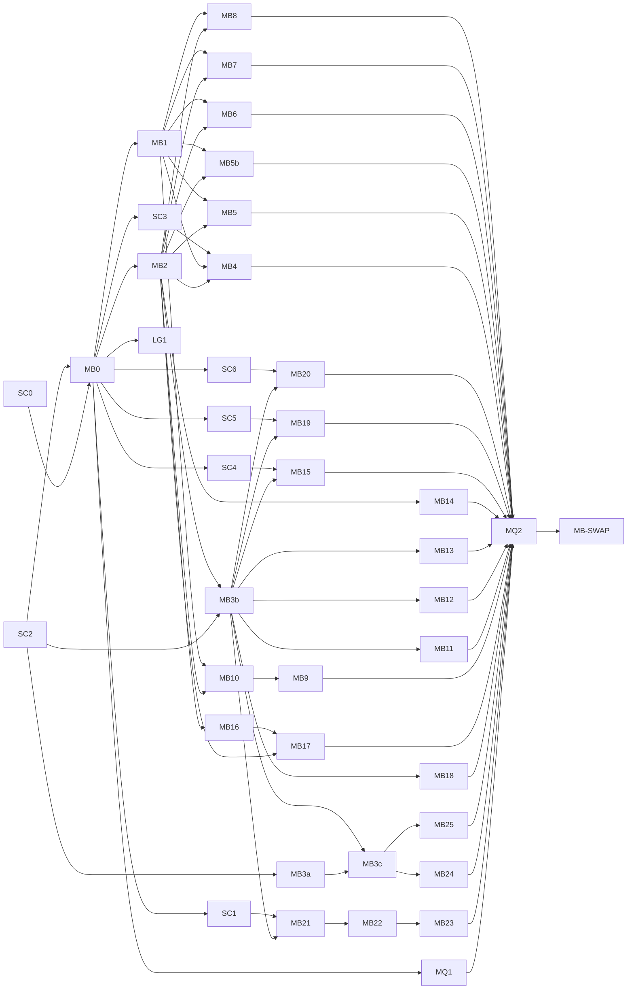

# Mobile app (native Android, Rust core; iOS later)

Reference notes for agents working on `mobile/`. Read [CLAUDE.md](../../CLAUDE.md) first: its
process and seven rules apply here. Other areas: [docs/agents/](./). The server contract is the web
app's ([webapp.md](webapp.md), [server.md](server.md)); the audio rules are the player's
([playback.md](playback.md)); remote control and the listen party are [party-remote.md](party-remote.md);
the app it REPLACES is [android.md](android.md) (read it: every hard-won rule there either survives
here or is made unnecessary, and this note says which); the Rust crates it shares come from the
desktop app ([desktop.md](desktop.md)).

**Status (2026-11-17): planned, nothing delivered.** This note is the plan the coding lots follow,
in order. Each lot, when it lands, replaces its plan paragraph by what was learned (rule, why,
number) — a delivered lot is not a changelog. The old `android/` app keeps building and shipping
until lot MB-SWAP.

## The need

A person on an Android phone, on a bad mobile link by default, wants Neezer as a real app: it opens
at once on the last screen, every tap answers in the same frame, the tapped track plays now and the
next one is already there, it keeps playing behind a locked screen for hours with no gap and no
silence, the media notification, the lock screen, a headset, the car's Bluetooth and the car overlay
drive it, downloads keep going in the background without ever slowing the music, and it costs little
battery, RAM and data. It has **the same features as today's app** — the SPA (`webapp/`) as the
WebView shows it, plus everything the native side of `android/` adds (player behind a locked screen,
downloads in the app's storage, car mode, updater, Deezer login, certificate pinning) — **1:1, not a
subset**, a **new logo**, and as much code as possible in **Rust**, shared with the desktop app and
reusable for an iOS app later.

What the WebView app could not fix, and why native is the cause and not a taste: the queue, the
audio decisions and the UI lived in a renderer Android throttles and freezes behind a locked screen
(android.md, bridges 7 to 12: a next-list LEASE of 200 titles, refill hooks, a 4 Hz tick suppressed,
acks with timeouts, re-adoption of advances). In this app the queue and the engine live in the app
process next to the media service; there is no page to freeze, so that whole protocol disappears.

## Research (sources) and what it decided

| Topic | Sources | Decision |
|---|---|---|
| Native UI toolkit | [Element X Android](https://github.com/element-hq/element-x-android) (Compose UI over the Matrix Rust SDK through UniFFI), [Spotify engineering: client architecture](https://engineering.atspotify.com/spotify-modernizes-client-side-architecture-to-accelerate-service-on-all-devices/) and [Scaling mobile at Spotify](https://danielsaidi.com/blog/conferences/2013/11/06/scaling-mobile-at-spotify) (thin native UI over a shared core), [Baseline Profiles + Macrobenchmark](https://developer.android.com/topic/performance/baselineprofiles/measure-baselineprofile) | **Jetpack Compose** (Kotlin) for the UI only, Material 3 as a base re-skinned to Sillon; every decision, state and byte of network in Rust. A Rust UI toolkit (Slint, egui, Dioxus) was rejected: no TalkBack-grade accessibility, no system text input/IME polish, no MediaSession/Auto integration — rule 5 would fail on the first sheet. |
| Rust ↔ Kotlin | [UniFFI 0.30 Gradle notes](https://mozilla.github.io/uniffi-rs/0.30/kotlin/gradle.html), [Running Rust on Android with UniFFI](https://engineered.at/articles/running-rust-on-android-with-uniffi), [One Rust core across Android and iOS (2026)](https://ac-opensource.github.io/blog/2026-04-07-one-rust-core-across-android-and-ios.html), [Gobley](https://github.com/ovitrif/gobley) and [Ubique's UniFFI KMP plugin](https://klibs.io/project/UbiqueInnovation/uniffi-kotlin-multiplatform-bindings), `cargo search` (uniffi 0.32.2, cargo-ndk 4.1.2, ndk 0.9.0 on 2026-11-17) | **UniFFI 0.32 proc-macros, library mode, one `cdylib` (`libnz_ffi.so`)**, built by **cargo-ndk 4.1** from a plain Gradle `Exec` task (no third-party Gradle plugin: their maturity could not be confirmed, and an `Exec` is debuggable by a weaker coder). Hand-written JNI only on the one hot path that needs it (the API-26 AudioTrack fallback, lot MB3a). Same tool generates Swift for iOS. |
| Audio engine | Desktop D5/D6 (`nz-audio`: two voices, gapless, crossfade, trim, EQ, bass, mono/balance, speed, tap, party clock — measured), [Media3 battery consumption](https://developer.android.com/media/media3/exoplayer/battery-consumption) (offload helps long screen-off playback, but forbids effects, speed and silence skipping), [Qualcomm: audio offload in ExoPlayer](https://www.qualcomm.com/developer/blog/2023/08/audio-offload-support-exoplayer) (≈13 % less current, AAC only, Opus offload from API 30 on some SoCs), android.md *bridge 12* (the 250 ms AudioTrack floor was the "cuts every few seconds") | **The Rust engine (`nz-audio`), not ExoPlayer.** Crossfade, trim, EQ, bass, mono/balance, speed, analysis tap and the party output clock already exist and are measured there; ExoPlayer has no crossfade (the old app needed two players and a page to arbitrate them) and offload would forbid every effect the person uses. The cost is offload's ~13 %; lot MQ2 measures screen-off CPU time against a stock ExoPlayer baseline on the same files and reopens this decision if the engine costs more than **1.3×** the baseline. |
| Audio output | [Oboe history / AAudio on 8.0](https://chromium.googlesource.com/external/github.com/google/oboe/+show/ab11519cd5fcd307cbe6ab3aa2a46a619ca9f5ab/docs/AndroidAudioHistory.md) (AAudio crashes after close on 8.0: Oboe uses OpenSL ES there), [low-latency audio guide](https://developer.android.com/games/sdk/oboe/low-latency-audio), [cpal 0.18 AAudio host](https://docs.rs/crate/cpal/0.18.0/source/src/host/aaudio/mod.rs) and [cpal PR #1015](https://black-queen-531f.myworkers1.workers.dev/RustAudio/cpal/pull/1015) (noisy output, callback sizes from 12 to 4 000 frames, no performance-mode control) | **Own output over AAudio through the `ndk` crate** (`ndk::audio`, `PerformanceMode::PowerSaving`, usage Media / content Music, a 500 ms–1 s buffer — the old app's measured NativeSink lesson) on **API ≥ 27**; on **API 26** an `AudioTrack` (`MODE_STREAM`, float, ≥ 500 ms) written by one Kotlin thread that pulls PCM from Rust into a direct `ByteBuffer`. Not cpal on Android (no power-saving mode, the reported noise), not Oboe (a C++ toolchain for what two hundred lines of `ndk` do). Low latency is NOT the goal: a music player wants big buffers and few wake-ups. |
| Media session, notification, lock screen, Auto | [Media3 session/player](https://developer.android.com/media/media3/session/player) (`SimpleBasePlayer`), [background playback](https://developer.android.google.cn/media/media3/session/background-playback?authuser=5), [MediaLibraryService](https://developer.android.com/media/media3/session/serve-content), [Android for Cars media](https://developer.android.com/media/implement/surfaces/cars), [massdroid: Android Auto notes](https://raw.githubusercontent.com/sfortis/massdroid_native/main/docs/android-auto.md) (sideloaded apps need AA's "Unknown sources") | **Media3 `MediaLibraryService` + a `SimpleBasePlayer` facade** (`NzPlayer`, main looper) whose state is the Rust snapshot and whose commands go to Rust. The notification, the lock screen, headset buttons, Bluetooth AVRCP and Android Auto then come from Media3 for free; the facade holds no logic. |
| Background downloads | [Foreground service timeouts (A15: dataSync 6 h / 24 h)](https://developer.android.com/develop/background-work/services/fg-service-timeout), [User-initiated data transfer (A14+)](https://android-developers.googleblog.com/2024/09/google-maps-improved-download-reliability-user-initiated-data-transfer-api.html) (Maps: 10 %+ fewer failed offline downloads) | The Rust offline worker does the transfers; Android only keeps the process alive: **a user-initiated data-transfer job on API ≥ 34**, **WorkManager with a `dataSync` foreground worker below**; both stop when the queue is empty, and the queue resumes from SQLite after any kill (rule 2). |
| Transcription | Desktop T1–T4 (whisper.cpp on Vulkan, measured on a Radeon), [llama.cpp #9464](https://github.com/ggml-org/llama.cpp/discussions/9464) (Android Vulkan through ggml: Adreno fails to load, very slow), [on-device STT benchmark](https://voiceping-landingpage-prod.pages.dev/en/blog/research-offline-speech-transcription-benchmark/) | **Server-side only**, as the SPA and today's app do (start/stop, status, transcript panel, search): parity does not include local transcription (a desktop-only feature). A later, unplanned lot may add whisper.cpp on the CPU, charging + unmetered + idle only. |
| Size and cold start | [bitdrift: Rust mobile SDK size](https://blog.bitdrift.io/post/optimizing-rust-mobile-sdk-binary-size), [UniFFI build optimisations](https://thunderbiscuit.github.io/uniffi-examples/build-workflows/optimizations.html), [Baseline Profiles](https://developer.android.com/topic/performance/baselineprofiles/measure-baselineprofile) (official sample: 324.8 → 229.0 ms startup) | Release profile `opt-level = "s"` with `opt-level = 3` overrides for the audio/DSP/analysis crates, `lto = "thin"`, `codegen-units = 1`, `strip = true`, **`panic = "unwind"`** (UniFFI turns a panic into a Kotlin exception; `abort` would kill the process); R8 full mode; a Baseline Profile covering start + first scroll + first play. |
| Reference apps | [Symfonium](https://symfonium.app/) (manual + automatic cache, rolling play cache, favourites auto-cached), [Tempo / Tempus](https://github.com/CappielloAntonio/tempo) (Media3 ExoPlayer + session), Feishin (Electron desktop — no mobile lesson), Spotify (shared native core + thin platform UI) | Same split as the strong apps: one core, thin platform UI; downloads, a rolling play cache and an always-on offline browse. |
| Emulation | [Chromium: Android emulator](https://chromium.googlesource.com/chromium/src/+/main/docs/android_emulator.md), [Emulator headless build](https://androidstudio.googleblog.com/2019/02/emulator-2818-canary.html), [emulator on GitHub Actions](https://proandroiddev.com/how-to-run-an-android-emulator-on-github-actions-0fafb96e568a) | The qemu-based emulator, `-no-window -gpu swiftshader_indirect -no-audio`-class flags (see *Tests and emulation*), as the user, KVM through `/dev/kvm` — never libvirt, never sudo. |

**Measured on this machine before writing the plan** (throwaway prototype in `~/.cache/neezer-proto`,
never committed; Rust 1.99.1):

- `/dev/kvm` is `crw-rw-rw-`: `qemu-system-x86_64 -accel kvm -display none` runs as the user (ran
  until `timeout` killed it, no `failed to initialize kvm`). No Android SDK was installed; it now
  lives in `~/.local/share/android-sdk` (5.2 GB: cmdline-tools, platform-tools, NDK 30.0.16248370,
  emulator, platforms/build-tools 35, `system-images;android-35;default;x86_64`) — on disk, never
  `/tmp` (a 24 GB tmpfs in RAM). `cargo-ndk 4.1.2` is installed in `~/.cargo/bin`, and the
  `aarch64-linux-android` / `x86_64-linux-android` Rust targets are added.
- **A separate Cargo workspace can depend on the desktop crates by path**: `nz-model`, `nz-player`,
  `nz-api` and `nz-cache` built unchanged from `~/.cache/neezer-proto/core` (their
  `version.workspace = true` / `serde = { workspace = true }` resolve against `desktop/Cargo.toml`).
  So `mobile/rust` gets its own `Cargo.lock` and never edits the desktop's.
- **UniFFI 0.32.2 library mode generates the Kotlin from the host build**: an `Object` with a
  constructor, a `Record`, an `Option`, a callback interface → 1 548 lines of Kotlin (JNA-based).
- **Several `#[uniffi::export] impl Screens` blocks in different files of one crate merge into ONE
  Kotlin class** (`home.rs` with an `async fn home()` on the tokio runtime → `suspend fun home()`,
  `search.rs` with `fn search_hint()` → `fun searchHint()`). That is what lets the feature lots
  each own one file on both sides of the boundary.
- **`strip = true` deletes UniFFI's metadata**: bindgen on the stripped release `.so` said `No
  UniFFI metadata found`. Bindings are generated from the unstripped host DEBUG build; the Android
  release libraries may be stripped.
- **cargo-ndk 4.1.2 + NDK 30 cross-compile the shared stack for `arm64-v8a`, API 26**: `nz-api`
  (reqwest + rustls, whose crypto provider here is **aws-lc-rs** — C, built by the NDK's clang),
  `nz-cache` (bundled SQLite), `rustls-platform-verifier` + its `-android` crate, `nz-player`,
  `nz-model`, and all of `nz-audio`'s native dependencies (`opusic-sys` = libopus, `signalsmith-stretch`
  C++, `rubato`, `cpal` + `ndk`). A cold arm64 release build took **685 s** with
  `CARGO_BUILD_JOBS=4` (aws-lc and libopus dominate); an incremental one 11 s.
- **`nz-audio` itself does NOT compile for Android today**: `output.rs` names
  `cpal::HostId::PipeWire` and `cpal::HostId::Alsa`, which do not exist on that target (4 × E0599).
  That is SC2's first job (the `cpal` feature, Linux hosts behind `cfg`).
- The prototype's `.so` was 620 KB on arm64, but it called none of the crates (LTO dropped them):
  that number says NOTHING about the real size. MB0 measures the first real one.
- **The emulator boots headless**: AVD API 35 x86_64 (`pixel_6` profile), `-no-window -no-audio
  -gpu swiftshader_indirect -no-boot-anim -no-snapshot -memory 3072 -cores 4`: `sys.boot_completed`
  after **23 s** cold, the emulator process at **3.8 GB RSS** (hence two emulators at most). With
  `-no-audio` the guest still has an AudioFlinger MIXER output on `AUDIO_DEVICE_OUT_SPEAKER` at
  48 kHz, so AAudio has a device to open; whether it consumes at real time is MQ1's measure.

**Pitfalls known before the first line** (each is repeated in the lots it concerns):

- Strip vs bindgen (above). Never run `uniffi-bindgen` on a release/stripped library.
- `rustls-platform-verifier` (reqwest 0.13's `rustls` feature) must be initialised from Kotlin on
  Android (`rustls_platform_verifier::android::init_hosted(env, context)` once, plus its Maven
  component `rustls:rustls-platform-verifier`), or every TLS handshake fails. Lot MB2.
- UniFFI records are Kotlin `data class`es with `List` fields: Compose treats them as UNSTABLE and
  recomposes every row on every change. Declare `uniffi.nz_ffi.*` stable in the Compose compiler's
  `stabilityConfigurationFile` (lot MB0), and give every `LazyColumn` item a `key`.
- A UniFFI callback runs on the Rust thread that fired it: Kotlin must hand it to a `Flow`/channel
  and return at once; never call back into Rust synchronously from inside it (deadlock on the
  core's lock). Rust never holds a lock while calling Kotlin.
- A Kotlin coroutine cancelled while awaiting a UniFFI `async fn` cancels the Rust future (drop);
  Rust code after an `.await` must therefore be cancellation-safe (no half-written cache row).
- `versionCode` must stay ABOVE every code the old app shipped (`android.yaml` used
  `github.run_number`): the new workflow uses `2_000_000 + run_number`, or Android refuses the update.
- The new app keeps **`applicationId = "org.nsupysonic.app"` and the same signing key**, so it
  installs as an UPDATE of the old one through the existing `/api/android/apk` channel and keeps its
  data directory (where the migration reads from). A new id would be a second app and lose
  everything (rule 7).
- AAudio on API 26 can crash after close (Oboe #40): the AudioTrack fallback there.
- An Android emulator plays its sound on the host by default: always `-no-audio`, or route it to
  a null sink; and never open its window on the user's display.

## Architecture

### Repository layout

```
mobile/
  rust/                         # Cargo workspace (own Cargo.lock), edition 2024
    Cargo.toml                  # [workspace.dependencies] pins EVERY crate any lot needs (MB0)
    crates/
      nz-core/                  # the app core: sessions, screens' data, player wiring, offline,
                                #   party, remote, settings — platform-free, no FFI types
      nz-ffi/                   # UniFFI surface only (cdylib libnz_ffi.so): records, objects,
                                #   listeners; one file per lot; converts nz-core <-> FFI types
      nz-droid-audio/           # Android output: AAudio (API ≥ 27) + the AudioTrack pull hook
      nz-viz-gl/                # GLES 3 renderer of the worlds on an ANativeWindow (glow + EGL)
    bindgen/                    # bin `uniffi-bindgen` (uniffi "cli" feature), host only
    build-android.sh            # cargo ndk (3 ABIs) + bindgen from the host debug build
  android/                      # Gradle project (Kotlin 2, AGP 8, version catalog)
    settings.gradle.kts  build.gradle.kts  gradle/libs.versions.toml  compose-stability.conf
    app/                        # :app — Application, MainActivity, NavHost, AppGraph (manual DI)
    bridge/                     # :bridge — generated UniFFI Kotlin + Flow adapters, NzCore holder
    designsystem/               # :designsystem — Sillon tokens, fonts, Icon, glass, components
    playback/                   # :playback — MediaLibraryService, NzPlayer, focus, locks, AudioTrack
    feature/<area>/             # one Gradle module per feature lot (disjoint files)
    car/                        # :car — the car overlay (ported from android/), tile, triggers
    baselineprofile/            # :baselineprofile — Macrobenchmark + profile generator
  brand/                        # logo SVG sources + export script (lot LG1)
  tools/                        # emu.sh (headless emulator), measure scripts (lot MQ1)
desktop/crates/                 # SHARED crates (desktop workspace members, tested by desktop CI)
  nz-model nz-api nz-cache nz-player nz-audio nz-viz      # existing, reused
  nz-analysis nz-offline nz-remote nz-party               # NEW, extracted from desktop/app/src/wiring
```

`mobile/rust` depends on the shared crates by path (`../../desktop/crates/nz-*`), and on the
repository's own crates the desktop already uses (`webapp/rhythm`, `webapp/appcore`,
`android/nscore` through `nz-audio`). A change a shared crate needs is made IN that crate and keeps
the desktop CI green; it is never forked into `mobile/`.

### Reuse, crate by crate

| Crate | Verdict | What the mobile needs, and the lot |
|---|---|---|
| `nz-model` | **As is.** Pure serde types, tolerant. | Nothing. FFI records are NOT derived on it (it has `serde_json::Value` fields UniFFI cannot carry, and the FFI wants screen-shaped, slimmer rows): `nz-ffi` converts. |
| `nz-api` | **As is + 1 lot (SC3).** Lanes, `503`/`Retry-After`, 409 split, offline, cache seam, `SessionJar::at(path)` already injectable. | SC3 adds: a TOFU pin (`ApiBuilder::pinned_leaf_sha256`, accept platform-valid OR that exact leaf, `ApiError::Certificate{sha256, changed}`), `probe_certificate(url)` (handshake refused, nothing sent — `Ssl.kt`'s rule), a byte/request counter per screen tag, and documents the Android verifier init. `directories` stays (only used by `default_path`, which mobile never calls). |
| `nz-cache` | **As is.** `Cache::open_with_cache_dir(data, cache)` takes both dirs. | Nothing. Data dir = `filesDir/neezer` (offline audio, SQLite), cache dir = `cacheDir/neezer` (covers, play cache — the system may clear it, which is what those are for). `covers::variant` (image crate) unused on mobile: Android decodes (see *Covers*). |
| `nz-player` | **As is.** Pure queue/transport state machine, listen accounting, shuffle. | Nothing. |
| `nz-audio` | **Reused + 1 lot (SC2).** The engine already has `Engine::new_offline` → `OfflineSink::render(&mut [f32])`, a pull-driven sink. | SC2 turns it into a supported EXTERNAL sink: `Engine::new_external(cfg, opener) -> (Engine, ExternalSink)` with `render`, `Engine::set_external_output(OutputInfo)` (rate, channels, `latency_frames` the clock subtracts — the party and the analysis need it), `Engine::note_underruns(total)`; makes the crate compile for Android (today it does not: `HostId::PipeWire`/`Alsa`); puts `cpal` behind a default feature `cpal` so the Android build compiles none of it; `EngineConfig.spool_dir` is always passed (no `$XDG` default on Android). Desktop unchanged with default features. |
| `nz-viz` | **As is.** Bars + scope geometry from `rhythm`. | Drawn by Compose `Canvas` (MB21). |
| `nz-mpris` | **Not used** (Linux D-Bus). | Media3 is its Android counterpart. |
| `nz-transcribe` | **Not used** (local whisper is desktop-only). | — |
| `desktop/app/src/wiring/analysis.rs` (2 268 lines, 0 GPUI) | **Extract → `nz-analysis` (SC1).** | Tap → `rhythm` analyser → frames, only while a view is visible. |
| `wiring/offline.rs` (3 059, GPUI only in tests) | **Extract → `nz-offline` (SC4).** | The downloads worker (Bulk lane, `.part` + rename, resume, causes). |
| `wiring/remote_host.rs` + `remote_controller.rs` (3 458, ~19 GPUI uses) | **Extract → `nz-remote` (SC5).** | Be controlled / control another player; GPUI glue stays in the desktop app. |
| `wiring/party_guest.rs` (2 757, 0 GPUI) + `party_host.rs` (1 580, 17 GPUI uses) | **Extract → `nz-party` (SC6).** | Host and guest; the guest's `Planner` uses `appcore::sync` and `nz-audio`'s `PartyChannel`. |
| `wiring/engine.rs`, `net.rs`, `events.rs` | **Read, re-written in `nz-core`** (small, app-shaped). | MB2/MB3b. |
| `webapp/rhythm`, `webapp/appcore`, `android/nscore` | **As is**, through the crates above. | `rhythm`'s `viz_scene.rs` also drives the worlds' uniforms (MB22). |
| Mobile-only | `nz-core` (screens' data, list handles, settings store, migration), `nz-ffi`, `nz-droid-audio`, `nz-viz-gl`. | MB0 creates them. |

### The FFI boundary

One object graph, built once by `:bridge` at `Application.onCreate` (cheap: opens SQLite, starts the
runtime; no network):

```rust
// nz-ffi/src/core.rs (MB0 stub, MB2 fills)
#[derive(uniffi::Record)]
pub struct CoreConfig { pub data_dir: String, pub cache_dir: String, pub app_version: String,
                        pub version_code: u64, pub sdk_int: u32, pub device_name: String }

#[derive(uniffi::Object)] pub struct NzCore { /* Arc<nz_core::Core> */ }

#[uniffi::export(async_runtime = "tokio")]
impl NzCore {
    #[uniffi::constructor] pub fn new(cfg: CoreConfig) -> Result<Arc<Self>, NzError>;
    pub fn server(&self) -> Option<ServerInfo>;                       // configured origin, pin
    pub async fn set_server(&self, url: String) -> Result<ServerInfo, NzError>; // GET /api/version
    pub async fn probe_certificate(&self, url: String) -> Result<CertInfo, NzError>; // SC3/MB4
    pub fn pin_certificate(&self, origin: String, sha256: String);
    pub async fn login(&self, username: String, password: String) -> Result<Me, NzError>;
    pub async fn restore(&self) -> Result<Option<Me>, NzError>;       // jar -> GET /api/me
    pub async fn logout(&self) -> Result<(), NzError>;
    pub fn set_network(&self, net: NetworkState);                     // ConnectivityManager
    pub fn set_foreground(&self, visible: bool);                      // ProcessLifecycleOwner
    pub fn subscribe_session(&self, l: Box<dyn SessionListener>);     // SessionEnded, Me changed
    pub fn stats(&self) -> NetStats;                                  // per screen tag: requests, bytes
    pub fn screens(&self) -> Arc<Screens>;     // read-only screen data (feature lots add methods
                                               //   in THEIR OWN impl block, in their own file)
    pub fn player(&self) -> Arc<PlayerApi>;    // MB3b
    pub fn offline(&self) -> Arc<OfflineApi>;  // MB15
    pub fn remote(&self) -> Arc<RemoteApi>;    // MB19
    pub fn party(&self) -> Arc<PartyApi>;      // MB20
    pub fn viz(&self) -> Arc<VizApi>;          // MB21/MB22
    pub fn settings(&self) -> Arc<SettingsApi>;// MB16/MB17
    pub fn shutdown(&self);                    // joins every thread that borrows the runtime
}

#[derive(uniffi::Enum)]
pub enum NetworkState { None, Wifi { metered: bool }, Cellular { metered: bool }, Other { metered: bool } }

#[derive(uniffi::Error, Debug)]          // every variant has a French sentence: nz_error_text(e)
pub enum NzError {
    Offline, Timeout, Session, RemoteEnded { restored: bool },
    NotReady { retry_after_s: u32 }, Conflict { message: String },
    Provider { status: u16, code: Option<String>, message: String },
    Server { status: u16, message: String },
    Certificate { sha256: String, changed: bool },
    Unsupported { feature: String },   // the server is older than the feature (rule 7)
    Invalid { message: String }, Internal { message: String },
}
#[uniffi::export] pub fn nz_error_text(e: &NzError) -> String; // ApiError::cause_fr, never a code
```

Rules of the boundary (every lot):

- **One impl block per lot, in its own file.** UniFFI allows several `#[uniffi::export] impl Screens`
  blocks in different files of the same crate: MB0 creates `nz-ffi/src/<lot>.rs` for every lot and
  declares it in `lib.rs`; a lot writes only its file. Same for `nz-core/src/<area>/`.
- **Screen-shaped records, not server JSON.** A row crossing the boundary carries what the screen
  draws (title, subtitle, duration, cover key, flags) and nothing else; a 4 000-row list never
  crosses whole: it is a **`ListHandle`** (below).
- **Reads are `async fn`, cancellable.** A screen asks `cached_x()` (disk only, `Option`) then
  `x()` (network on the `User` lane, refreshes the cache); the ViewModel shows the first, replaces
  it with the second, and on failure with a cached copy keeps it and says "Hors ligne · version
  mémorisée" — without one, `LoadFailed` with the cause and "Réessayer" (rule 3).
- **Writes are optimistic.** A mutation updates Rust's in-memory state at once, emits the change,
  sends the request; a failure rolls back and returns an `NzError` the UI turns into a toast with
  "Réessayer". Mutations are never retried automatically (desktop's rule).
- **Hot reads are synchronous and cheap**: `player.position()` is an atomic read, called by the UI
  each frame only while a progress bar is on screen. Rust pushes events only on CHANGE, never on a
  timer (a 4 Hz tick into a sleeping UI is the old app's 115 000-state backlog).
- **Listeners per area** (`PlayerListener`, `OfflineListener`, `SessionListener`, …), each declared
  in its lot's file — never one shared event enum every lot would edit.

```rust
// nz-ffi/src/lists.rs (MB0 stub, MB2 fills) — every long list, windowed (rule 4)
#[derive(uniffi::Object)] pub struct ListHandle { /* Arc<nz_core::lists::List> */ }
#[uniffi::export]
impl ListHandle {
    pub fn len(&self) -> u32;
    pub fn window(&self, start: u32, count: u32) -> Vec<TrackRow>;   // count ≤ 128
    pub fn index_of(&self, key: String) -> Option<u32>;
    pub fn filter(&self, query: String) -> u32;     // appcore::fold; returns the new len
    pub fn sort(&self, by: SortKey, descending: bool) -> u32;
    pub fn version(&self) -> u64;                    // bumps on every change; the UI re-windows
}
#[derive(uniffi::Record)]
pub struct TrackRow { pub key: String, pub id: String, pub title: String, pub artists: String,
    pub album: String, pub album_id: Option<String>, pub duration_s: u32, pub cover: Option<String>,
    pub explicit: bool, pub liked: bool, pub disliked: bool, pub unavailable: bool,
    pub downloaded: bool, pub source: String, pub position: u32 }
```

### Threads (Android)

| Thread | Owns | Priority |
|---|---|---|
| Kotlin main | Compose, input, `NzPlayer` facade, MediaSession | normal; never blocks: every FFI read that can touch disk or network is `suspend` |
| `nz-net` (tokio, 2 workers) | every HTTP request, cache writes, listeners' dispatch | normal |
| engine `nz-load-*`, `nz-decode-*`, `nz-audio-spool` | `nz-audio`'s own threads (joined by `Engine`) | `setpriority(-16)` (Android's `THREAD_PRIORITY_AUDIO`, what ExoPlayer's playback thread uses) on decode/spool |
| AAudio data callback (or the API-26 `nz-audiotrack` Kotlin thread) | `ExternalSink::render` | real time: no allocation, no lock, no syscall, no JNI except the API-26 pull |
| `nz-analysis` | tap → `rhythm` → frames | `setpriority(+5)`; runs only while a visualiser or the EQ meter is visible |
| `nz-viz-gl` | the worlds' GLES context on the SurfaceView's window | normal, frame-capped (eco: 30 fps) |
| `nz-bulk` | downloads, cover warming, offline sync, migration | `setpriority(+10)`; Bulk lane |

Every thread that borrows the tokio runtime is owned by something that JOINS it before
`NzCore::shutdown` drops the runtime (desktop D13's pitfall: a thread blocked in `Handle::block_on`
on a dropped runtime panics or hangs). `shutdown` is called from `Application`'s process death path
only in tests; Android kills the process otherwise, so no correctness may depend on a clean
shutdown — state is in SQLite (WAL) after every change.

### Rule 1 on the phone

- **Network**: `nz-api`'s three lanes, unchanged — `User` (≤ 6 in flight, never waits), `Prefetch`
  (≤ 1, starts once the current track is playable and no `User` request for 250 ms,
  `X-NS-Background: 1`), `Bulk` (≤ 1, waits 1 s without `User`, token bucket at 25 % of the playing
  stream's throughput while it streams, `X-NS-Background: 1`). `503 + Retry-After` waits exactly.
  Every new consumer (covers, lyrics, migration, Auto's browse tree) picks a lane; none bypasses.
- **What is "the action just taken"**: the tapped track (stream on `User`), the screen being
  opened (its read on `User`), the visible covers (visible-first, `coverqueue.js`'s rule; a cover
  scrolled away is cancelled — the UniFFI future is dropped). **Right after**: the next track
  (`preload_next` on `Prefetch` once the current is playable), the playing track's gain/edges/
  lyrics/art in `ladder.js`'s order, the next screen's data on `Prefetch`. **Everything else** on
  `Bulk`: downloads, offline sync, migration, Auto's tree warm-up.
- **CPU**: decode/output first, then the UI thread, then analysis (+5), then bulk (+10).
- **Android process**: the media service is the only foreground service while playing; downloads
  get a UIDT job / WorkManager worker only while the queue is non-empty AND nothing waits on the
  link (the worker itself yields through the Bulk lane).
- **Battery**: behind a locked screen the engine spools the current and the next track WHOLE in
  bursts (`read_ahead_bytes` raised from 2 MB to 32 MB while the screen is off and the track is not
  yet on disk), so the cellular radio sleeps between bursts instead of trickling; the Wi-Fi lock is
  held only while a network source is being read.

### Network errors (rule 3)

`nz-api` already ports `lib/api.js#req` (offline, 3 tries with backoff for GETs started online,
mutations never retried, `X-NS-Error` final, `401` session vs `remote ended`, the two `409`s,
timeouts 4/12/15 s). The phone adds:

- `ConnectivityManager.registerDefaultNetworkCallback` → `set_network`: `None` flips `nz-api`
  offline AT ONCE (no request waits a timeout to learn it); metered changes the Auto quality ladder's
  ceiling and the downloads' policy (Réglages → Téléchargements, the SPA's options).
- A screen never spins forever: `LoadFailed` (cause + "Réessayer") after the first failure, or the
  cached copy with the offline note.
- Counted, not timed: `NzCore::stats()` returns requests and bytes per screen tag; every screen lot
  writes its numbers (cold and warm) in the PR and holds them in a test.

### Caches (what was fetched once is kept)

`nz-cache` as the desktop uses it (one SQLite in WAL, `PRAGMA user_version`, idempotent migrations
at start — rule 7 for the device's own data): API cache (the SPA's cacheable paths, keyed by user),
covers (files, LRU 300 MB, `cacheDir`), play cache (complete files only, LRU default 2 GB,
`cacheDir`), downloads (`filesDir`, never evicted, published by rename once complete), queue,
pending podcast progress, kv (settings). Paths never come from the server: a file name is a hash.

**Covers**: Rust fetches and caches the encoded file (lane, visible-first, the CDN allow-list of
`CarCovers` — the configured origin or `*.dzcdn.net` over HTTPS, no private IP literal) and returns
its PATH; Android decodes it (Coil 3 with a custom `Fetcher` + `Keyer` that call
`screens.cover_path(url, px)`, Coil's own network and disk caches OFF, hardware bitmaps,
downsampled to the view's size). Decoding in Rust and copying RGBA across JNI would cost more than
the platform decoder.

### Auth, security, data

- `POST /api/login`, cookie jar `SessionJar::at(filesDir/neezer/session.json)` (app-private).
  The client sends no `Origin`/`Sec-Fetch-Site` (desktop's rule). Never log a cookie, password, ARL.
- **TOFU pinning, as `Ssl.kt`** (android.md *Trust boundaries*): "Vérifier le certificat" unticked
  learns the leaf with a handshake that sends nothing, shows its SHA-256, pins it per origin; then a
  chain the system accepts OR that exact leaf passes, another one is `Certificate{changed: true}`
  ("le certificat a changé"). Another host is never relaxed. Cleartext only to the configured
  origin (Rust refuses any other http URL, redirects followed by hand — `Net.kt`'s rule).
- `data_extraction_rules.xml` excludes everything from backup and device transfer.
- The ARL never touches the device's storage: the Deezer login WebView hands it to the server.

### Navigation, screens and the UI

- Single `MainActivity`, Navigation Compose with type-safe routes, a phone shell (bottom bar
  Accueil / Rechercher / Bibliothèque / Podcasts, the mini-player above it, the full-screen player as
  a sheet) and a tablet/landscape shell (rail + reading columns, as `DesktopNowPlaying`). Back goes
  to the SCREEN, not the route (webapp.md's rule).
- MB0 writes `app/.../NavGraph.kt` ONCE with every route of the inventory, each calling an entry
  composable that already exists as a stub in its feature module (`feature/<area>/.../<Area>Entry.kt`).
  Feature lots fill their module and never edit `NavGraph.kt`.
- Long lists: `LazyColumn` over a `ListHandle` (`items(count = len, key = …)`, pages of 64 rows
  fetched as they near the viewport), never a `List` of 4 000 records.
- French copy, glyphs through the design system's `Icon` (no emoji), Sillon tokens only (no literal
  colour), motion from the design system's tokens with the eco/reduced guard ([transitions.md](transitions.md)).

### iOS later (not planned in detail)

`nz-core`/`nz-ffi` compile for `aarch64-apple-ios`; UniFFI generates Swift; the UI is SwiftUI.
What changes: output through CoreAudio (cpal's CoreAudio host works there, so `nz-audio`'s default
`cpal` path is fine), `MPNowPlayingInfoCenter` + `MPRemoteCommandCenter` instead of Media3, background
downloads through `URLSession` background transfers (Rust cannot run while suspended — hence the
`Downloader` seam SC4 leaves in `nz-offline`), CarPlay instead of the overlay (an overlay over another
app is impossible on iOS), the worlds' GLSL translated to Metal (naga) or rendered through wgpu, no
self-update (TestFlight/App Store) and no ARL login WebView restrictions beyond WKWebView's. The seams
to keep now: output (SC2's external sink), downloader (SC4), certificate store (SC3), and no Android
type in `nz-core`.

## Feature inventory (what "1:1" means)

Two sources, both required: the SPA as today's app shows it (the desktop inventory in
[desktop.md](desktop.md) *Feature inventory* lists its screens, SPA files and endpoints — this
table names the owning LOT and what the phone changes), and the native side of `android/`
([android.md](android.md)). A lot is done only when every row it owns works against the same
endpoints with the same rules as the SPA files named. "Not ported" is a short, explicit list at
the end — anything else missing is a bug.

### From the SPA

| Area | SPA reference | Lot |
|---|---|---|
| Server choice (URL, port, SSL toggle, TOFU pin), login, logout, session restore, invite redemption (`/invite/<code>`), onboarding (artists, account link/import) | `routes/Login`, `Invite`, `Onboarding`, `components/Onboarding*`, android `SetupActivity`, `Ssl.kt` | MB4 (setup, pin, migration), MB2 (login/restore), MB5b (invite + onboarding) |
| Home: hero, resume card, mood cards, releases card, recap card, Flow picker/controls/up next, energy picker | `routes/Home`, `HomeHero`, `ResumeCard`, `MoodCard`, `RecapHomeCard`, `FlowPicker`, `FlowControls`, `FlowUpNext`, `EnergyPicker`, `lib/flow.js` | MB5 |
| Search: tracks/albums/artists/playlists/podcasts, top result, transcripts hits, YouTube fallback in the same list, "broad search becomes a radio" | `routes/Search`, `TopResult`, `TranscriptHits`, `lib/searchrank.js`, `lib/queryradio.js`, `lib/youtube.js` | MB6 |
| Artist, album, discography, credits (track, person), credits sheet | `routes/Artist`, `Album`, `Credits`, `TrackCredits`, `CreditsSheet`, `PersonCredits` | MB7 |
| Library: playlists + folders (sheet, move, order), favourites, artists, albums, uploads (+ upload usage), dislikes, unavailable, history (library leaf), local tracks | `routes/Library`, `LibraryNav`, `FolderSheet`, `MoveToFolderSheet`, `DislikedTracks`, `UnavailableList`, `routes/History`, `lib/playlistfolders.js` | MB8 |
| Playlist: 4 000 rows, edit, reorder, add/remove (`AddTracksSheet`), members (role-driven), share link, read-only public link (`/shared/playlist/<id>`), recommended tracks at the bottom, export to services, import from link (`/import/<url>`) | `routes/Playlist`, `PlaylistTracks`, `PlaylistMembersSheet`, `ShareSheet`, `ExportSheet`, `routes/Import`, `routes/SharedPlaylist`, `lib/linkimport.js`, `lib/services.js` | MB9 |
| Track actions: the ONE context-menu spec (every list), like/dislike, play next/add to queue, swipe right = play next, radio (track/artist/genre), add to playlist (picker), credits, replace (sheet, candidates), delete upload, go to album/artist, share | `ContextMenu`, `lib/trackmenu.js`, `PlaylistPicker`, `ReplaceSheet`, `lib/actions.js`, `lib/replace.js`, `lib/trackverdict.js` | MB10 |
| Player engine: queue (4 000), shuffle, repeat, gapless, crossfade, silence trim, normalisation (ReplayGain), quality (Auto/320/128/64/FLAC), first-track normalisation, seek plan (`/ready`, `?start=`), listen accounting, podcast progress, play cache | `Player.svelte`, `lib/playback.js`, `lib/audio/seekplan.js`, `lib/gaincache.js`, `lib/edges.js`, `lib/playcache.js`, `lib/podcastProgress.js` | MB3b |
| Mini player, full-screen player (phone thumb column, tablet reading columns), queue editor (one component, drag, remove, clear upcoming), sleep timer (incl. end of track), quality menu + badge, podcast speed, more menu, lyrics (synced, the phone's lyrics VIEW), lyric card (share image), full credits | `PlayerBar`, `MobileNowPlaying`, `DesktopNowPlaying`, `NowPlaying`, `ImmersivePlayer`, `QueueList`, `SleepButton`, `lib/sleep.js`, `QualityMenu`, `SpeedButton`, `NowPlayingMore`, `Lyrics`, `LyricCard`, `lib/lyriccard.js` | MB11 |
| Audio effects: EQ (picker, meter, ten vertical faders, presets), bass lift, mono/balance, output naming + direct/processed verdict, volume warning (peak-hold, baseline) | `AudioEffects`, `TrimControl`, `lib/eqpresets.js`, `lib/audio/output.js`, `pan.js`, `saturation.js`, android `AudioRoute.kt` | MB12 |
| Podcasts: subscriptions, search/subscribe by URL, show (by UUID or Deezer id), episodes (cursor), progress, auto-archive, markers, chapters (list, sheet, ticks), transcript panel + search, start/stop server transcription, episode panel | `routes/Podcasts`, `Show`, `PodcastCard`, `PodcastEpisodePanel`, `ChapterList`, `ChapterSheet`, `ChapterTicks`, `TranscriptPanel`, `lib/markers.js`, `lib/chapters.js`, `lib/transcript*.js` | MB13 |
| Discovery: Nouveautés (two shelves, per-release list, settings, seen), release shelves (`/releases/artists`, `/releases/discovery`), Récap (years, stories, share), moods, Explorer (ten parent styles, style tile → genre station), discovery slider, mute artist, playlist recommendations, `/recommend` | `routes/Releases`, `ReleaseShelf`, `ReleaseCard`, `routes/Recap`, `RecapStory`, `RecapSlide`, `RecapShare`, `ExplorerStyles`, `StylePicker`, `GenreTiles`, `DiscoverySlider`, `lib/discovery.js`, `lib/genrestation.js`, `lib/recap*.js` | MB14 |
| Genre studio, genre tree, tag/bulk sheets, extractor, trainer, client-side analysis (`webapp/trainer`, `lib/genre/*`, `lib/analysis/*`) | `routes/Genres`, `GenreLibrary`, `GenreTree`, `GenreTagSheet`, `GenreBulkSheet`, `GenreExtractor` | MB18 |
| Offline: downloads per playlist/album/show, quality, "only downloaded" filter, play cache, offline browsing, network indicator, storage use, remove | `lib/offline.js`, `lib/playcache.js`, `lib/apicache.js`, `NetworkIndicator`, Réglages → Téléchargements | MB15 (+ SC4) |
| Remote control: be controlled, control another player, claim link (`/rc/<token>`), banner, host chip, links management | `lib/remote/*`, `RemoteSheet`, `RemoteButton`, `RemoteHostChip`, `RemoteBanner`, `routes/RemoteClaim` | MB19 (+ SC5) |
| Listen party: host and guest (`/party/<id>`), sheet, button | `lib/party/*`, `PartySheet`, `PartyButton`, `routes/Party` | MB20 (+ SC6) |
| Visualiser: bars, oscilloscope (orientation, colour), settings (palette, intensity, fps cap, eco), full screen, flash warning | `Visualizer`, `VisualizerSettings`, `FlashWarning`, `EcoToggle`, `lib/viz/scenes/{bars,scope}.js`, `routes/Viz` | MB21 (+ SC1) |
| The 50 worlds, skins (226 rows), world picker, pinned world per screen, quality tiers, eco grade, post FX, GL status | `lib/viz/worlds/*`, `skins.js`, `gl/*`, `scenes/gl.js`, `WorldPicker`, `quality.js` | MB22, MB23 |
| Réglages, user sections: Lecture & son, Apparence (Encre / Papier / Pochette, custom accent, cover-derived accent), Animations, Écoute, Bibliothèque, Téléchargements, Découverte, Sources (order, my accounts, Deezer ARL, YouTube connect, access grants, groups), Compte (export services), Aide (diagnostic log, app version) | `routes/Settings` sections `playback appearance viz listen library downloads discovery sources accounts account help`, `*Settings.svelte`, `MyAccounts`, `SourceOrder`, `AccessSettings`, `ServicesSettings`, `YoutubeConnect`, `AccountPicker`, `lib/theme.js`, `lib/coverpalette.js`, `lib/log.js` | MB16 |
| Réglages, admin: Utilisateurs (dashboard, invites), Serveur (archive, rules, cleanup + preview, storage, quotas, migrate, analysis plan/backfill, credits/enrich/similar backfills, automatch, transcription settings + workers, job failures, cache flush, Deezer status) | `AdminUsers`, `InviteSheet`, `JobFailures`, `AutomatchPanel`, `CreditsBackfill`, `EnrichBackfill`, `SimilarRebuild`, `TranscribeSettings` | MB17 |
| Toasts, notices, hard reload/"new version" notice, network indicator, skeletons, load failures, app links (`lib/applink.js`), keyboard shortcuts on a hardware keyboard/Chromebook | `Toasts`, `Notices`, `HardReload`, `Skeleton`, `LoadFailed`, `lib/applink.js` | MB1 (components), MB2 (links), MB16 (shortcuts list) |

### From the native `android/` app

| Behaviour (android.md) | New home | Lot |
|---|---|---|
| Plays behind a locked screen for hours, next/prev/play/pause/seek from notification, headset, lock screen, car card with no page awake (bridges 7–12) | The queue and the engine ARE in the app process: Media3 session over `NzPlayer`. The lease/refill/ack protocol is not ported — it has no reason to exist | MB3b, MB3c |
| Network retry while stopped (2/5/10 s on IO, 5xx retried, 4xx and decode errors skip at most 3 in a row, end of list → session paused) | Same policy in `nz-core::player` (`fault` skip, `FAULT_SKIPS_MAX = 3`), unit-tested on the JVM-free Rust side | MB3b |
| Sink buffer 500 ms–1 s, rebuffer threshold 500 ms, 32 MB read-ahead for seeking a generated stream, underrun/rebuffer counters in the journal | AAudio buffer ≥ 500 ms; `nz-audio`'s spool; `output_stats()` = underruns, rebuffers, buffer ms, rate | MB3a, MB3b |
| Audio focus (one request, transient loss pauses, duck), becoming noisy pauses | `:playback` | MB3c |
| Mono/balance, EQ/bass in the app's player | `nz-audio` DSP (desktop D6) | MB12 |
| Output naming (`AudioRoute`: Bluetooth/USB/wired/HDMI/speaker, name, connection id) and the direct/processed verdict per connection | `AudioManager` device callback → `player.set_route(...)` | MB12 |
| Downloads in the app's storage, published once complete, Range playback, launch-time cleanup | `nz-offline` + `nz-cache` downloads; no `__nsoffline` interception needed | MB15 |
| Download yields to the player's own hold (`YieldGate`, `LinkNeed`) | The Bulk lane + the stream throughput cap in `nz-api` — one mechanism, no lease | SC4, MB15 |
| Updater from ITS server (`/api/android/apk`, 202 + Retry-After, APK checks before the installer: zip, binary manifest, package, versionCode, signing lineage; causes `preparing truncated archive invalid package signature permission`) | Ported to Kotlin as is (`ApkArchive`, `Updater`) + Rust fetch on Bulk | MB4 |
| Deezer login (`DeezerLoginActivity`: Deezer's own page in a throwaway WebView, `arl` cookie read, jar wiped before and after, no bridge, SSO refused) | Ported to Kotlin as is; hands the ARL to the same server route the SPA's `lib/nativeDeezer.js` caller uses | MB4 |
| TOFU certificate pinning (`Ssl.kt`), cleartext only to the configured origin, redirects by hand | `nz-api` (SC3) + setup screen | SC3, MB4 |
| Renderer death rebuild, battery-optimisation offer (once, when Android actually killed us) | No renderer. The battery exemption offer stays: once, when the engine reports the process was killed during playback (a `kv` flag written at play, cleared at clean pause) | MB3c |
| Car mode: overlay over navigation apps (FULL/MINI/ULTRA, per-app placement, drag, opacity, blur), triggers (GPS app in front via usage access, Bluetooth, boot/update, wake ladder, sustain rung, job), speed lock (fused/platform GPS), native search (700 ms, 2 chars), pinned playlists (24) + Favoris tile, covers loader with allow-list, settings activity, quick tile, voice input | Ported from `android/` (Views, already native; pure policy classes and their JVM tests move unchanged); its two seams change: `PlayerService.transport/state` → a Media3 `MediaController`, `__nsCarPlay`/`__nsCarFav` → `NzCore` calls | MB24 |
| App shortcuts (`shortcuts.xml`), share a file, save a text (export), open server settings | `:app` (shortcuts, share intents) | MB2, MB9 |
| Bridge `NSNative.*` for the SPA | Gone: there is no page. `/api/android/apk` and the server's `android_*` settings stay for the updater | — |

### Added by the phone (not in today's app)

- **Android Auto** browse tree (Media3 `MediaLibraryService`: Favoris, playlists, Flow, recent) —
  lot MB25; cheap once the service exists, and a car head unit is the "next action" surface.
- Themed (monochrome) launcher icon and a real notification glyph — lot LG1.

### Not ported, on purpose

The service worker and the code splitting (no page); the `NSNative` bridge and its versions; the
WebView renderer rebuild; the next-list lease protocol; the IndexedDB → app-storage move (replaced
by the one-shot migration, MB4); local transcription (desktop-only).

## Tests and emulation

### Where things run

- **Rust, host**: `cargo test --workspace --locked` in `mobile/rust` (the core's logic, the FFI
  conversions, the AAudio-free engine path through `ExternalSink`), and the desktop CI for every
  shared crate. Most of the behaviour is proven HERE, against `tools/perf_api.py --serve` (the
  synthetic 8 000-track library) or recorded fixtures (`desktop/tools/dump_fixtures.py`).
- **Kotlin, JVM**: `gradle testDebugUnitTest` (pure policy classes: ViewModels with a fake core, the
  car mode's policies, the updater's checks — the old `android/` tests move with their classes).
- **Kotlin, device**: instrumented tests and Macrobenchmark on the emulator (below). Compose UI
  tests use `createAndroidComposeRule` with semantics, never screen coordinates.

### The emulator, headless, as the user

`/dev/kvm` is world-read/writable here (measured `crw-rw-rw-`): acceleration needs no group and no
sudo. Never libvirt (root-only on this machine). `mobile/tools/emu.sh` (lot MQ1) is the ONLY way a
lot starts an emulator, so the rules live in one place:

```sh
export ANDROID_HOME="$HOME/.local/share/android-sdk"          # never /tmp (tmpfs = RAM)
export ANDROID_AVD_HOME="$HOME/.local/share/android-avd"
mobile/tools/emu.sh start --port 5580   # even port 5554-5682; one per worker, chosen by the lot
mobile/tools/emu.sh wait  --port 5580   # waits for sys.boot_completed=1 (event, not a sleep)
mobile/tools/emu.sh stop  --port 5580   # adb -s emulator-5580 emu kill, then its own PID only
```

`start` runs `emulator -avd nz35 -port <p> -no-window -no-audio -gpu swiftshader_indirect
-no-boot-anim -no-snapshot-save -read-only -memory 3072 -cores 4` (AVD `nz35`: API 35 x86_64
`default` image, Pixel-class profile), writes its PID to `~/.cache/neezer-emu/<port>.pid`, and refuses
to start when `MemAvailable` < 8 GB. **No window and no sound on the user's session**: `-no-window`
and `-no-audio` are mandatory; nothing ever runs `adb` against a device the lot did not start
(`adb -s emulator-<port>` on every call — a bare `adb` may pick the user's phone). Kill only your
own PID — never `pkill emulator`/`qemu`. At most **two emulators** run on this machine at once.
For the underrun/battery measures that need a working audio HAL, `-no-audio` is replaced by
`-audio none` only if MQ1 measured that AAudio still clocks with it; otherwise those measures run on
a real phone over `adb` and say so (see *Measures*).

CI: the `mobile.yaml` workflow enables KVM on the runner (udev rule, the documented GitHub Actions
recipe) and runs the smoke + Macrobenchmark job on an API 35 x86_64 emulator against
`tools/perf_api.py --serve` reached at `10.0.2.2`.

### Measures (every lot that touches what they measure writes them in its PR)

| Measure | How | Target (emulator x86_64, KVM, swiftshader; real phone numbers reported beside) |
|---|---|---|
| Cold start | Macrobenchmark `StartupTimingMetric`, `StartupMode.COLD`, 10 iterations, Baseline Profile on vs off | TTID ≤ 500 ms; TTFD (home painted from cache, `reportFullyDrawn`) ≤ 900 ms |
| Tap → sound | `PlayerApi.output_stats()` carries `tap_ns` (Kotlin's tap instant passed in the command) and `first_audible_ns` (first rendered frame above −60 dBFS); difference read from events, not a clock poll | play cache/download ≤ 150 ms; archived track on the LAN ≤ 800 ms; first play generated server-side ≤ 1.5 s |
| RAM | **Counted bytes** of the Rust stores (`NzCore::memory()` — queue, lists, caches in memory, decoded covers held by Coil via its `MemoryCache.size`); PSS of the APP's own process (`dumpsys meminfo org.nsupysonic.app`, never a shared test process) as a secondary figure | queue of 4 000 ≤ 4 MB counted; idle on home PSS ≤ 120 MB; 30 min of playback: counted bytes flat (no growth > 1 %) |
| CPU / battery | `/proc/<pid>/stat` utime+stime over 30 min of playback, screen off (`input keyevent KEYCODE_SLEEP`), Doze forced (`dumpsys deviceidle force-idle`); same files through a stock Media3 ExoPlayer baseline APK | ≤ 1.3× the ExoPlayer baseline; analysis thread at 0 % while no view is visible |
| Network | `NzCore::stats()` per screen tag, cold and warm | ≤ the SPA's own count for the same screen (`webapp/test/requests/run.mjs`); warm open of a visited screen: 0 blocking requests |
| Smoothness | Macrobenchmark `FrameTimingMetric` on: library scroll (8 000), queue scroll (4 000), full-screen player open | p95 frame ≤ 16.7 ms, p99 ≤ 25 ms, 0 frozen frames (> 700 ms) |
| Underruns | `output_stats().underruns` (AAudio `getXRunCount` / AudioTrack `getUnderrunCount`) and `rebuffers` | **0** over 30 min screen off + Doze, on Wi-Fi and on the emulator's throttled `gsm`/`edge` network profile |
| APK | `apkanalyzer apk file-size`, per ABI split and universal | universal ≤ 45 MB, arm64-v8a split ≤ 18 MB; `libnz_ffi.so` arm64 ≤ 9 MB |

## Worker rules (mandatory in every lot; each prompt repeats them)

1. **Git, non-interactive only**: `export GIT_EDITOR=true GIT_SEQUENCE_EDITOR=true EDITOR=true VISUAL=true`;
   `git commit -m`, `git merge --no-edit`, never `rebase -i`. **Never `git stash`** (the stack is shared
   by every worktree): set work aside with a WIP commit.
2. **Before merging**: `git fetch origin && git rebase origin/master`, then
   `git diff --stat origin/master...HEAD` must list ONLY the lot's files (its "Exclusive files" below,
   plus its own section of this note). Anything else means a stale base or a stray edit: fix it before
   merging (a squash from a stale base already erased merged work).
3. **One writer per file.** A lot writes only its exclusive files. The shared files (`Cargo.toml`s,
   `lib.rs`/`mod.rs`, `NavGraph.kt`, `AndroidManifest.xml`, `settings.gradle.kts`, `libs.versions.toml`,
   `build.gradle.kts`, `mobile.yaml`) are created ONCE by MB0/SC0; a lot that truly needs one changed
   stops and asks (`ao report --needs-input`), it does not edit it.
4. **Memory is measured in counted bytes**, never by the RSS of a shared test process.
5. **A thread that borrows the tokio runtime is joined before the runtime stops.**
6. **Tests wait on events, never on the clock** (no `sleep` to "let it settle"; a channel, a latch,
   `boot_completed`, a state change).
7. **Nothing on the user's display or speakers**: emulator `-no-window -no-audio` through
   `mobile/tools/emu.sh`, `adb -s emulator-<port>` always, Xvfb for any desktop window, kill only
   your own PIDs.
8. **Nothing big in `/tmp`** (24 GB tmpfs = RAM, quota): builds, SDK, AVDs, recordings and logs go
   under `~/.cache`, `~/.local/share` or the worktree's `target/`. `CARGO_BUILD_JOBS=4`, one cargo at a
   time, no release build you do not need.
9. **French UI copy, no emoji, Sillon tokens only, rule 1 lanes for every request**, and the numbers
   (requests, bytes, ms, frames) written in the PR and next to the assertions.
10. **Done means**: the lot's acceptance list met and measured, CI fully green (every job of every
    workflow that ran, security scanners' logs read), this note's lot section replaced by what was
    learned, PR merged; then `ao report --done`.

## The lots

### Order, waves and the graph

A **wave** is a set of lots whose exclusive files are disjoint and whose dependencies are merged:
they run in parallel. Inside a wave, start the lots on the critical path first (bold). This machine
holds **at most four Rust-building lots at once** (`CARGO_BUILD_JOBS=4` each) and **two emulators**.

| Wave | Lots (parallel) | Waits for |
|---|---|---|
| 0a | **SC0** shared-crate stubs · **SC2** engine external sink + `cpal` feature (`nz-audio` must build for Android before any mobile crate depends on it) | — |
| 0b | **MB0** skeleton: Cargo + Gradle + UniFFI + cargo-ndk + CI | SC0, SC2 |
| 1 | **MB2** core runtime · **MB1** design system · **SC3** TLS pin + counters · SC1 `nz-analysis` · SC4 `nz-offline` · SC5 `nz-remote` · SC6 `nz-party` · LG1 logo · MQ1 test harness | MB0 |
| 2 | **MB3a** AAudio output · **MB3b** player core · **MB4** setup/migration/updater/Deezer · MB5 home · MB5b invite + onboarding · MB6 search · MB7 artist/album/credits · MB8 library · MB10 track actions | MB1 + MB2 (+ SC2 for MB3a/b, SC3 for MB4) |
| 3 | **MB3c** media service · MB9 playlist · MB11 now playing · MB12 audio effects · MB13 podcasts · MB14 discovery · MB15 offline · MB16 Réglages (user) · MB17 Réglages (admin) · MB19 remote · MB20 party · MB21 bars + scope | wave 2 (+ SC1/SC4/SC5/SC6 where named) |
| 4 | MB18 genre studio · **MB22** worlds renderer · **MB24** car mode · MB25 Android Auto | MB3c (MB24, MB25), MB21 (MB22) |
| 5 | MB23 the 50 worlds (batch) · **MQ2** the whole journey, measured | MB22 (MB23), every MB lot (MQ2) |
| 6 | **MB-SWAP** the new app becomes `neezer.apk` | MQ2 |



**Contract first.** MB0 writes every SHARED declaration the later lots compile against, already in
its final shape: the routes and their entry composables (stubs), the cross-module composables
(`MiniPlayer`, `DownloadButton`, `TrackActions.open`, `RemoteButton`, `PartyButton`,
`ExplorerStylesSection`, `AudioFxSections`, `AdminSections`, `VizSurface`, `WorldSurface`), the FFI
objects (`NzCore`, `Screens`, `PlayerApi`, `OfflineApi`, `RemoteApi`, `PartyApi`, `VizApi`,
`SettingsApi`, `ListHandle`) with the methods named in each lot below returning
`Err(NzError::Unsupported{feature})`, and the shared FFI types (`TrackRow`, `AppLink`, `NzError`,
`PlayerCommand`, `PlayerSnapshot`). A lot then replaces the stub BODIES in its own files. A lot that
finds a contract wrong stops and asks; it never forks a parallel type.

### Module and file ownership

| Lot | Rust (under `mobile/rust/crates/`) | Kotlin (under `mobile/android/`) | Elsewhere |
|---|---|---|---|
| SC0 | — | — | `desktop/crates/{nz-analysis,nz-offline,nz-remote,nz-party}/` (new), `desktop/app/Cargo.toml`, `desktop/Cargo.lock` |
| MB0 | everything (stubs), `Cargo.toml`s, `lib.rs`s, `build-android.sh`, `bindgen/` | everything (stubs), all `build.gradle.kts`, `settings.gradle.kts`, `libs.versions.toml`, `app/**` | `.github/workflows/mobile.yaml`, `.gitignore`, `CLAUDE.md` + `AGENTS.md` (CI count only) |
| MB1 | — | `designsystem/**` | `docs/agents/screenshots/mobile/MB1/` |
| MB2 | `nz-core/src/core/**`, `nz-ffi/src/{core,lists,covers,links,errors}.rs` | `bridge/src/main/java/**` except generated, `bridge/src/test/**` | — |
| SC1 | — | — | `desktop/crates/nz-analysis/**`, `desktop/app/src/wiring/analysis.rs` |
| SC2 | — | — | `desktop/crates/nz-audio/**` |
| SC3 | — | — | `desktop/crates/nz-api/**` |
| SC4 | — | — | `desktop/crates/nz-offline/**`, `desktop/app/src/wiring/offline.rs` |
| SC5 | — | — | `desktop/crates/nz-remote/**`, `desktop/app/src/wiring/remote_{host,controller}.rs` |
| SC6 | — | — | `desktop/crates/nz-party/**`, `desktop/app/src/wiring/party_{host,guest}.rs` |
| LG1 | — | `app/src/main/res/{mipmap-anydpi-v26,drawable}/ic_launcher*.xml`, `app/src/main/res/drawable/ic_stat_neezer.xml` (MB0 leaves placeholders and does not touch them again) | `mobile/brand/**` |
| MQ1 | — | `baselineprofile/**`, `app/src/androidTest/**` | `mobile/tools/**` |
| MB3a | `nz-droid-audio/**` | `playback/src/main/java/fr/neezer/mobile/playback/AudioTrackPull.kt` | — |
| MB3b | `nz-core/src/player/**`, `nz-ffi/src/player.rs` | — | — |
| MB3c | — | `playback/**` except `AudioTrackPull.kt` and `playback/.../auto/**` | — |
| MB4 | `nz-core/src/setup/**`, `nz-ffi/src/setup.rs` | `feature/setup/**` | — |
| MB5 | `nz-core/src/home/**`, `nz-ffi/src/home.rs` | `feature/home/**` | — |
| MB5b | `nz-core/src/onboarding/**`, `nz-ffi/src/onboarding.rs` | `feature/onboarding/**` | — |
| MB6 | `nz-core/src/search/**`, `nz-ffi/src/search.rs` | `feature/search/**` | — |
| MB7 | `nz-core/src/entity/**`, `nz-ffi/src/entity.rs` | `feature/entity/**` | — |
| MB8 | `nz-core/src/library/**`, `nz-ffi/src/library.rs` | `feature/library/**` | — |
| MB9 | `nz-core/src/playlist/**`, `nz-ffi/src/playlist.rs` | `feature/playlist/**` | — |
| MB10 | `nz-core/src/actions/**`, `nz-ffi/src/actions.rs` | `feature/trackactions/**` | — |
| MB11 | `nz-core/src/nowplaying/**` (lyrics, lyric card, sleep UI state), `nz-ffi/src/nowplaying.rs` | `feature/nowplaying/**` | — |
| MB12 | `nz-core/src/audiofx/**`, `nz-ffi/src/audiofx.rs` | `feature/audiofx/**` | — |
| MB13 | `nz-core/src/podcasts/**`, `nz-ffi/src/podcasts.rs` | `feature/podcasts/**` | — |
| MB14 | `nz-core/src/discovery/**`, `nz-ffi/src/discovery.rs` | `feature/discovery/**` | — |
| MB15 | `nz-core/src/offline/**`, `nz-ffi/src/offline.rs` | `feature/offline/**` | — |
| MB16 | `nz-core/src/settings/**`, `nz-ffi/src/settings.rs` | `feature/settings/**` | — |
| MB17 | `nz-core/src/admin/**`, `nz-ffi/src/admin.rs` | `feature/admin/**` | — |
| MB18 | `nz-core/src/genres/**`, `nz-ffi/src/genres.rs` | `feature/genres/**` | — |
| MB19 | `nz-core/src/remote/**`, `nz-ffi/src/remote.rs` | `feature/remote/**` | — |
| MB20 | `nz-core/src/party/**`, `nz-ffi/src/party.rs` | `feature/party/**` | — |
| MB21 | `nz-core/src/viz/**`, `nz-ffi/src/viz.rs` | `feature/viz/**` | — |
| MB22 | `nz-viz-gl/**`, `nz-ffi/src/worlds.rs` | `feature/worlds/**` | `mobile/tools/extract-worlds.mjs`, `mobile/android/feature/worlds/src/main/assets/viz/` |
| MB23 | (per-world fixes inside `nz-viz-gl/src/worlds/<id>.rs` only) | — | `docs/agents/screenshots/mobile/MB23/` |
| MB24 | `nz-ffi/src/car.rs` | `car/**` | — |
| MB25 | `nz-ffi/src/auto.rs` | `playback/src/main/java/fr/neezer/mobile/playback/auto/**` | — |
| MQ2 | — | `baselineprofile/src/main/**/Journey*.kt` | `docs/agents/screenshots/mobile/MQ2/` |
| MB-SWAP | — | `app/build.gradle.kts` (versioning only) | `.github/workflows/{release,android,mobile}.yaml`, `android/app/**` (removed), `android/README.md`, `docs/agents/android.md`, `CLAUDE.md`/`AGENTS.md` table row |

MB0 creates every file; once it is merged, the few `:app` files named on a later row (LG1's icons,
MQ1's `androidTest`, MQ2's `baseline-prof.txt`, MB-SWAP's versioning block) belong to that row's lot
and to nobody else. Every lot also rewrites ITS OWN section of this note (and only that section)
when it lands.

### The prompts

Every lot ends with a complete prompt for its worker. Each one carries the same
rules block (the *Worker rules* in French, for the worker); copy a prompt whole, never trimmed.

### SC0 — Shared-crate stubs (wave 0a)

**Goal.** Create the four empty shared crates the extraction lots fill, so that no later lot edits
a shared manifest. **Depends on**: nothing.
**Exclusive files**: `desktop/crates/{nz-analysis,nz-offline,nz-remote,nz-party}/{Cargo.toml,src/lib.rs}`,
`desktop/app/Cargo.toml` (four path dependencies), `desktop/Cargo.lock`.
**Contract.** Each `Cargo.toml` uses `version.workspace = true`, `edition.workspace = true` and only
`{ workspace = true }` dependencies, listing everything its extraction will need (read the `use`
lines of the wiring files): `nz-analysis` → `rhythm` (path `../../../webapp/rhythm`), `nz-audio` (path, **`default-features = false`**
— SC2 makes `cpal` a default feature, and a shared crate that re-enabled it would drag cpal into the
Android build through feature unification),
`serde`, `tracing`; `nz-offline` → `nz-api`, `nz-cache`, `nz-model`, `tokio`, `serde`, `serde_json`,
`thiserror`, `tracing`; `nz-remote` → `nz-api`, `nz-cache`, `nz-model`, `nz-player`, `tokio`, `serde`,
`serde_json`, `tracing`; `nz-party` → `nz-api`, `nz-model`, `nz-audio` (`default-features = false`), `appcore` (path
`../../../webapp/appcore`), `tokio`, `serde`, `serde_json`, `tracing`. **No GPUI, no cpal, no zbus,
no whisper** in any of them. `lib.rs` = a module doc naming the wiring file it will receive and the
lot (SC1/SC4/SC5/SC6), `#![forbid(unsafe_code)]` where the wiring file has none.
**Acceptance.** Desktop CI fully green; `cargo tree -p <crate> -e normal | grep -E 'gpui|cpal|zbus|whisper'`
empty for the four; `cargo ndk -t arm64-v8a -P 26 check -p <crate>` passes for each (NDK at
`~/.local/share/android-sdk/ndk/30.0.16248370`) — the proof they stay Android-clean.
**Pitfalls.** `appcore`/`rhythm` are path crates outside the workspace; adding a dependency the
lock does not have yet is the ONE moment `desktop/Cargo.lock` changes — the extraction lots must not.

```text
Tu es le worker du lot SC0 du plan mobile Neezer. Lis CLAUDE.md, puis docs/agents/mobile.md
(sections « Reuse, crate by crate », « Worker rules » et « SC0 »), puis docs/agents/desktop.md
(« Workspace », « Threads »).
Objectif : créer les quatre crates partagées VIDES desktop/crates/nz-analysis, nz-offline, nz-remote,
nz-party (Cargo.toml + src/lib.rs avec la doc du module), les ajouter en dépendance de chemin dans
desktop/app/Cargo.toml, mettre à jour desktop/Cargo.lock. Liste les dépendances de chacune en lisant
les `use` de desktop/app/src/wiring/{analysis,offline,remote_host,remote_controller,party_host,party_guest}.rs,
uniquement en `{ workspace = true }` ou en chemin, jamais gpui/cpal/zbus/whisper.
Fichiers à toi seul : ceux de la section SC0 ; aucun autre.
Acceptation : CI desktop entièrement verte ; `cargo tree` sans gpui/cpal/zbus/whisper pour les quatre ;
`cargo ndk -t arm64-v8a -P 26 check -p <crate>` passe pour chacune ; chiffres et commandes dans la PR.
Règles (non négociables, apprises sur l'app desktop) :
- Git non interactif : export GIT_EDITOR=true GIT_SEQUENCE_EDITOR=true EDITOR=true VISUAL=true ;
  git commit -m, git merge --no-edit, jamais rebase -i. Jamais git stash : un commit WIP.
- Avant de fusionner : git fetch origin && git rebase origin/master, puis
  git diff --stat origin/master...HEAD ne doit lister QUE les fichiers de ton lot (et ta section de
  docs/agents/mobile.md) ; sinon corrige avant (un squash depuis une base périmée a déjà effacé du travail).
- Un seul écrivain par fichier. Les fichiers partagés (Cargo.toml, lib.rs/mod.rs, NavGraph.kt, manifeste
  de :app, settings.gradle.kts, libs.versions.toml, build.gradle.kts, mobile.yaml) sont créés une fois
  par le lot socle : s'il faut en changer un, arrête-toi et fais ao report --needs-input.
- Mémoire mesurée en octets comptés, jamais par le RSS d'un processus de test partagé.
- Tout thread qui emprunte un runtime tokio est joint avant l'arrêt de ce runtime.
- Tests sur des événements (canal, latch, boot_completed, changement d'état), jamais sur l'horloge.
- Rien sur l'affichage ni les haut-parleurs de l'utilisateur : émulateur via mobile/tools/emu.sh
  (avant MQ1 : mêmes drapeaux à la main, -no-window -no-audio, ton propre port), toujours
  adb -s emulator-<port>, Xvfb pour une fenêtre desktop, ne tue que TES PID (jamais pkill/killall).
- Rien de gros dans /tmp (tmpfs en RAM) : SDK, AVD, builds, journaux sous ~/.cache, ~/.local/share
  ou target/. CARGO_BUILD_JOBS=4, un cargo à la fois, pas de build release inutile.
- Interface en français, pas d'emoji, jetons Sillon seulement, chaque requête sur sa voie (règle 1) ;
  les chiffres (requêtes, octets, ms, images) dans la PR et à côté des assertions.
- Fini = acceptation mesurée, CI entièrement verte (chaque job de chaque workflow, journaux des
  scanners de sécurité lus), section du lot réécrite avec ce qui a été appris, PR fusionnée.
Fin : branche <ta-branche>/sc0, PR « chore(desktop): SC0 shared crate stubs for the mobile core »,
CI verte, rebase + diff --stat limité à tes fichiers, merge, section SC0 de mobile.md réécrite avec
ce qui a été appris, `ao report --done`.
```

### MB0 — Skeleton: Cargo, Gradle, UniFFI, cargo-ndk, CI (wave 0b)

**Goal.** An installable, empty-but-complete app: every module, route, FFI object, manifest entry,
dependency pin and CI job exists, so that no later lot ever edits a shared file. **Depends on**: SC0.

**Exclusive files**: all of `mobile/` at creation, `.github/workflows/mobile.yaml`, `.gitignore`
(`mobile/android/**/build/`, `mobile/rust/target/`, `**/jniLibs/`, `bridge/build/generated/`),
`CLAUDE.md` and `AGENTS.md` (only: "Eight workflows" → "Nine", `mobile` added to the list).

**Contract.**

- `mobile/rust/Cargo.toml`: `[workspace] resolver = "3"`, members `crates/*` + `bindgen`; edition
  2024, rust-version 1.89; `[workspace.dependencies]` pins EVERY external crate the plan names
  (check each with `cargo search`, record the final versions in this note): `uniffi = { version =
  "0.32.2", features = ["tokio"] }`, `tokio` (rt-multi-thread, sync, time, macros), `serde`,
  `serde_json`, `thiserror`, `tracing`, `tracing-subscriber`, a logcat writer for `tracing`
  (`paranoid-android` or `tracing-logcat` — pick one that resolves and builds for Android), `ndk =
  { version = "0.9", features = ["audio", "api-level-26"] }`, `jni = "0.21"`, `libc`, `glow`,
  `khronos-egl` (dynamic), `rustls-platform-verifier` (the version reqwest's lock already has), and
  the shared crates by path (`nz-model`, `nz-api`, `nz-cache`, `nz-player`, `nz-audio` with
  `default-features = false` (SC2, merged before MB0, made `cpal` a default feature), `nz-viz`, `nz-analysis`,
  `nz-offline`, `nz-remote`, `nz-party`, `appcore`, `rhythm`). Profile: release `opt-level = "s"`,
  `lto = "thin"`, `codegen-units = 1`, `strip = true`, `panic = "unwind"`; `[profile.release.package.X]
  opt-level = 3` for `nz-audio`, `symphonia*`, `rhythm`, `nscore`, `rubato`, `signalsmith-stretch`,
  `nz-analysis`, `nz-viz-gl`.
- Crates `nz-core` (lib), `nz-ffi` (`crate-type = ["cdylib", "lib"]`, `uniffi::setup_scaffolding!()`),
  `nz-droid-audio`, `nz-viz-gl`, `bindgen` (bin, `uniffi` feature `cli`). `nz-core/src/lib.rs` declares
  every area module of the ownership table; `nz-ffi/src/lib.rs` declares every FFI file. Every stub
  method of the *FFI boundary* and of each lot's contract exists with its final signature and returns
  `Err(NzError::Unsupported { feature: "<lot>".into() })` (or an empty value for infallible ones);
  `nz_version() -> String` works for real.
- `build-android.sh`: host `cargo build -p nz-ffi` (debug, unstripped) → `cargo run -p bindgen --
  generate --library target/debug/libnz_ffi.so --language kotlin --no-format --out-dir
  ../android/bridge/build/generated/uniffi`; then `cargo ndk -t arm64-v8a -t armeabi-v7a -t x86_64
  -P 26 -o ../android/bridge/src/main/jniLibs build --release -p nz-ffi`. `ANDROID_NDK_HOME` read
  from the env or `$ANDROID_HOME/ndk/<pinned>`.
- Gradle (`mobile/android`): Kotlin 2.x, AGP 8.x, compileSdk 36, targetSdk 35, minSdk 26, JDK 17,
  version catalog pinning Compose BOM, Material 3, Navigation Compose (type-safe routes), Lifecycle,
  Media3 1.10.x (`session`, `common`), Coil 3 (`coil-compose` only), WorkManager, JNA
  (`net.java.dev.jna:jna:<5.x>@aar`), Macrobenchmark + baselineprofile plugin, Paparazzi, JUnit.
  Modules: `:app :bridge :designsystem :playback :car :baselineprofile` and `:feature:{setup,
  onboarding,home,search,entity,library,playlist,trackactions,nowplaying,audiofx,podcasts,discovery,
  offline,settings,admin,genres,remote,party,viz,worlds}`; module dependencies already declared
  (every feature → `:bridge :designsystem`; `search → discovery`; `settings → audiofx, admin,
  offline`; `playlist, entity, podcasts → offline, trackactions`; `nowplaying → remote, party, viz,
  worlds`; `app → all`). `:bridge` registers `build/generated/uniffi` as a source dir and runs
  `build-android.sh` through an `Exec` task before `preBuild` (skippable with `-PskipRust` for
  Kotlin-only CI steps that reuse built artifacts).
- `compose-stability.conf`: `uniffi.nz_ffi.*`. R8 full mode, keep rules for `com.sun.jna.**`
  and `uniffi.**`.
- `applicationId = "org.nsupysonic.app"` (rule 7: same app, same data dir), namespaces
  `fr.neezer.mobile.*`; `versionCode = 2_000_000 + (VERSION_CODE env or 1)`; signing exactly as
  `android/app/build.gradle.kts` (v1+v2+v3, same env vars); an `activity-alias`
  `org.nsupysonic.app.SetupActivity` (LAUNCHER) → the new `MainActivity`, so home-screen icons and
  pinned shortcuts of the old app keep working; `org.nsupysonic.app.MainActivity` alias too.
- App manifest: permissions = the old app's union + `RUN_USER_INITIATED_JOBS`,
  `FOREGROUND_SERVICE_DATA_SYNC`; `data_extraction_rules.xml` excluding everything; `neezer://`
  VIEW scheme and `ACTION_SEND text/plain` (a shared link) on `MainActivity`. Each library module
  owns its own `AndroidManifest.xml` (merged): `:playback` declares `NzMediaService`
  (`foregroundServiceType="mediaPlayback"`, intent filters `androidx.media3.session.MediaLibraryService`
  and `android.media.browse.MediaBrowserService`); `:feature:offline` the UIDT `JobService`; `:car`
  every car component under its OLD fully-qualified names (`org.nsupysonic.app.CarModeService`,
  `CarTileService`, `CarSettingsActivity`, the receivers, the job service) so a tile the person added
  survives the update; `:feature:setup` `DeezerLoginActivity` and the `FileProvider`.
- `app/.../NavGraph.kt`: every route of the inventory (`Setup, Login, Invite(code), Onboarding,
  Home, Search(q?), Artist(id), Album(id), Credits(name), Playlist(id), SharedPlaylist(id),
  Import(url?), Library(tab?), History, Podcasts, Show(id), Releases, ReleaseShelf(kind),
  Recap(year?), Genres, Viz, Settings(section?), Party(id), RemoteClaim(token)`), each calling
  `<Area>Entry(route, nav)` from its module; the phone shell (bottom bar + `MiniPlayer()` + the
  `NowPlayingSheet()` host + `TrackActionsHost()`), the wide shell (rail); `AppLink → route` mapping
  complete. `:bridge` holds `interface NzNavigator { fun go(link: AppLink); fun back(); fun
  openPlayer(); fun openQueue() }` and `NzBridge.install(app: Application)` (stub; MB2 fills).
- `mobile/brand/` placeholder icon (a plain lemon disc) wired as the adaptive icon + monochrome +
  `ic_stat_neezer`, so LG1 only swaps file contents.
- `.github/workflows/mobile.yaml` (paths: `mobile/**`, `desktop/crates/**`, `webapp/rhythm/**`,
  `webapp/appcore/**`, `android/nscore/**`, the workflow): job `rust` (fmt, clippy `-D warnings`,
  `cargo test --workspace --locked`); job `apk` (JDK 17, setup-gradle pinned, Rust Android targets,
  NDK via `sdkmanager`, `cargo install cargo-ndk --locked --version 4.1.2`, `build-android.sh`,
  `testDebugUnitTest`, `lintDebug`, `assembleRelease`, `apksigner verify --min-sdk-version 23` with
  v1/v2/v3 required as in `android.yaml`, size report per ABI, artifact `neezer-mobile.apk`); job `emulator` (KVM enabled by the documented udev rule, SDK
  emulator + API 35 x86_64 image cached) that runs `mobile/tools/ci-emulator.sh` when that file
  exists and reports "skipped: no harness yet" otherwise — MQ1 writes the script, never the workflow.
  NOT attached to releases (MB-SWAP does that).

**Acceptance.** CI fully green; the APK installs on the emulator (headless, flags of *The emulator*)
over a freshly installed OLD `neezer.apk` (`adb install -r` succeeds: same id, same key, higher
code); the app opens on the shell, every route opens its stub, Aide shows `nz_version()` from
Rust; `git diff --stat` shows nothing under `desktop/` or `android/`; the measured clean-build time,
APK sizes per ABI and `libnz_ffi.so` size are in the PR and in this section.
**Pitfalls.** The strip-vs-bindgen trap (bindgen on the host DEBUG library only). JNA's AAR must be
`@aar` (the jar lacks the Android natives). `rustls-platform-verifier` needs its Android Maven
component (its crate ships a local Maven repo; point Gradle at it through `cargo metadata`). Compose
stability config, or every row recomposes. The old app's CI used `github.run_number`: the +2 000 000
offset is not optional.

```text
Tu es le worker du lot MB0 (squelette) de la nouvelle app mobile Neezer. Lis CLAUDE.md, puis
docs/agents/mobile.md EN ENTIER (c'est le contrat de tous les lots que ton squelette doit déjà
déclarer), puis docs/agents/android.md (signature, versionCode, manifeste) et docs/agents/commands.md.
Objectif : créer mobile/ (workspace Cargo, crates nz-core/nz-ffi/nz-droid-audio/nz-viz-gl/bindgen,
build-android.sh, projet Gradle multi-module complet, manifestes, NavGraph avec toutes les routes,
tous les stubs de contrat FFI et Compose avec leurs signatures définitives) et
.github/workflows/mobile.yaml, exactement comme la section MB0 le décrit. Aucun code fonctionnel
au-delà de nz_version() : des stubs qui renvoient Unsupported.
Fichiers à toi seul : ceux de la section MB0 ; rien sous desktop/ ni android/.
Acceptation : CI entièrement verte ; l'APK s'installe par-dessus l'ancien neezer.apk (adb install -r)
sur l'émulateur sans affichage ; toutes les routes ouvrent leur stub ; Aide affiche nz_version() ;
temps de build, tailles d'APK par ABI et de libnz_ffi.so dans la PR et dans la section MB0.
Règles (non négociables, apprises sur l'app desktop) :
- Git non interactif : export GIT_EDITOR=true GIT_SEQUENCE_EDITOR=true EDITOR=true VISUAL=true ;
  git commit -m, git merge --no-edit, jamais rebase -i. Jamais git stash : un commit WIP.
- Avant de fusionner : git fetch origin && git rebase origin/master, puis
  git diff --stat origin/master...HEAD ne doit lister QUE les fichiers de ton lot (et ta section de
  docs/agents/mobile.md) ; sinon corrige avant (un squash depuis une base périmée a déjà effacé du travail).
- Un seul écrivain par fichier. Les fichiers partagés (Cargo.toml, lib.rs/mod.rs, NavGraph.kt, manifeste
  de :app, settings.gradle.kts, libs.versions.toml, build.gradle.kts, mobile.yaml) sont créés une fois
  par le lot socle : s'il faut en changer un, arrête-toi et fais ao report --needs-input.
- Mémoire mesurée en octets comptés, jamais par le RSS d'un processus de test partagé.
- Tout thread qui emprunte un runtime tokio est joint avant l'arrêt de ce runtime.
- Tests sur des événements (canal, latch, boot_completed, changement d'état), jamais sur l'horloge.
- Rien sur l'affichage ni les haut-parleurs de l'utilisateur : émulateur via mobile/tools/emu.sh
  (avant MQ1 : mêmes drapeaux à la main, -no-window -no-audio, ton propre port), toujours
  adb -s emulator-<port>, Xvfb pour une fenêtre desktop, ne tue que TES PID (jamais pkill/killall).
- Rien de gros dans /tmp (tmpfs en RAM) : SDK, AVD, builds, journaux sous ~/.cache, ~/.local/share
  ou target/. CARGO_BUILD_JOBS=4, un cargo à la fois, pas de build release inutile.
- Interface en français, pas d'emoji, jetons Sillon seulement, chaque requête sur sa voie (règle 1) ;
  les chiffres (requêtes, octets, ms, images) dans la PR et à côté des assertions.
- Fini = acceptation mesurée, CI entièrement verte (chaque job de chaque workflow, journaux des
  scanners de sécurité lus), section du lot réécrite avec ce qui a été appris, PR fusionnée.
Fin : branche <ta-branche>/mb0, PR « feat(mobile): MB0 skeleton (Cargo, Gradle, UniFFI, cargo-ndk, CI) »,
CI verte, rebase + diff --stat, merge, section MB0 réécrite (versions finales épinglées, mesures),
`ao report --done`.
```

### MB1 — Design system `:designsystem` (wave 1)

**Goal.** Sillon in Compose: every screen lot builds from these tokens and components and never
from a literal colour, size or duration. **Depends on**: MB0. **Exclusive files**: `designsystem/**`,
`docs/agents/screenshots/mobile/MB1/`.
**Contract.** `NzTheme(theme: NzThemeKind /* Encre, Papier, Pochette */, accent: Color?, coverAccent:
Color?, content)`; `object Sillon { val colors; val type; val space; val radius; val motion }` with the
EXACT values of `webapp/src/app.css` (`--bg --s1 --s2 --ln --tx --dim --ac --onac --btn --onbtn --hrt
--ac-text --ac-mark`, the three glass tiers and `--glass-bg-strong`), the fonts already in
`android/app/src/main/res/font/` (Bricolage Grotesque display, Instrument Sans text, JetBrains Mono
figures), the motion tokens of `webapp/src/lib/motion.js` with the eco/reduced guard
(`LocalNzMotion`, [transitions.md](transitions.md)). Components (stateless, previewed):
`NzButton(kind)`, `NzIconButton`, `NzSwitch` (webapp.md's switch rule), `NzChip`, `NzSegmented`,
`NzSheet` (glass tier 3: `RenderEffect` blur on API ≥ 31, the opaque fill below), `NzTopBar` (glass
strong), `Icon(glyph: NzGlyph)` (the paths of `components/Icon.svelte` as `ImageVector`s — no emoji, no
Material icon font), `LoadFailed(cause, onRetry)`, `Skeleton`, `NzToastHost` + `NzToasts.show(text,
actionLabel?, onAction?)`, `TrackRowView(row: TrackRow, playing: Boolean, onClick, onMore,
onSwipeQueue)` (swipe right = play next, webapp.md), `CoverImage(url, sizeDp, shape)`, `NzFader`
(vertical), `QualityBadge`, `Avatar`, `EmptyState`, `NetworkIndicator(state)`,
`rememberListWindow(handle: ListHandle, pageSize = 64)` (pages fetched as they near the viewport,
dropped beyond 4 pages away).
**Acceptance.** Paparazzi screenshots of every component in the three themes at 360 dp and 600 dp,
committed under `docs/agents/screenshots/mobile/MB1/` and looked at; a JVM test computes every
text/surface pair's contrast (≥ 4.5:1 body, ≥ 3:1 large/glyph — webapp.md's measured pairs, e.g. the
lemon `#d2ff3c` never carries `#fff`); every interactive component exposes a ≥ 48 dp touch target
(semantics test); `rememberListWindow` over a fake 8 000-row handle asks at most 3 windows for a
fling of 2 000 rows (count).
**Pitfalls.** `--ac` is a SURFACE (text on it is `--onac`); Papier's accent text is ink. Blur only on
tiers 2/3 and only API ≥ 31 (cost). No Material default look: every Material component used is
re-skinned (rule 5).

```text
Tu es le worker du lot MB1 (design system) de la nouvelle app mobile Neezer. Lis CLAUDE.md, puis
docs/agents/mobile.md (« Architecture », « Worker rules », « MB1 »), docs/agents/webapp.md (Sillon,
thèmes, verre, interrupteurs), docs/agents/transitions.md, et webapp/src/app.css, lib/motion.js,
components/Icon.svelte.
Objectif : le module Gradle :designsystem (Compose) avec les jetons Sillon exacts, les polices, le
mouvement avec la garde éco/réduit, et les composants de la section MB1, sans aucune couleur littérale
hors des jetons. Captures Paparazzi des trois thèmes à 360 dp et 600 dp.
Fichiers à toi seul : mobile/android/designsystem/** et docs/agents/screenshots/mobile/MB1/.
Acceptation : captures commitées et regardées ; test JVM des contrastes ; cibles tactiles ≥ 48 dp ;
rememberListWindow : ≤ 3 fenêtres demandées pour un fling de 2 000 lignes sur 8 000 (compté).
Règles (non négociables, apprises sur l'app desktop) :
- Git non interactif : export GIT_EDITOR=true GIT_SEQUENCE_EDITOR=true EDITOR=true VISUAL=true ;
  git commit -m, git merge --no-edit, jamais rebase -i. Jamais git stash : un commit WIP.
- Avant de fusionner : git fetch origin && git rebase origin/master, puis
  git diff --stat origin/master...HEAD ne doit lister QUE les fichiers de ton lot (et ta section de
  docs/agents/mobile.md) ; sinon corrige avant (un squash depuis une base périmée a déjà effacé du travail).
- Un seul écrivain par fichier. Les fichiers partagés (Cargo.toml, lib.rs/mod.rs, NavGraph.kt, manifeste
  de :app, settings.gradle.kts, libs.versions.toml, build.gradle.kts, mobile.yaml) sont créés une fois
  par le lot socle : s'il faut en changer un, arrête-toi et fais ao report --needs-input.
- Mémoire mesurée en octets comptés, jamais par le RSS d'un processus de test partagé.
- Tout thread qui emprunte un runtime tokio est joint avant l'arrêt de ce runtime.
- Tests sur des événements (canal, latch, boot_completed, changement d'état), jamais sur l'horloge.
- Rien sur l'affichage ni les haut-parleurs de l'utilisateur : émulateur via mobile/tools/emu.sh
  (avant MQ1 : mêmes drapeaux à la main, -no-window -no-audio, ton propre port), toujours
  adb -s emulator-<port>, Xvfb pour une fenêtre desktop, ne tue que TES PID (jamais pkill/killall).
- Rien de gros dans /tmp (tmpfs en RAM) : SDK, AVD, builds, journaux sous ~/.cache, ~/.local/share
  ou target/. CARGO_BUILD_JOBS=4, un cargo à la fois, pas de build release inutile.
- Interface en français, pas d'emoji, jetons Sillon seulement, chaque requête sur sa voie (règle 1) ;
  les chiffres (requêtes, octets, ms, images) dans la PR et à côté des assertions.
- Fini = acceptation mesurée, CI entièrement verte (chaque job de chaque workflow, journaux des
  scanners de sécurité lus), section du lot réécrite avec ce qui a été appris, PR fusionnée.
Fin : branche <ta-branche>/mb1, PR « feat(mobile): MB1 Sillon design system », CI verte, rebase +
diff --stat, merge, section MB1 réécrite, `ao report --done`.
```

### MB2 — Core runtime, session, lists, covers, links `:bridge` (wave 1)

**Goal.** The object every screen talks to: runtime, server, login/restore/logout, network state,
counters, list handles, cover paths, app links, errors; and its Kotlin side (`NzBridge`, flows,
`ScreenState`, Coil fetcher, platform TLS init). **Depends on**: MB0.
**Exclusive files**: `nz-core/src/core/**`, `nz-ffi/src/{core,lists,covers,links,errors}.rs`,
`mobile/android/bridge/src/{main/java,test}/**`.
**Contract.** The *FFI boundary* section verbatim (`NzCore`, `CoreConfig`, `NetworkState`, `NzError`,
`nz_error_text`, `ListHandle`, `TrackRow`), plus: `Screens::cover_path(url: String, size_px: u32) ->
Result<String, NzError>` (async; lane `User` when called from a visible item, the CDN allow-list of
*Covers*, LRU 300 MB, returns a file path); `nz_core::links::parse(url) -> Option<AppLink>` exported as
`parse_app_link(url: String) -> Option<AppLink>` with `enum AppLink { Home, Search{q}, Artist{id},
Album{id}, Playlist{id}, Track{id}, Podcast{id}, Credits{name}, SharedPlaylist{id}, Import{url},
Party{id}, RemoteClaim{token}, Invite{code}, Settings{section}, Recap{year} }` accepting the SPA's
`/app/#/...` URLs, `neezer://...`, and Deezer/Spotify links the import understands; `NzCore::memory()
-> MemoryReport { queue_bytes, lists_bytes, api_cache_mem_bytes }` (counted); in `nz-core`, a
`lists::Registry` of the open lists (weak references) with `update_rows(key, f)` that patches every
open row carrying that key and bumps those lists' `version` — what MB10's like/dislike and MB15's
"downloaded" flag use so every visible list changes in the same frame without a re-fetch. Kotlin: `NzBridge.install`
(creates `NzCore` with `filesDir/neezer` + `cacheDir/neezer`, calls the platform TLS init — a JNI
export `Java_fr_neezer_mobile_bridge_Platform_init(env, cls, context)` in `nz-ffi` that calls
`rustls_platform_verifier::android::init_hosted` — registers the default-network callback →
`set_network`, `ProcessLifecycleOwner` → `set_foreground`, installs Coil's `ImageLoader` with
`NzCoverFetcher`/`NzCoverKeyer` and its disk/network caches OFF); `sealed interface
ScreenState<T> { Loading; Ready(data: T, stale: Boolean); Failed(cause: String, retry: () -> Unit) }`
and `fun <T> screenFlow(cached: suspend () -> T?, fresh: suspend () -> T): Flow<ScreenState<T>>`
(rule 3: cached first, fresh replaces, failure keeps the cached copy with `stale = true`).
**Acceptance.** Rust integration tests against `tools/perf_api.py --serve`: login, restore after a new
`NzCore` on the same dirs, logout clears the jar, `401` → `SessionListener.on_session_ended`;
`set_network(None)` makes the next GET fail `Offline` with **0 sockets opened** (count); `stats()`
counts requests/bytes per tag; a `ListHandle` over 8 000 rows: `window(0, 64)` returns 64 rows,
`filter("a")` returns the fold count the SPA's `appcore` returns; `cover_path` refuses `http://10.0.0.1/x.jpg`
and `https://evil.example/x.jpg` without opening a socket. JVM: `screenFlow` emits Loading → Ready(stale)
→ Ready for cached+fresh, Loading → Failed for neither. Emulator: a cover from perf_api paints
through the fetcher; TLS to an https test server with a public chain succeeds (proves the verifier init).
**Pitfalls.** Callbacks run on Rust threads (hand to a Flow, return at once); cancellation-safe
futures; never `block_on` in an FFI call made from the main thread; the verifier init must run before
the first request (in `install`, before anything else).

```text
Tu es le worker du lot MB2 (runtime du noyau) de la nouvelle app mobile Neezer. Lis CLAUDE.md, puis
docs/agents/mobile.md (« The FFI boundary », « Threads », « Rule 1 », « Network errors », « Caches »,
« Auth », « Worker rules », « MB2 »), docs/agents/desktop.md (« Network errors », « Caches », « Auth »),
et le code de desktop/crates/nz-api et nz-cache.
Objectif : remplir les stubs de nz-core/src/core, nz-ffi/src/{core,lists,covers,links,errors}.rs et du
module Kotlin :bridge selon le contrat de la section MB2 (NzCore, session, réseau, compteurs,
ListHandle, cover_path, liens, init TLS Android, screenFlow, fetcher Coil).
Fichiers à toi seul : ceux de la section MB2.
Acceptation : les tests de la section MB2 (Rust contre tools/perf_api.py --serve, JVM, émulateur sans
affichage), avec les comptes de requêtes, d'octets et de sockets écrits dans la PR.
Règles (non négociables, apprises sur l'app desktop) :
- Git non interactif : export GIT_EDITOR=true GIT_SEQUENCE_EDITOR=true EDITOR=true VISUAL=true ;
  git commit -m, git merge --no-edit, jamais rebase -i. Jamais git stash : un commit WIP.
- Avant de fusionner : git fetch origin && git rebase origin/master, puis
  git diff --stat origin/master...HEAD ne doit lister QUE les fichiers de ton lot (et ta section de
  docs/agents/mobile.md) ; sinon corrige avant (un squash depuis une base périmée a déjà effacé du travail).
- Un seul écrivain par fichier. Les fichiers partagés (Cargo.toml, lib.rs/mod.rs, NavGraph.kt, manifeste
  de :app, settings.gradle.kts, libs.versions.toml, build.gradle.kts, mobile.yaml) sont créés une fois
  par le lot socle : s'il faut en changer un, arrête-toi et fais ao report --needs-input.
- Mémoire mesurée en octets comptés, jamais par le RSS d'un processus de test partagé.
- Tout thread qui emprunte un runtime tokio est joint avant l'arrêt de ce runtime.
- Tests sur des événements (canal, latch, boot_completed, changement d'état), jamais sur l'horloge.
- Rien sur l'affichage ni les haut-parleurs de l'utilisateur : émulateur via mobile/tools/emu.sh
  (avant MQ1 : mêmes drapeaux à la main, -no-window -no-audio, ton propre port), toujours
  adb -s emulator-<port>, Xvfb pour une fenêtre desktop, ne tue que TES PID (jamais pkill/killall).
- Rien de gros dans /tmp (tmpfs en RAM) : SDK, AVD, builds, journaux sous ~/.cache, ~/.local/share
  ou target/. CARGO_BUILD_JOBS=4, un cargo à la fois, pas de build release inutile.
- Interface en français, pas d'emoji, jetons Sillon seulement, chaque requête sur sa voie (règle 1) ;
  les chiffres (requêtes, octets, ms, images) dans la PR et à côté des assertions.
- Fini = acceptation mesurée, CI entièrement verte (chaque job de chaque workflow, journaux des
  scanners de sécurité lus), section du lot réécrite avec ce qui a été appris, PR fusionnée.
Fin : branche <ta-branche>/mb2, PR « feat(mobile): MB2 core runtime, session, lists, covers », CI verte,
rebase + diff --stat, merge, section MB2 réécrite, `ao report --done`.
```

### SC1 — Extract `nz-analysis` (wave 1)

**Goal.** Move the desktop's analysis wiring (tap → `rhythm` → frames, 0 GPUI) into the shared
crate, unchanged in behaviour. **Depends on**: SC0. **Exclusive files**: `desktop/crates/nz-analysis/**`,
`desktop/app/src/wiring/analysis.rs` (becomes `pub use nz_analysis::*;` plus any GPUI glue).
**Contract.** The public items `wiring/analysis.rs` exposes today keep their names and signatures
in `nz_analysis`; its tests move with it. No new dependency (SC0 declared them).
**Acceptance.** Desktop CI fully green with the same test count (before/after numbers in the PR);
`cargo ndk -t arm64-v8a -P 26 check -p nz-analysis` passes; `git diff --stat` = the two paths.
**Pitfalls.** The analysis runs only while a view is visible — keep that gate where it is.

```text
Tu es le worker du lot SC1 du plan mobile Neezer. Lis CLAUDE.md, docs/agents/mobile.md (« Reuse »,
« Worker rules », « SC1 »), docs/agents/desktop.md (D10b, D16, « Threads »), docs/agents/rhythm.md.
Objectif : déplacer desktop/app/src/wiring/analysis.rs (et ses tests) dans desktop/crates/nz-analysis
sans changer son comportement ni ses signatures publiques ; le fichier du desktop devient une
ré-exportation. Aucune nouvelle dépendance.
Fichiers à toi seul : desktop/crates/nz-analysis/** et desktop/app/src/wiring/analysis.rs.
Acceptation : CI desktop verte avec le même nombre de tests (avant/après dans la PR) ;
`cargo ndk -t arm64-v8a -P 26 check -p nz-analysis` passe.
Règles (non négociables, apprises sur l'app desktop) :
- Git non interactif : export GIT_EDITOR=true GIT_SEQUENCE_EDITOR=true EDITOR=true VISUAL=true ;
  git commit -m, git merge --no-edit, jamais rebase -i. Jamais git stash : un commit WIP.
- Avant de fusionner : git fetch origin && git rebase origin/master, puis
  git diff --stat origin/master...HEAD ne doit lister QUE les fichiers de ton lot (et ta section de
  docs/agents/mobile.md) ; sinon corrige avant (un squash depuis une base périmée a déjà effacé du travail).
- Un seul écrivain par fichier. Les fichiers partagés (Cargo.toml, lib.rs/mod.rs, NavGraph.kt, manifeste
  de :app, settings.gradle.kts, libs.versions.toml, build.gradle.kts, mobile.yaml) sont créés une fois
  par le lot socle : s'il faut en changer un, arrête-toi et fais ao report --needs-input.
- Mémoire mesurée en octets comptés, jamais par le RSS d'un processus de test partagé.
- Tout thread qui emprunte un runtime tokio est joint avant l'arrêt de ce runtime.
- Tests sur des événements (canal, latch, boot_completed, changement d'état), jamais sur l'horloge.
- Rien sur l'affichage ni les haut-parleurs de l'utilisateur : émulateur via mobile/tools/emu.sh
  (avant MQ1 : mêmes drapeaux à la main, -no-window -no-audio, ton propre port), toujours
  adb -s emulator-<port>, Xvfb pour une fenêtre desktop, ne tue que TES PID (jamais pkill/killall).
- Rien de gros dans /tmp (tmpfs en RAM) : SDK, AVD, builds, journaux sous ~/.cache, ~/.local/share
  ou target/. CARGO_BUILD_JOBS=4, un cargo à la fois, pas de build release inutile.
- Interface en français, pas d'emoji, jetons Sillon seulement, chaque requête sur sa voie (règle 1) ;
  les chiffres (requêtes, octets, ms, images) dans la PR et à côté des assertions.
- Fini = acceptation mesurée, CI entièrement verte (chaque job de chaque workflow, journaux des
  scanners de sécurité lus), section du lot réécrite avec ce qui a été appris, PR fusionnée.
Fin : branche <ta-branche>/sc1, PR « refactor(desktop): SC1 extract nz-analysis », CI verte, rebase +
diff --stat, merge, section SC1 réécrite, `ao report --done`.
```

### SC2 — `nz-audio`: external sink, `cpal` feature, output latency (delivered 2026-11-17)

**Goal.** Let a platform output (AAudio, AudioTrack, later CoreAudio) drive the engine with the
same clock the desktop's cpal output gives it, and make the crate BUILD for Android at all.
**Depends on**: nothing. **Exclusive files**: `desktop/crates/nz-audio/**` (kept: nothing outside it
changed except this section).

- **What it is now**: `[features] default = ["cpal"]; cpal = ["dep:cpal"]`. With default features
  the desktop is untouched — same `probe`, same `Mixer` created at the DEVICE's rate, same
  PipeWire→ALSA order, same silence pump. With `default-features = false` nothing that names cpal
  is compiled: `output_devices()` answers `[]`, `Engine::new` runs the pump, and the only device
  path left is the external sink.
  ```rust
  let (engine, sink) = Engine::new_external(cfg, opener); // cfg.spool_dir always passed
  engine.set_external_output(OutputInfo { device, sample_rate, channels, latency_frames });
  engine.note_underruns(xruns_total);                    // AAudio getXRunCount
  // then, from the platform's real-time thread, per device buffer:
  sink.render(&mut interleaved_stereo_f32);              // no alloc, no lock, no wait
  ```
  `ExternalSink::shared() -> Arc<MixerShared>` is the handle a bench or the platform keeps when the
  callback owns the sink (same atomics, not a copy). `OfflineSink` is now a **type alias** for
  `ExternalSink`: D5's and D6's tests are driven by the very seam a phone runs, not a lookalike.
- **The position contract holds**: `position() = rendered frames − latency_frames`, and
  `set_external_output` is the ONE number the platform must report (its own buffer) — called again
  on every route change. Measured: 4 800 frames with a 1 440-frame (30 ms) report → **0.070000 s**
  exactly; after a "route change" to 480 frames → **0.090000 s**. Paused, the latency clamps at 0.
  The platform MUST open its device at `EngineConfig::sample_rate` (voices are decoded at it before
  the first callback runs); a different rate is recorded for `output_info()` and logged, the mix
  stays at the engine's rate.
- **The seam is the desktop's, to the sample**: two FLACs cut out of one 2 s cosine, rendered through
  `ExternalSink::render` in 10 ms buffers → **max difference from the whole file 0.0000000** over
  96 000 frames, seam Δ **0.000829** against a sine step of 0.057596, frame 96 000 exactly `0.0`.
  The sink is proven `Send` by moving it into another thread (a real platform callback is one):
  10 buffers rendered there, peak **0.2500**, clock read back by the app **0.100000 s**.
- **`note_underruns(total)` is a TOTAL, not a delta** (AAudio's `getXRunCount` and AudioTrack's
  `getUnderrunCount` are totals since the device opened): storing it keeps `underruns()` monotonic
  however often the platform repeats a reading — `3, 3, 7` reads **7**, not 13. `underruns()` is
  the mixer's own starvations **plus** the device's xruns, because it is the one number Réglages
  shows and both are glitches the person heard. `MixerShared::device_underruns()` separates them.
- **Android, measured on this machine** (NDK `30.0.16248370`, cargo-ndk 4.1.2, `-P 26`, arm64-v8a,
  `CARGO_BUILD_JOBS=4`, debug):
  - `cargo ndk -t arm64-v8a -P 26 build -p nz-audio --no-default-features` → **OK, 14.0 s** (first
    build for that target dir), `cargo tree --no-default-features` has **0 `cpal` lines**.
  - The same command WITH default features fails exactly as the plan predicted: **4 × E0599**
    (`HostId::PipeWire` ×2, `HostId::Alsa` ×2). Note what that proves: **cpal 0.18.2 itself
    cross-compiles for aarch64-linux-android** — the feature is about our Linux host names and an
    unused backend, not about cpal failing to build.
  - `libopus` (through `symphonia-adapter-libopus` → `opusic-sys 0.7.7`, **Opus 1.6.1**) builds with
    **CMake** and the NDK's **Clang 21** (the NDK toolchain file is found from `ANDROID_NDK_HOME`);
    `signalsmith-stretch 0.1.3` compiles its C++ with `clang++` (the `cc` crate's
    `CXX_aarch64-linux-android`, set from the NDK). Nothing needed a `Cargo.toml` override, a
    `-D` flag or a hand-written CMake argument.
  - `opusic-sys` prints three harmless warnings in every Android build — `Unable to find Android env
    variable 'ANDROID_STL' / 'ANDROID_ARM_MODE' / 'ANDROID_ARM_NEON'. Hope for good default...` —
    and the build is correct: CMake takes the NDK toolchain's defaults (c++_static, thumb, NEON on
    arm64). Do not "fix" them by exporting those variables.
- **Pitfalls confirmed by building**:
  - `output.rs` had to be split in two: `#[cfg(feature = "cpal")]` on the module that names cpal
    (callback, `Setup`, `probe`, `HOSTS`, the output thread, the stream) and two `start`
    definitions. A `#[cfg]` on a match ARM keeps `Output` compiling in both worlds
    (`Device` arm absent without cpal); the `Drop` impl for the device output has to live INSIDE
    the cpal module or it cannot name its private fields.
  - Making cpal optional changes **no lockfile line** (`Cargo.lock` lists optional dependencies
    regardless of features) — the proof that the desktop's dependency graph did not move.
  - `Engine::new` on a cpal-less build still returns an engine (silence pump), which is what keeps
    the shared `tests/playback.rs` suite green for Android even though there is no device.
  - `set_output_device` answers `Err("aucune sortie audio réelle")` on an external sink: the
    platform owns its device, and the app must not pretend to switch it (MB3a wires its own).
  - The test-side `scratch()` directory is `std::env::temp_dir()`: fine on this machine's tmpfs for
    the few FLAC fixtures, but a phone has no `TMPDIR` — `EngineConfig.spool_dir` is always passed
    from the caller there, never `EngineConfig::default()`'s `$XDG`/`HOME` guess.
- **Files**: `Cargo.toml` (the feature), `src/output.rs` (the split, `ExternalSink`, `OfflineSink`
  alias), `src/engine.rs` (`new_external`, `set_external_output`, `note_underruns`),
  `src/mixer.rs` (the device xrun total), `src/lib.rs` (exports and the cpal-gated host test),
  `tests/external.rs` (five tests: the seam, the latency, the xrun total, the callback thread, and
the cpal-less fallback).

### SC3 — `nz-api`: certificate pin (TOFU), probe, counters (wave 1)

**Goal.** `Ssl.kt`'s trust model and per-screen counting, in the shared client. **Depends on**: MB0.
**Exclusive files**: `desktop/crates/nz-api/**`.
**Contract.** `ApiBuilder::pinned_leaf_sha256(Option<[u8; 32]>)` — a custom rustls verifier: the
platform verifier's verdict OR an exact leaf match; a mismatch on a pinned origin →
`ApiError::Certificate { sha256: String /* hex, colon-separated */, changed: bool }` with a French
`cause_fr` ("Le certificat du serveur a changé"); `pub async fn probe_certificate(url) ->
Result<CertificateInfo { sha256, subject, issuer, not_after, system_trusted }, ApiError>` that
completes a TLS handshake, sends NO request bytes and closes; `Api::stats() -> Vec<TagStats { tag,
requests, bytes_in, bytes_out }>` and `Api::with_tag(tag)` (a cheap clone carrying the screen tag);
http allowed only to the configured origin (any other `http://` URL → `ApiError::Invalid`); redirects
followed by hand, the cookie sent only to the configured origin. The desktop keeps its behaviour
(no pin unless asked).
**Acceptance.** Desktop CI green; tests with a local self-signed TLS server (rcgen-generated cert at
test time): unpinned → `Certificate{changed:false}` refused; pinned → accepted; another cert on the
same origin → `changed:true`; `probe_certificate` reads the fingerprint and the server receives 0
application bytes (counted on the server side); a redirect to another origin never carries the
cookie; counters add up to the bytes the test server sent.
**Pitfalls.** `rustls-platform-verifier` on Android needs the Kotlin-side init (MB2), not this crate;
keep the platform verifier as the first opinion — the pin only ADDS the one leaf.

```text
Tu es le worker du lot SC3 du plan mobile Neezer. Lis CLAUDE.md, docs/agents/mobile.md (« Auth,
security, data », « Worker rules », « SC3 »), docs/agents/android.md (« Trust boundaries »),
android/app/src/main/java/org/nsupysonic/app/{Ssl,Net}.kt, et desktop/crates/nz-api.
Objectif : ajouter à nz-api l'épinglage TOFU, probe_certificate sans envoyer d'octet applicatif, les
compteurs par écran (with_tag/stats), le http limité à l'origine configurée et les redirections suivies
à la main, selon la section SC3, sans changer le comportement par défaut du desktop.
Fichiers à toi seul : desktop/crates/nz-api/**.
Acceptation : CI desktop verte ; tests avec un serveur TLS auto-signé local (non épinglé refusé, épinglé
accepté, certificat changé = changed:true, sonde = 0 octet applicatif reçu, cookie jamais envoyé à une
autre origine, compteurs exacts).
Règles (non négociables, apprises sur l'app desktop) :
- Git non interactif : export GIT_EDITOR=true GIT_SEQUENCE_EDITOR=true EDITOR=true VISUAL=true ;
  git commit -m, git merge --no-edit, jamais rebase -i. Jamais git stash : un commit WIP.
- Avant de fusionner : git fetch origin && git rebase origin/master, puis
  git diff --stat origin/master...HEAD ne doit lister QUE les fichiers de ton lot (et ta section de
  docs/agents/mobile.md) ; sinon corrige avant (un squash depuis une base périmée a déjà effacé du travail).
- Un seul écrivain par fichier. Les fichiers partagés (Cargo.toml, lib.rs/mod.rs, NavGraph.kt, manifeste
  de :app, settings.gradle.kts, libs.versions.toml, build.gradle.kts, mobile.yaml) sont créés une fois
  par le lot socle : s'il faut en changer un, arrête-toi et fais ao report --needs-input.
- Mémoire mesurée en octets comptés, jamais par le RSS d'un processus de test partagé.
- Tout thread qui emprunte un runtime tokio est joint avant l'arrêt de ce runtime.
- Tests sur des événements (canal, latch, boot_completed, changement d'état), jamais sur l'horloge.
- Rien sur l'affichage ni les haut-parleurs de l'utilisateur : émulateur via mobile/tools/emu.sh
  (avant MQ1 : mêmes drapeaux à la main, -no-window -no-audio, ton propre port), toujours
  adb -s emulator-<port>, Xvfb pour une fenêtre desktop, ne tue que TES PID (jamais pkill/killall).
- Rien de gros dans /tmp (tmpfs en RAM) : SDK, AVD, builds, journaux sous ~/.cache, ~/.local/share
  ou target/. CARGO_BUILD_JOBS=4, un cargo à la fois, pas de build release inutile.
- Interface en français, pas d'emoji, jetons Sillon seulement, chaque requête sur sa voie (règle 1) ;
  les chiffres (requêtes, octets, ms, images) dans la PR et à côté des assertions.
- Fini = acceptation mesurée, CI entièrement verte (chaque job de chaque workflow, journaux des
  scanners de sécurité lus), section du lot réécrite avec ce qui a été appris, PR fusionnée.
Fin : branche <ta-branche>/sc3, PR « feat(desktop): SC3 nz-api certificate pin, probe, counters », CI
desktop ET mobile vertes, rebase + diff --stat, merge, section SC3 réécrite, `ao report --done`.
```

### SC4 — Extract `nz-offline` (wave 1)

**Goal.** One downloads worker for both apps. **Depends on**: SC0.
**Exclusive files**: `desktop/crates/nz-offline/**`, `desktop/app/src/wiring/offline.rs`.
**Contract.** Everything of `wiring/offline.rs` that is not GPUI moves; the GPUI glue (the
`cx`/`Entity` updates, ~5 uses) stays in the desktop file as an adapter. The crate exposes a
`Downloader` trait (`fetch(track, quality, dest_part) -> Result<u64>`; default impl = `nz-api` on the
Bulk lane) so iOS can supply `URLSession` later, an `Offline` handle (`add_set/remove_set/pause/resume/
retry/progress/events()`), and joins its `nz-bulk` thread on drop (D13's pitfall).
**Acceptance.** Desktop CI green, same test count (the `#[gpui::test]` ones stay in the desktop file
or are rewritten without GPUI); `cargo ndk … check -p nz-offline` passes; a crate test downloads a set
from perf_api, kills the handle mid-file, restarts, resumes without re-downloading finished files
(count of bytes fetched).
**Pitfalls.** The worker yields through the Bulk lane only — no second throttle. A file is published
by rename once complete; a `.part` is never listed.

```text
Tu es le worker du lot SC4 du plan mobile Neezer. Lis CLAUDE.md, docs/agents/mobile.md (« Reuse »,
« Rule 1 », « Worker rules », « SC4 »), docs/agents/desktop.md (D13 et ses pièges).
Objectif : extraire la partie sans GPUI de desktop/app/src/wiring/offline.rs dans desktop/crates/nz-offline
(trait Downloader, handle Offline, thread nz-bulk joint au drop), le fichier desktop devenant un
adaptateur GPUI, comportement inchangé.
Fichiers à toi seul : desktop/crates/nz-offline/** et desktop/app/src/wiring/offline.rs.
Acceptation : CI desktop verte, même nombre de tests ; check Android arm64 ; test de reprise après
arrêt en plein fichier (octets récupérés comptés, aucun fichier terminé retéléchargé).
Règles (non négociables, apprises sur l'app desktop) :
- Git non interactif : export GIT_EDITOR=true GIT_SEQUENCE_EDITOR=true EDITOR=true VISUAL=true ;
  git commit -m, git merge --no-edit, jamais rebase -i. Jamais git stash : un commit WIP.
- Avant de fusionner : git fetch origin && git rebase origin/master, puis
  git diff --stat origin/master...HEAD ne doit lister QUE les fichiers de ton lot (et ta section de
  docs/agents/mobile.md) ; sinon corrige avant (un squash depuis une base périmée a déjà effacé du travail).
- Un seul écrivain par fichier. Les fichiers partagés (Cargo.toml, lib.rs/mod.rs, NavGraph.kt, manifeste
  de :app, settings.gradle.kts, libs.versions.toml, build.gradle.kts, mobile.yaml) sont créés une fois
  par le lot socle : s'il faut en changer un, arrête-toi et fais ao report --needs-input.
- Mémoire mesurée en octets comptés, jamais par le RSS d'un processus de test partagé.
- Tout thread qui emprunte un runtime tokio est joint avant l'arrêt de ce runtime.
- Tests sur des événements (canal, latch, boot_completed, changement d'état), jamais sur l'horloge.
- Rien sur l'affichage ni les haut-parleurs de l'utilisateur : émulateur via mobile/tools/emu.sh
  (avant MQ1 : mêmes drapeaux à la main, -no-window -no-audio, ton propre port), toujours
  adb -s emulator-<port>, Xvfb pour une fenêtre desktop, ne tue que TES PID (jamais pkill/killall).
- Rien de gros dans /tmp (tmpfs en RAM) : SDK, AVD, builds, journaux sous ~/.cache, ~/.local/share
  ou target/. CARGO_BUILD_JOBS=4, un cargo à la fois, pas de build release inutile.
- Interface en français, pas d'emoji, jetons Sillon seulement, chaque requête sur sa voie (règle 1) ;
  les chiffres (requêtes, octets, ms, images) dans la PR et à côté des assertions.
- Fini = acceptation mesurée, CI entièrement verte (chaque job de chaque workflow, journaux des
  scanners de sécurité lus), section du lot réécrite avec ce qui a été appris, PR fusionnée.
Fin : branche <ta-branche>/sc4, PR « refactor(desktop): SC4 extract nz-offline », CI verte, rebase +
diff --stat, merge, section SC4 réécrite, `ao report --done`.
```

### SC5 — Extract `nz-remote` (wave 1)

**Goal.** Remote control (be controlled / control) shared. **Depends on**: SC0.
**Exclusive files**: `desktop/crates/nz-remote/**`, `desktop/app/src/wiring/remote_host.rs`,
`desktop/app/src/wiring/remote_controller.rs`.
**Contract.** The protocol state machines (poll `since/chan`, acks, levels, the position line,
command application through `nz_player::Command`) move; GPUI updates stay as adapters. Polling,
never a held connection ([party-remote.md](party-remote.md)). Every thread/task it starts is owned
and joined.
**Acceptance.** Desktop CI green, same test count; Android check; a crate test runs a host and a
controller against perf_api: a `pause` reaches the host and is acked; commands are NOT queued across
an outage (party-remote.md's rule).

```text
Tu es le worker du lot SC5 du plan mobile Neezer. Lis CLAUDE.md, docs/agents/mobile.md (« Reuse »,
« Worker rules », « SC5 »), docs/agents/party-remote.md, docs/agents/desktop.md (D15a).
Objectif : extraire la logique sans GPUI de desktop/app/src/wiring/remote_host.rs et remote_controller.rs
dans desktop/crates/nz-remote ; les fichiers desktop deviennent des adaptateurs GPUI ; comportement inchangé.
Fichiers à toi seul : desktop/crates/nz-remote/** et ces deux fichiers.
Acceptation : CI desktop verte, même nombre de tests ; check Android arm64 ; test hôte + télécommande
contre perf_api (pause transmise et acquittée, pas de file de commandes pendant une coupure).
Règles (non négociables, apprises sur l'app desktop) :
- Git non interactif : export GIT_EDITOR=true GIT_SEQUENCE_EDITOR=true EDITOR=true VISUAL=true ;
  git commit -m, git merge --no-edit, jamais rebase -i. Jamais git stash : un commit WIP.
- Avant de fusionner : git fetch origin && git rebase origin/master, puis
  git diff --stat origin/master...HEAD ne doit lister QUE les fichiers de ton lot (et ta section de
  docs/agents/mobile.md) ; sinon corrige avant (un squash depuis une base périmée a déjà effacé du travail).
- Un seul écrivain par fichier. Les fichiers partagés (Cargo.toml, lib.rs/mod.rs, NavGraph.kt, manifeste
  de :app, settings.gradle.kts, libs.versions.toml, build.gradle.kts, mobile.yaml) sont créés une fois
  par le lot socle : s'il faut en changer un, arrête-toi et fais ao report --needs-input.
- Mémoire mesurée en octets comptés, jamais par le RSS d'un processus de test partagé.
- Tout thread qui emprunte un runtime tokio est joint avant l'arrêt de ce runtime.
- Tests sur des événements (canal, latch, boot_completed, changement d'état), jamais sur l'horloge.
- Rien sur l'affichage ni les haut-parleurs de l'utilisateur : émulateur via mobile/tools/emu.sh
  (avant MQ1 : mêmes drapeaux à la main, -no-window -no-audio, ton propre port), toujours
  adb -s emulator-<port>, Xvfb pour une fenêtre desktop, ne tue que TES PID (jamais pkill/killall).
- Rien de gros dans /tmp (tmpfs en RAM) : SDK, AVD, builds, journaux sous ~/.cache, ~/.local/share
  ou target/. CARGO_BUILD_JOBS=4, un cargo à la fois, pas de build release inutile.
- Interface en français, pas d'emoji, jetons Sillon seulement, chaque requête sur sa voie (règle 1) ;
  les chiffres (requêtes, octets, ms, images) dans la PR et à côté des assertions.
- Fini = acceptation mesurée, CI entièrement verte (chaque job de chaque workflow, journaux des
  scanners de sécurité lus), section du lot réécrite avec ce qui a été appris, PR fusionnée.
Fin : branche <ta-branche>/sc5, PR « refactor(desktop): SC5 extract nz-remote », CI verte, rebase +
diff --stat, merge, section SC5 réécrite, `ao report --done`.
```

### SC6 — Extract `nz-party` (wave 1)

**Goal.** Listen party host and guest shared. **Depends on**: SC0.
**Exclusive files**: `desktop/crates/nz-party/**`, `desktop/app/src/wiring/party_host.rs`,
`desktop/app/src/wiring/party_guest.rs`.
**Contract.** `party_guest.rs` (0 GPUI) moves whole; `party_host.rs`'s protocol moves, its 17 GPUI uses
stay as an adapter. The guest drives `nz_audio::PartyChannel` and the output clock (which on Android
comes from SC2's external sink — the guest must only use `Engine::output_clock()`).
**Acceptance.** Desktop CI green, same test count; Android check; the existing guest planner tests
pass in the crate.

```text
Tu es le worker du lot SC6 du plan mobile Neezer. Lis CLAUDE.md, docs/agents/mobile.md (« Reuse »,
« Worker rules », « SC6 »), docs/agents/party-remote.md, docs/agents/desktop.md (D15b).
Objectif : déplacer desktop/app/src/wiring/party_guest.rs entier et la partie protocole de party_host.rs
dans desktop/crates/nz-party ; adaptateurs GPUI côté desktop ; comportement inchangé.
Fichiers à toi seul : desktop/crates/nz-party/** et ces deux fichiers.
Acceptation : CI desktop verte, même nombre de tests ; check Android arm64.
Règles (non négociables, apprises sur l'app desktop) :
- Git non interactif : export GIT_EDITOR=true GIT_SEQUENCE_EDITOR=true EDITOR=true VISUAL=true ;
  git commit -m, git merge --no-edit, jamais rebase -i. Jamais git stash : un commit WIP.
- Avant de fusionner : git fetch origin && git rebase origin/master, puis
  git diff --stat origin/master...HEAD ne doit lister QUE les fichiers de ton lot (et ta section de
  docs/agents/mobile.md) ; sinon corrige avant (un squash depuis une base périmée a déjà effacé du travail).
- Un seul écrivain par fichier. Les fichiers partagés (Cargo.toml, lib.rs/mod.rs, NavGraph.kt, manifeste
  de :app, settings.gradle.kts, libs.versions.toml, build.gradle.kts, mobile.yaml) sont créés une fois
  par le lot socle : s'il faut en changer un, arrête-toi et fais ao report --needs-input.
- Mémoire mesurée en octets comptés, jamais par le RSS d'un processus de test partagé.
- Tout thread qui emprunte un runtime tokio est joint avant l'arrêt de ce runtime.
- Tests sur des événements (canal, latch, boot_completed, changement d'état), jamais sur l'horloge.
- Rien sur l'affichage ni les haut-parleurs de l'utilisateur : émulateur via mobile/tools/emu.sh
  (avant MQ1 : mêmes drapeaux à la main, -no-window -no-audio, ton propre port), toujours
  adb -s emulator-<port>, Xvfb pour une fenêtre desktop, ne tue que TES PID (jamais pkill/killall).
- Rien de gros dans /tmp (tmpfs en RAM) : SDK, AVD, builds, journaux sous ~/.cache, ~/.local/share
  ou target/. CARGO_BUILD_JOBS=4, un cargo à la fois, pas de build release inutile.
- Interface en français, pas d'emoji, jetons Sillon seulement, chaque requête sur sa voie (règle 1) ;
  les chiffres (requêtes, octets, ms, images) dans la PR et à côté des assertions.
- Fini = acceptation mesurée, CI entièrement verte (chaque job de chaque workflow, journaux des
  scanners de sécurité lus), section du lot réécrite avec ce qui a été appris, PR fusionnée.
Fin : branche <ta-branche>/sc6, PR « refactor(desktop): SC6 extract nz-party », CI verte, rebase +
diff --stat, merge, section SC6 réécrite, `ao report --done`.
```

### LG1 — The new logo (wave 1)

**Goal.** A new Neezer mark, coherent with Sillon (the groove; ink `#0c0c0b`, lemon `#d2ff3c`, cream
`#f3f0e8`; the layered glass of the SPA's surfaces), that reads at 16 px and survives every
launcher mask. **Depends on**: MB0 (placeholders). **Exclusive files**: `mobile/brand/**`, the
launcher/notification resources named in the ownership table.
**Research first (in the PR, sources named)**: Android [adaptive icons](https://developer.android.com/develop/ui/views/launch/icon_design_adaptive)
(108 dp canvas, the 66 dp safe zone, monochrome layer for themed icons on Android 13+), the
notification small-icon rules (white silhouette on transparent, no colour, legible at 24 dp), Material
product-icon guidance, Apple's app-icon guidance (for iOS later), and how glass/“liquid” marks are
drawn today (layered translucency, a highlight, refraction) — as a VISUAL LANGUAGE, never a copied mark.
**Must not resemble**: Spotify (three arcs in a disc — concentric GROOVES are close to it: a groove
mark must break that reading, e.g. a spiral or an off-centre lens over grooves), Deezer (bars, the
heart), Apple Music (a note), YouTube Music (a play triangle in a disc — the old SPA icon is a play
triangle on purple: retired), Tidal, Qobuz. No text, no emoji, no gradient that dies in monochrome.
**Deliverables.** Three directions as SVG, a contact sheet (each at 16, 24, 48, 108 px, on light and
dark wallpapers, in circle/squircle/teardrop masks, monochrome) → **the person chooses** (`ao report
--needs-input` with the sheet as an artifact; do not pick alone). Then for the chosen one:
`mobile/brand/logo.svg` (master, 1024 viewBox), `logo-mono.svg`, `logo-notification.svg`, an export
script (`mobile/brand/export.sh`, resvg or rsvg-convert, no network) producing the Android vector
drawables (adaptive foreground/background/monochrome, round, `ic_stat_neezer`) and a 512 px PNG for
the release page.
**Acceptance (measured).** At 16 px the mark's silhouette keeps ≥ 2 distinct shapes (no detail below
1 px); every stroke ≥ 2 dp at 24 dp; contrast ≥ 3:1 against both a white and a black wallpaper in
colour AND monochrome; the foreground stays inside the 66 dp circle (a script checks the bounding box
of the SVG paths); the emulator's launcher shows it in the three masks and as a themed icon
(screenshots via `adb exec-out screencap` on the headless emulator, never the user's screen).

```text
Tu es le worker du lot LG1 (nouveau logo) de la nouvelle app mobile Neezer. Lis CLAUDE.md,
docs/agents/mobile.md (« LG1 », « Worker rules », « Tests and emulation »), docs/agents/webapp.md
(Sillon, verre) et webapp/src/app.css.
Objectif : rechercher (sources nommées dans la PR) puis dessiner TROIS directions de logo en SVG
cohérentes avec Sillon (sillon, encre/citron/crème, verre en couches), sans ressembler à Spotify,
Deezer, Apple Music, YouTube Music, Tidal ou Qobuz, sans texte ni emoji ; planche de contact
(16/24/48/108 px, fonds clair et sombre, trois masques, monochrome) ajoutée comme artefact ; puis
`ao report --needs-input` : la personne choisit. Ensuite seulement : SVG maître, monochrome,
notification, script d'export hors-ligne, ressources Android de la section LG1.
Fichiers à toi seul : mobile/brand/** et les ressources d'icône nommées dans la table de propriété.
Acceptation : les mesures de la section LG1 (silhouette à 16 px, traits ≥ 2 dp à 24 dp, contrastes ≥ 3:1
en couleur et monochrome, zone sûre 66 dp vérifiée par script, captures de l'émulateur sans affichage).
Règles (non négociables, apprises sur l'app desktop) :
- Git non interactif : export GIT_EDITOR=true GIT_SEQUENCE_EDITOR=true EDITOR=true VISUAL=true ;
  git commit -m, git merge --no-edit, jamais rebase -i. Jamais git stash : un commit WIP.
- Avant de fusionner : git fetch origin && git rebase origin/master, puis
  git diff --stat origin/master...HEAD ne doit lister QUE les fichiers de ton lot (et ta section de
  docs/agents/mobile.md) ; sinon corrige avant (un squash depuis une base périmée a déjà effacé du travail).
- Un seul écrivain par fichier. Les fichiers partagés (Cargo.toml, lib.rs/mod.rs, NavGraph.kt, manifeste
  de :app, settings.gradle.kts, libs.versions.toml, build.gradle.kts, mobile.yaml) sont créés une fois
  par le lot socle : s'il faut en changer un, arrête-toi et fais ao report --needs-input.
- Mémoire mesurée en octets comptés, jamais par le RSS d'un processus de test partagé.
- Tout thread qui emprunte un runtime tokio est joint avant l'arrêt de ce runtime.
- Tests sur des événements (canal, latch, boot_completed, changement d'état), jamais sur l'horloge.
- Rien sur l'affichage ni les haut-parleurs de l'utilisateur : émulateur via mobile/tools/emu.sh
  (avant MQ1 : mêmes drapeaux à la main, -no-window -no-audio, ton propre port), toujours
  adb -s emulator-<port>, Xvfb pour une fenêtre desktop, ne tue que TES PID (jamais pkill/killall).
- Rien de gros dans /tmp (tmpfs en RAM) : SDK, AVD, builds, journaux sous ~/.cache, ~/.local/share
  ou target/. CARGO_BUILD_JOBS=4, un cargo à la fois, pas de build release inutile.
- Interface en français, pas d'emoji, jetons Sillon seulement, chaque requête sur sa voie (règle 1) ;
  les chiffres (requêtes, octets, ms, images) dans la PR et à côté des assertions.
- Fini = acceptation mesurée, CI entièrement verte (chaque job de chaque workflow, journaux des
  scanners de sécurité lus), section du lot réécrite avec ce qui a été appris, PR fusionnée.
Fin : branche <ta-branche>/lg1, PR « feat(mobile): LG1 new Neezer logo », CI verte, rebase + diff --stat,
merge, section LG1 réécrite (direction retenue et pourquoi), `ao report --done`.
```

### MQ1 — Test and measurement harness (wave 1)

**Goal.** The tools every later lot measures with. **Depends on**: MB0.
**Exclusive files**: `mobile/tools/**`, `mobile/android/baselineprofile/**`, `mobile/android/app/src/androidTest/**`.
**Contract.** `mobile/tools/emu.sh {create,start,wait,stop,status} --port N` exactly as *The emulator*
says (AVD `nz35`, `-no-window -no-audio -gpu swiftshader_indirect`, PID file, MemAvailable guard,
refusal to touch a port it did not start); `mobile/tools/perf-server.sh` (starts `tools/perf_api.py
--serve` on a free port, prints the URL the emulator uses: `http://10.0.2.2:<port>`); `mobile/tools/measure.sh
{startup,frames,cpu,memory,underruns,apk}` writing JSON under `~/.cache/neezer-measure/`; the
Macrobenchmark module with `StartupBenchmark` (COLD, 10 iterations, profile on/off), `ScrollBenchmark`
(library 8 000, queue 4 000), `BaselineProfileGenerator` (start → home → library scroll → play);
and `mobile/tools/ci-emulator.sh` (boot, install, smoke: launch → shell visible → every route
opens, then `gradle connectedDebugAndroidTest` over every module — later lots put their
instrumented tests in THEIR module's `src/androidTest`, never in `:app`'s) — `mobile.yaml` (MB0's) already calls it.
**Also measure and write here**: whether AAudio opens and clocks with `-no-audio` vs `-audio none`
on the emulator (the underrun measures depend on it), cold boot time of the AVD, RAM of one emulator.
**Acceptance.** `emu.sh start/wait/stop` twice in a row leaves no process and no lock; two ports run
side by side; the benchmarks run against the MB0 shell and print numbers; nothing ever appears on the
display or the speakers.

```text
Tu es le worker du lot MQ1 (outillage de test et de mesure) de la nouvelle app mobile Neezer. Lis
CLAUDE.md, docs/agents/mobile.md (« Tests and emulation », « Measures », « Worker rules », « MQ1 »),
docs/agents/commands.md et docs/agents/testing.md.
Objectif : mobile/tools/emu.sh (émulateur sans fenêtre ni son, KVM, ports distincts, PID, garde
mémoire), perf-server.sh, measure.sh, ci-emulator.sh, le module :baselineprofile (démarrage à froid,
défilement 8 000 / 4 000, générateur de Baseline Profile), selon la section MQ1. Mesurer et écrire si
AAudio fonctionne avec -no-audio ou -audio none, le temps de démarrage de l'AVD et sa RAM.
Fichiers à toi seul : mobile/tools/**, mobile/android/baselineprofile/**, mobile/android/app/src/androidTest/**.
Acceptation : start/wait/stop deux fois sans processus restant ; deux émulateurs côte à côte ; les
benchmarks tournent sur le squelette et donnent des nombres ; rien sur l'écran ni les haut-parleurs.
Règles (non négociables, apprises sur l'app desktop) :
- Git non interactif : export GIT_EDITOR=true GIT_SEQUENCE_EDITOR=true EDITOR=true VISUAL=true ;
  git commit -m, git merge --no-edit, jamais rebase -i. Jamais git stash : un commit WIP.
- Avant de fusionner : git fetch origin && git rebase origin/master, puis
  git diff --stat origin/master...HEAD ne doit lister QUE les fichiers de ton lot (et ta section de
  docs/agents/mobile.md) ; sinon corrige avant (un squash depuis une base périmée a déjà effacé du travail).
- Un seul écrivain par fichier. Les fichiers partagés (Cargo.toml, lib.rs/mod.rs, NavGraph.kt, manifeste
  de :app, settings.gradle.kts, libs.versions.toml, build.gradle.kts, mobile.yaml) sont créés une fois
  par le lot socle : s'il faut en changer un, arrête-toi et fais ao report --needs-input.
- Mémoire mesurée en octets comptés, jamais par le RSS d'un processus de test partagé.
- Tout thread qui emprunte un runtime tokio est joint avant l'arrêt de ce runtime.
- Tests sur des événements (canal, latch, boot_completed, changement d'état), jamais sur l'horloge.
- Rien sur l'affichage ni les haut-parleurs de l'utilisateur : émulateur via mobile/tools/emu.sh
  (avant MQ1 : mêmes drapeaux à la main, -no-window -no-audio, ton propre port), toujours
  adb -s emulator-<port>, Xvfb pour une fenêtre desktop, ne tue que TES PID (jamais pkill/killall).
- Rien de gros dans /tmp (tmpfs en RAM) : SDK, AVD, builds, journaux sous ~/.cache, ~/.local/share
  ou target/. CARGO_BUILD_JOBS=4, un cargo à la fois, pas de build release inutile.
- Interface en français, pas d'emoji, jetons Sillon seulement, chaque requête sur sa voie (règle 1) ;
  les chiffres (requêtes, octets, ms, images) dans la PR et à côté des assertions.
- Fini = acceptation mesurée, CI entièrement verte (chaque job de chaque workflow, journaux des
  scanners de sécurité lus), section du lot réécrite avec ce qui a été appris, PR fusionnée.
Fin : branche <ta-branche>/mq1, PR « test(mobile): MQ1 emulator and measurement harness », CI verte,
rebase + diff --stat, merge, section MQ1 réécrite (mesures), `ao report --done`.
```

### The standard every screen lot meets

Written once here; each screen lot's acceptance says "the screen standard" and adds its own rows.

1. **Data**: a `cached_x()` + `x()` pair in the lot's FFI file, `screenFlow` in the ViewModel; cold
   and warm request/byte counts from `NzCore::stats()` in the PR, **≤ the SPA's** for the same screen
   (`webapp/test/requests/run.mjs` numbers, or the endpoint list of the SPA file if the bench has
   none); warm open of a visited screen = 0 blocking requests.
2. **Failure**: offline with a cached copy → the copy + "Hors ligne · version mémorisée"; without →
   `LoadFailed` with the cause (`nz_error_text`) + "Réessayer"; never a spinner past the first failure.
3. **Lists**: through a `ListHandle` + `rememberListWindow`, keys on every item; the worst realistic
   input (8 000 library, 4 000 playlist/queue) scrolls at p95 ≤ 16.7 ms (MQ1's `ScrollBenchmark` or a
   module benchmark).
4. **Clicks**: optimistic (state first, then the request), rollback + toast "Réessayer" on failure.
5. **Look**: Paparazzi at 360 dp and 600 dp in Encre and Papier committed under
   `docs/agents/screenshots/mobile/<lot>/`, plus one headless-emulator screenshot of the real screen;
   looked at, inconsistencies fixed (rule 5). French copy, `Icon` glyphs, TalkBack labels on every
   control, font scale 200 % does not clip.
6. **Server older than the feature** (rule 7): `NzError::Unsupported` hides the entry instead of
   failing (feature probes come from `nz-api`'s `features.rs` / `/api/version`).

### MB3a — Android audio output `nz-droid-audio` (wave 2)

**Goal.** The engine's sound reaches the device, with big buffers and few wake-ups, through route
changes. **Depends on**: SC2. **Exclusive files**: `nz-droid-audio/**`,
`playback/src/main/java/fr/neezer/mobile/playback/AudioTrackPull.kt`.
**Contract.**
```rust
pub struct OutputPrefs { pub sample_rate: u32 /* 48_000 */, pub buffer_ms_min: u32 /* 500 */,
                         pub buffer_ms_max: u32 /* 1000 */ }
pub enum DroidOutputError { NeedsAudioTrack /* sdk < 27 */, Open(String) }
pub struct DroidOutput { /* AAudio stream + reopen thread */ }
impl DroidOutput {
    pub fn start(engine: &nz_audio::Engine, sink: nz_audio::ExternalSink, prefs: OutputPrefs,
                 sdk_int: u32) -> Result<Self, DroidOutputError>;
    pub fn info(&self) -> nz_audio::OutputInfo;
    pub fn underruns(&self) -> u64;
    pub fn performance_mode(&self) -> &'static str;   // what AAudio actually granted
    pub fn stop(self);                                // joins the reopen thread
}
// API 26: JNI exports for AudioTrackPull.kt (the only hand-written JNI of the app):
// Java_fr_neezer_mobile_playback_AudioTrackPull_nativeRender(env, cls, handle: jlong,
//     buf: java.nio.ByteBuffer /* direct, float32 interleaved */, frames: jint) -> jint
// ..._nativeSetLatency(handle, frames: jlong), ..._nativeUnderruns(handle, total: jlong)
```
AAudio: shared mode, `PerformanceMode::PowerSaving`, usage `Media`, content `Music`, float, stereo,
48 kHz, `setBufferSizeInFrames` to the largest value ≤ capacity within 500–1000 ms; data callback =
`sink.render`; error callback (`AAUDIO_ERROR_DISCONNECTED`, a Bluetooth/wired switch) only raises a
flag — the `nz-out-reopen` thread closes and reopens the stream and moves the sink into the new one
(AAudio forbids reopening inside the callback); after each open, `engine.set_external_output(info)`
with `latency_frames` from `AAudioStream_getTimestamp`; xruns from `getXRunCount` →
`engine.note_underruns`. `AudioTrackPull.kt`: one thread, `AudioTrack` `MODE_STREAM`,
`ENCODING_PCM_FLOAT`, buffer ≥ 500 ms, `THREAD_PRIORITY_AUDIO`, loop `nativeRender → write(…,
WRITE_BLOCKING)`, `getUnderrunCount` reported, `AudioDeviceCallback` → re-create.
**Acceptance.** Instrumented test (headless emulator, MQ1's audio mode): 60 s of a rendered sine
through `ExternalSink` → 0 underruns, granted performance mode and buffer frames written in the PR;
`reopen` exercised by a test hook (stop + reopen while playing: the position continues, no
repeated or skipped frames counted in the sink); the API-26 path on an `android-26` x86_64 image
(downloaded under `~/.local/share/android-sdk`): 60 s, 0 underruns. No allocation in `render` (a
counting allocator in a host test of the callback body).
**Pitfalls.** `PowerSaving` may be silently refused (read it back). Never lock or allocate in the
callback. The emulator's audio HAL may need `-audio none` instead of `-no-audio` (MQ1 measured it).

```text
Tu es le worker du lot MB3a (sortie audio Android) de la nouvelle app mobile Neezer. Lis CLAUDE.md,
docs/agents/mobile.md (« Research » lignes audio, « Threads », « Tests and emulation », « Worker rules »,
« MB3a »), docs/agents/android.md (bridge 12 : buffer 500 ms–1 s), docs/agents/playback.md, et le code
de desktop/crates/nz-audio (ExternalSink de SC2).
Objectif : la crate nz-droid-audio (AAudio via le crate ndk, PowerSaving, 500–1000 ms, réouverture
hors callback sur changement de sortie, latence et sous-alimentations remontées au moteur) et
AudioTrackPull.kt pour l'API 26, selon le contrat de la section MB3a.
Fichiers à toi seul : mobile/rust/crates/nz-droid-audio/** et
mobile/android/playback/src/main/java/fr/neezer/mobile/playback/AudioTrackPull.kt.
Acceptation : tests instrumentés de la section MB3a (0 sous-alimentation sur 60 s, réouverture sans
trou ni répétition comptée, chemin API 26), aucune allocation dans le callback (allocateur compteur).
Règles (non négociables, apprises sur l'app desktop) :
- Git non interactif : export GIT_EDITOR=true GIT_SEQUENCE_EDITOR=true EDITOR=true VISUAL=true ;
  git commit -m, git merge --no-edit, jamais rebase -i. Jamais git stash : un commit WIP.
- Avant de fusionner : git fetch origin && git rebase origin/master, puis
  git diff --stat origin/master...HEAD ne doit lister QUE les fichiers de ton lot (et ta section de
  docs/agents/mobile.md) ; sinon corrige avant (un squash depuis une base périmée a déjà effacé du travail).
- Un seul écrivain par fichier. Les fichiers partagés (Cargo.toml, lib.rs/mod.rs, NavGraph.kt, manifeste
  de :app, settings.gradle.kts, libs.versions.toml, build.gradle.kts, mobile.yaml) sont créés une fois
  par le lot socle : s'il faut en changer un, arrête-toi et fais ao report --needs-input.
- Mémoire mesurée en octets comptés, jamais par le RSS d'un processus de test partagé.
- Tout thread qui emprunte un runtime tokio est joint avant l'arrêt de ce runtime.
- Tests sur des événements (canal, latch, boot_completed, changement d'état), jamais sur l'horloge.
- Rien sur l'affichage ni les haut-parleurs de l'utilisateur : émulateur via mobile/tools/emu.sh
  (avant MQ1 : mêmes drapeaux à la main, -no-window -no-audio, ton propre port), toujours
  adb -s emulator-<port>, Xvfb pour une fenêtre desktop, ne tue que TES PID (jamais pkill/killall).
- Rien de gros dans /tmp (tmpfs en RAM) : SDK, AVD, builds, journaux sous ~/.cache, ~/.local/share
  ou target/. CARGO_BUILD_JOBS=4, un cargo à la fois, pas de build release inutile.
- Interface en français, pas d'emoji, jetons Sillon seulement, chaque requête sur sa voie (règle 1) ;
  les chiffres (requêtes, octets, ms, images) dans la PR et à côté des assertions.
- Fini = acceptation mesurée, CI entièrement verte (chaque job de chaque workflow, journaux des
  scanners de sécurité lus), section du lot réécrite avec ce qui a été appris, PR fusionnée.
Fin : branche <ta-branche>/mb3a, PR « feat(mobile): MB3a AAudio output and API-26 AudioTrack »,
CI verte, rebase + diff --stat, merge, section MB3a réécrite (mode accordé, buffer, mesures),
`ao report --done`.
```

### MB3b — Player core `nz-core::player` (wave 2)

**Goal.** The queue, the engine and every playback rule of the SPA and of the old native player,
in Rust, behind `PlayerApi`. **Depends on**: MB2, SC2 (MB3a for the Android wiring at the end; the
host tests do not need it). **Exclusive files**: `nz-core/src/player/**`, `nz-ffi/src/player.rs`.
**Contract.**
```rust
#[derive(uniffi::Object)] pub struct PlayerApi;
#[uniffi::export(async_runtime = "tokio")]
impl PlayerApi {
    pub fn command(&self, cmd: PlayerCommand, tap_ns: u64);   // never blocks, optimistic
    pub fn snapshot(&self) -> PlayerSnapshot;                // cheap copy
    pub fn position(&self) -> PositionInfo;                  // atomics only
    pub fn queue(&self) -> Arc<ListHandle>;
    pub fn subscribe(&self, l: Box<dyn PlayerListener>);     // on_snapshot on CHANGE only
    pub fn audio(&self) -> AudioSettings;
    pub fn set_audio(&self, s: AudioSettings);               // persisted in kv
    pub fn output_stats(&self) -> OutputStats;
    pub fn set_screen_on(&self, on: bool);                   // read-ahead 2 MB on / 32 MB off
    pub fn set_route(&self, route: AudioRoute);              // MB12 uses it for the verdict
    pub fn set_sleep(&self, s: Option<SleepTimer>);
    pub fn set_ducked(&self, ducked: bool);                  // audio focus "can duck": 0.2 ramp
}
#[derive(uniffi::Enum)] pub enum PlayerCommand {
    Play, Pause, Toggle, Next, Prev, Seek { s: f64 }, Jump { index: u32, key: String },
    PlayQueue { tracks: Vec<TrackRef>, start: u32, context: Option<PlayContext> },
    PlayEntity { kind: String, id: String, shuffle: bool },   // album/playlist/artist/favorites/flow/...
    AddToQueue { tracks: Vec<TrackRef> }, PlayNext { tracks: Vec<TrackRef> },
    Remove { index: u32, key: String }, Move { from: u32, to: u32 }, ClearUpcoming,
    SetShuffle { on: bool }, CycleRepeat, SetVolume { v: f32 }, ToggleMute,
    StartRadio { kind: String, id: String }, StartFlow { style: Option<String> },
}
#[derive(uniffi::Record)] pub struct TrackRef { pub key: String, pub id: String }
#[derive(uniffi::Record)] pub struct PlayContext { pub kind: String, pub id: String }
#[derive(uniffi::Record)] pub struct PlayerSnapshot { pub state: PlayState, pub current: Option<NowPlaying>,
    pub index: Option<u32>, pub len: u32, pub shuffle: bool, pub repeat: Repeat, pub volume: f32,
    pub muted: bool, pub streaming: bool, pub sleep: Option<SleepState>, pub error: Option<String>,
    pub fault: Option<String>, pub version: u64 }
#[derive(uniffi::Record)] pub struct NowPlaying { pub key: String, pub id: String, pub title: String,
    pub artists: String, pub album: String, pub album_id: Option<String>, pub artist_id: Option<String>,
    pub cover: Option<String>, pub duration_s: f64, pub is_episode: bool, pub quality: String,
    pub source: String, pub liked: bool }
#[derive(uniffi::Record)] pub struct PositionInfo { pub position_s: f64, pub duration_s: f64,
    pub buffered_s: f64, pub playing: bool }
#[derive(uniffi::Record)] pub struct AudioSettings { pub quality: Quality /* Auto, Opus320, Opus128,
    Opus64, Flac */, pub crossfade_s: f32, pub trim_silence: bool, pub normalization: Normalization,
    pub eq_db: Vec<f32> /* 10 */, pub eq_preset: Option<String>, pub bass_db: f32, pub mono: bool,
    pub balance: f32, pub speed: f32, pub metered_cap: Quality }
#[derive(uniffi::Record)] pub struct OutputStats { pub underruns: u64, pub rebuffers: u64,
    pub buffer_ms: u32, pub sample_rate: u32, pub latency_ms: u32, pub performance_mode: String,
    pub last_tap_ns: u64, pub last_first_audible_ns: u64 }
```
Behaviour (port, do not invent — the SPA files of the inventory and android.md): sources in order
download → complete play-cache file → network (`User` lane for the current, `preload_next` on
`Prefetch` once the current is playable); the Auto quality ladder (EWMA of the last 3 streams: ≥ 600 kB/s
→ 320, ≥ 200 → 128, else 64; capped by `metered_cap` on a metered network); the seek plan (`/ready`:
range, `?start=`, or deferred); first-track normalisation; gains/edges in `ladder.js`'s order with
`EDGES_AHEAD`; `POST /api/listen` on every change with the seconds PLAYED; podcast progress (pause,
every 30 s, quit; offline → `pending_progress`); the fault policy (IO retried after 2/5/10 s, 5xx
retried, a 4xx/decode error skips the title, at most 3 in a row, then `Paused` with `fault`); the
Flow's refill when `context.wants_more()` (`/flow/next`), `radio_next`; repeat one/all; the sleep
timer (minutes or end of track); the queue persisted in `nz-cache`'s `Queue` and restored PAUSED at
the same position at start; the tap timestamps for the tap→sound measure. On Android, `nz-ffi`
builds `Engine::new_external` + `nz_droid_audio::DroidOutput` (`cfg(target_os = "android")`); on
the host the tests drive `ExternalSink` by hand.
**Acceptance.** Host tests against perf_api reproducing at least: desktop D4/D5/D6's scenarios
(gapless seam sample-exact, crossfade curve, trim at the edge ±10 ms, speed with pitch kept),
`NativeRoutingTest`'s policy (background + next → advance; empty → stall; repeat one → no loop;
3 faults → stop), the quality ladder transitions, listen POST count/seconds, podcast progress
offline then flushed, queue restore; a 4 000-entry queue costs ≤ 4 MB counted (`NzCore::memory()`);
`command()` returns in < 1 ms on the caller (it only enqueues — measured as a count of locks taken: 1).
**Pitfalls.** Never hold the player lock while calling a listener. `PlayQueue` with 4 000 `TrackRef`s
is one FFI call (≈ 300 KB), not 4 000. Screen-off read-ahead must fall back to 2 MB when the screen
comes on (rule 1: a prefetch must not eat the link the person is using).

```text
Tu es le worker du lot MB3b (cœur du lecteur) de la nouvelle app mobile Neezer. Lis CLAUDE.md,
docs/agents/mobile.md (« The FFI boundary », « Rule 1 », « Feature inventory », « Worker rules »,
« MB3b »), docs/agents/playback.md EN ENTIER, docs/agents/android.md (bridges 7 à 12, la politique
de fautes), docs/agents/desktop.md (D4, D5, D6, « Streams »), puis webapp/src/components/Player.svelte,
lib/playback.js, lib/audio/seekplan.js, lib/ladder.js, lib/edges.js, lib/podcastProgress.js.
Objectif : nz-core/src/player et nz-ffi/src/player.rs selon le contrat de la section MB3b : file,
moteur nz-audio (ExternalSink), sources téléchargement → cache → réseau par voies, qualité Auto,
plan de seek, écoutes, progression podcast, fautes, Flow/radio, minuterie, restauration de la file.
Fichiers à toi seul : nz-core/src/player/** et nz-ffi/src/player.rs.
Acceptation : tests hôte de la section MB3b contre tools/perf_api.py --serve ; file de 4 000 ≤ 4 Mo
comptés ; command() n'attend jamais (1 verrou compté).
Règles (non négociables, apprises sur l'app desktop) :
- Git non interactif : export GIT_EDITOR=true GIT_SEQUENCE_EDITOR=true EDITOR=true VISUAL=true ;
  git commit -m, git merge --no-edit, jamais rebase -i. Jamais git stash : un commit WIP.
- Avant de fusionner : git fetch origin && git rebase origin/master, puis
  git diff --stat origin/master...HEAD ne doit lister QUE les fichiers de ton lot (et ta section de
  docs/agents/mobile.md) ; sinon corrige avant (un squash depuis une base périmée a déjà effacé du travail).
- Un seul écrivain par fichier. Les fichiers partagés (Cargo.toml, lib.rs/mod.rs, NavGraph.kt, manifeste
  de :app, settings.gradle.kts, libs.versions.toml, build.gradle.kts, mobile.yaml) sont créés une fois
  par le lot socle : s'il faut en changer un, arrête-toi et fais ao report --needs-input.
- Mémoire mesurée en octets comptés, jamais par le RSS d'un processus de test partagé.
- Tout thread qui emprunte un runtime tokio est joint avant l'arrêt de ce runtime.
- Tests sur des événements (canal, latch, boot_completed, changement d'état), jamais sur l'horloge.
- Rien sur l'affichage ni les haut-parleurs de l'utilisateur : émulateur via mobile/tools/emu.sh
  (avant MQ1 : mêmes drapeaux à la main, -no-window -no-audio, ton propre port), toujours
  adb -s emulator-<port>, Xvfb pour une fenêtre desktop, ne tue que TES PID (jamais pkill/killall).
- Rien de gros dans /tmp (tmpfs en RAM) : SDK, AVD, builds, journaux sous ~/.cache, ~/.local/share
  ou target/. CARGO_BUILD_JOBS=4, un cargo à la fois, pas de build release inutile.
- Interface en français, pas d'emoji, jetons Sillon seulement, chaque requête sur sa voie (règle 1) ;
  les chiffres (requêtes, octets, ms, images) dans la PR et à côté des assertions.
- Fini = acceptation mesurée, CI entièrement verte (chaque job de chaque workflow, journaux des
  scanners de sécurité lus), section du lot réécrite avec ce qui a été appris, PR fusionnée.
Fin : branche <ta-branche>/mb3b, PR « feat(mobile): MB3b player core », CI verte, rebase + diff --stat,
merge, section MB3b réécrite, `ao report --done`.
```

### MB4 — Setup, migration from the old app, updater, Deezer login (wave 2)

**Goal.** The first minutes: choose the server (URL, port, SSL toggle, TOFU pin), log in, and — for a
person updating from the WebView app — find everything where they left it. **Depends on**: MB1,
MB2, SC3. **Exclusive files**: `nz-core/src/setup/**`, `nz-ffi/src/setup.rs`, `feature/setup/**`.
**Contract.** `Screens::probe_server(url) -> ServerProbe { origin, version, https, cert:
Option<CertificateInfo>, system_trusted }`; `NzCore::pin_certificate(origin, sha256)`; setup/login
screens (`SetupEntry`, `LoginEntry`). **Migration** (`Screens::migration_status() -> MigrationState`,
`run_migration(input: MigrationInput) -> MigrationReport`, runs once, on Bulk, resumable):
1. `SharedPreferences("settings")`: `host`, `port`, the SSL toggle, `pinOrigin`/`pinCert` → server +
   pin. The car mode's own preferences file is NOT touched (`:car` reads it under the same name).
2. The session: `CookieManager.getInstance().getCookie(origin)` (initialises the WebView library once,
   on a worker) → seeds `SessionJar`, so the person is not logged out.
3. Downloads: every `filesDir/offline/<sha>.audio` with its `.json` (`{id, type}`) → RENAMED (same
   filesystem, never copied, never deleted) into `nz-cache`'s offline dir and registered as tracks of
   a set "Repris de l'ancienne app"; metadata fetched lazily when online.
4. The SPA's own storage (settings in `localStorage`, download sets and covers in IndexedDB): a
   hidden WebView loads `<origin>/__nsmigrate` which `shouldInterceptRequest` answers with a local
   page (no network needed, same origin → same storage); its script returns `JSON.stringify` of the
   known keys (the lot builds the mapping table from `webapp/src/lib/stores.js`, `offline.js`,
   `theme.js`: quality, crossfade, trim, normalisation, EQ + preset, bass, mono/balance, theme,
   accent, viz settings, download sets) → `kv`/`downloads`. Unknown keys are ignored.
5. A notice says what was taken over ("Repris : 214 titres téléchargés, 3 playlists hors ligne,
   18 réglages") or the cause of each failure; `kv` `migrated_from_webview = 1`. The old WebView data
   directory is left in place (cleanup is a later release's decision).
**Updater**: `Updater.kt`, `ApkArchive.kt` and their JVM tests ported unchanged in behaviour (zip,
binary manifest, package, versionCode, signing lineage, causes `preparing truncated archive invalid
package signature permission`, "Réessayer" except signature); the download itself through Rust
(`Screens::fetch_update(dest) -> UpdateFile`, Bulk lane, `202 + Retry-After` waited, a body shorter
than `Content-Length` refused); `/api/version`'s `android.apk` → a notice + Réglages → Aide.
**Deezer login**: `DeezerLoginActivity` ported as is (Deezer's page in a throwaway WebView, the
Deezer jar wiped before and after — scoped to `deezer.com`, cookie polled ~600 ms, SSO refused, NO
bridge); the ARL goes to the same server route the SPA's caller of `lib/nativeDeezer.js` uses, through
`SettingsApi::save_deezer_arl(arl)` declared in this lot's FFI file.
**Acceptance.** The screen standard; the **upgrade test**: on the headless emulator, install the OLD
`neezer.apk` (built from `android/` at master), point it at perf_api, log in, download 3 tracks, set
the EQ and the theme; `adb install -r` the new APK → it opens logged in, on that server, the 3 tracks
play with the network off (`cmd connectivity airplane-mode enable`), the EQ and the theme are those
set. TOFU with a self-signed local TLS proxy: pin shown, accepted, then a changed cert → "le
certificat a changé". The ported updater tests pass on the JVM.
**Pitfalls.** Never delete anything of the old app's data during migration (rename audio only).
The cookie read must target the configured ORIGIN only. The intercepted migration URL must be
answered locally and never reach the network.

```text
Tu es le worker du lot MB4 (installation, migration, mise à jour, connexion Deezer) de la nouvelle app
mobile Neezer. Lis CLAUDE.md (règle 7 surtout), docs/agents/mobile.md (« Auth », « Worker rules »,
« The standard every screen lot meets », « MB4 »), docs/agents/android.md EN ENTIER, puis
android/app/src/main/java/org/nsupysonic/app/{SetupActivity,Prefs,Ssl,Updater,ApkArchive,
DeezerLoginActivity,OfflineStore}.kt et webapp/src/lib/{stores,offline,theme,nativeDeezer}.js.
Objectif : écrans d'installation et de connexion (URL, port, SSL, épinglage TOFU), migration unique
depuis l'ancienne app (préférences, cookie de session, téléchargements renommés jamais supprimés,
localStorage/IndexedDB lus par une WebView cachée sur une URL interceptée localement), mise à jour
depuis le serveur, connexion Deezer, selon la section MB4.
Fichiers à toi seul : nz-core/src/setup/**, nz-ffi/src/setup.rs, mobile/android/feature/setup/**.
Acceptation : le standard des écrans ; le test de mise à jour depuis l'ancien APK sur l'émulateur sans
affichage (connecté, 3 titres lus hors réseau, EQ et thème conservés) ; TOFU avec certificat changé ;
tests JVM du programme de mise à jour.
Règles (non négociables, apprises sur l'app desktop) :
- Git non interactif : export GIT_EDITOR=true GIT_SEQUENCE_EDITOR=true EDITOR=true VISUAL=true ;
  git commit -m, git merge --no-edit, jamais rebase -i. Jamais git stash : un commit WIP.
- Avant de fusionner : git fetch origin && git rebase origin/master, puis
  git diff --stat origin/master...HEAD ne doit lister QUE les fichiers de ton lot (et ta section de
  docs/agents/mobile.md) ; sinon corrige avant (un squash depuis une base périmée a déjà effacé du travail).
- Un seul écrivain par fichier. Les fichiers partagés (Cargo.toml, lib.rs/mod.rs, NavGraph.kt, manifeste
  de :app, settings.gradle.kts, libs.versions.toml, build.gradle.kts, mobile.yaml) sont créés une fois
  par le lot socle : s'il faut en changer un, arrête-toi et fais ao report --needs-input.
- Mémoire mesurée en octets comptés, jamais par le RSS d'un processus de test partagé.
- Tout thread qui emprunte un runtime tokio est joint avant l'arrêt de ce runtime.
- Tests sur des événements (canal, latch, boot_completed, changement d'état), jamais sur l'horloge.
- Rien sur l'affichage ni les haut-parleurs de l'utilisateur : émulateur via mobile/tools/emu.sh
  (avant MQ1 : mêmes drapeaux à la main, -no-window -no-audio, ton propre port), toujours
  adb -s emulator-<port>, Xvfb pour une fenêtre desktop, ne tue que TES PID (jamais pkill/killall).
- Rien de gros dans /tmp (tmpfs en RAM) : SDK, AVD, builds, journaux sous ~/.cache, ~/.local/share
  ou target/. CARGO_BUILD_JOBS=4, un cargo à la fois, pas de build release inutile.
- Interface en français, pas d'emoji, jetons Sillon seulement, chaque requête sur sa voie (règle 1) ;
  les chiffres (requêtes, octets, ms, images) dans la PR et à côté des assertions.
- Fini = acceptation mesurée, CI entièrement verte (chaque job de chaque workflow, journaux des
  scanners de sécurité lus), section du lot réécrite avec ce qui a été appris, PR fusionnée.
Fin : branche <ta-branche>/mb4, PR « feat(mobile): MB4 setup, migration, updater, Deezer login », CI
verte, rebase + diff --stat, merge, section MB4 réécrite, `ao report --done`.
```

### Screen lots, wave 2: MB5, MB5b, MB6, MB7, MB8, MB10

Each: **Depends on** MB1 + MB2 (play actions call `PlayerApi::command`, a stub until MB3b — the
ViewModel test asserts the command sent through a fake). **Exclusive files**: the lot's row of the
ownership table. **Acceptance**: the screen standard + the rows below. The SPA files of the
inventory are the behaviour; port them, do not invent.

- **MB5 — Home.** FFI (`home.rs`): `cached_home()/home() -> HomeData { hero: HeroData, resume:
  Option<ResumeCard>, moods: Vec<MoodCard>, releases: Option<ReleasesCard>, recap: Option<RecapCard>,
  flow: FlowState }`, `flow_styles() -> Vec<FlowStyle>`, `set_energy(level)`, `discovery_level()/
  set_discovery_level(v)` (the slider, also used by MB16). Kotlin: `HomeEntry`, the Flow picker/
  controls/up next ("the Flow holds the playing title and AT MOST the next", webapp.md). Rows:
  cold home ≤ the SPA's request count; the hero paints from cache before any request on a warm start
  (TTFD from cache ≤ 900 ms measured by MQ1's `StartupBenchmark`).
- **MB5b — Invite and onboarding.** FFI (`onboarding.rs`): `inspect_invite(code)`, `redeem_invite(code,
  username, password)`, `onboarding_state()`, artists search/like/done, account options/link/import
  (import is a background job: progress + causes, rule 2). Kotlin: `InviteEntry`, `OnboardingEntry`.
  Rows: an import of a large account shows progress and finishes with per-item causes; leaving and
  coming back resumes (server job).
- **MB6 — Search.** FFI (`search.rs`): `search(q, scope) -> SearchResults { top: Option<TopResult>,
  tracks: Arc<ListHandle>, albums, artists, playlists, podcasts, transcripts: Vec<TranscriptHit>,
  youtube: Vec<TrackRow> }` with `lib/searchrank.js`'s ranking ported in Rust, `search_as_radio(q)`
  (`queryradio.js`), recent searches in kv. Debounce 250 ms, ≥ 2 characters, previous request
  cancelled on a new key (one in flight). Kotlin: `SearchEntry` with `ExplorerStylesSection()` (MB14's)
  on the empty state. Rows: typing "daft punk" fast sends ≤ 3 requests (count); YouTube results inside
  the same list, ON by default (webapp.md).
- **MB7 — Artist, album, credits.** FFI (`entity.rs`): `artist(id)`, `album(id)`, `discography(id,
  kind, cursor)`, `track_credits(id)`, `person_credits(name)`. Kotlin: `ArtistEntry`, `AlbumEntry`,
  `CreditsEntry`, the credits sheet, `DownloadButton(kind="album", id)` (MB15's) on the album. Rows:
  album → play → first sound measured through `output_stats()` once MB3b is merged (else noted).
- **MB8 — Library.** FFI (`library.rs`): `library_playlists() -> LibraryTree { folders, playlists }`,
  folder CRUD/move/order (optimistic), `favorites() -> Arc<ListHandle>` (8 000), `favorite_ids()`
  (light route, the car's counter), albums, artists, uploads (+ usage), dislikes, unavailable (+
  replace entry), history (cursor), local tracks. Kotlin: `LibraryEntry(tab)`, `HistoryEntry`. Rows:
  8 000 favourites open with ONE request (or 0 warm) and scroll at p95 ≤ 16.7 ms; folder move offline
  rolls back with "Réessayer".
- **MB10 — Track actions.** FFI (`actions.rs`): `track_menu(row: TrackRow, ctx: MenuContext) ->
  Vec<MenuItem>` (the ONE spec of `lib/trackmenu.js`, ported in Rust so every list gets the same
  menu), `like/unlike/dislike/undislike(key)` (optimistic, updates every open `ListHandle` row via
  their `version`), `add_to_playlist(playlist_id, keys)`, `replace_candidates(key)`, `replace(key,
  candidate)`, `delete_uploads(keys)`, `share_link(kind, id)`. Kotlin: `TrackActionsHost()` +
  `TrackActions.open(row, ctx)`, the playlist picker, the replace sheet, swipe-right = play next.
  Rows: a like is visible in the same frame (no request awaited) on every open list; the menu of a
  podcast episode, an upload and a YouTube row differ exactly as the SPA's.

Their prompts: *Ready prompts for the screen lots* below.

### MB3c — Media service `:playback` (wave 3)

**Goal.** Media3 owns the system surfaces; the player stays in Rust. **Depends on**: MB3a, MB3b.
**Exclusive files**: `playback/**` except `AudioTrackPull.kt` and `playback/.../auto/**`.
**Contract.** `NzMediaService : MediaLibraryService` (session = `MediaLibrarySession` over `NzPlayer`,
callback delegating browse to `LibraryTrees.current` — a minimal root here, MB25 registers the full
tree); `NzPlayer : SimpleBasePlayer(Looper.getMainLooper())`: `getState()` built from
`PlayerSnapshot` (commands: play/pause, seek, next/prev, shuffle, repeat, set media items from a
controller → `PlayEntity`/`PlayQueue`), the playlist exposed as a WINDOW (previous 1 + current +
next 100 — Media3 rebuilds the list on every state, 4 000 items would cost a frame each time), the
position through a `PositionSupplier` reading `PlayerApi.position()` (no tick), artwork through a
`BitmapLoader` using `cover_path`; `handleX` methods → `PlayerApi.command(…, tapNs)` and return an
immediate future. Audio focus (`AudioFocusRequestCompat`, `AUDIOFOCUS_GAIN`; loss → pause; transient
→ pause, resume on gain if it was playing; can-duck → `set_ducked(true)`), `ACTION_AUDIO_BECOMING_NOISY`
→ pause, `PARTIAL_WAKE_LOCK` while `Playing`/`Buffering`, a `WifiLock` (`WIFI_MODE_FULL_HIGH_PERF`)
only while `snapshot.streaming`, screen on/off → `set_screen_on`, the battery-exemption offer once
(only when a playback was killed by the system — a kv flag set at play, cleared at clean pause), the
notification small icon `ic_stat_neezer`.
**Acceptance.** Instrumented on the headless emulator, activity FINISHED: a `MediaController` (what
the notification and the lock screen use) plays, pauses, skips, seeks — the snapshot follows within
one state; `input keyevent 87/85` (headset next/play) works with the screen off; 30 min screen off +
`deviceidle force-idle` over a 40-title queue of short perf_api tracks: every track change happens,
**0 underruns**, 0 rebuffers on Wi-Fi (MQ1's audio mode), CPU time written; a second app taking audio
focus pauses us and gives it back; the notification shows title/artist/artwork (screenshot via
`screencap`).
**Pitfalls.** `SimpleBasePlayer` on a non-main looper crashed the service when a controller
connected (Media3 issue): main looper only, and nothing slow in `getState()` (it reads Rust's cached
snapshot). Never start the foreground service from the background except through Media3's own
play path.

```text
Tu es le worker du lot MB3c (service média) de la nouvelle app mobile Neezer. Lis CLAUDE.md,
docs/agents/mobile.md (« Research » lignes Media3, « Rule 1 », « Worker rules », « MB3c »),
docs/agents/android.md (PlayerService, focus, notification, batterie), et la doc Media3
SimpleBasePlayer / MediaLibraryService.
Objectif : le module :playback (sauf AudioTrackPull.kt et auto/) selon la section MB3c : service
MediaLibraryService, façade NzPlayer sur l'état Rust (fenêtre de 102 éléments, position par
PositionSupplier, artwork via cover_path), focus audio, devenir-bruyant, verrous de veille et Wi-Fi,
écran allumé/éteint, offre d'exemption batterie une seule fois.
Fichiers à toi seul : mobile/android/playback/** sauf AudioTrackPull.kt et playback/.../auto/**.
Acceptation : tests instrumentés de la section MB3c sur l'émulateur sans affichage (contrôleur avec
activité terminée, touches casque écran éteint, 30 min écran éteint + Doze : tous les changements de
titre, 0 sous-alimentation, temps CPU écrit ; focus audio rendu ; notification capturée).
Règles (non négociables, apprises sur l'app desktop) :
- Git non interactif : export GIT_EDITOR=true GIT_SEQUENCE_EDITOR=true EDITOR=true VISUAL=true ;
  git commit -m, git merge --no-edit, jamais rebase -i. Jamais git stash : un commit WIP.
- Avant de fusionner : git fetch origin && git rebase origin/master, puis
  git diff --stat origin/master...HEAD ne doit lister QUE les fichiers de ton lot (et ta section de
  docs/agents/mobile.md) ; sinon corrige avant (un squash depuis une base périmée a déjà effacé du travail).
- Un seul écrivain par fichier. Les fichiers partagés (Cargo.toml, lib.rs/mod.rs, NavGraph.kt, manifeste
  de :app, settings.gradle.kts, libs.versions.toml, build.gradle.kts, mobile.yaml) sont créés une fois
  par le lot socle : s'il faut en changer un, arrête-toi et fais ao report --needs-input.
- Mémoire mesurée en octets comptés, jamais par le RSS d'un processus de test partagé.
- Tout thread qui emprunte un runtime tokio est joint avant l'arrêt de ce runtime.
- Tests sur des événements (canal, latch, boot_completed, changement d'état), jamais sur l'horloge.
- Rien sur l'affichage ni les haut-parleurs de l'utilisateur : émulateur via mobile/tools/emu.sh
  (avant MQ1 : mêmes drapeaux à la main, -no-window -no-audio, ton propre port), toujours
  adb -s emulator-<port>, Xvfb pour une fenêtre desktop, ne tue que TES PID (jamais pkill/killall).
- Rien de gros dans /tmp (tmpfs en RAM) : SDK, AVD, builds, journaux sous ~/.cache, ~/.local/share
  ou target/. CARGO_BUILD_JOBS=4, un cargo à la fois, pas de build release inutile.
- Interface en français, pas d'emoji, jetons Sillon seulement, chaque requête sur sa voie (règle 1) ;
  les chiffres (requêtes, octets, ms, images) dans la PR et à côté des assertions.
- Fini = acceptation mesurée, CI entièrement verte (chaque job de chaque workflow, journaux des
  scanners de sécurité lus), section du lot réécrite avec ce qui a été appris, PR fusionnée.
Fin : branche <ta-branche>/mb3c, PR « feat(mobile): MB3c Media3 service over the Rust player », CI verte,
rebase + diff --stat, merge, section MB3c réécrite (mesures), `ao report --done`.
```

### Screen lots, wave 3: MB9, MB11, MB12, MB13, MB14, MB15, MB16, MB17, MB19, MB20, MB21

Dependencies in brackets; prompts in *Ready prompts for the screen lots*.

- **MB9 — Playlist** [MB10]. FFI (`playlist.rs`): `playlist(id) -> PlaylistData { meta, tracks:
  Arc<ListHandle>, role, members, recommendations }`, edit (title, description, cover), reorder
  (`version` conflict → re-read, desktop's 409 rule), add/remove, members (role-driven), share link
  create/revoke, public read-only page (`/shared/playlist/<id>`), export (formats, services, job with
  progress), import from a link (`/import/<url>`, a background job with causes). Kotlin:
  `PlaylistEntry`, `SharedPlaylistEntry`, `ImportEntry`, `DownloadButton("playlist", id)`. Rows: a
  4 000-row playlist opens with one request, scrolls at p95 ≤ 16.7 ms, a drag reorder answers in the
  frame and survives a `409` by re-reading.
- **MB11 — Now playing** [MB3b]. FFI (`nowplaying.rs`): `lyrics(key) -> Lyrics { synced: Vec<Line>,
  plain }`, `lyric_card(key, lines, style) -> String /* PNG path */`, `full_credits(key)`, cover-derived
  accent (`coverpalette.js` in Rust, for Pochette). Kotlin: `MiniPlayer()`, `NowPlayingSheet()` (phone
  thumb column; wide: reading columns), the queue editor (ONE component, `PlayerApi.queue()` handle,
  drag, remove, clear upcoming), sleep timer, quality menu + badge, podcast speed, more menu, lyrics
  view (the phone's lyrics are a VIEW, not a hidden gesture), lyric card share (`ACTION_SEND` image),
  `RemoteButton()`/`PartyButton()` slots, `VizSurface()` slot. Rows: the progress bar reads
  `position()` per frame only while visible (0 FFI calls screen off, counted); a 4 000-entry queue
  drag at p95 ≤ 16.7 ms; open/close of the full-screen player 0 dropped frames over 20 runs.
- **MB12 — Audio effects** [MB3b]. FFI (`audiofx.rs`): EQ presets list, meter frames (only while the
  card is visible — `VizApi` tap), output verdicts per connection. Kotlin: `AudioFxSections()` (EQ
  picker + meter + ten VERTICAL faders, bass, mono/balance, crossfade, trim, normalisation, the
  volume warning with its peak-hold rule), `AudioManager` device callback → `PlayerApi::set_route`
  (`AudioRoute.kt`'s ranking ported). Rows: moving a fader changes the sound within one buffer
  (measured on the sink), the meter stops (0 analysis CPU) when the card leaves.
- **MB13 — Podcasts** [MB3b]. FFI (`podcasts.rs`): subscriptions, search/subscribe by URL, show by
  UUID or Deezer id, episodes (cursor), progress, auto-archive, markers, chapters, transcript (+ search,
  `transcriptcache.js`), start/stop server transcription + status. Kotlin: `PodcastsEntry`, `ShowEntry`,
  episode panel, chapter list/sheet/ticks, transcript panel, `DownloadButton("show", id)`. Rows: an
  episode resumes at its saved position offline; a show of 2 000 episodes pages by cursor.
- **MB14 — Discovery** [MB2]. FFI (`discovery.rs`): releases (two shelves, per-release list, seen,
  settings, check), shelves, recap (years, stories, share image), moods, explorer styles, genre station,
  mute artist, `/recommend`. Kotlin: `ReleasesEntry`, `ReleaseShelfEntry(kind)`, `RecapEntry(year)`
  (stories, tap/hold, share), `ExplorerStylesSection()`. Rows: the recap story preloads only the next
  slide's image (Prefetch lane), never the whole year.
- **MB15 — Offline** [SC4, MB3b]. FFI (`offline.rs`): `OfflineApi { add_set(kind, id, quality),
  remove_set, sets(), progress(), pause(), resume(), retry(key), storage(), subscribe(OfflineListener)
  }` over `nz-offline`; the "only downloaded" filter; storage use. Android: a UIDT `JobService`
  (`setUserInitiated(true)`, API ≥ 34) or a WorkManager worker with a `dataSync` foreground notification
  (API < 34) kept ONLY while the queue is non-empty, showing progress; `onTimeout`/`onStopJob` stops
  cleanly, the queue resumes from SQLite on the next start (rule 2). Kotlin: `DownloadButton(kind, id)`
  (states: absent / queued / n of m / done / failed with cause), Réglages → Téléchargements section.
  Rows: downloading a 200-track playlist while a track streams: **0 underruns, 0 rebuffers** of the
  playing track and the Bulk lane at ≤ 25 % of the stream's throughput (counted bytes); kill the
  process mid-download → resumes without re-fetching finished files; airplane mode → the downloaded
  playlist plays and browses entirely.
- **MB16 — Réglages, user sections** [MB2; hosts MB12's and MB15's sections]. FFI (`settings.rs`):
  `SettingsApi` (server settings `/settings` the user may change, sources order, my accounts, Deezer
  ARL (MB4's save), YouTube connect, access grants, groups, export services, diagnostic log export,
  app/server versions); local settings in kv (theme, accent, animations, listen, library, discovery).
  Kotlin: `SettingsEntry(section)` two levels (webapp.md), sections `playback appearance viz listen
  library downloads discovery sources accounts account help`, `AdminSections()` slot for admins.
  Rows: every setting the SPA has is here (a checklist against `routes/Settings.svelte` in the PR);
  a value set here overrides the config file (rule 6) — read back from the server.
- **MB17 — Réglages, admin** [MB16]. FFI (`admin.rs`): users dashboard, invites, server (archive status,
  rules, cleanup preview/run, storage, quotas, migrate, analysis plan/backfill/schedule, credits/enrich/
  similar backfills, automatch run/cancel/settings, transcription settings + workers, job failures with
  causes, cache flush, Deezer status). Long jobs show progress and causes (rule 2) and resume. Kotlin:
  `AdminSections()`. Rows: a checklist against the SPA's admin components; no admin entry for a
  non-admin (`/api/me`'s `user.admin`).
- **MB19 — Remote control** [SC5, MB3b]. FFI (`remote.rs`): `RemoteApi` over `nz-remote` (be
  controlled: links create/revoke/list, host loop; control: claim `/rc/<token>`, the remote player's
  state, commands), `RemoteEnded{restored}` handling. Kotlin: `RemoteButton()`, the sheet, the banner,
  the host chip, `RemoteClaimEntry(token)`. Rows: phone controls the desktop app (both from perf_api)
  — pause reaches it, acked; the host loop polls only while a link is active (0 requests otherwise).
- **MB20 — Listen party** [SC6, MB3b]. FFI (`party.rs`): `PartyApi` over `nz-party` (host, join
  `/party/<id>`, leave, members). The guest's sync reads `Engine::output_clock()` (SC2's latency).
  Kotlin: `PartyButton()`, `PartySheet`, `PartyEntry(id)`. Rows: two emulators (one host, one guest)
  on perf_api: the guest's position stays within the SPA's tolerance (party-remote.md) for 5 min.
- **MB21 — Visualiser: bars and oscilloscope** [SC1, MB3b]. FFI (`viz.rs`): `VizApi { set_visible(view,
  bool), frame() -> VizFrame /* bars heights, scope samples, palette */ }` over `nz-analysis` + `nz-viz`
  (the tap runs only while a view is visible). Kotlin: `VizSurface(mode)` on a Compose `Canvas`
  (bars, scope with orientation/colour), `VizEntry` (full screen), viz settings (palette, intensity, fps
  cap, eco), `FlashWarning`. Rows: 60 fps p95 ≤ 16.7 ms on the full-screen bars; analysis thread CPU
  = 0 when no view is visible (counted ticks); eco = 30 fps cap.

### Ready prompts for the screen lots
One per lot of the two *Screen lots* lists above, complete (rules included).

**MB5 — home**

```text
Tu es le worker du lot MB5 (accueil) de la nouvelle app mobile Neezer. Lis CLAUDE.md, puis
docs/agents/mobile.md (« The FFI boundary », « Navigation, screens and the UI », « The standard every
screen lot meets », « Worker rules », et le paragraphe **MB5** de « Screen lots, wave 2 »), docs/agents/webapp.md,
puis les fichiers SPA que « Feature inventory » associe à MB5 et les routes serveur qu'ils
appellent (neezer/webui/*.py).
Objectif : remplir nz-core/src/home/, nz-ffi/src/home.rs et mobile/android/feature/home/ selon le
contrat du paragraphe MB5 ; le comportement est celui des fichiers SPA, porté, jamais réinventé ; les
composants des autres lots s'appellent par leurs stubs de MB0.
Fichiers à toi seul : nz-core/src/home/**, nz-ffi/src/home.rs, mobile/android/feature/home/**,
docs/agents/screenshots/mobile/MB5/ ; aucun autre.
Acceptation : le standard des écrans (requêtes/octets froid et chaud ≤ SPA, échec avec cause et
Réessayer, listes fenêtrées, clics optimistes, captures 360/600 dp Encre/Papier + capture de l'émulateur
sans affichage, regardées, TalkBack, échelle 200 %).
Règles (non négociables, apprises sur l'app desktop) :
- Git non interactif : export GIT_EDITOR=true GIT_SEQUENCE_EDITOR=true EDITOR=true VISUAL=true ;
  git commit -m, git merge --no-edit, jamais rebase -i. Jamais git stash : un commit WIP.
- Avant de fusionner : git fetch origin && git rebase origin/master, puis
  git diff --stat origin/master...HEAD ne doit lister QUE les fichiers de ton lot (et ta section de
  docs/agents/mobile.md) ; sinon corrige avant (un squash depuis une base périmée a déjà effacé du travail).
- Un seul écrivain par fichier. Les fichiers partagés (Cargo.toml, lib.rs/mod.rs, NavGraph.kt, manifeste
  de :app, settings.gradle.kts, libs.versions.toml, build.gradle.kts, mobile.yaml) sont créés une fois
  par le lot socle : s'il faut en changer un, arrête-toi et fais ao report --needs-input.
- Mémoire mesurée en octets comptés, jamais par le RSS d'un processus de test partagé.
- Tout thread qui emprunte un runtime tokio est joint avant l'arrêt de ce runtime.
- Tests sur des événements (canal, latch, boot_completed, changement d'état), jamais sur l'horloge.
- Rien sur l'affichage ni les haut-parleurs de l'utilisateur : émulateur via mobile/tools/emu.sh
  (avant MQ1 : mêmes drapeaux à la main, -no-window -no-audio, ton propre port), toujours
  adb -s emulator-<port>, Xvfb pour une fenêtre desktop, ne tue que TES PID (jamais pkill/killall).
- Rien de gros dans /tmp (tmpfs en RAM) : SDK, AVD, builds, journaux sous ~/.cache, ~/.local/share
  ou target/. CARGO_BUILD_JOBS=4, un cargo à la fois, pas de build release inutile.
- Interface en français, pas d'emoji, jetons Sillon seulement, chaque requête sur sa voie (règle 1) ;
  les chiffres (requêtes, octets, ms, images) dans la PR et à côté des assertions.
- Fini = acceptation mesurée, CI entièrement verte (chaque job de chaque workflow, journaux des
  scanners de sécurité lus), section du lot réécrite avec ce qui a été appris, PR fusionnée.
Fin : branche <ta-branche>/mb5, PR « feat(mobile): MB5 home », CI verte, rebase + diff --stat,
merge, paragraphe MB5 réécrit avec les mesures, ao report --done.
```

**MB5b — invite and onboarding**

```text
Tu es le worker du lot MB5b (invitation et accueil des nouveaux) de la nouvelle app mobile Neezer. Lis CLAUDE.md, puis
docs/agents/mobile.md (« The FFI boundary », « Navigation, screens and the UI », « The standard every
screen lot meets », « Worker rules », et le paragraphe **MB5b** de « Screen lots, wave 2 »), docs/agents/webapp.md,
docs/agents/providers.md (import de compte), puis les fichiers SPA que « Feature inventory » associe à MB5b et les routes serveur qu'ils
appellent (neezer/webui/*.py).
Objectif : remplir nz-core/src/onboarding/, nz-ffi/src/onboarding.rs et mobile/android/feature/onboarding/ selon le
contrat du paragraphe MB5b ; le comportement est celui des fichiers SPA, porté, jamais réinventé ; les
composants des autres lots s'appellent par leurs stubs de MB0.
Fichiers à toi seul : nz-core/src/onboarding/**, nz-ffi/src/onboarding.rs, mobile/android/feature/onboarding/**,
docs/agents/screenshots/mobile/MB5b/ ; aucun autre.
Acceptation : le standard des écrans (requêtes/octets froid et chaud ≤ SPA, échec avec cause et
Réessayer, listes fenêtrées, clics optimistes, captures 360/600 dp Encre/Papier + capture de l'émulateur
sans affichage, regardées, TalkBack, échelle 200 %) + import long : progression et causes par élément, reprise.
Règles (non négociables, apprises sur l'app desktop) :
- Git non interactif : export GIT_EDITOR=true GIT_SEQUENCE_EDITOR=true EDITOR=true VISUAL=true ;
  git commit -m, git merge --no-edit, jamais rebase -i. Jamais git stash : un commit WIP.
- Avant de fusionner : git fetch origin && git rebase origin/master, puis
  git diff --stat origin/master...HEAD ne doit lister QUE les fichiers de ton lot (et ta section de
  docs/agents/mobile.md) ; sinon corrige avant (un squash depuis une base périmée a déjà effacé du travail).
- Un seul écrivain par fichier. Les fichiers partagés (Cargo.toml, lib.rs/mod.rs, NavGraph.kt, manifeste
  de :app, settings.gradle.kts, libs.versions.toml, build.gradle.kts, mobile.yaml) sont créés une fois
  par le lot socle : s'il faut en changer un, arrête-toi et fais ao report --needs-input.
- Mémoire mesurée en octets comptés, jamais par le RSS d'un processus de test partagé.
- Tout thread qui emprunte un runtime tokio est joint avant l'arrêt de ce runtime.
- Tests sur des événements (canal, latch, boot_completed, changement d'état), jamais sur l'horloge.
- Rien sur l'affichage ni les haut-parleurs de l'utilisateur : émulateur via mobile/tools/emu.sh
  (avant MQ1 : mêmes drapeaux à la main, -no-window -no-audio, ton propre port), toujours
  adb -s emulator-<port>, Xvfb pour une fenêtre desktop, ne tue que TES PID (jamais pkill/killall).
- Rien de gros dans /tmp (tmpfs en RAM) : SDK, AVD, builds, journaux sous ~/.cache, ~/.local/share
  ou target/. CARGO_BUILD_JOBS=4, un cargo à la fois, pas de build release inutile.
- Interface en français, pas d'emoji, jetons Sillon seulement, chaque requête sur sa voie (règle 1) ;
  les chiffres (requêtes, octets, ms, images) dans la PR et à côté des assertions.
- Fini = acceptation mesurée, CI entièrement verte (chaque job de chaque workflow, journaux des
  scanners de sécurité lus), section du lot réécrite avec ce qui a été appris, PR fusionnée.
Fin : branche <ta-branche>/mb5b, PR « feat(mobile): MB5b invite and onboarding », CI verte, rebase + diff --stat,
merge, paragraphe MB5b réécrit avec les mesures, ao report --done.
```

**MB6 — search**

```text
Tu es le worker du lot MB6 (recherche) de la nouvelle app mobile Neezer. Lis CLAUDE.md, puis
docs/agents/mobile.md (« The FFI boundary », « Navigation, screens and the UI », « The standard every
screen lot meets », « Worker rules », et le paragraphe **MB6** de « Screen lots, wave 2 »), docs/agents/webapp.md,
puis les fichiers SPA que « Feature inventory » associe à MB6 et les routes serveur qu'ils
appellent (neezer/webui/*.py).
Objectif : remplir nz-core/src/search/, nz-ffi/src/search.rs et mobile/android/feature/search/ selon le
contrat du paragraphe MB6 ; le comportement est celui des fichiers SPA, porté, jamais réinventé ; les
composants des autres lots s'appellent par leurs stubs de MB0.
Fichiers à toi seul : nz-core/src/search/**, nz-ffi/src/search.rs, mobile/android/feature/search/**,
docs/agents/screenshots/mobile/MB6/ ; aucun autre.
Acceptation : le standard des écrans (requêtes/octets froid et chaud ≤ SPA, échec avec cause et
Réessayer, listes fenêtrées, clics optimistes, captures 360/600 dp Encre/Papier + capture de l'émulateur
sans affichage, regardées, TalkBack, échelle 200 %) + « daft punk » tapé vite : ≤ 3 requêtes ; YouTube dans la même liste.
Règles (non négociables, apprises sur l'app desktop) :
- Git non interactif : export GIT_EDITOR=true GIT_SEQUENCE_EDITOR=true EDITOR=true VISUAL=true ;
  git commit -m, git merge --no-edit, jamais rebase -i. Jamais git stash : un commit WIP.
- Avant de fusionner : git fetch origin && git rebase origin/master, puis
  git diff --stat origin/master...HEAD ne doit lister QUE les fichiers de ton lot (et ta section de
  docs/agents/mobile.md) ; sinon corrige avant (un squash depuis une base périmée a déjà effacé du travail).
- Un seul écrivain par fichier. Les fichiers partagés (Cargo.toml, lib.rs/mod.rs, NavGraph.kt, manifeste
  de :app, settings.gradle.kts, libs.versions.toml, build.gradle.kts, mobile.yaml) sont créés une fois
  par le lot socle : s'il faut en changer un, arrête-toi et fais ao report --needs-input.
- Mémoire mesurée en octets comptés, jamais par le RSS d'un processus de test partagé.
- Tout thread qui emprunte un runtime tokio est joint avant l'arrêt de ce runtime.
- Tests sur des événements (canal, latch, boot_completed, changement d'état), jamais sur l'horloge.
- Rien sur l'affichage ni les haut-parleurs de l'utilisateur : émulateur via mobile/tools/emu.sh
  (avant MQ1 : mêmes drapeaux à la main, -no-window -no-audio, ton propre port), toujours
  adb -s emulator-<port>, Xvfb pour une fenêtre desktop, ne tue que TES PID (jamais pkill/killall).
- Rien de gros dans /tmp (tmpfs en RAM) : SDK, AVD, builds, journaux sous ~/.cache, ~/.local/share
  ou target/. CARGO_BUILD_JOBS=4, un cargo à la fois, pas de build release inutile.
- Interface en français, pas d'emoji, jetons Sillon seulement, chaque requête sur sa voie (règle 1) ;
  les chiffres (requêtes, octets, ms, images) dans la PR et à côté des assertions.
- Fini = acceptation mesurée, CI entièrement verte (chaque job de chaque workflow, journaux des
  scanners de sécurité lus), section du lot réécrite avec ce qui a été appris, PR fusionnée.
Fin : branche <ta-branche>/mb6, PR « feat(mobile): MB6 search », CI verte, rebase + diff --stat,
merge, paragraphe MB6 réécrit avec les mesures, ao report --done.
```

**MB7 — artist, album, credits**

```text
Tu es le worker du lot MB7 (artiste, album, crédits) de la nouvelle app mobile Neezer. Lis CLAUDE.md, puis
docs/agents/mobile.md (« The FFI boundary », « Navigation, screens and the UI », « The standard every
screen lot meets », « Worker rules », et le paragraphe **MB7** de « Screen lots, wave 2 »), docs/agents/webapp.md,
puis les fichiers SPA que « Feature inventory » associe à MB7 et les routes serveur qu'ils
appellent (neezer/webui/*.py).
Objectif : remplir nz-core/src/entity/, nz-ffi/src/entity.rs et mobile/android/feature/entity/ selon le
contrat du paragraphe MB7 ; le comportement est celui des fichiers SPA, porté, jamais réinventé ; les
composants des autres lots s'appellent par leurs stubs de MB0.
Fichiers à toi seul : nz-core/src/entity/**, nz-ffi/src/entity.rs, mobile/android/feature/entity/**,
docs/agents/screenshots/mobile/MB7/ ; aucun autre.
Acceptation : le standard des écrans (requêtes/octets froid et chaud ≤ SPA, échec avec cause et
Réessayer, listes fenêtrées, clics optimistes, captures 360/600 dp Encre/Papier + capture de l'émulateur
sans affichage, regardées, TalkBack, échelle 200 %).
Règles (non négociables, apprises sur l'app desktop) :
- Git non interactif : export GIT_EDITOR=true GIT_SEQUENCE_EDITOR=true EDITOR=true VISUAL=true ;
  git commit -m, git merge --no-edit, jamais rebase -i. Jamais git stash : un commit WIP.
- Avant de fusionner : git fetch origin && git rebase origin/master, puis
  git diff --stat origin/master...HEAD ne doit lister QUE les fichiers de ton lot (et ta section de
  docs/agents/mobile.md) ; sinon corrige avant (un squash depuis une base périmée a déjà effacé du travail).
- Un seul écrivain par fichier. Les fichiers partagés (Cargo.toml, lib.rs/mod.rs, NavGraph.kt, manifeste
  de :app, settings.gradle.kts, libs.versions.toml, build.gradle.kts, mobile.yaml) sont créés une fois
  par le lot socle : s'il faut en changer un, arrête-toi et fais ao report --needs-input.
- Mémoire mesurée en octets comptés, jamais par le RSS d'un processus de test partagé.
- Tout thread qui emprunte un runtime tokio est joint avant l'arrêt de ce runtime.
- Tests sur des événements (canal, latch, boot_completed, changement d'état), jamais sur l'horloge.
- Rien sur l'affichage ni les haut-parleurs de l'utilisateur : émulateur via mobile/tools/emu.sh
  (avant MQ1 : mêmes drapeaux à la main, -no-window -no-audio, ton propre port), toujours
  adb -s emulator-<port>, Xvfb pour une fenêtre desktop, ne tue que TES PID (jamais pkill/killall).
- Rien de gros dans /tmp (tmpfs en RAM) : SDK, AVD, builds, journaux sous ~/.cache, ~/.local/share
  ou target/. CARGO_BUILD_JOBS=4, un cargo à la fois, pas de build release inutile.
- Interface en français, pas d'emoji, jetons Sillon seulement, chaque requête sur sa voie (règle 1) ;
  les chiffres (requêtes, octets, ms, images) dans la PR et à côté des assertions.
- Fini = acceptation mesurée, CI entièrement verte (chaque job de chaque workflow, journaux des
  scanners de sécurité lus), section du lot réécrite avec ce qui a été appris, PR fusionnée.
Fin : branche <ta-branche>/mb7, PR « feat(mobile): MB7 artist, album, credits », CI verte, rebase + diff --stat,
merge, paragraphe MB7 réécrit avec les mesures, ao report --done.
```

**MB8 — library**

```text
Tu es le worker du lot MB8 (bibliothèque) de la nouvelle app mobile Neezer. Lis CLAUDE.md, puis
docs/agents/mobile.md (« The FFI boundary », « Navigation, screens and the UI », « The standard every
screen lot meets », « Worker rules », et le paragraphe **MB8** de « Screen lots, wave 2 »), docs/agents/webapp.md,
puis les fichiers SPA que « Feature inventory » associe à MB8 et les routes serveur qu'ils
appellent (neezer/webui/*.py).
Objectif : remplir nz-core/src/library/, nz-ffi/src/library.rs et mobile/android/feature/library/ selon le
contrat du paragraphe MB8 ; le comportement est celui des fichiers SPA, porté, jamais réinventé ; les
composants des autres lots s'appellent par leurs stubs de MB0.
Fichiers à toi seul : nz-core/src/library/**, nz-ffi/src/library.rs, mobile/android/feature/library/**,
docs/agents/screenshots/mobile/MB8/ ; aucun autre.
Acceptation : le standard des écrans (requêtes/octets froid et chaud ≤ SPA, échec avec cause et
Réessayer, listes fenêtrées, clics optimistes, captures 360/600 dp Encre/Papier + capture de l'émulateur
sans affichage, regardées, TalkBack, échelle 200 %) + 8 000 favoris : 1 requête à froid, 0 à chaud, p95 ≤ 16,7 ms.
Règles (non négociables, apprises sur l'app desktop) :
- Git non interactif : export GIT_EDITOR=true GIT_SEQUENCE_EDITOR=true EDITOR=true VISUAL=true ;
  git commit -m, git merge --no-edit, jamais rebase -i. Jamais git stash : un commit WIP.
- Avant de fusionner : git fetch origin && git rebase origin/master, puis
  git diff --stat origin/master...HEAD ne doit lister QUE les fichiers de ton lot (et ta section de
  docs/agents/mobile.md) ; sinon corrige avant (un squash depuis une base périmée a déjà effacé du travail).
- Un seul écrivain par fichier. Les fichiers partagés (Cargo.toml, lib.rs/mod.rs, NavGraph.kt, manifeste
  de :app, settings.gradle.kts, libs.versions.toml, build.gradle.kts, mobile.yaml) sont créés une fois
  par le lot socle : s'il faut en changer un, arrête-toi et fais ao report --needs-input.
- Mémoire mesurée en octets comptés, jamais par le RSS d'un processus de test partagé.
- Tout thread qui emprunte un runtime tokio est joint avant l'arrêt de ce runtime.
- Tests sur des événements (canal, latch, boot_completed, changement d'état), jamais sur l'horloge.
- Rien sur l'affichage ni les haut-parleurs de l'utilisateur : émulateur via mobile/tools/emu.sh
  (avant MQ1 : mêmes drapeaux à la main, -no-window -no-audio, ton propre port), toujours
  adb -s emulator-<port>, Xvfb pour une fenêtre desktop, ne tue que TES PID (jamais pkill/killall).
- Rien de gros dans /tmp (tmpfs en RAM) : SDK, AVD, builds, journaux sous ~/.cache, ~/.local/share
  ou target/. CARGO_BUILD_JOBS=4, un cargo à la fois, pas de build release inutile.
- Interface en français, pas d'emoji, jetons Sillon seulement, chaque requête sur sa voie (règle 1) ;
  les chiffres (requêtes, octets, ms, images) dans la PR et à côté des assertions.
- Fini = acceptation mesurée, CI entièrement verte (chaque job de chaque workflow, journaux des
  scanners de sécurité lus), section du lot réécrite avec ce qui a été appris, PR fusionnée.
Fin : branche <ta-branche>/mb8, PR « feat(mobile): MB8 library », CI verte, rebase + diff --stat,
merge, paragraphe MB8 réécrit avec les mesures, ao report --done.
```

**MB10 — track actions**

```text
Tu es le worker du lot MB10 (actions sur un titre) de la nouvelle app mobile Neezer. Lis CLAUDE.md, puis
docs/agents/mobile.md (« The FFI boundary », « Navigation, screens and the UI », « The standard every
screen lot meets », « Worker rules », et le paragraphe **MB10** de « Screen lots, wave 2 »), docs/agents/webapp.md,
webapp/src/lib/trackmenu.js (LA spec du menu), puis les fichiers SPA que « Feature inventory » associe à MB10 et les routes serveur qu'ils
appellent (neezer/webui/*.py).
Objectif : remplir nz-core/src/actions/, nz-ffi/src/actions.rs et mobile/android/feature/trackactions/ selon le
contrat du paragraphe MB10 ; le comportement est celui des fichiers SPA, porté, jamais réinventé ; les
composants des autres lots s'appellent par leurs stubs de MB0.
Fichiers à toi seul : nz-core/src/actions/**, nz-ffi/src/actions.rs, mobile/android/feature/trackactions/**,
docs/agents/screenshots/mobile/MB10/ ; aucun autre.
Acceptation : le standard des écrans (requêtes/octets froid et chaud ≤ SPA, échec avec cause et
Réessayer, listes fenêtrées, clics optimistes, captures 360/600 dp Encre/Papier + capture de l'émulateur
sans affichage, regardées, TalkBack, échelle 200 %) + un « j'aime » visible dans la même image sur toutes les listes ouvertes.
Règles (non négociables, apprises sur l'app desktop) :
- Git non interactif : export GIT_EDITOR=true GIT_SEQUENCE_EDITOR=true EDITOR=true VISUAL=true ;
  git commit -m, git merge --no-edit, jamais rebase -i. Jamais git stash : un commit WIP.
- Avant de fusionner : git fetch origin && git rebase origin/master, puis
  git diff --stat origin/master...HEAD ne doit lister QUE les fichiers de ton lot (et ta section de
  docs/agents/mobile.md) ; sinon corrige avant (un squash depuis une base périmée a déjà effacé du travail).
- Un seul écrivain par fichier. Les fichiers partagés (Cargo.toml, lib.rs/mod.rs, NavGraph.kt, manifeste
  de :app, settings.gradle.kts, libs.versions.toml, build.gradle.kts, mobile.yaml) sont créés une fois
  par le lot socle : s'il faut en changer un, arrête-toi et fais ao report --needs-input.
- Mémoire mesurée en octets comptés, jamais par le RSS d'un processus de test partagé.
- Tout thread qui emprunte un runtime tokio est joint avant l'arrêt de ce runtime.
- Tests sur des événements (canal, latch, boot_completed, changement d'état), jamais sur l'horloge.
- Rien sur l'affichage ni les haut-parleurs de l'utilisateur : émulateur via mobile/tools/emu.sh
  (avant MQ1 : mêmes drapeaux à la main, -no-window -no-audio, ton propre port), toujours
  adb -s emulator-<port>, Xvfb pour une fenêtre desktop, ne tue que TES PID (jamais pkill/killall).
- Rien de gros dans /tmp (tmpfs en RAM) : SDK, AVD, builds, journaux sous ~/.cache, ~/.local/share
  ou target/. CARGO_BUILD_JOBS=4, un cargo à la fois, pas de build release inutile.
- Interface en français, pas d'emoji, jetons Sillon seulement, chaque requête sur sa voie (règle 1) ;
  les chiffres (requêtes, octets, ms, images) dans la PR et à côté des assertions.
- Fini = acceptation mesurée, CI entièrement verte (chaque job de chaque workflow, journaux des
  scanners de sécurité lus), section du lot réécrite avec ce qui a été appris, PR fusionnée.
Fin : branche <ta-branche>/mb10, PR « feat(mobile): MB10 track actions », CI verte, rebase + diff --stat,
merge, paragraphe MB10 réécrit avec les mesures, ao report --done.
```

**MB9 — playlist**

```text
Tu es le worker du lot MB9 (playlist) de la nouvelle app mobile Neezer. Lis CLAUDE.md, puis
docs/agents/mobile.md (« The FFI boundary », « Navigation, screens and the UI », « The standard every
screen lot meets », « Worker rules », et le paragraphe **MB9** de « Screen lots, wave 3 »), docs/agents/webapp.md,
puis les fichiers SPA que « Feature inventory » associe à MB9 et les routes serveur qu'ils
appellent (neezer/webui/*.py).
Objectif : remplir nz-core/src/playlist/, nz-ffi/src/playlist.rs et mobile/android/feature/playlist/ selon le
contrat du paragraphe MB9 ; le comportement est celui des fichiers SPA, porté, jamais réinventé ; les
composants des autres lots s'appellent par leurs stubs de MB0.
Fichiers à toi seul : nz-core/src/playlist/**, nz-ffi/src/playlist.rs, mobile/android/feature/playlist/**,
docs/agents/screenshots/mobile/MB9/ ; aucun autre.
Acceptation : le standard des écrans (requêtes/octets froid et chaud ≤ SPA, échec avec cause et
Réessayer, listes fenêtrées, clics optimistes, captures 360/600 dp Encre/Papier + capture de l'émulateur
sans affichage, regardées, TalkBack, échelle 200 %) + 4 000 lignes : 1 requête, p95 ≤ 16,7 ms, réordonnancement qui survit à un 409.
Règles (non négociables, apprises sur l'app desktop) :
- Git non interactif : export GIT_EDITOR=true GIT_SEQUENCE_EDITOR=true EDITOR=true VISUAL=true ;
  git commit -m, git merge --no-edit, jamais rebase -i. Jamais git stash : un commit WIP.
- Avant de fusionner : git fetch origin && git rebase origin/master, puis
  git diff --stat origin/master...HEAD ne doit lister QUE les fichiers de ton lot (et ta section de
  docs/agents/mobile.md) ; sinon corrige avant (un squash depuis une base périmée a déjà effacé du travail).
- Un seul écrivain par fichier. Les fichiers partagés (Cargo.toml, lib.rs/mod.rs, NavGraph.kt, manifeste
  de :app, settings.gradle.kts, libs.versions.toml, build.gradle.kts, mobile.yaml) sont créés une fois
  par le lot socle : s'il faut en changer un, arrête-toi et fais ao report --needs-input.
- Mémoire mesurée en octets comptés, jamais par le RSS d'un processus de test partagé.
- Tout thread qui emprunte un runtime tokio est joint avant l'arrêt de ce runtime.
- Tests sur des événements (canal, latch, boot_completed, changement d'état), jamais sur l'horloge.
- Rien sur l'affichage ni les haut-parleurs de l'utilisateur : émulateur via mobile/tools/emu.sh
  (avant MQ1 : mêmes drapeaux à la main, -no-window -no-audio, ton propre port), toujours
  adb -s emulator-<port>, Xvfb pour une fenêtre desktop, ne tue que TES PID (jamais pkill/killall).
- Rien de gros dans /tmp (tmpfs en RAM) : SDK, AVD, builds, journaux sous ~/.cache, ~/.local/share
  ou target/. CARGO_BUILD_JOBS=4, un cargo à la fois, pas de build release inutile.
- Interface en français, pas d'emoji, jetons Sillon seulement, chaque requête sur sa voie (règle 1) ;
  les chiffres (requêtes, octets, ms, images) dans la PR et à côté des assertions.
- Fini = acceptation mesurée, CI entièrement verte (chaque job de chaque workflow, journaux des
  scanners de sécurité lus), section du lot réécrite avec ce qui a été appris, PR fusionnée.
Fin : branche <ta-branche>/mb9, PR « feat(mobile): MB9 playlist », CI verte, rebase + diff --stat,
merge, paragraphe MB9 réécrit avec les mesures, ao report --done.
```

**MB11 — now playing**

```text
Tu es le worker du lot MB11 (lecture en cours) de la nouvelle app mobile Neezer. Lis CLAUDE.md, puis
docs/agents/mobile.md (« The FFI boundary », « Navigation, screens and the UI », « The standard every
screen lot meets », « Worker rules », et le paragraphe **MB11** de « Screen lots, wave 3 »), docs/agents/webapp.md,
docs/agents/playback.md, docs/agents/transitions.md, puis les fichiers SPA que « Feature inventory » associe à MB11 et les routes serveur qu'ils
appellent (neezer/webui/*.py).
Objectif : remplir nz-core/src/nowplaying/, nz-ffi/src/nowplaying.rs et mobile/android/feature/nowplaying/ selon le
contrat du paragraphe MB11 ; le comportement est celui des fichiers SPA, porté, jamais réinventé ; les
composants des autres lots s'appellent par leurs stubs de MB0.
Fichiers à toi seul : nz-core/src/nowplaying/**, nz-ffi/src/nowplaying.rs, mobile/android/feature/nowplaying/**,
docs/agents/screenshots/mobile/MB11/ ; aucun autre.
Acceptation : le standard des écrans (requêtes/octets froid et chaud ≤ SPA, échec avec cause et
Réessayer, listes fenêtrées, clics optimistes, captures 360/600 dp Encre/Papier + capture de l'émulateur
sans affichage, regardées, TalkBack, échelle 200 %) + 0 appel FFI de position écran éteint ; file de 4 000 glissée à p95 ≤ 16,7 ms.
Règles (non négociables, apprises sur l'app desktop) :
- Git non interactif : export GIT_EDITOR=true GIT_SEQUENCE_EDITOR=true EDITOR=true VISUAL=true ;
  git commit -m, git merge --no-edit, jamais rebase -i. Jamais git stash : un commit WIP.
- Avant de fusionner : git fetch origin && git rebase origin/master, puis
  git diff --stat origin/master...HEAD ne doit lister QUE les fichiers de ton lot (et ta section de
  docs/agents/mobile.md) ; sinon corrige avant (un squash depuis une base périmée a déjà effacé du travail).
- Un seul écrivain par fichier. Les fichiers partagés (Cargo.toml, lib.rs/mod.rs, NavGraph.kt, manifeste
  de :app, settings.gradle.kts, libs.versions.toml, build.gradle.kts, mobile.yaml) sont créés une fois
  par le lot socle : s'il faut en changer un, arrête-toi et fais ao report --needs-input.
- Mémoire mesurée en octets comptés, jamais par le RSS d'un processus de test partagé.
- Tout thread qui emprunte un runtime tokio est joint avant l'arrêt de ce runtime.
- Tests sur des événements (canal, latch, boot_completed, changement d'état), jamais sur l'horloge.
- Rien sur l'affichage ni les haut-parleurs de l'utilisateur : émulateur via mobile/tools/emu.sh
  (avant MQ1 : mêmes drapeaux à la main, -no-window -no-audio, ton propre port), toujours
  adb -s emulator-<port>, Xvfb pour une fenêtre desktop, ne tue que TES PID (jamais pkill/killall).
- Rien de gros dans /tmp (tmpfs en RAM) : SDK, AVD, builds, journaux sous ~/.cache, ~/.local/share
  ou target/. CARGO_BUILD_JOBS=4, un cargo à la fois, pas de build release inutile.
- Interface en français, pas d'emoji, jetons Sillon seulement, chaque requête sur sa voie (règle 1) ;
  les chiffres (requêtes, octets, ms, images) dans la PR et à côté des assertions.
- Fini = acceptation mesurée, CI entièrement verte (chaque job de chaque workflow, journaux des
  scanners de sécurité lus), section du lot réécrite avec ce qui a été appris, PR fusionnée.
Fin : branche <ta-branche>/mb11, PR « feat(mobile): MB11 now playing », CI verte, rebase + diff --stat,
merge, paragraphe MB11 réécrit avec les mesures, ao report --done.
```

**MB12 — audio effects**

```text
Tu es le worker du lot MB12 (effets audio) de la nouvelle app mobile Neezer. Lis CLAUDE.md, puis
docs/agents/mobile.md (« The FFI boundary », « Navigation, screens and the UI », « The standard every
screen lot meets », « Worker rules », et le paragraphe **MB12** de « Screen lots, wave 3 »), docs/agents/webapp.md,
docs/agents/playback.md, android/app/src/main/java/org/nsupysonic/app/AudioRoute.kt, puis les fichiers SPA que « Feature inventory » associe à MB12 et les routes serveur qu'ils
appellent (neezer/webui/*.py).
Objectif : remplir nz-core/src/audiofx/, nz-ffi/src/audiofx.rs et mobile/android/feature/audiofx/ selon le
contrat du paragraphe MB12 ; le comportement est celui des fichiers SPA, porté, jamais réinventé ; les
composants des autres lots s'appellent par leurs stubs de MB0.
Fichiers à toi seul : nz-core/src/audiofx/**, nz-ffi/src/audiofx.rs, mobile/android/feature/audiofx/**,
docs/agents/screenshots/mobile/MB12/ ; aucun autre.
Acceptation : le standard des écrans (requêtes/octets froid et chaud ≤ SPA, échec avec cause et
Réessayer, listes fenêtrées, clics optimistes, captures 360/600 dp Encre/Papier + capture de l'émulateur
sans affichage, regardées, TalkBack, échelle 200 %) + un curseur change le son en un buffer ; 0 CPU d'analyse quand la carte disparaît.
Règles (non négociables, apprises sur l'app desktop) :
- Git non interactif : export GIT_EDITOR=true GIT_SEQUENCE_EDITOR=true EDITOR=true VISUAL=true ;
  git commit -m, git merge --no-edit, jamais rebase -i. Jamais git stash : un commit WIP.
- Avant de fusionner : git fetch origin && git rebase origin/master, puis
  git diff --stat origin/master...HEAD ne doit lister QUE les fichiers de ton lot (et ta section de
  docs/agents/mobile.md) ; sinon corrige avant (un squash depuis une base périmée a déjà effacé du travail).
- Un seul écrivain par fichier. Les fichiers partagés (Cargo.toml, lib.rs/mod.rs, NavGraph.kt, manifeste
  de :app, settings.gradle.kts, libs.versions.toml, build.gradle.kts, mobile.yaml) sont créés une fois
  par le lot socle : s'il faut en changer un, arrête-toi et fais ao report --needs-input.
- Mémoire mesurée en octets comptés, jamais par le RSS d'un processus de test partagé.
- Tout thread qui emprunte un runtime tokio est joint avant l'arrêt de ce runtime.
- Tests sur des événements (canal, latch, boot_completed, changement d'état), jamais sur l'horloge.
- Rien sur l'affichage ni les haut-parleurs de l'utilisateur : émulateur via mobile/tools/emu.sh
  (avant MQ1 : mêmes drapeaux à la main, -no-window -no-audio, ton propre port), toujours
  adb -s emulator-<port>, Xvfb pour une fenêtre desktop, ne tue que TES PID (jamais pkill/killall).
- Rien de gros dans /tmp (tmpfs en RAM) : SDK, AVD, builds, journaux sous ~/.cache, ~/.local/share
  ou target/. CARGO_BUILD_JOBS=4, un cargo à la fois, pas de build release inutile.
- Interface en français, pas d'emoji, jetons Sillon seulement, chaque requête sur sa voie (règle 1) ;
  les chiffres (requêtes, octets, ms, images) dans la PR et à côté des assertions.
- Fini = acceptation mesurée, CI entièrement verte (chaque job de chaque workflow, journaux des
  scanners de sécurité lus), section du lot réécrite avec ce qui a été appris, PR fusionnée.
Fin : branche <ta-branche>/mb12, PR « feat(mobile): MB12 audio effects », CI verte, rebase + diff --stat,
merge, paragraphe MB12 réécrit avec les mesures, ao report --done.
```

**MB13 — podcasts**

```text
Tu es le worker du lot MB13 (podcasts) de la nouvelle app mobile Neezer. Lis CLAUDE.md, puis
docs/agents/mobile.md (« The FFI boundary », « Navigation, screens and the UI », « The standard every
screen lot meets », « Worker rules », et le paragraphe **MB13** de « Screen lots, wave 3 »), docs/agents/webapp.md,
docs/agents/server.md (podcasts, transcription), puis les fichiers SPA que « Feature inventory » associe à MB13 et les routes serveur qu'ils
appellent (neezer/webui/*.py).
Objectif : remplir nz-core/src/podcasts/, nz-ffi/src/podcasts.rs et mobile/android/feature/podcasts/ selon le
contrat du paragraphe MB13 ; le comportement est celui des fichiers SPA, porté, jamais réinventé ; les
composants des autres lots s'appellent par leurs stubs de MB0.
Fichiers à toi seul : nz-core/src/podcasts/**, nz-ffi/src/podcasts.rs, mobile/android/feature/podcasts/**,
docs/agents/screenshots/mobile/MB13/ ; aucun autre.
Acceptation : le standard des écrans (requêtes/octets froid et chaud ≤ SPA, échec avec cause et
Réessayer, listes fenêtrées, clics optimistes, captures 360/600 dp Encre/Papier + capture de l'émulateur
sans affichage, regardées, TalkBack, échelle 200 %) + reprise hors ligne à la position ; 2 000 épisodes paginés par curseur.
Règles (non négociables, apprises sur l'app desktop) :
- Git non interactif : export GIT_EDITOR=true GIT_SEQUENCE_EDITOR=true EDITOR=true VISUAL=true ;
  git commit -m, git merge --no-edit, jamais rebase -i. Jamais git stash : un commit WIP.
- Avant de fusionner : git fetch origin && git rebase origin/master, puis
  git diff --stat origin/master...HEAD ne doit lister QUE les fichiers de ton lot (et ta section de
  docs/agents/mobile.md) ; sinon corrige avant (un squash depuis une base périmée a déjà effacé du travail).
- Un seul écrivain par fichier. Les fichiers partagés (Cargo.toml, lib.rs/mod.rs, NavGraph.kt, manifeste
  de :app, settings.gradle.kts, libs.versions.toml, build.gradle.kts, mobile.yaml) sont créés une fois
  par le lot socle : s'il faut en changer un, arrête-toi et fais ao report --needs-input.
- Mémoire mesurée en octets comptés, jamais par le RSS d'un processus de test partagé.
- Tout thread qui emprunte un runtime tokio est joint avant l'arrêt de ce runtime.
- Tests sur des événements (canal, latch, boot_completed, changement d'état), jamais sur l'horloge.
- Rien sur l'affichage ni les haut-parleurs de l'utilisateur : émulateur via mobile/tools/emu.sh
  (avant MQ1 : mêmes drapeaux à la main, -no-window -no-audio, ton propre port), toujours
  adb -s emulator-<port>, Xvfb pour une fenêtre desktop, ne tue que TES PID (jamais pkill/killall).
- Rien de gros dans /tmp (tmpfs en RAM) : SDK, AVD, builds, journaux sous ~/.cache, ~/.local/share
  ou target/. CARGO_BUILD_JOBS=4, un cargo à la fois, pas de build release inutile.
- Interface en français, pas d'emoji, jetons Sillon seulement, chaque requête sur sa voie (règle 1) ;
  les chiffres (requêtes, octets, ms, images) dans la PR et à côté des assertions.
- Fini = acceptation mesurée, CI entièrement verte (chaque job de chaque workflow, journaux des
  scanners de sécurité lus), section du lot réécrite avec ce qui a été appris, PR fusionnée.
Fin : branche <ta-branche>/mb13, PR « feat(mobile): MB13 podcasts », CI verte, rebase + diff --stat,
merge, paragraphe MB13 réécrit avec les mesures, ao report --done.
```

**MB14 — discovery**

```text
Tu es le worker du lot MB14 (découverte) de la nouvelle app mobile Neezer. Lis CLAUDE.md, puis
docs/agents/mobile.md (« The FFI boundary », « Navigation, screens and the UI », « The standard every
screen lot meets », « Worker rules », et le paragraphe **MB14** de « Screen lots, wave 3 »), docs/agents/webapp.md,
puis les fichiers SPA que « Feature inventory » associe à MB14 et les routes serveur qu'ils
appellent (neezer/webui/*.py).
Objectif : remplir nz-core/src/discovery/, nz-ffi/src/discovery.rs et mobile/android/feature/discovery/ selon le
contrat du paragraphe MB14 ; le comportement est celui des fichiers SPA, porté, jamais réinventé ; les
composants des autres lots s'appellent par leurs stubs de MB0.
Fichiers à toi seul : nz-core/src/discovery/**, nz-ffi/src/discovery.rs, mobile/android/feature/discovery/**,
docs/agents/screenshots/mobile/MB14/ ; aucun autre.
Acceptation : le standard des écrans (requêtes/octets froid et chaud ≤ SPA, échec avec cause et
Réessayer, listes fenêtrées, clics optimistes, captures 360/600 dp Encre/Papier + capture de l'émulateur
sans affichage, regardées, TalkBack, échelle 200 %).
Règles (non négociables, apprises sur l'app desktop) :
- Git non interactif : export GIT_EDITOR=true GIT_SEQUENCE_EDITOR=true EDITOR=true VISUAL=true ;
  git commit -m, git merge --no-edit, jamais rebase -i. Jamais git stash : un commit WIP.
- Avant de fusionner : git fetch origin && git rebase origin/master, puis
  git diff --stat origin/master...HEAD ne doit lister QUE les fichiers de ton lot (et ta section de
  docs/agents/mobile.md) ; sinon corrige avant (un squash depuis une base périmée a déjà effacé du travail).
- Un seul écrivain par fichier. Les fichiers partagés (Cargo.toml, lib.rs/mod.rs, NavGraph.kt, manifeste
  de :app, settings.gradle.kts, libs.versions.toml, build.gradle.kts, mobile.yaml) sont créés une fois
  par le lot socle : s'il faut en changer un, arrête-toi et fais ao report --needs-input.
- Mémoire mesurée en octets comptés, jamais par le RSS d'un processus de test partagé.
- Tout thread qui emprunte un runtime tokio est joint avant l'arrêt de ce runtime.
- Tests sur des événements (canal, latch, boot_completed, changement d'état), jamais sur l'horloge.
- Rien sur l'affichage ni les haut-parleurs de l'utilisateur : émulateur via mobile/tools/emu.sh
  (avant MQ1 : mêmes drapeaux à la main, -no-window -no-audio, ton propre port), toujours
  adb -s emulator-<port>, Xvfb pour une fenêtre desktop, ne tue que TES PID (jamais pkill/killall).
- Rien de gros dans /tmp (tmpfs en RAM) : SDK, AVD, builds, journaux sous ~/.cache, ~/.local/share
  ou target/. CARGO_BUILD_JOBS=4, un cargo à la fois, pas de build release inutile.
- Interface en français, pas d'emoji, jetons Sillon seulement, chaque requête sur sa voie (règle 1) ;
  les chiffres (requêtes, octets, ms, images) dans la PR et à côté des assertions.
- Fini = acceptation mesurée, CI entièrement verte (chaque job de chaque workflow, journaux des
  scanners de sécurité lus), section du lot réécrite avec ce qui a été appris, PR fusionnée.
Fin : branche <ta-branche>/mb14, PR « feat(mobile): MB14 discovery », CI verte, rebase + diff --stat,
merge, paragraphe MB14 réécrit avec les mesures, ao report --done.
```

**MB15 — offline**

```text
Tu es le worker du lot MB15 (hors ligne) de la nouvelle app mobile Neezer. Lis CLAUDE.md, puis
docs/agents/mobile.md (« The FFI boundary », « Navigation, screens and the UI », « The standard every
screen lot meets », « Worker rules », et le paragraphe **MB15** de « Screen lots, wave 3 »), docs/agents/webapp.md,
docs/agents/android.md (téléchargements, YieldGate), docs/agents/desktop.md (D13), puis les fichiers SPA que « Feature inventory » associe à MB15 et les routes serveur qu'ils
appellent (neezer/webui/*.py).
Objectif : remplir nz-core/src/offline/, nz-ffi/src/offline.rs et mobile/android/feature/offline/ selon le
contrat du paragraphe MB15 ; le comportement est celui des fichiers SPA, porté, jamais réinventé ; les
composants des autres lots s'appellent par leurs stubs de MB0.
Fichiers à toi seul : nz-core/src/offline/**, nz-ffi/src/offline.rs, mobile/android/feature/offline/**,
docs/agents/screenshots/mobile/MB15/ ; aucun autre.
Acceptation : le standard des écrans (requêtes/octets froid et chaud ≤ SPA, échec avec cause et
Réessayer, listes fenêtrées, clics optimistes, captures 360/600 dp Encre/Papier + capture de l'émulateur
sans affichage, regardées, TalkBack, échelle 200 %) + 200 titres téléchargés pendant une lecture : 0 sous-alimentation, Bulk ≤ 25 % du débit ; reprise après kill ; mode avion.
Règles (non négociables, apprises sur l'app desktop) :
- Git non interactif : export GIT_EDITOR=true GIT_SEQUENCE_EDITOR=true EDITOR=true VISUAL=true ;
  git commit -m, git merge --no-edit, jamais rebase -i. Jamais git stash : un commit WIP.
- Avant de fusionner : git fetch origin && git rebase origin/master, puis
  git diff --stat origin/master...HEAD ne doit lister QUE les fichiers de ton lot (et ta section de
  docs/agents/mobile.md) ; sinon corrige avant (un squash depuis une base périmée a déjà effacé du travail).
- Un seul écrivain par fichier. Les fichiers partagés (Cargo.toml, lib.rs/mod.rs, NavGraph.kt, manifeste
  de :app, settings.gradle.kts, libs.versions.toml, build.gradle.kts, mobile.yaml) sont créés une fois
  par le lot socle : s'il faut en changer un, arrête-toi et fais ao report --needs-input.
- Mémoire mesurée en octets comptés, jamais par le RSS d'un processus de test partagé.
- Tout thread qui emprunte un runtime tokio est joint avant l'arrêt de ce runtime.
- Tests sur des événements (canal, latch, boot_completed, changement d'état), jamais sur l'horloge.
- Rien sur l'affichage ni les haut-parleurs de l'utilisateur : émulateur via mobile/tools/emu.sh
  (avant MQ1 : mêmes drapeaux à la main, -no-window -no-audio, ton propre port), toujours
  adb -s emulator-<port>, Xvfb pour une fenêtre desktop, ne tue que TES PID (jamais pkill/killall).
- Rien de gros dans /tmp (tmpfs en RAM) : SDK, AVD, builds, journaux sous ~/.cache, ~/.local/share
  ou target/. CARGO_BUILD_JOBS=4, un cargo à la fois, pas de build release inutile.
- Interface en français, pas d'emoji, jetons Sillon seulement, chaque requête sur sa voie (règle 1) ;
  les chiffres (requêtes, octets, ms, images) dans la PR et à côté des assertions.
- Fini = acceptation mesurée, CI entièrement verte (chaque job de chaque workflow, journaux des
  scanners de sécurité lus), section du lot réécrite avec ce qui a été appris, PR fusionnée.
Fin : branche <ta-branche>/mb15, PR « feat(mobile): MB15 offline », CI verte, rebase + diff --stat,
merge, paragraphe MB15 réécrit avec les mesures, ao report --done.
```

**MB16 — settings (user)**

```text
Tu es le worker du lot MB16 (Réglages (utilisateur)) de la nouvelle app mobile Neezer. Lis CLAUDE.md, puis
docs/agents/mobile.md (« The FFI boundary », « Navigation, screens and the UI », « The standard every
screen lot meets », « Worker rules », et le paragraphe **MB16** de « Screen lots, wave 3 »), docs/agents/webapp.md,
docs/agents/providers.md, puis les fichiers SPA que « Feature inventory » associe à MB16 et les routes serveur qu'ils
appellent (neezer/webui/*.py).
Objectif : remplir nz-core/src/settings/, nz-ffi/src/settings.rs et mobile/android/feature/settings/ selon le
contrat du paragraphe MB16 ; le comportement est celui des fichiers SPA, porté, jamais réinventé ; les
composants des autres lots s'appellent par leurs stubs de MB0.
Fichiers à toi seul : nz-core/src/settings/**, nz-ffi/src/settings.rs, mobile/android/feature/settings/**,
docs/agents/screenshots/mobile/MB16/ ; aucun autre.
Acceptation : le standard des écrans (requêtes/octets froid et chaud ≤ SPA, échec avec cause et
Réessayer, listes fenêtrées, clics optimistes, captures 360/600 dp Encre/Papier + capture de l'émulateur
sans affichage, regardées, TalkBack, échelle 200 %) + checklist complète contre routes/Settings.svelte ; valeur relue du serveur (règle 6).
Règles (non négociables, apprises sur l'app desktop) :
- Git non interactif : export GIT_EDITOR=true GIT_SEQUENCE_EDITOR=true EDITOR=true VISUAL=true ;
  git commit -m, git merge --no-edit, jamais rebase -i. Jamais git stash : un commit WIP.
- Avant de fusionner : git fetch origin && git rebase origin/master, puis
  git diff --stat origin/master...HEAD ne doit lister QUE les fichiers de ton lot (et ta section de
  docs/agents/mobile.md) ; sinon corrige avant (un squash depuis une base périmée a déjà effacé du travail).
- Un seul écrivain par fichier. Les fichiers partagés (Cargo.toml, lib.rs/mod.rs, NavGraph.kt, manifeste
  de :app, settings.gradle.kts, libs.versions.toml, build.gradle.kts, mobile.yaml) sont créés une fois
  par le lot socle : s'il faut en changer un, arrête-toi et fais ao report --needs-input.
- Mémoire mesurée en octets comptés, jamais par le RSS d'un processus de test partagé.
- Tout thread qui emprunte un runtime tokio est joint avant l'arrêt de ce runtime.
- Tests sur des événements (canal, latch, boot_completed, changement d'état), jamais sur l'horloge.
- Rien sur l'affichage ni les haut-parleurs de l'utilisateur : émulateur via mobile/tools/emu.sh
  (avant MQ1 : mêmes drapeaux à la main, -no-window -no-audio, ton propre port), toujours
  adb -s emulator-<port>, Xvfb pour une fenêtre desktop, ne tue que TES PID (jamais pkill/killall).
- Rien de gros dans /tmp (tmpfs en RAM) : SDK, AVD, builds, journaux sous ~/.cache, ~/.local/share
  ou target/. CARGO_BUILD_JOBS=4, un cargo à la fois, pas de build release inutile.
- Interface en français, pas d'emoji, jetons Sillon seulement, chaque requête sur sa voie (règle 1) ;
  les chiffres (requêtes, octets, ms, images) dans la PR et à côté des assertions.
- Fini = acceptation mesurée, CI entièrement verte (chaque job de chaque workflow, journaux des
  scanners de sécurité lus), section du lot réécrite avec ce qui a été appris, PR fusionnée.
Fin : branche <ta-branche>/mb16, PR « feat(mobile): MB16 settings (user) », CI verte, rebase + diff --stat,
merge, paragraphe MB16 réécrit avec les mesures, ao report --done.
```

**MB17 — settings (admin)**

```text
Tu es le worker du lot MB17 (Réglages (administration)) de la nouvelle app mobile Neezer. Lis CLAUDE.md, puis
docs/agents/mobile.md (« The FFI boundary », « Navigation, screens and the UI », « The standard every
screen lot meets », « Worker rules », et le paragraphe **MB17** de « Screen lots, wave 3 »), docs/agents/webapp.md,
docs/agents/server.md, puis les fichiers SPA que « Feature inventory » associe à MB17 et les routes serveur qu'ils
appellent (neezer/webui/*.py).
Objectif : remplir nz-core/src/admin/, nz-ffi/src/admin.rs et mobile/android/feature/admin/ selon le
contrat du paragraphe MB17 ; le comportement est celui des fichiers SPA, porté, jamais réinventé ; les
composants des autres lots s'appellent par leurs stubs de MB0.
Fichiers à toi seul : nz-core/src/admin/**, nz-ffi/src/admin.rs, mobile/android/feature/admin/**,
docs/agents/screenshots/mobile/MB17/ ; aucun autre.
Acceptation : le standard des écrans (requêtes/octets froid et chaud ≤ SPA, échec avec cause et
Réessayer, listes fenêtrées, clics optimistes, captures 360/600 dp Encre/Papier + capture de l'émulateur
sans affichage, regardées, TalkBack, échelle 200 %) + checklist contre les composants admin de la SPA ; rien pour un non-admin.
Règles (non négociables, apprises sur l'app desktop) :
- Git non interactif : export GIT_EDITOR=true GIT_SEQUENCE_EDITOR=true EDITOR=true VISUAL=true ;
  git commit -m, git merge --no-edit, jamais rebase -i. Jamais git stash : un commit WIP.
- Avant de fusionner : git fetch origin && git rebase origin/master, puis
  git diff --stat origin/master...HEAD ne doit lister QUE les fichiers de ton lot (et ta section de
  docs/agents/mobile.md) ; sinon corrige avant (un squash depuis une base périmée a déjà effacé du travail).
- Un seul écrivain par fichier. Les fichiers partagés (Cargo.toml, lib.rs/mod.rs, NavGraph.kt, manifeste
  de :app, settings.gradle.kts, libs.versions.toml, build.gradle.kts, mobile.yaml) sont créés une fois
  par le lot socle : s'il faut en changer un, arrête-toi et fais ao report --needs-input.
- Mémoire mesurée en octets comptés, jamais par le RSS d'un processus de test partagé.
- Tout thread qui emprunte un runtime tokio est joint avant l'arrêt de ce runtime.
- Tests sur des événements (canal, latch, boot_completed, changement d'état), jamais sur l'horloge.
- Rien sur l'affichage ni les haut-parleurs de l'utilisateur : émulateur via mobile/tools/emu.sh
  (avant MQ1 : mêmes drapeaux à la main, -no-window -no-audio, ton propre port), toujours
  adb -s emulator-<port>, Xvfb pour une fenêtre desktop, ne tue que TES PID (jamais pkill/killall).
- Rien de gros dans /tmp (tmpfs en RAM) : SDK, AVD, builds, journaux sous ~/.cache, ~/.local/share
  ou target/. CARGO_BUILD_JOBS=4, un cargo à la fois, pas de build release inutile.
- Interface en français, pas d'emoji, jetons Sillon seulement, chaque requête sur sa voie (règle 1) ;
  les chiffres (requêtes, octets, ms, images) dans la PR et à côté des assertions.
- Fini = acceptation mesurée, CI entièrement verte (chaque job de chaque workflow, journaux des
  scanners de sécurité lus), section du lot réécrite avec ce qui a été appris, PR fusionnée.
Fin : branche <ta-branche>/mb17, PR « feat(mobile): MB17 settings (admin) », CI verte, rebase + diff --stat,
merge, paragraphe MB17 réécrit avec les mesures, ao report --done.
```

**MB19 — remote control**

```text
Tu es le worker du lot MB19 (télécommande) de la nouvelle app mobile Neezer. Lis CLAUDE.md, puis
docs/agents/mobile.md (« The FFI boundary », « Navigation, screens and the UI », « The standard every
screen lot meets », « Worker rules », et le paragraphe **MB19** de « Screen lots, wave 3 »), docs/agents/webapp.md,
docs/agents/party-remote.md, puis les fichiers SPA que « Feature inventory » associe à MB19 et les routes serveur qu'ils
appellent (neezer/webui/*.py).
Objectif : remplir nz-core/src/remote/, nz-ffi/src/remote.rs et mobile/android/feature/remote/ selon le
contrat du paragraphe MB19 ; le comportement est celui des fichiers SPA, porté, jamais réinventé ; les
composants des autres lots s'appellent par leurs stubs de MB0.
Fichiers à toi seul : nz-core/src/remote/**, nz-ffi/src/remote.rs, mobile/android/feature/remote/**,
docs/agents/screenshots/mobile/MB19/ ; aucun autre.
Acceptation : le standard des écrans (requêtes/octets froid et chaud ≤ SPA, échec avec cause et
Réessayer, listes fenêtrées, clics optimistes, captures 360/600 dp Encre/Papier + capture de l'émulateur
sans affichage, regardées, TalkBack, échelle 200 %) + le téléphone pilote l'app desktop (pause acquittée) ; 0 requête sans lien actif.
Règles (non négociables, apprises sur l'app desktop) :
- Git non interactif : export GIT_EDITOR=true GIT_SEQUENCE_EDITOR=true EDITOR=true VISUAL=true ;
  git commit -m, git merge --no-edit, jamais rebase -i. Jamais git stash : un commit WIP.
- Avant de fusionner : git fetch origin && git rebase origin/master, puis
  git diff --stat origin/master...HEAD ne doit lister QUE les fichiers de ton lot (et ta section de
  docs/agents/mobile.md) ; sinon corrige avant (un squash depuis une base périmée a déjà effacé du travail).
- Un seul écrivain par fichier. Les fichiers partagés (Cargo.toml, lib.rs/mod.rs, NavGraph.kt, manifeste
  de :app, settings.gradle.kts, libs.versions.toml, build.gradle.kts, mobile.yaml) sont créés une fois
  par le lot socle : s'il faut en changer un, arrête-toi et fais ao report --needs-input.
- Mémoire mesurée en octets comptés, jamais par le RSS d'un processus de test partagé.
- Tout thread qui emprunte un runtime tokio est joint avant l'arrêt de ce runtime.
- Tests sur des événements (canal, latch, boot_completed, changement d'état), jamais sur l'horloge.
- Rien sur l'affichage ni les haut-parleurs de l'utilisateur : émulateur via mobile/tools/emu.sh
  (avant MQ1 : mêmes drapeaux à la main, -no-window -no-audio, ton propre port), toujours
  adb -s emulator-<port>, Xvfb pour une fenêtre desktop, ne tue que TES PID (jamais pkill/killall).
- Rien de gros dans /tmp (tmpfs en RAM) : SDK, AVD, builds, journaux sous ~/.cache, ~/.local/share
  ou target/. CARGO_BUILD_JOBS=4, un cargo à la fois, pas de build release inutile.
- Interface en français, pas d'emoji, jetons Sillon seulement, chaque requête sur sa voie (règle 1) ;
  les chiffres (requêtes, octets, ms, images) dans la PR et à côté des assertions.
- Fini = acceptation mesurée, CI entièrement verte (chaque job de chaque workflow, journaux des
  scanners de sécurité lus), section du lot réécrite avec ce qui a été appris, PR fusionnée.
Fin : branche <ta-branche>/mb19, PR « feat(mobile): MB19 remote control », CI verte, rebase + diff --stat,
merge, paragraphe MB19 réécrit avec les mesures, ao report --done.
```

**MB20 — listen party**

```text
Tu es le worker du lot MB20 (écoute partagée) de la nouvelle app mobile Neezer. Lis CLAUDE.md, puis
docs/agents/mobile.md (« The FFI boundary », « Navigation, screens and the UI », « The standard every
screen lot meets », « Worker rules », et le paragraphe **MB20** de « Screen lots, wave 3 »), docs/agents/webapp.md,
docs/agents/party-remote.md, puis les fichiers SPA que « Feature inventory » associe à MB20 et les routes serveur qu'ils
appellent (neezer/webui/*.py).
Objectif : remplir nz-core/src/party/, nz-ffi/src/party.rs et mobile/android/feature/party/ selon le
contrat du paragraphe MB20 ; le comportement est celui des fichiers SPA, porté, jamais réinventé ; les
composants des autres lots s'appellent par leurs stubs de MB0.
Fichiers à toi seul : nz-core/src/party/**, nz-ffi/src/party.rs, mobile/android/feature/party/**,
docs/agents/screenshots/mobile/MB20/ ; aucun autre.
Acceptation : le standard des écrans (requêtes/octets froid et chaud ≤ SPA, échec avec cause et
Réessayer, listes fenêtrées, clics optimistes, captures 360/600 dp Encre/Papier + capture de l'émulateur
sans affichage, regardées, TalkBack, échelle 200 %) + deux émulateurs : l'invité reste dans la tolérance 5 min.
Règles (non négociables, apprises sur l'app desktop) :
- Git non interactif : export GIT_EDITOR=true GIT_SEQUENCE_EDITOR=true EDITOR=true VISUAL=true ;
  git commit -m, git merge --no-edit, jamais rebase -i. Jamais git stash : un commit WIP.
- Avant de fusionner : git fetch origin && git rebase origin/master, puis
  git diff --stat origin/master...HEAD ne doit lister QUE les fichiers de ton lot (et ta section de
  docs/agents/mobile.md) ; sinon corrige avant (un squash depuis une base périmée a déjà effacé du travail).
- Un seul écrivain par fichier. Les fichiers partagés (Cargo.toml, lib.rs/mod.rs, NavGraph.kt, manifeste
  de :app, settings.gradle.kts, libs.versions.toml, build.gradle.kts, mobile.yaml) sont créés une fois
  par le lot socle : s'il faut en changer un, arrête-toi et fais ao report --needs-input.
- Mémoire mesurée en octets comptés, jamais par le RSS d'un processus de test partagé.
- Tout thread qui emprunte un runtime tokio est joint avant l'arrêt de ce runtime.
- Tests sur des événements (canal, latch, boot_completed, changement d'état), jamais sur l'horloge.
- Rien sur l'affichage ni les haut-parleurs de l'utilisateur : émulateur via mobile/tools/emu.sh
  (avant MQ1 : mêmes drapeaux à la main, -no-window -no-audio, ton propre port), toujours
  adb -s emulator-<port>, Xvfb pour une fenêtre desktop, ne tue que TES PID (jamais pkill/killall).
- Rien de gros dans /tmp (tmpfs en RAM) : SDK, AVD, builds, journaux sous ~/.cache, ~/.local/share
  ou target/. CARGO_BUILD_JOBS=4, un cargo à la fois, pas de build release inutile.
- Interface en français, pas d'emoji, jetons Sillon seulement, chaque requête sur sa voie (règle 1) ;
  les chiffres (requêtes, octets, ms, images) dans la PR et à côté des assertions.
- Fini = acceptation mesurée, CI entièrement verte (chaque job de chaque workflow, journaux des
  scanners de sécurité lus), section du lot réécrite avec ce qui a été appris, PR fusionnée.
Fin : branche <ta-branche>/mb20, PR « feat(mobile): MB20 listen party », CI verte, rebase + diff --stat,
merge, paragraphe MB20 réécrit avec les mesures, ao report --done.
```

**MB21 — visualiser: bars and scope**

```text
Tu es le worker du lot MB21 (visualiseur : barres et oscilloscope) de la nouvelle app mobile Neezer. Lis CLAUDE.md, puis
docs/agents/mobile.md (« The FFI boundary », « Navigation, screens and the UI », « The standard every
screen lot meets », « Worker rules », et le paragraphe **MB21** de « Screen lots, wave 3 »), docs/agents/webapp.md,
docs/agents/animations.md, docs/agents/rhythm.md, puis les fichiers SPA que « Feature inventory » associe à MB21 et les routes serveur qu'ils
appellent (neezer/webui/*.py).
Objectif : remplir nz-core/src/viz/, nz-ffi/src/viz.rs et mobile/android/feature/viz/ selon le
contrat du paragraphe MB21 ; le comportement est celui des fichiers SPA, porté, jamais réinventé ; les
composants des autres lots s'appellent par leurs stubs de MB0.
Fichiers à toi seul : nz-core/src/viz/**, nz-ffi/src/viz.rs, mobile/android/feature/viz/**,
docs/agents/screenshots/mobile/MB21/ ; aucun autre.
Acceptation : le standard des écrans (requêtes/octets froid et chaud ≤ SPA, échec avec cause et
Réessayer, listes fenêtrées, clics optimistes, captures 360/600 dp Encre/Papier + capture de l'émulateur
sans affichage, regardées, TalkBack, échelle 200 %) + p95 ≤ 16,7 ms plein écran ; 0 tick d'analyse sans vue visible ; éco = 30 i/s.
Règles (non négociables, apprises sur l'app desktop) :
- Git non interactif : export GIT_EDITOR=true GIT_SEQUENCE_EDITOR=true EDITOR=true VISUAL=true ;
  git commit -m, git merge --no-edit, jamais rebase -i. Jamais git stash : un commit WIP.
- Avant de fusionner : git fetch origin && git rebase origin/master, puis
  git diff --stat origin/master...HEAD ne doit lister QUE les fichiers de ton lot (et ta section de
  docs/agents/mobile.md) ; sinon corrige avant (un squash depuis une base périmée a déjà effacé du travail).
- Un seul écrivain par fichier. Les fichiers partagés (Cargo.toml, lib.rs/mod.rs, NavGraph.kt, manifeste
  de :app, settings.gradle.kts, libs.versions.toml, build.gradle.kts, mobile.yaml) sont créés une fois
  par le lot socle : s'il faut en changer un, arrête-toi et fais ao report --needs-input.
- Mémoire mesurée en octets comptés, jamais par le RSS d'un processus de test partagé.
- Tout thread qui emprunte un runtime tokio est joint avant l'arrêt de ce runtime.
- Tests sur des événements (canal, latch, boot_completed, changement d'état), jamais sur l'horloge.
- Rien sur l'affichage ni les haut-parleurs de l'utilisateur : émulateur via mobile/tools/emu.sh
  (avant MQ1 : mêmes drapeaux à la main, -no-window -no-audio, ton propre port), toujours
  adb -s emulator-<port>, Xvfb pour une fenêtre desktop, ne tue que TES PID (jamais pkill/killall).
- Rien de gros dans /tmp (tmpfs en RAM) : SDK, AVD, builds, journaux sous ~/.cache, ~/.local/share
  ou target/. CARGO_BUILD_JOBS=4, un cargo à la fois, pas de build release inutile.
- Interface en français, pas d'emoji, jetons Sillon seulement, chaque requête sur sa voie (règle 1) ;
  les chiffres (requêtes, octets, ms, images) dans la PR et à côté des assertions.
- Fini = acceptation mesurée, CI entièrement verte (chaque job de chaque workflow, journaux des
  scanners de sécurité lus), section du lot réécrite avec ce qui a été appris, PR fusionnée.
Fin : branche <ta-branche>/mb21, PR « feat(mobile): MB21 visualiser: bars and scope », CI verte, rebase + diff --stat,
merge, paragraphe MB21 réécrit avec les mesures, ao report --done.
```

### MB18 — Genre studio and genre tree (wave 4)

**Goal.** The SPA's genre studio on the phone (library, tree with move/undo/reset, tag and bulk sheets,
extractor, trainer, client-side measures). **Depends on**: MB3b (play from the studio), MB16 (its
Réglages entry). **Exclusive files**: `nz-core/src/genres/**`, `nz-ffi/src/genres.rs`, `feature/genres/**`.
**Contract.** FFI (`genres.rs`): the `/genre/*`, `/explorer*`, `/analysis*` routes the SPA's
`routes/Genres.svelte` and `lib/genre/*` call; the trainer and the measure run in Rust (`webapp/trainer`
and `webapp/measure` are Rust crates already — path dependencies, as the desktop's D16 did), on the
`nz-bulk` thread (+10), progress + causes, resumable. Kotlin: `GenresEntry`, the tree (windowed),
sheets. **Acceptance.** The screen standard; a 1 000-node tree scrolls at p95 ≤ 16.7 ms; a training run
never costs the playing track an underrun (counted) and yields while a screen loads. **Read**
[analysis-genre.md](analysis-genre.md) and desktop.md D16 first.

```text
Tu es le worker du lot MB18 (studio de genres) de la nouvelle app mobile Neezer. Lis CLAUDE.md,
docs/agents/mobile.md (« The standard every screen lot meets », « Worker rules », « MB18 »),
docs/agents/analysis-genre.md, docs/agents/desktop.md (D16), webapp/src/routes/Genres.svelte et
webapp/src/lib/genre/*.
Objectif : nz-core/src/genres, nz-ffi/src/genres.rs, mobile/android/feature/genres selon la section MB18 ;
entraînement et mesures en Rust (crates webapp/trainer et webapp/measure en dépendance de chemin) sur
le thread bulk, avec progression, causes et reprise.
Fichiers à toi seul : ceux de la ligne MB18 de la table de propriété.
Acceptation : le standard des écrans ; arbre de 1 000 nœuds à p95 ≤ 16,7 ms ; 0 sous-alimentation de
la piste en cours pendant un entraînement (compté).
Règles (non négociables, apprises sur l'app desktop) :
- Git non interactif : export GIT_EDITOR=true GIT_SEQUENCE_EDITOR=true EDITOR=true VISUAL=true ;
  git commit -m, git merge --no-edit, jamais rebase -i. Jamais git stash : un commit WIP.
- Avant de fusionner : git fetch origin && git rebase origin/master, puis
  git diff --stat origin/master...HEAD ne doit lister QUE les fichiers de ton lot (et ta section de
  docs/agents/mobile.md) ; sinon corrige avant (un squash depuis une base périmée a déjà effacé du travail).
- Un seul écrivain par fichier. Les fichiers partagés (Cargo.toml, lib.rs/mod.rs, NavGraph.kt, manifeste
  de :app, settings.gradle.kts, libs.versions.toml, build.gradle.kts, mobile.yaml) sont créés une fois
  par le lot socle : s'il faut en changer un, arrête-toi et fais ao report --needs-input.
- Mémoire mesurée en octets comptés, jamais par le RSS d'un processus de test partagé.
- Tout thread qui emprunte un runtime tokio est joint avant l'arrêt de ce runtime.
- Tests sur des événements (canal, latch, boot_completed, changement d'état), jamais sur l'horloge.
- Rien sur l'affichage ni les haut-parleurs de l'utilisateur : émulateur via mobile/tools/emu.sh
  (avant MQ1 : mêmes drapeaux à la main, -no-window -no-audio, ton propre port), toujours
  adb -s emulator-<port>, Xvfb pour une fenêtre desktop, ne tue que TES PID (jamais pkill/killall).
- Rien de gros dans /tmp (tmpfs en RAM) : SDK, AVD, builds, journaux sous ~/.cache, ~/.local/share
  ou target/. CARGO_BUILD_JOBS=4, un cargo à la fois, pas de build release inutile.
- Interface en français, pas d'emoji, jetons Sillon seulement, chaque requête sur sa voie (règle 1) ;
  les chiffres (requêtes, octets, ms, images) dans la PR et à côté des assertions.
- Fini = acceptation mesurée, CI entièrement verte (chaque job de chaque workflow, journaux des
  scanners de sécurité lus), section du lot réécrite avec ce qui a été appris, PR fusionnée.
Fin : branche <ta-branche>/mb18, PR « feat(mobile): MB18 genre studio », CI verte, rebase + diff --stat,
merge, section MB18 réécrite, `ao report --done`.
```

### MB22 — Worlds renderer `nz-viz-gl` (wave 4)

**Goal.** The 50 worlds, natively: the SAME GLSL fragment shaders the SPA runs (WebGL2 = GLSL ES 3.00
= GLES 3.0's language), driven by the SAME Rust arithmetic (`rhythm`'s `viz_motion.rs`/`viz_scene.rs`
— uniforms, spectrum texture, clocks), rendered from Rust on the SurfaceView's `ANativeWindow`.
**Depends on**: MB21. **Exclusive files**: `nz-viz-gl/**`, `nz-ffi/src/worlds.rs`, `feature/worlds/**`,
`mobile/tools/extract-worlds.mjs`, `feature/worlds/src/main/assets/viz/`.
**Contract.** `mobile/tools/extract-worlds.mjs` (node, no network) imports `webapp/src/lib/viz/worlds/*.js`,
`skins.js`, `gl/glsl.js` (prelude, `MUSIC_OFFSET` layout) and writes `assets/viz/worlds.json` (per
world: id, uses, feedback, params, look, fragment source, the `create().step` driver translated to a
declared rule set — only `state[i] = f(dt)` forms exist; anything else fails the script, listing the
world) + `skins.json`; the JSON is COMMITTED and a CI check re-runs the script and diffs (like the
committed `.wasm`). FFI (`worlds.rs`): `WorldsApi { attach(surface: jlong /* ANativeWindow* from a JNI
helper */), detach(), resize(w, h), set_world(id), set_skin(genre), set_quality(tier), set_eco(on),
catalogue() -> Vec<WorldInfo> }`; a `nz-viz-gl` thread owns the EGL context (GLES 3.0), compiles a
world on first show (cached program), runs `gl/renderer.js` + `postfx.js`'s passes (feedback, bloom,
grade, chromatic aberration) ported, at the screen's rate capped by the setting, eco = 30 fps and the
eco grade (animations.md). Kotlin: `WorldSurface(world)` (a `SurfaceView` in `AndroidView`, lifecycle
→ attach/detach), `WorldPicker` (catalogue: 50 worlds, eleven shelves), the pinned world per screen.
**Acceptance.** Three reference worlds (`aurora`, `plasma`, `pulse`) render on the headless emulator (swiftshader) and their frames match the
SPA's bench contact sheet within the bench's own tolerance (`webapp/test` viz bench: mean/detail/tempo
numbers of animations.md); detach releases the context (0 GL objects alive, counted); with the world
hidden, the thread is stopped (0 CPU ticks); p95 frame time on the emulator written.
**Pitfalls.** WebGL defaults ≠ GLES defaults (precision qualifiers must be explicit, `texture` vs
`texture2D` already ES 3.00); EGL context loss on surface destroy → rebuild; never render while the
surface is gone; the analysis must already run (MB21's tap) only while visible.

```text
Tu es le worker du lot MB22 (moteur des mondes) de la nouvelle app mobile Neezer. Lis CLAUDE.md,
docs/agents/mobile.md (« MB22 », « Threads », « Worker rules »), docs/agents/animations.md EN ENTIER,
docs/agents/rhythm.md, puis webapp/src/lib/viz/{gl/*,scenes/gl.js,worlds/index.js,skins.js} et
webapp/rhythm/src/viz_{scene,motion}.rs.
Objectif : extraire les shaders et paramètres des 50 mondes en JSON committé (script node vérifié en CI),
porter le renderer et les passes post-FX en Rust (glow + EGL, GLES 3.0, thread nz-viz-gl sur
l'ANativeWindow d'un SurfaceView), et le module Kotlin :feature:worlds, selon la section MB22.
Fichiers à toi seul : ceux de la ligne MB22 de la table de propriété.
Acceptation : aurora, plasma et pulse rendus sur l'émulateur sans affichage, conformes aux contrats du
banc de la SPA ; 0 objet GL vivant après detach ; 0 tick CPU monde caché ; p95 du temps d'image écrit.
Règles (non négociables, apprises sur l'app desktop) :
- Git non interactif : export GIT_EDITOR=true GIT_SEQUENCE_EDITOR=true EDITOR=true VISUAL=true ;
  git commit -m, git merge --no-edit, jamais rebase -i. Jamais git stash : un commit WIP.
- Avant de fusionner : git fetch origin && git rebase origin/master, puis
  git diff --stat origin/master...HEAD ne doit lister QUE les fichiers de ton lot (et ta section de
  docs/agents/mobile.md) ; sinon corrige avant (un squash depuis une base périmée a déjà effacé du travail).
- Un seul écrivain par fichier. Les fichiers partagés (Cargo.toml, lib.rs/mod.rs, NavGraph.kt, manifeste
  de :app, settings.gradle.kts, libs.versions.toml, build.gradle.kts, mobile.yaml) sont créés une fois
  par le lot socle : s'il faut en changer un, arrête-toi et fais ao report --needs-input.
- Mémoire mesurée en octets comptés, jamais par le RSS d'un processus de test partagé.
- Tout thread qui emprunte un runtime tokio est joint avant l'arrêt de ce runtime.
- Tests sur des événements (canal, latch, boot_completed, changement d'état), jamais sur l'horloge.
- Rien sur l'affichage ni les haut-parleurs de l'utilisateur : émulateur via mobile/tools/emu.sh
  (avant MQ1 : mêmes drapeaux à la main, -no-window -no-audio, ton propre port), toujours
  adb -s emulator-<port>, Xvfb pour une fenêtre desktop, ne tue que TES PID (jamais pkill/killall).
- Rien de gros dans /tmp (tmpfs en RAM) : SDK, AVD, builds, journaux sous ~/.cache, ~/.local/share
  ou target/. CARGO_BUILD_JOBS=4, un cargo à la fois, pas de build release inutile.
- Interface en français, pas d'emoji, jetons Sillon seulement, chaque requête sur sa voie (règle 1) ;
  les chiffres (requêtes, octets, ms, images) dans la PR et à côté des assertions.
- Fini = acceptation mesurée, CI entièrement verte (chaque job de chaque workflow, journaux des
  scanners de sécurité lus), section du lot réécrite avec ce qui a été appris, PR fusionnée.
Fin : branche <ta-branche>/mb22, PR « feat(mobile): MB22 native worlds renderer », CI verte, rebase +
diff --stat, merge, section MB22 réécrite, `ao report --done`.
```

### MB23 — The 50 worlds, verified (wave 5, batch)

**Goal.** Every world of the catalogue renders natively and passes the SPA bench's contracts.
**Depends on**: MB22. **Exclusive files**: per batch worker, `nz-viz-gl/src/worlds/<id>.rs` (a
per-world override file, only when a world needs a GLES fix) for its OWN list of worlds;
`docs/agents/screenshots/mobile/MB23/<id>.png`. Split into up to 10 `batch` workers of 5 worlds each
(disjoint lists, alphabetical); one orchestrating lot owner merges them in one PR.
**Acceptance.** For each world: compiles under GLES 3.0, renders on the headless emulator, the bench
contracts hold (mean/detail/tempo/cover share as animations.md lists them), contact sheet committed;
any world that cannot is listed with the cause (never silently dropped).

```text
Tu es un worker batch du lot MB23 (vérification des mondes) de la nouvelle app mobile Neezer. Lis
CLAUDE.md, docs/agents/mobile.md (« MB22 », « MB23 », « Worker rules »), docs/agents/animations.md.
Objectif : pour TA liste de mondes (<liste de 5 ids>), vérifier le rendu natif sur l'émulateur sans
affichage, corriger dans nz-viz-gl/src/worlds/<id>.rs uniquement ce que GLES 3.0 exige, vérifier les
contrats du banc, committer la capture docs/agents/screenshots/mobile/MB23/<id>.png.
Fichiers à toi seul : nz-viz-gl/src/worlds/<id>.rs et les captures de TES mondes.
Acceptation : chaque monde de ta liste rend et passe les contrats, ou est listé avec sa cause.
Règles (non négociables, apprises sur l'app desktop) :
- Git non interactif : export GIT_EDITOR=true GIT_SEQUENCE_EDITOR=true EDITOR=true VISUAL=true ;
  git commit -m, git merge --no-edit, jamais rebase -i. Jamais git stash : un commit WIP.
- Avant de fusionner : git fetch origin && git rebase origin/master, puis
  git diff --stat origin/master...HEAD ne doit lister QUE les fichiers de ton lot (et ta section de
  docs/agents/mobile.md) ; sinon corrige avant (un squash depuis une base périmée a déjà effacé du travail).
- Un seul écrivain par fichier. Les fichiers partagés (Cargo.toml, lib.rs/mod.rs, NavGraph.kt, manifeste
  de :app, settings.gradle.kts, libs.versions.toml, build.gradle.kts, mobile.yaml) sont créés une fois
  par le lot socle : s'il faut en changer un, arrête-toi et fais ao report --needs-input.
- Mémoire mesurée en octets comptés, jamais par le RSS d'un processus de test partagé.
- Tout thread qui emprunte un runtime tokio est joint avant l'arrêt de ce runtime.
- Tests sur des événements (canal, latch, boot_completed, changement d'état), jamais sur l'horloge.
- Rien sur l'affichage ni les haut-parleurs de l'utilisateur : émulateur via mobile/tools/emu.sh
  (avant MQ1 : mêmes drapeaux à la main, -no-window -no-audio, ton propre port), toujours
  adb -s emulator-<port>, Xvfb pour une fenêtre desktop, ne tue que TES PID (jamais pkill/killall).
- Rien de gros dans /tmp (tmpfs en RAM) : SDK, AVD, builds, journaux sous ~/.cache, ~/.local/share
  ou target/. CARGO_BUILD_JOBS=4, un cargo à la fois, pas de build release inutile.
- Interface en français, pas d'emoji, jetons Sillon seulement, chaque requête sur sa voie (règle 1) ;
  les chiffres (requêtes, octets, ms, images) dans la PR et à côté des assertions.
- Fini = acceptation mesurée, CI entièrement verte (chaque job de chaque workflow, journaux des
  scanners de sécurité lus), section du lot réécrite avec ce qui a été appris, PR fusionnée.
Fin : ne fusionne pas toi-même : pousse ta branche et `ao report --done` ; le propriétaire du lot MB23
réunit les branches dans une PR, CI verte, rebase + diff --stat, merge, section MB23 réécrite.
```

### MB24 — Car mode (wave 4)

**Goal.** The car overlay exactly as android.md describes it, on the new player. **Depends on**:
MB3c (and MB8 for the favourites counter route, MB6 for search). **Exclusive files**: `car/**`,
`nz-ffi/src/car.rs`.
**Contract.** Move the old car classes (`android/app/src/main/java/org/nsupysonic/app/Car*.kt`,
`CarModeContract`, the JVM tests `Car*Test.kt`) into `:car` KEEPING their package
`org.nsupysonic.app` (the manifest's component names, the tile, the person's preferences file).
Change only the two seams: (1) `PlayerService.state()/onState/transport()` → a Media3
`MediaController` bound to `NzMediaService` (state = its `Player`, transport = its commands);
(2) `__nsCarPlay(kind, id, title, payload)` / `__nsCarFav()` → `car.rs`: `car_play(kind, id) ->
bool` (`PlayEntity`/`PlayQueue`/favourites, the same kinds `KINDS` of `lib/car.js`) and
`car_toggle_favorite() -> Option<bool>`; the catalogue (`CarPlaylistSource`) and covers (`CarCovers`)
read through `NzCore` (cookie and allow-list in Rust) instead of `Net`/`CookieManager`. The pins, the
24-pin cap, the Favoris tile and its light counter, triggers, motion, placement, the 2 s grace, the
wake ladder, the job — unchanged.
**Acceptance.** Every moved JVM test passes unchanged (count before/after in the PR); on the headless
emulator: the tile starts the overlay, a pinned playlist plays through the new player, next/pause from
the card work with the main activity finished, the overlay never appears over a non-navigation app
when the GPS trigger is usable (the existing `CarVisibility` tests + one instrumented run).
**Pitfalls.** Do not "improve" the car policies while moving them — they encode measured fixes.

```text
Tu es le worker du lot MB24 (mode voiture) de la nouvelle app mobile Neezer. Lis CLAUDE.md,
docs/agents/mobile.md (« MB24 », « Worker rules »), docs/agents/android.md EN ENTIER (toutes les
sections car), puis android/app/src/main/java/org/nsupysonic/app/Car*.kt et webapp/src/lib/car.js.
Objectif : déplacer le mode voiture dans le module :car en gardant le paquet org.nsupysonic.app et
toutes ses politiques, et ne changer que ses deux jonctions (MediaController au lieu de PlayerService ;
car.rs au lieu des crochets __nsCarPlay/__nsCarFav ; catalogue et pochettes via NzCore), selon MB24.
Fichiers à toi seul : mobile/android/car/** et nz-ffi/src/car.rs.
Acceptation : tous les tests JVM car déplacés passent sans changement (compte avant/après) ; tuile →
overlay → playlist épinglée jouée par le nouveau lecteur, suivant/pause activité terminée, aucune
apparition au-dessus d'une app non-GPS.
Règles (non négociables, apprises sur l'app desktop) :
- Git non interactif : export GIT_EDITOR=true GIT_SEQUENCE_EDITOR=true EDITOR=true VISUAL=true ;
  git commit -m, git merge --no-edit, jamais rebase -i. Jamais git stash : un commit WIP.
- Avant de fusionner : git fetch origin && git rebase origin/master, puis
  git diff --stat origin/master...HEAD ne doit lister QUE les fichiers de ton lot (et ta section de
  docs/agents/mobile.md) ; sinon corrige avant (un squash depuis une base périmée a déjà effacé du travail).
- Un seul écrivain par fichier. Les fichiers partagés (Cargo.toml, lib.rs/mod.rs, NavGraph.kt, manifeste
  de :app, settings.gradle.kts, libs.versions.toml, build.gradle.kts, mobile.yaml) sont créés une fois
  par le lot socle : s'il faut en changer un, arrête-toi et fais ao report --needs-input.
- Mémoire mesurée en octets comptés, jamais par le RSS d'un processus de test partagé.
- Tout thread qui emprunte un runtime tokio est joint avant l'arrêt de ce runtime.
- Tests sur des événements (canal, latch, boot_completed, changement d'état), jamais sur l'horloge.
- Rien sur l'affichage ni les haut-parleurs de l'utilisateur : émulateur via mobile/tools/emu.sh
  (avant MQ1 : mêmes drapeaux à la main, -no-window -no-audio, ton propre port), toujours
  adb -s emulator-<port>, Xvfb pour une fenêtre desktop, ne tue que TES PID (jamais pkill/killall).
- Rien de gros dans /tmp (tmpfs en RAM) : SDK, AVD, builds, journaux sous ~/.cache, ~/.local/share
  ou target/. CARGO_BUILD_JOBS=4, un cargo à la fois, pas de build release inutile.
- Interface en français, pas d'emoji, jetons Sillon seulement, chaque requête sur sa voie (règle 1) ;
  les chiffres (requêtes, octets, ms, images) dans la PR et à côté des assertions.
- Fini = acceptation mesurée, CI entièrement verte (chaque job de chaque workflow, journaux des
  scanners de sécurité lus), section du lot réécrite avec ce qui a été appris, PR fusionnée.
Fin : branche <ta-branche>/mb24, PR « feat(mobile): MB24 car mode on the native player », CI verte,
rebase + diff --stat, merge, section MB24 réécrite, `ao report --done`.
```

### MB25 — Android Auto (wave 4)

**Goal.** A head unit browses and plays Neezer (added value; free once MB3c exists).
**Depends on**: MB3c. **Exclusive files**: `playback/src/main/java/fr/neezer/mobile/playback/auto/**`,
`nz-ffi/src/auto.rs`.
**Contract.** `AutoLibraryTree : LibraryTree` registered at service start: root → Favoris, Playlists
(the person's, pinned first), Mon Flow, Récents, Téléchargements; stable media ids (`kind:id`), ≤ 100
children per node, artwork through `cover_path`; `auto.rs`: `auto_children(parent) -> Vec<AutoItem>`
(cached first, `Prefetch` lane — never `User`, the phone's screen comes first) and `auto_play(media_id)`.
**Acceptance.** With the Desktop Head Unit (DHU, from the SDK's extras, run headless) or Media3's
`MediaBrowser` test client: the tree browses, a playlist plays, the browse costs ≤ 1 request per node
(0 warm). Documented: a sideloaded app needs Android Auto's "Unknown sources" developer setting.

```text
Tu es le worker du lot MB25 (Android Auto) de la nouvelle app mobile Neezer. Lis CLAUDE.md,
docs/agents/mobile.md (« MB25 », « Rule 1 », « Worker rules ») et la doc Media3 MediaLibraryService /
Android for Cars.
Objectif : l'arbre de navigation Auto (Favoris, Playlists, Mon Flow, Récents, Téléchargements) servi
par Rust sur la voie Prefetch, la lecture d'un élément, selon la section MB25.
Fichiers à toi seul : mobile/android/playback/src/main/java/fr/neezer/mobile/playback/auto/** et
nz-ffi/src/auto.rs.
Acceptation : navigation et lecture via DHU sans affichage ou client MediaBrowser de test ; ≤ 1 requête
par nœud (0 à chaud) ; la note « Unknown sources » écrite.
Règles (non négociables, apprises sur l'app desktop) :
- Git non interactif : export GIT_EDITOR=true GIT_SEQUENCE_EDITOR=true EDITOR=true VISUAL=true ;
  git commit -m, git merge --no-edit, jamais rebase -i. Jamais git stash : un commit WIP.
- Avant de fusionner : git fetch origin && git rebase origin/master, puis
  git diff --stat origin/master...HEAD ne doit lister QUE les fichiers de ton lot (et ta section de
  docs/agents/mobile.md) ; sinon corrige avant (un squash depuis une base périmée a déjà effacé du travail).
- Un seul écrivain par fichier. Les fichiers partagés (Cargo.toml, lib.rs/mod.rs, NavGraph.kt, manifeste
  de :app, settings.gradle.kts, libs.versions.toml, build.gradle.kts, mobile.yaml) sont créés une fois
  par le lot socle : s'il faut en changer un, arrête-toi et fais ao report --needs-input.
- Mémoire mesurée en octets comptés, jamais par le RSS d'un processus de test partagé.
- Tout thread qui emprunte un runtime tokio est joint avant l'arrêt de ce runtime.
- Tests sur des événements (canal, latch, boot_completed, changement d'état), jamais sur l'horloge.
- Rien sur l'affichage ni les haut-parleurs de l'utilisateur : émulateur via mobile/tools/emu.sh
  (avant MQ1 : mêmes drapeaux à la main, -no-window -no-audio, ton propre port), toujours
  adb -s emulator-<port>, Xvfb pour une fenêtre desktop, ne tue que TES PID (jamais pkill/killall).
- Rien de gros dans /tmp (tmpfs en RAM) : SDK, AVD, builds, journaux sous ~/.cache, ~/.local/share
  ou target/. CARGO_BUILD_JOBS=4, un cargo à la fois, pas de build release inutile.
- Interface en français, pas d'emoji, jetons Sillon seulement, chaque requête sur sa voie (règle 1) ;
  les chiffres (requêtes, octets, ms, images) dans la PR et à côté des assertions.
- Fini = acceptation mesurée, CI entièrement verte (chaque job de chaque workflow, journaux des
  scanners de sécurité lus), section du lot réécrite avec ce qui a été appris, PR fusionnée.
Fin : branche <ta-branche>/mb25, PR « feat(mobile): MB25 Android Auto browse tree », CI verte, rebase +
diff --stat, merge, section MB25 réécrite, `ao report --done`.
```

### MQ2 — The whole journey, measured (wave 5)

**Goal.** The desktop's D17 for the phone: one scripted journey, every measure of *Measures*, real
numbers, and a Baseline Profile generated from it. **Depends on**: every MB lot (MB23 may lag: then
the worlds row says so). **Exclusive files**: `baselineprofile/src/main/**/Journey*.kt`,
`docs/agents/screenshots/mobile/MQ2/`, the generated `baseline-prof.txt` (in `:app`'s `src/main/`,
the one file of `:app` this lot writes).
**Journey.** Cold start on a warm cache → home → search "a" → album → play (tap→sound) → library
favourites (8 000) fling → playlist (4 000) → full-screen player → queue drag → lock screen 30 min with
Doze over 40 titles → unlock → download a 50-track playlist while playing → airplane mode → play the
downloads → Réglages → back. On the emulator; on a real phone over `adb` too if one is connected
(never required; say which).
**Acceptance.** Every target of *Measures* met or the gap explained with its cause and a follow-up lot;
the CPU-time comparison against the stock ExoPlayer baseline APK written (the engine decision's
1.3× threshold); request/byte counts per screen ≤ the SPA's; the numbers written in this note's
*Measures* table (replacing targets by measured values).

```text
Tu es le worker du lot MQ2 (parcours complet mesuré) de la nouvelle app mobile Neezer. Lis CLAUDE.md,
docs/agents/mobile.md EN ENTIER (« Measures » surtout), docs/agents/desktop.md (D17).
Objectif : le parcours scripté de la section MQ2 sur l'émulateur sans affichage (et un vrai téléphone
si branché), toutes les mesures du tableau « Measures », la comparaison CPU écran éteint avec l'APK de
référence ExoPlayer, le Baseline Profile généré depuis ce parcours.
Fichiers à toi seul : baselineprofile/src/main/**/Journey*.kt, baseline-prof.txt de :app,
docs/agents/screenshots/mobile/MQ2/.
Acceptation : chaque cible atteinte ou l'écart expliqué avec sa cause et un lot de suite ; les valeurs
mesurées remplacent les cibles dans le tableau « Measures ».
Règles (non négociables, apprises sur l'app desktop) :
- Git non interactif : export GIT_EDITOR=true GIT_SEQUENCE_EDITOR=true EDITOR=true VISUAL=true ;
  git commit -m, git merge --no-edit, jamais rebase -i. Jamais git stash : un commit WIP.
- Avant de fusionner : git fetch origin && git rebase origin/master, puis
  git diff --stat origin/master...HEAD ne doit lister QUE les fichiers de ton lot (et ta section de
  docs/agents/mobile.md) ; sinon corrige avant (un squash depuis une base périmée a déjà effacé du travail).
- Un seul écrivain par fichier. Les fichiers partagés (Cargo.toml, lib.rs/mod.rs, NavGraph.kt, manifeste
  de :app, settings.gradle.kts, libs.versions.toml, build.gradle.kts, mobile.yaml) sont créés une fois
  par le lot socle : s'il faut en changer un, arrête-toi et fais ao report --needs-input.
- Mémoire mesurée en octets comptés, jamais par le RSS d'un processus de test partagé.
- Tout thread qui emprunte un runtime tokio est joint avant l'arrêt de ce runtime.
- Tests sur des événements (canal, latch, boot_completed, changement d'état), jamais sur l'horloge.
- Rien sur l'affichage ni les haut-parleurs de l'utilisateur : émulateur via mobile/tools/emu.sh
  (avant MQ1 : mêmes drapeaux à la main, -no-window -no-audio, ton propre port), toujours
  adb -s emulator-<port>, Xvfb pour une fenêtre desktop, ne tue que TES PID (jamais pkill/killall).
- Rien de gros dans /tmp (tmpfs en RAM) : SDK, AVD, builds, journaux sous ~/.cache, ~/.local/share
  ou target/. CARGO_BUILD_JOBS=4, un cargo à la fois, pas de build release inutile.
- Interface en français, pas d'emoji, jetons Sillon seulement, chaque requête sur sa voie (règle 1) ;
  les chiffres (requêtes, octets, ms, images) dans la PR et à côté des assertions.
- Fini = acceptation mesurée, CI entièrement verte (chaque job de chaque workflow, journaux des
  scanners de sécurité lus), section du lot réécrite avec ce qui a été appris, PR fusionnée.
Fin : branche <ta-branche>/mq2, PR « test(mobile): MQ2 the whole journey, measured », CI verte, rebase +
diff --stat, merge, `ao report --done`.
```

### MB-SWAP — The native app becomes `neezer.apk` (wave 6)

**Goal.** Every server's updater now offers the native app; the WebView app is retired.
**Depends on**: MQ2 (and the person's go-ahead: `ao report --needs-input` with MQ2's numbers before
switching the release asset — it changes every user's app).
**Exclusive files**: `.github/workflows/{release,android,mobile}.yaml`, `mobile/android/app/build.gradle.kts`
(versioning only), `android/app/**` + `android/build.gradle.kts` + `android/settings.gradle.kts`
(removed — **`android/nscore` stays**, the desktop's `nz-audio` depends on it by path),
`android/README.md`, `docs/agents/android.md` (becomes the history of the retired app + the rules the
native app kept), the `CLAUDE.md`/`AGENTS.md` table row for `android/`.
**Contract.** `mobile.yaml` attaches the release APK to `v*` tags as `neezer.apk` (the asset name
`neezer/webui/androidapk.py` fetches) with the stable signing secrets; `android.yaml` keeps only the
`nscore` jobs (renamed `nscore`), or is folded into `mobile.yaml`; no server change: `/api/android/apk`,
`/api/version`'s `android.*` and `[webapp] android_*` keep their meaning (rule 7: an old server serves
the new app as it served the old one). The updater offered by the OLD app installs the new one over it
(same id, same key, higher code) — tested once more on the release build.
**Acceptance.** A tagged pre-release: an old app on the emulator, server pointed at the release, taps
"Mettre à jour" → the native app installs over it and the MB4 migration runs (same checks as MB4's
upgrade test); all workflows fully green; the desktop's `nz-audio` still builds (`android/nscore` intact).

```text
Tu es le worker du lot MB-SWAP (bascule) de la nouvelle app mobile Neezer. Lis CLAUDE.md (règle 7),
docs/agents/mobile.md (« MB-SWAP », « MQ2 », « Worker rules »), docs/agents/android.md,
neezer/webui/androidapk.py et .github/workflows/{release,android,mobile}.yaml.
Objectif : avant tout, `ao report --needs-input` avec les mesures de MQ2 : la personne doit accepter la
bascule. Ensuite : la release attache l'APK natif sous le nom neezer.apk, l'ancienne app android/app est
retirée (android/nscore reste), android.md devient l'historique, selon la section MB-SWAP.
Fichiers à toi seul : ceux de la section MB-SWAP.
Acceptation : pré-release taguée ; ancienne app → « Mettre à jour » → app native installée par-dessus,
migration MB4 réussie ; tous les workflows verts ; nz-audio du desktop compile toujours.
Règles (non négociables, apprises sur l'app desktop) :
- Git non interactif : export GIT_EDITOR=true GIT_SEQUENCE_EDITOR=true EDITOR=true VISUAL=true ;
  git commit -m, git merge --no-edit, jamais rebase -i. Jamais git stash : un commit WIP.
- Avant de fusionner : git fetch origin && git rebase origin/master, puis
  git diff --stat origin/master...HEAD ne doit lister QUE les fichiers de ton lot (et ta section de
  docs/agents/mobile.md) ; sinon corrige avant (un squash depuis une base périmée a déjà effacé du travail).
- Un seul écrivain par fichier. Les fichiers partagés (Cargo.toml, lib.rs/mod.rs, NavGraph.kt, manifeste
  de :app, settings.gradle.kts, libs.versions.toml, build.gradle.kts, mobile.yaml) sont créés une fois
  par le lot socle : s'il faut en changer un, arrête-toi et fais ao report --needs-input.
- Mémoire mesurée en octets comptés, jamais par le RSS d'un processus de test partagé.
- Tout thread qui emprunte un runtime tokio est joint avant l'arrêt de ce runtime.
- Tests sur des événements (canal, latch, boot_completed, changement d'état), jamais sur l'horloge.
- Rien sur l'affichage ni les haut-parleurs de l'utilisateur : émulateur via mobile/tools/emu.sh
  (avant MQ1 : mêmes drapeaux à la main, -no-window -no-audio, ton propre port), toujours
  adb -s emulator-<port>, Xvfb pour une fenêtre desktop, ne tue que TES PID (jamais pkill/killall).
- Rien de gros dans /tmp (tmpfs en RAM) : SDK, AVD, builds, journaux sous ~/.cache, ~/.local/share
  ou target/. CARGO_BUILD_JOBS=4, un cargo à la fois, pas de build release inutile.
- Interface en français, pas d'emoji, jetons Sillon seulement, chaque requête sur sa voie (règle 1) ;
  les chiffres (requêtes, octets, ms, images) dans la PR et à côté des assertions.
- Fini = acceptation mesurée, CI entièrement verte (chaque job de chaque workflow, journaux des
  scanners de sécurité lus), section du lot réécrite avec ce qui a été appris, PR fusionnée.
Fin : branche <ta-branche>/swap, PR « feat(mobile): MB-SWAP ship the native app as neezer.apk », CI verte,
rebase + diff --stat, merge, `ao report --done`.
```
